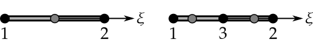
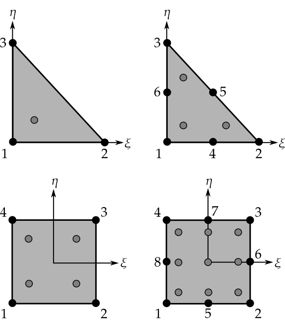
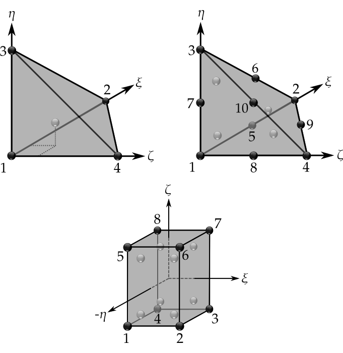
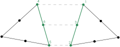

<!-- availability: available akantu::fe -->
# Appendix: elements

This appendix corresponds to upstream's *Shape Functions* appendix
(`appendix/elements.rst`) and to the element tables of *Basic types*
(`basic_types.rst`). Everything below is generated from the port's
code (element tables of `akantu-core`, kernels and quadrature rules of
`akantu-fe`) by `cargo test -p akantu --test manual`, which also checks:

* the node coordinates: every shape function is 1 at its node and 0 at
  the others ($N_j(\boldsymbol{\xi}_i) = \delta_{ij}$, evaluated with the
  port's kernels);
* the shape-function formulas and their derivatives: they are evaluated
  and compared with the kernels (`compute_shapes`, `compute_dnds`) at the
  nodes, at the quadrature points and at 50 points of the reference box
  (`shape_formulas_match_the_kernels`).

Each shape function has one source, a formula written in the test; the
derivatives are derived from it exactly (rational arithmetic), and the
formulas shown below are rendered from the same expressions, so what the
page shows is what the test evaluates.

For each element type the tables give the coordinates of the nodes in the
reference element, the shape functions $N_i$ and their derivatives with
respect to the natural coordinates, the facets, and the points and
weights of the default quadrature rule. The element is mapped to the
mesh by the same shape functions,
$\boldsymbol{x}(\boldsymbol{\xi}) = \sum_i N_i(\boldsymbol{\xi})\,\boldsymbol{x}_i$
(iso-parametric elements); the derivatives with respect to $\boldsymbol{x}$
and the integration weights follow from the Jacobian of this map
([Basic types](../basic-types.md#the-finite-element-engine)). A
quadrature rule integrates
$\int f \,\mathrm{d}\Omega \approx \sum_q w_q\, f(\boldsymbol{\xi}_q)$
over the reference element, which is why the weights of a rule add up,
to rounding, to the measure of the reference element (2 for the segment, $\tfrac{1}{2}$
for the triangle, 4 for the quadrangle, $\tfrac{1}{6}$ for the
tetrahedron, 1 for the prism, 8 for the hexahedron).

The kernels and the quadrature rules themselves are verified bit for bit
against the upstream library (parity rows ELEM-*, QUAD-*). Local node
numbers start at 0; the quadrature points and weights are printed in the
shortest decimal form that reads back to the same `f64`.

## Element types

<!-- BEGIN GENERATED: element-summary -->
| Type | Kind | Dim. | Nodes | Shape functions | Default order | Quadrature points | Facet types |
|---|---|---|---|---|---|---|---|
| [`_point_1`](#point_1) | regular | 0 | 1 | 1 | 1 | 1 | `_point_1` |
| [`_segment_2`](#segment_2) | regular | 1 | 2 | 2 | 1 | 1 | `_point_1` |
| [`_segment_3`](#segment_3) | regular | 1 | 3 | 3 | 2 | 2 | `_point_1` |
| [`_triangle_3`](#triangle_3) | regular | 2 | 3 | 3 | 1 | 1 | `_segment_2` |
| [`_triangle_6`](#triangle_6) | regular | 2 | 6 | 6 | 2 | 3 | `_segment_3` |
| [`_quadrangle_4`](#quadrangle_4) | regular | 2 | 4 | 4 | 2 | 4 | `_segment_2` |
| [`_quadrangle_8`](#quadrangle_8) | regular | 2 | 8 | 8 | 3 | 4 | `_segment_3` |
| [`_tetrahedron_4`](#tetrahedron_4) | regular | 3 | 4 | 4 | 1 | 1 | `_triangle_3` |
| [`_tetrahedron_10`](#tetrahedron_10) | regular | 3 | 10 | 10 | 2 | 4 | `_triangle_6` |
| [`_pentahedron_6`](#pentahedron_6) | regular | 3 | 6 | 6 | 1 | 6 | `_triangle_3`, `_quadrangle_4` |
| [`_pentahedron_15`](#pentahedron_15) | regular | 3 | 15 | 15 | 2 | 6 | `_triangle_6`, `_quadrangle_8` |
| [`_hexahedron_8`](#hexahedron_8) | regular | 3 | 8 | 8 | 2 | 8 | `_quadrangle_4` |
| [`_hexahedron_20`](#hexahedron_20) | regular | 3 | 20 | 20 | 3 | 8 | `_quadrangle_8` |
| [`_cohesive_1d_2`](#cohesive_1d_2) | cohesive | 1 | 2 | 1 | 1 | 1 | `_point_1` |
| [`_cohesive_2d_4`](#cohesive_2d_4) | cohesive | 2 | 4 | 2 | 2 | 2 | `_segment_2` |
| [`_cohesive_2d_6`](#cohesive_2d_6) | cohesive | 2 | 6 | 3 | 3 | 2 | `_segment_3` |
| [`_cohesive_3d_12`](#cohesive_3d_12) | cohesive | 3 | 12 | 6 | 3 | 4 | `_triangle_6` |
| [`_cohesive_3d_16`](#cohesive_3d_16) | cohesive | 3 | 16 | 8 | 3 | 4 | `_quadrangle_8` |
| [`_cohesive_3d_6`](#cohesive_3d_6) | cohesive | 3 | 6 | 3 | 2 | 3 | `_triangle_3` |
| [`_cohesive_3d_8`](#cohesive_3d_8) | cohesive | 3 | 8 | 4 | 2 | 4 | `_quadrangle_4` |
| `_bernoulli_beam_2` | structural | 2 | 2 | 2 | 3 | 2 | — |
| `_bernoulli_beam_3` | structural | 3 | 2 | 2 | 3 | 2 | — |
| `_discrete_kirchhoff_triangle_18` | structural | 3 | 3 | 3 | 2 | 3 | — |
| `_igfem_segment_3` | IGFEM | 1 | 3 | 3 | 1 | set by the IGFEM engine | — |
| `_igfem_triangle_4` | IGFEM | 2 | 4 | 4 | 1 | set by the IGFEM engine | — |
| `_igfem_triangle_5` | IGFEM | 2 | 5 | 5 | 1 | set by the IGFEM engine | — |
<!-- END GENERATED: element-summary -->

Notes:

* *Default order* is the integration order of the default quadrature
  rule (upstream `ElementClassProperty::polynomial_degree`); the rule's
  number of points follows from it and from the Gauss family.
* The upstream manual's tables (`basic_types.rst`) disagree with the
  upstream code, which the port follows, in two places: `_quadrangle_8`
  is listed with 9 quadrature points (the code integrates it with 4,
  order 3) and `_hexahedron_8` as *cubic* (it is trilinear; its default
  rule has 8 points, order 2). The 3-D section also spells it
  `_hexadedron_8`.
* The structural element types have their kernels, their FE engine
  (`StructuralFeEngine`) and their model, but no per-type section below
  ([Structural mechanics model](../models/structural.md)). The Bernoulli
  beams have two nodes and are of mixed order: the axial displacement
  is interpolated linearly, the transverse displacements with cubic
  Hermite functions of the nodal displacements and rotations.

  
  *Figure: a Bernoulli beam element (`_bernoulli_beam_2`,
  `_bernoulli_beam_3`) of length $2a$, nodes numbered from 1; the drawing
  shows three quadrature points, the default rule of the port's
  structural engine has two (table above) (figure of the Akantu
  manual).*
 The IGFEM
  types have their kernels and their engine in the IGFEM crate
  ([IGFEM](../models/igfem.md)); their quadrature follows the
  sub-elements of the interface.

## Regular elements

Natural coordinates: $\xi$ (1-D), $(\xi, \eta)$ (2-D),
$(\xi, \eta, \zeta)$ (3-D). Segments, quadrangles and hexahedra use
$[-1, 1]$ per coordinate, triangles and tetrahedra the unit simplex,
pentahedra (prisms) $\xi \in [-1, 1]$ times the unit triangle in
$(\eta, \zeta)$. Most types are Lagrange elements (each $N_i$ is a
product of one-dimensional Lagrange polynomials, or the barycentric
equivalent on a simplex); `_quadrangle_8`, `_hexahedron_20` and
`_pentahedron_15` are serendipity elements, without the interior nodes of
the full quadratic Lagrange elements. The drawings below number the nodes
from 1, as upstream's manual; the tables number them from 0, as the code.

The node numbering of `_tetrahedron_4` is a permutation of that of the
vertices of `_tetrahedron_10`
($\boldsymbol{N} = (1 - \xi - \eta - \zeta,\ \eta,\ \zeta,\ \xi)$,
upstream behaviour kept on purpose, UD-041).

<!-- BEGIN GENERATED: element-appendix-regular -->
### point_1

| Property | Value |
|---|---|
| Rust name | `ElementType::Point1` (upstream `_point_1`) |
| Spatial / natural dimension | 0 / 0 |
| Nodes / shape functions | 1 / 1 |
| Interpolation | `_itp_lagrange_point_1` |
| Default integration order | 1 |
| Linear (P1) type | `_point_1` |
| Cohesive type on its facets | `_cohesive_1d_2` |

| Node | — | $N_i$ |
|---|---|---|
| 0 | — | $1$ |

| Facet type | Local nodes |
|---|---|
| `_point_1` | 0 |

Default quadrature: 1 point(s), weights sum to 1.

| Point | — | Weight |
|---|---|---|
| 0 | — | 1 |

### segment_2

*Figure: the 1-D elements `_segment_2` (left) and `_segment_3` (right), nodes numbered from 1 (the tables number from 0) and quadrature points in grey (figure of the Akantu manual).*

| Property | Value |
|---|---|
| Rust name | `ElementType::Segment2` (upstream `_segment_2`) |
| Spatial / natural dimension | 1 / 1 |
| Nodes / shape functions | 2 / 2 |
| Interpolation | `_itp_lagrange_segment_2` |
| Default integration order | 1 |
| Linear (P1) type | `_segment_2` |
| Cohesive type on its facets | `_cohesive_2d_4` |

| Node | $\xi$ | $N_i$ | $\partial N_i / \partial \xi$ |
|---|---|---|---|
| 0 | (-1) | $\frac{1}{2}\left(1 - \xi\right)$ | $-\frac{1}{2}$ |
| 1 | (1) | $\frac{1}{2}\left(1 + \xi\right)$ | $\frac{1}{2}$ |

| Facet type | Local nodes |
|---|---|
| `_point_1` | 0 |
| `_point_1` | 1 |

Default quadrature: 1 point(s), weights sum to 2.

| Point | $\xi$ | Weight |
|---|---|---|
| 0 | (0) | 2 |

### segment_3

| Property | Value |
|---|---|
| Rust name | `ElementType::Segment3` (upstream `_segment_3`) |
| Spatial / natural dimension | 1 / 1 |
| Nodes / shape functions | 3 / 3 |
| Interpolation | `_itp_lagrange_segment_3` |
| Default integration order | 2 |
| Linear (P1) type | `_segment_2` |
| Cohesive type on its facets | `_cohesive_2d_6` |

| Node | $\xi$ | $N_i$ | $\partial N_i / \partial \xi$ |
|---|---|---|---|
| 0 | (-1) | $\frac{1}{2}\xi\left(\xi - 1\right)$ | $\xi - \frac{1}{2}$ |
| 1 | (1) | $\frac{1}{2}\xi\left(\xi + 1\right)$ | $\xi + \frac{1}{2}$ |
| 2 | (0) | $1 - \xi^{2}$ | $-2\xi$ |

| Facet type | Local nodes |
|---|---|
| `_point_1` | 0 |
| `_point_1` | 1 |

Default quadrature: 2 point(s), weights sum to 2.

| Point | $\xi$ | Weight |
|---|---|---|
| 0 | (-0.5773502691896258) | 1 |
| 1 | (0.5773502691896258) | 1 |

### triangle_3

*Figure: the 2-D elements `_triangle_3`, `_triangle_6` (top), `_quadrangle_4` and `_quadrangle_8` (bottom), nodes numbered from 1 (the tables number from 0) and quadrature points in grey; the drawing shows 9 points for `_quadrangle_8`, whose default rule has 4 (figure of the Akantu manual).*

| Property | Value |
|---|---|
| Rust name | `ElementType::Triangle3` (upstream `_triangle_3`) |
| Spatial / natural dimension | 2 / 2 |
| Nodes / shape functions | 3 / 3 |
| Interpolation | `_itp_lagrange_triangle_3` |
| Default integration order | 1 |
| Linear (P1) type | `_triangle_3` |
| Cohesive type on its facets | `_cohesive_3d_6` |

| Node | $(\xi, \eta)$ | $N_i$ | $\partial N_i / \partial \xi$ | $\partial N_i / \partial \eta$ |
|---|---|---|---|---|
| 0 | (0, 0) | $1 - \xi - \eta$ | $-1$ | $-1$ |
| 1 | (1, 0) | $\xi$ | $1$ | $0$ |
| 2 | (0, 1) | $\eta$ | $0$ | $1$ |

| Facet type | Local nodes |
|---|---|
| `_segment_2` | 0, 1 |
| `_segment_2` | 1, 2 |
| `_segment_2` | 2, 0 |

Default quadrature: 1 point(s), weights sum to 0.5.

| Point | $(\xi, \eta)$ | Weight |
|---|---|---|
| 0 | (0.3333333333333333, 0.3333333333333333) | 0.5 |

### triangle_6

| Property | Value |
|---|---|
| Rust name | `ElementType::Triangle6` (upstream `_triangle_6`) |
| Spatial / natural dimension | 2 / 2 |
| Nodes / shape functions | 6 / 6 |
| Interpolation | `_itp_lagrange_triangle_6` |
| Default integration order | 2 |
| Linear (P1) type | `_triangle_3` |
| Cohesive type on its facets | `_cohesive_3d_12` |

| Node | $(\xi, \eta)$ | $N_i$ | $\partial N_i / \partial \xi$ | $\partial N_i / \partial \eta$ |
|---|---|---|---|---|
| 0 | (0, 0) | $\left(1 - \xi - \eta\right)\left(1 - 2\xi - 2\eta\right)$ | $4\xi + 4\eta - 3$ | $4\xi + 4\eta - 3$ |
| 1 | (1, 0) | $\xi\left(2\xi - 1\right)$ | $4\xi - 1$ | $0$ |
| 2 | (0, 1) | $\eta\left(2\eta - 1\right)$ | $0$ | $4\eta - 1$ |
| 3 | (0.5, 0) | $4\xi\left(1 - \xi - \eta\right)$ | $-8\xi - 4\eta + 4$ | $-4\xi$ |
| 4 | (0.5, 0.5) | $4\xi\eta$ | $4\eta$ | $4\xi$ |
| 5 | (0, 0.5) | $4\eta\left(1 - \xi - \eta\right)$ | $-4\eta$ | $-4\xi - 8\eta + 4$ |

| Facet type | Local nodes |
|---|---|
| `_segment_3` | 0, 1, 3 |
| `_segment_3` | 1, 2, 4 |
| `_segment_3` | 2, 0, 5 |

Default quadrature: 3 point(s), weights sum to 0.5.

| Point | $(\xi, \eta)$ | Weight |
|---|---|---|
| 0 | (0.16666666666666666, 0.16666666666666666) | 0.16666666666666666 |
| 1 | (0.6666666666666666, 0.16666666666666666) | 0.16666666666666666 |
| 2 | (0.16666666666666666, 0.6666666666666666) | 0.16666666666666666 |

### quadrangle_4

| Property | Value |
|---|---|
| Rust name | `ElementType::Quadrangle4` (upstream `_quadrangle_4`) |
| Spatial / natural dimension | 2 / 2 |
| Nodes / shape functions | 4 / 4 |
| Interpolation | `_itp_lagrange_quadrangle_4` |
| Default integration order | 2 |
| Linear (P1) type | `_quadrangle_4` |
| Cohesive type on its facets | `_cohesive_3d_8` |

| Node | $(\xi, \eta)$ | $N_i$ | $\partial N_i / \partial \xi$ | $\partial N_i / \partial \eta$ |
|---|---|---|---|---|
| 0 | (-1, -1) | $\frac{1}{4}\left(1 - \xi\right)\left(1 - \eta\right)$ | $-\frac{1}{4}\left(1 - \eta\right)$ | $-\frac{1}{4}\left(1 - \xi\right)$ |
| 1 | (1, -1) | $\frac{1}{4}\left(1 + \xi\right)\left(1 - \eta\right)$ | $\frac{1}{4}\left(1 - \eta\right)$ | $-\frac{1}{4}\left(1 + \xi\right)$ |
| 2 | (1, 1) | $\frac{1}{4}\left(1 + \xi\right)\left(1 + \eta\right)$ | $\frac{1}{4}\left(1 + \eta\right)$ | $\frac{1}{4}\left(1 + \xi\right)$ |
| 3 | (-1, 1) | $\frac{1}{4}\left(1 - \xi\right)\left(1 + \eta\right)$ | $-\frac{1}{4}\left(1 + \eta\right)$ | $\frac{1}{4}\left(1 - \xi\right)$ |

| Facet type | Local nodes |
|---|---|
| `_segment_2` | 0, 1 |
| `_segment_2` | 1, 2 |
| `_segment_2` | 2, 3 |
| `_segment_2` | 3, 0 |

Default quadrature: 4 point(s), weights sum to 4.

| Point | $(\xi, \eta)$ | Weight |
|---|---|---|
| 0 | (-0.5773502691896258, -0.5773502691896258) | 1 |
| 1 | (0.5773502691896258, -0.5773502691896258) | 1 |
| 2 | (-0.5773502691896258, 0.5773502691896258) | 1 |
| 3 | (0.5773502691896258, 0.5773502691896258) | 1 |

### quadrangle_8

| Property | Value |
|---|---|
| Rust name | `ElementType::Quadrangle8` (upstream `_quadrangle_8`) |
| Spatial / natural dimension | 2 / 2 |
| Nodes / shape functions | 8 / 8 |
| Interpolation | `_itp_serendip_quadrangle_8` |
| Default integration order | 3 |
| Linear (P1) type | `_quadrangle_4` |
| Cohesive type on its facets | `_cohesive_3d_16` |

| Node | $(\xi, \eta)$ | $N_i$ | $\partial N_i / \partial \xi$ | $\partial N_i / \partial \eta$ |
|---|---|---|---|---|
| 0 | (-1, -1) | $\frac{1}{4}\left(1 - \xi\right)\left(1 - \eta\right)\left(-1 - \xi - \eta\right)$ | $-\frac{\xi\eta}{2} - \frac{\eta^{2}}{4} + \frac{\xi}{2} + \frac{\eta}{4}$ | $-\frac{\xi^{2}}{4} - \frac{\xi\eta}{2} + \frac{\xi}{4} + \frac{\eta}{2}$ |
| 1 | (1, -1) | $\frac{1}{4}\left(1 + \xi\right)\left(1 - \eta\right)\left(-1 + \xi - \eta\right)$ | $-\frac{\xi\eta}{2} + \frac{\eta^{2}}{4} + \frac{\xi}{2} - \frac{\eta}{4}$ | $-\frac{\xi^{2}}{4} + \frac{\xi\eta}{2} - \frac{\xi}{4} + \frac{\eta}{2}$ |
| 2 | (1, 1) | $\frac{1}{4}\left(1 + \xi\right)\left(1 + \eta\right)\left(-1 + \xi + \eta\right)$ | $\frac{\xi\eta}{2} + \frac{\eta^{2}}{4} + \frac{\xi}{2} + \frac{\eta}{4}$ | $\frac{\xi^{2}}{4} + \frac{\xi\eta}{2} + \frac{\xi}{4} + \frac{\eta}{2}$ |
| 3 | (-1, 1) | $\frac{1}{4}\left(1 - \xi\right)\left(1 + \eta\right)\left(-1 - \xi + \eta\right)$ | $\frac{\xi\eta}{2} - \frac{\eta^{2}}{4} + \frac{\xi}{2} - \frac{\eta}{4}$ | $\frac{\xi^{2}}{4} - \frac{\xi\eta}{2} - \frac{\xi}{4} + \frac{\eta}{2}$ |
| 4 | (0, -1) | $\frac{1}{2}\left(1 - \xi^{2}\right)\left(1 - \eta\right)$ | $-\xi\left(1 - \eta\right)$ | $-\frac{1}{2}\left(1 - \xi^{2}\right)$ |
| 5 | (1, 0) | $\frac{1}{2}\left(1 + \xi\right)\left(1 - \eta^{2}\right)$ | $\frac{1}{2}\left(1 - \eta^{2}\right)$ | $-\eta\left(1 + \xi\right)$ |
| 6 | (0, 1) | $\frac{1}{2}\left(1 - \xi^{2}\right)\left(1 + \eta\right)$ | $-\xi\left(1 + \eta\right)$ | $\frac{1}{2}\left(1 - \xi^{2}\right)$ |
| 7 | (-1, 0) | $\frac{1}{2}\left(1 - \xi\right)\left(1 - \eta^{2}\right)$ | $-\frac{1}{2}\left(1 - \eta^{2}\right)$ | $-\eta\left(1 - \xi\right)$ |

| Facet type | Local nodes |
|---|---|
| `_segment_3` | 0, 1, 4 |
| `_segment_3` | 1, 2, 5 |
| `_segment_3` | 2, 3, 6 |
| `_segment_3` | 3, 0, 7 |

Default quadrature: 4 point(s), weights sum to 4.

| Point | $(\xi, \eta)$ | Weight |
|---|---|---|
| 0 | (-0.5773502691896258, -0.5773502691896258) | 1 |
| 1 | (0.5773502691896258, -0.5773502691896258) | 1 |
| 2 | (-0.5773502691896258, 0.5773502691896258) | 1 |
| 3 | (0.5773502691896258, 0.5773502691896258) | 1 |

### tetrahedron_4

*Figure: the 3-D elements `_tetrahedron_4`, `_tetrahedron_10` (top) and `_hexahedron_8` (bottom), nodes numbered from 1 (the tables number from 0) and quadrature points in grey; the drawing numbers the vertices of `_tetrahedron_4` like those of `_tetrahedron_10`, the kernel takes them in another order (table below, UD-041) (figure of the Akantu manual).*

| Property | Value |
|---|---|
| Rust name | `ElementType::Tetrahedron4` (upstream `_tetrahedron_4`) |
| Spatial / natural dimension | 3 / 3 |
| Nodes / shape functions | 4 / 4 |
| Interpolation | `_itp_lagrange_tetrahedron_4` |
| Default integration order | 1 |
| Linear (P1) type | `_tetrahedron_4` |

| Node | $(\xi, \eta, \zeta)$ | $N_i$ | $\partial N_i / \partial \xi$ | $\partial N_i / \partial \eta$ | $\partial N_i / \partial \zeta$ |
|---|---|---|---|---|---|
| 0 | (0, 0, 0) | $1 - \xi - \eta - \zeta$ | $-1$ | $-1$ | $-1$ |
| 1 | (0, 1, 0) | $\eta$ | $0$ | $1$ | $0$ |
| 2 | (0, 0, 1) | $\zeta$ | $0$ | $0$ | $1$ |
| 3 | (1, 0, 0) | $\xi$ | $1$ | $0$ | $0$ |

| Facet type | Local nodes |
|---|---|
| `_triangle_3` | 0, 2, 1 |
| `_triangle_3` | 1, 2, 3 |
| `_triangle_3` | 2, 0, 3 |
| `_triangle_3` | 0, 1, 3 |

Default quadrature: 1 point(s), weights sum to 0.16666666666666666.

| Point | $(\xi, \eta, \zeta)$ | Weight |
|---|---|---|
| 0 | (0.25, 0.25, 0.25) | 0.16666666666666666 |

### tetrahedron_10

| Property | Value |
|---|---|
| Rust name | `ElementType::Tetrahedron10` (upstream `_tetrahedron_10`) |
| Spatial / natural dimension | 3 / 3 |
| Nodes / shape functions | 10 / 10 |
| Interpolation | `_itp_lagrange_tetrahedron_10` |
| Default integration order | 2 |
| Linear (P1) type | `_tetrahedron_4` |

| Node | $(\xi, \eta, \zeta)$ | $N_i$ | $\partial N_i / \partial \xi$ | $\partial N_i / \partial \eta$ | $\partial N_i / \partial \zeta$ |
|---|---|---|---|---|---|
| 0 | (0, 0, 0) | $\left(1 - \xi - \eta - \zeta\right)\left(1 - 2\xi - 2\eta - 2\zeta\right)$ | $4\xi + 4\eta + 4\zeta - 3$ | $4\xi + 4\eta + 4\zeta - 3$ | $4\xi + 4\eta + 4\zeta - 3$ |
| 1 | (1, 0, 0) | $\xi\left(2\xi - 1\right)$ | $4\xi - 1$ | $0$ | $0$ |
| 2 | (0, 1, 0) | $\eta\left(2\eta - 1\right)$ | $0$ | $4\eta - 1$ | $0$ |
| 3 | (0, 0, 1) | $\zeta\left(2\zeta - 1\right)$ | $0$ | $0$ | $4\zeta - 1$ |
| 4 | (0.5, 0, 0) | $4\xi\left(1 - \xi - \eta - \zeta\right)$ | $-8\xi - 4\eta - 4\zeta + 4$ | $-4\xi$ | $-4\xi$ |
| 5 | (0.5, 0.5, 0) | $4\xi\eta$ | $4\eta$ | $4\xi$ | $0$ |
| 6 | (0, 0.5, 0) | $4\eta\left(1 - \xi - \eta - \zeta\right)$ | $-4\eta$ | $-4\xi - 8\eta - 4\zeta + 4$ | $-4\eta$ |
| 7 | (0, 0, 0.5) | $4\zeta\left(1 - \xi - \eta - \zeta\right)$ | $-4\zeta$ | $-4\zeta$ | $-4\xi - 4\eta - 8\zeta + 4$ |
| 8 | (0.5, 0, 0.5) | $4\xi\zeta$ | $4\zeta$ | $0$ | $4\xi$ |
| 9 | (0, 0.5, 0.5) | $4\eta\zeta$ | $0$ | $4\zeta$ | $4\eta$ |

| Facet type | Local nodes |
|---|---|
| `_triangle_6` | 0, 2, 1, 6, 5, 4 |
| `_triangle_6` | 1, 2, 3, 5, 9, 8 |
| `_triangle_6` | 2, 0, 3, 6, 7, 9 |
| `_triangle_6` | 0, 1, 3, 4, 8, 7 |

Default quadrature: 4 point(s), weights sum to 0.16666666666666666.

| Point | $(\xi, \eta, \zeta)$ | Weight |
|---|---|---|
| 0 | (0.1381966011250105, 0.1381966011250105, 0.1381966011250105) | 0.041666666666666664 |
| 1 | (0.5854101966249685, 0.1381966011250105, 0.1381966011250105) | 0.041666666666666664 |
| 2 | (0.1381966011250105, 0.5854101966249685, 0.1381966011250105) | 0.041666666666666664 |
| 3 | (0.1381966011250105, 0.1381966011250105, 0.5854101966249685) | 0.041666666666666664 |

### pentahedron_6

| Property | Value |
|---|---|
| Rust name | `ElementType::Pentahedron6` (upstream `_pentahedron_6`) |
| Spatial / natural dimension | 3 / 3 |
| Nodes / shape functions | 6 / 6 |
| Interpolation | `_itp_lagrange_pentahedron_6` |
| Default integration order | 1 |
| Linear (P1) type | `_pentahedron_6` |

| Node | $(\xi, \eta, \zeta)$ | $N_i$ | $\partial N_i / \partial \xi$ | $\partial N_i / \partial \eta$ | $\partial N_i / \partial \zeta$ |
|---|---|---|---|---|---|
| 0 | (-1, 1, 0) | $\frac{1}{2}\eta\left(1 - \xi\right)$ | $-\frac{\eta}{2}$ | $\frac{1}{2}\left(1 - \xi\right)$ | $0$ |
| 1 | (-1, 0, 1) | $\frac{1}{2}\zeta\left(1 - \xi\right)$ | $-\frac{\zeta}{2}$ | $0$ | $\frac{1}{2}\left(1 - \xi\right)$ |
| 2 | (-1, 0, 0) | $\frac{1}{2}\left(1 - \eta - \zeta\right)\left(1 - \xi\right)$ | $-\frac{1}{2}\left(1 - \eta - \zeta\right)$ | $-\frac{1}{2}\left(1 - \xi\right)$ | $-\frac{1}{2}\left(1 - \xi\right)$ |
| 3 | (1, 1, 0) | $\frac{1}{2}\eta\left(1 + \xi\right)$ | $\frac{\eta}{2}$ | $\frac{1}{2}\left(1 + \xi\right)$ | $0$ |
| 4 | (1, 0, 1) | $\frac{1}{2}\zeta\left(1 + \xi\right)$ | $\frac{\zeta}{2}$ | $0$ | $\frac{1}{2}\left(1 + \xi\right)$ |
| 5 | (1, 0, 0) | $\frac{1}{2}\left(1 - \eta - \zeta\right)\left(1 + \xi\right)$ | $\frac{1}{2}\left(1 - \eta - \zeta\right)$ | $-\frac{1}{2}\left(1 + \xi\right)$ | $-\frac{1}{2}\left(1 + \xi\right)$ |

| Facet type | Local nodes |
|---|---|
| `_triangle_3` | 0, 2, 1 |
| `_triangle_3` | 3, 4, 5 |
| `_quadrangle_4` | 0, 1, 4, 3 |
| `_quadrangle_4` | 0, 3, 5, 2 |
| `_quadrangle_4` | 1, 2, 5, 4 |

Default quadrature: 6 point(s), weights sum to 0.9999999999999999.

| Point | $(\xi, \eta, \zeta)$ | Weight |
|---|---|---|
| 0 | (-0.5773502691896258, 0.16666666666666666, 0.16666666666666666) | 0.16666666666666666 |
| 1 | (-0.5773502691896258, 0.6666666666666666, 0.16666666666666666) | 0.16666666666666666 |
| 2 | (-0.5773502691896258, 0.16666666666666666, 0.6666666666666666) | 0.16666666666666666 |
| 3 | (0.5773502691896258, 0.16666666666666666, 0.16666666666666666) | 0.16666666666666666 |
| 4 | (0.5773502691896258, 0.6666666666666666, 0.16666666666666666) | 0.16666666666666666 |
| 5 | (0.5773502691896258, 0.16666666666666666, 0.6666666666666666) | 0.16666666666666666 |

### pentahedron_15

| Property | Value |
|---|---|
| Rust name | `ElementType::Pentahedron15` (upstream `_pentahedron_15`) |
| Spatial / natural dimension | 3 / 3 |
| Nodes / shape functions | 15 / 15 |
| Interpolation | `_itp_lagrange_pentahedron_15` |
| Default integration order | 2 |
| Linear (P1) type | `_pentahedron_6` |

| Node | $(\xi, \eta, \zeta)$ | $N_i$ | $\partial N_i / \partial \xi$ | $\partial N_i / \partial \eta$ | $\partial N_i / \partial \zeta$ |
|---|---|---|---|---|---|
| 0 | (-1, 1, 0) | $\frac{1}{2}\eta\left(1 - \xi\right)\left(2\eta - 2 - \xi\right)$ | $\xi\eta - \eta^{2} + \frac{\eta}{2}$ | $\frac{\xi^{2}}{2} - 2\xi\eta + \frac{\xi}{2} + 2\eta - 1$ | $0$ |
| 1 | (-1, 0, 1) | $\frac{1}{2}\zeta\left(1 - \xi\right)\left(2\zeta - 2 - \xi\right)$ | $\xi\zeta - \zeta^{2} + \frac{\zeta}{2}$ | $0$ | $\frac{\xi^{2}}{2} - 2\xi\zeta + \frac{\xi}{2} + 2\zeta - 1$ |
| 2 | (-1, 0, 0) | $\frac{1}{2}\left(\xi - 1\right)\left(1 - \eta - \zeta\right)\left(\xi + 2\eta + 2\zeta\right)$ | $\frac{1}{2}\left(1 - \eta - \zeta\right)\left(\xi + 2\eta + 2\zeta\right) + \frac{1}{2}\left(\xi - 1\right)\left(1 - \eta - \zeta\right)$ | $-\frac{\xi^{2}}{2} - 2\xi\eta - 2\xi\zeta + \frac{3\xi}{2} + 2\eta + 2\zeta - 1$ | $-\frac{\xi^{2}}{2} - 2\xi\eta - 2\xi\zeta + \frac{3\xi}{2} + 2\eta + 2\zeta - 1$ |
| 3 | (1, 1, 0) | $\frac{1}{2}\eta\left(1 + \xi\right)\left(2\eta - 2 + \xi\right)$ | $\xi\eta + \eta^{2} - \frac{\eta}{2}$ | $\frac{\xi^{2}}{2} + 2\xi\eta - \frac{\xi}{2} + 2\eta - 1$ | $0$ |
| 4 | (1, 0, 1) | $\frac{1}{2}\zeta\left(1 + \xi\right)\left(2\zeta - 2 + \xi\right)$ | $\xi\zeta + \zeta^{2} - \frac{\zeta}{2}$ | $0$ | $\frac{\xi^{2}}{2} + 2\xi\zeta - \frac{\xi}{2} + 2\zeta - 1$ |
| 5 | (1, 0, 0) | $\frac{1}{2}\left(-\xi - 1\right)\left(1 - \eta - \zeta\right)\left(-\xi + 2\eta + 2\zeta\right)$ | $-\xi\eta - \xi\zeta + \eta^{2} + 2\eta\zeta + \zeta^{2} + \xi - \frac{3\eta}{2} - \frac{3\zeta}{2} + \frac{1}{2}$ | $-\frac{\xi^{2}}{2} + 2\xi\eta + 2\xi\zeta - \frac{3\xi}{2} + 2\eta + 2\zeta - 1$ | $-\frac{\xi^{2}}{2} + 2\xi\eta + 2\xi\zeta - \frac{3\xi}{2} + 2\eta + 2\zeta - 1$ |
| 6 | (-1, 0.5, 0.5) | $2\eta\zeta\left(1 - \xi\right)$ | $-2\eta\zeta$ | $2\zeta\left(1 - \xi\right)$ | $2\eta\left(1 - \xi\right)$ |
| 7 | (-1, 0, 0.5) | $2\zeta\left(1 - \eta - \zeta\right)\left(1 - \xi\right)$ | $-2\zeta\left(1 - \eta - \zeta\right)$ | $-2\zeta\left(1 - \xi\right)$ | $2\xi\eta + 4\xi\zeta - 2\xi - 2\eta - 4\zeta + 2$ |
| 8 | (-1, 0.5, 0) | $2\eta\left(1 - \xi\right)\left(1 - \eta - \zeta\right)$ | $-2\eta\left(1 - \eta - \zeta\right)$ | $4\xi\eta + 2\xi\zeta - 2\xi - 4\eta - 2\zeta + 2$ | $-2\eta\left(1 - \xi\right)$ |
| 9 | (0, 1, 0) | $\eta\left(1 - \xi^{2}\right)$ | $-2\xi\eta$ | $\left(1 - \xi^{2}\right)$ | $0$ |
| 10 | (0, 0, 1) | $\zeta\left(1 - \xi^{2}\right)$ | $-2\xi\zeta$ | $0$ | $\left(1 - \xi^{2}\right)$ |
| 11 | (0, 0, 0) | $\left(1 - \eta - \zeta\right)\left(1 - \xi^{2}\right)$ | $-2\xi\left(1 - \eta - \zeta\right)$ | $-\left(1 - \xi^{2}\right)$ | $-\left(1 - \xi^{2}\right)$ |
| 12 | (1, 0.5, 0.5) | $2\eta\zeta\left(1 + \xi\right)$ | $2\eta\zeta$ | $2\zeta\left(1 + \xi\right)$ | $2\eta\left(1 + \xi\right)$ |
| 13 | (1, 0, 0.5) | $2\zeta\left(1 - \eta - \zeta\right)\left(1 + \xi\right)$ | $2\zeta\left(1 - \eta - \zeta\right)$ | $-2\zeta\left(1 + \xi\right)$ | $2\left(1 - \eta - \zeta\right)\left(1 + \xi\right) - 2\zeta\left(1 + \xi\right)$ |
| 14 | (1, 0.5, 0) | $2\eta\left(1 - \eta - \zeta\right)\left(1 + \xi\right)$ | $2\eta\left(1 - \eta - \zeta\right)$ | $2\left(1 - \eta - \zeta\right)\left(1 + \xi\right) - 2\eta\left(1 + \xi\right)$ | $-2\eta\left(1 + \xi\right)$ |

| Facet type | Local nodes |
|---|---|
| `_triangle_6` | 0, 2, 1, 8, 7, 6 |
| `_triangle_6` | 3, 4, 5, 12, 13, 14 |
| `_quadrangle_8` | 0, 1, 4, 3, 6, 10, 12, 9 |
| `_quadrangle_8` | 0, 3, 5, 2, 9, 14, 11, 8 |
| `_quadrangle_8` | 1, 2, 5, 4, 7, 11, 13, 10 |

Default quadrature: 6 point(s), weights sum to 0.9999999999999999.

| Point | $(\xi, \eta, \zeta)$ | Weight |
|---|---|---|
| 0 | (-0.5773502691896258, 0.16666666666666666, 0.16666666666666666) | 0.16666666666666666 |
| 1 | (-0.5773502691896258, 0.6666666666666666, 0.16666666666666666) | 0.16666666666666666 |
| 2 | (-0.5773502691896258, 0.16666666666666666, 0.6666666666666666) | 0.16666666666666666 |
| 3 | (0.5773502691896258, 0.16666666666666666, 0.16666666666666666) | 0.16666666666666666 |
| 4 | (0.5773502691896258, 0.6666666666666666, 0.16666666666666666) | 0.16666666666666666 |
| 5 | (0.5773502691896258, 0.16666666666666666, 0.6666666666666666) | 0.16666666666666666 |

### hexahedron_8

| Property | Value |
|---|---|
| Rust name | `ElementType::Hexahedron8` (upstream `_hexahedron_8`) |
| Spatial / natural dimension | 3 / 3 |
| Nodes / shape functions | 8 / 8 |
| Interpolation | `_itp_lagrange_hexahedron_8` |
| Default integration order | 2 |
| Linear (P1) type | `_hexahedron_8` |

| Node | $(\xi, \eta, \zeta)$ | $N_i$ | $\partial N_i / \partial \xi$ | $\partial N_i / \partial \eta$ | $\partial N_i / \partial \zeta$ |
|---|---|---|---|---|---|
| 0 | (-1, -1, -1) | $\frac{1}{8}\left(1 - \xi\right)\left(1 - \eta\right)\left(1 - \zeta\right)$ | $-\frac{1}{8}\left(1 - \eta\right)\left(1 - \zeta\right)$ | $-\frac{1}{8}\left(1 - \xi\right)\left(1 - \zeta\right)$ | $-\frac{1}{8}\left(1 - \xi\right)\left(1 - \eta\right)$ |
| 1 | (1, -1, -1) | $\frac{1}{8}\left(1 + \xi\right)\left(1 - \eta\right)\left(1 - \zeta\right)$ | $\frac{1}{8}\left(1 - \eta\right)\left(1 - \zeta\right)$ | $-\frac{1}{8}\left(1 + \xi\right)\left(1 - \zeta\right)$ | $-\frac{1}{8}\left(1 + \xi\right)\left(1 - \eta\right)$ |
| 2 | (1, 1, -1) | $\frac{1}{8}\left(1 + \xi\right)\left(1 + \eta\right)\left(1 - \zeta\right)$ | $\frac{1}{8}\left(1 + \eta\right)\left(1 - \zeta\right)$ | $\frac{1}{8}\left(1 + \xi\right)\left(1 - \zeta\right)$ | $-\frac{1}{8}\left(1 + \xi\right)\left(1 + \eta\right)$ |
| 3 | (-1, 1, -1) | $\frac{1}{8}\left(1 - \xi\right)\left(1 + \eta\right)\left(1 - \zeta\right)$ | $-\frac{1}{8}\left(1 + \eta\right)\left(1 - \zeta\right)$ | $\frac{1}{8}\left(1 - \xi\right)\left(1 - \zeta\right)$ | $-\frac{1}{8}\left(1 - \xi\right)\left(1 + \eta\right)$ |
| 4 | (-1, -1, 1) | $\frac{1}{8}\left(1 - \xi\right)\left(1 - \eta\right)\left(1 + \zeta\right)$ | $-\frac{1}{8}\left(1 - \eta\right)\left(1 + \zeta\right)$ | $-\frac{1}{8}\left(1 - \xi\right)\left(1 + \zeta\right)$ | $\frac{1}{8}\left(1 - \xi\right)\left(1 - \eta\right)$ |
| 5 | (1, -1, 1) | $\frac{1}{8}\left(1 + \xi\right)\left(1 - \eta\right)\left(1 + \zeta\right)$ | $\frac{1}{8}\left(1 - \eta\right)\left(1 + \zeta\right)$ | $-\frac{1}{8}\left(1 + \xi\right)\left(1 + \zeta\right)$ | $\frac{1}{8}\left(1 + \xi\right)\left(1 - \eta\right)$ |
| 6 | (1, 1, 1) | $\frac{1}{8}\left(1 + \xi\right)\left(1 + \eta\right)\left(1 + \zeta\right)$ | $\frac{1}{8}\left(1 + \eta\right)\left(1 + \zeta\right)$ | $\frac{1}{8}\left(1 + \xi\right)\left(1 + \zeta\right)$ | $\frac{1}{8}\left(1 + \xi\right)\left(1 + \eta\right)$ |
| 7 | (-1, 1, 1) | $\frac{1}{8}\left(1 - \xi\right)\left(1 + \eta\right)\left(1 + \zeta\right)$ | $-\frac{1}{8}\left(1 + \eta\right)\left(1 + \zeta\right)$ | $\frac{1}{8}\left(1 - \xi\right)\left(1 + \zeta\right)$ | $\frac{1}{8}\left(1 - \xi\right)\left(1 + \eta\right)$ |

| Facet type | Local nodes |
|---|---|
| `_quadrangle_4` | 0, 3, 2, 1 |
| `_quadrangle_4` | 0, 1, 5, 4 |
| `_quadrangle_4` | 1, 2, 6, 5 |
| `_quadrangle_4` | 2, 3, 7, 6 |
| `_quadrangle_4` | 3, 0, 4, 7 |
| `_quadrangle_4` | 4, 5, 6, 7 |

Default quadrature: 8 point(s), weights sum to 8.

| Point | $(\xi, \eta, \zeta)$ | Weight |
|---|---|---|
| 0 | (-0.5773502691896258, -0.5773502691896258, -0.5773502691896258) | 1 |
| 1 | (0.5773502691896258, -0.5773502691896258, -0.5773502691896258) | 1 |
| 2 | (-0.5773502691896258, 0.5773502691896258, -0.5773502691896258) | 1 |
| 3 | (0.5773502691896258, 0.5773502691896258, -0.5773502691896258) | 1 |
| 4 | (-0.5773502691896258, -0.5773502691896258, 0.5773502691896258) | 1 |
| 5 | (0.5773502691896258, -0.5773502691896258, 0.5773502691896258) | 1 |
| 6 | (-0.5773502691896258, 0.5773502691896258, 0.5773502691896258) | 1 |
| 7 | (0.5773502691896258, 0.5773502691896258, 0.5773502691896258) | 1 |

### hexahedron_20

| Property | Value |
|---|---|
| Rust name | `ElementType::Hexahedron20` (upstream `_hexahedron_20`) |
| Spatial / natural dimension | 3 / 3 |
| Nodes / shape functions | 20 / 20 |
| Interpolation | `_itp_serendip_hexahedron_20` |
| Default integration order | 3 |
| Linear (P1) type | `_hexahedron_8` |

| Node | $(\xi, \eta, \zeta)$ | $N_i$ | $\partial N_i / \partial \xi$ | $\partial N_i / \partial \eta$ | $\partial N_i / \partial \zeta$ |
|---|---|---|---|---|---|
| 0 | (-1, -1, -1) | $\frac{1}{8}\left(1 - \xi\right)\left(1 - \eta\right)\left(1 - \zeta\right)\left(-2 - \xi - \eta - \zeta\right)$ | $-\frac{1}{8}\left(1 - \eta\right)\left(1 - \zeta\right)\left(-2 - \xi - \eta - \zeta\right) - \frac{1}{8}\left(1 - \xi\right)\left(1 - \eta\right)\left(1 - \zeta\right)$ | $-\frac{1}{8}\left(1 - \xi\right)\left(1 - \zeta\right)\left(-2 - \xi - \eta - \zeta\right) - \frac{1}{8}\left(1 - \xi\right)\left(1 - \eta\right)\left(1 - \zeta\right)$ | $-\frac{1}{8}\left(1 - \xi\right)\left(1 - \eta\right)\left(-2 - \xi - \eta - \zeta\right) - \frac{1}{8}\left(1 - \xi\right)\left(1 - \eta\right)\left(1 - \zeta\right)$ |
| 1 | (1, -1, -1) | $\frac{1}{8}\left(1 + \xi\right)\left(1 - \eta\right)\left(1 - \zeta\right)\left(-2 + \xi - \eta - \zeta\right)$ | $\frac{1}{8}\left(1 - \eta\right)\left(1 - \zeta\right)\left(-2 + \xi - \eta - \zeta\right) + \frac{1}{8}\left(1 + \xi\right)\left(1 - \eta\right)\left(1 - \zeta\right)$ | $-\frac{1}{8}\left(1 + \xi\right)\left(1 - \zeta\right)\left(-2 + \xi - \eta - \zeta\right) - \frac{1}{8}\left(1 + \xi\right)\left(1 - \eta\right)\left(1 - \zeta\right)$ | $-\frac{1}{8}\left(1 + \xi\right)\left(1 - \eta\right)\left(-2 + \xi - \eta - \zeta\right) - \frac{1}{8}\left(1 + \xi\right)\left(1 - \eta\right)\left(1 - \zeta\right)$ |
| 2 | (1, 1, -1) | $\frac{1}{8}\left(1 + \xi\right)\left(1 + \eta\right)\left(1 - \zeta\right)\left(-2 + \xi + \eta - \zeta\right)$ | $\frac{1}{8}\left(1 + \eta\right)\left(1 - \zeta\right)\left(-2 + \xi + \eta - \zeta\right) + \frac{1}{8}\left(1 + \xi\right)\left(1 + \eta\right)\left(1 - \zeta\right)$ | $\frac{1}{8}\left(1 + \xi\right)\left(1 - \zeta\right)\left(-2 + \xi + \eta - \zeta\right) + \frac{1}{8}\left(1 + \xi\right)\left(1 + \eta\right)\left(1 - \zeta\right)$ | $-\frac{1}{8}\left(1 + \xi\right)\left(1 + \eta\right)\left(-2 + \xi + \eta - \zeta\right) - \frac{1}{8}\left(1 + \xi\right)\left(1 + \eta\right)\left(1 - \zeta\right)$ |
| 3 | (-1, 1, -1) | $\frac{1}{8}\left(1 - \xi\right)\left(1 + \eta\right)\left(1 - \zeta\right)\left(-2 - \xi + \eta - \zeta\right)$ | $-\frac{1}{8}\left(1 + \eta\right)\left(1 - \zeta\right)\left(-2 - \xi + \eta - \zeta\right) - \frac{1}{8}\left(1 - \xi\right)\left(1 + \eta\right)\left(1 - \zeta\right)$ | $\frac{1}{8}\left(1 - \xi\right)\left(1 - \zeta\right)\left(-2 - \xi + \eta - \zeta\right) + \frac{1}{8}\left(1 - \xi\right)\left(1 + \eta\right)\left(1 - \zeta\right)$ | $-\frac{1}{8}\left(1 - \xi\right)\left(1 + \eta\right)\left(-2 - \xi + \eta - \zeta\right) - \frac{1}{8}\left(1 - \xi\right)\left(1 + \eta\right)\left(1 - \zeta\right)$ |
| 4 | (-1, -1, 1) | $\frac{1}{8}\left(1 - \xi\right)\left(1 - \eta\right)\left(1 + \zeta\right)\left(-2 - \xi - \eta + \zeta\right)$ | $-\frac{1}{8}\left(1 - \eta\right)\left(1 + \zeta\right)\left(-2 - \xi - \eta + \zeta\right) - \frac{1}{8}\left(1 - \xi\right)\left(1 - \eta\right)\left(1 + \zeta\right)$ | $-\frac{1}{8}\left(1 - \xi\right)\left(1 + \zeta\right)\left(-2 - \xi - \eta + \zeta\right) - \frac{1}{8}\left(1 - \xi\right)\left(1 - \eta\right)\left(1 + \zeta\right)$ | $\frac{1}{8}\left(1 - \xi\right)\left(1 - \eta\right)\left(-2 - \xi - \eta + \zeta\right) + \frac{1}{8}\left(1 - \xi\right)\left(1 - \eta\right)\left(1 + \zeta\right)$ |
| 5 | (1, -1, 1) | $\frac{1}{8}\left(1 + \xi\right)\left(1 - \eta\right)\left(1 + \zeta\right)\left(-2 + \xi - \eta + \zeta\right)$ | $\frac{1}{8}\left(1 - \eta\right)\left(1 + \zeta\right)\left(-2 + \xi - \eta + \zeta\right) + \frac{1}{8}\left(1 + \xi\right)\left(1 - \eta\right)\left(1 + \zeta\right)$ | $-\frac{1}{8}\left(1 + \xi\right)\left(1 + \zeta\right)\left(-2 + \xi - \eta + \zeta\right) - \frac{1}{8}\left(1 + \xi\right)\left(1 - \eta\right)\left(1 + \zeta\right)$ | $\frac{1}{8}\left(1 + \xi\right)\left(1 - \eta\right)\left(-2 + \xi - \eta + \zeta\right) + \frac{1}{8}\left(1 + \xi\right)\left(1 - \eta\right)\left(1 + \zeta\right)$ |
| 6 | (1, 1, 1) | $\frac{1}{8}\left(1 + \xi\right)\left(1 + \eta\right)\left(1 + \zeta\right)\left(-2 + \xi + \eta + \zeta\right)$ | $\frac{1}{8}\left(1 + \eta\right)\left(1 + \zeta\right)\left(-2 + \xi + \eta + \zeta\right) + \frac{1}{8}\left(1 + \xi\right)\left(1 + \eta\right)\left(1 + \zeta\right)$ | $\frac{1}{8}\left(1 + \xi\right)\left(1 + \zeta\right)\left(-2 + \xi + \eta + \zeta\right) + \frac{1}{8}\left(1 + \xi\right)\left(1 + \eta\right)\left(1 + \zeta\right)$ | $\frac{1}{8}\left(1 + \xi\right)\left(1 + \eta\right)\left(-2 + \xi + \eta + \zeta\right) + \frac{1}{8}\left(1 + \xi\right)\left(1 + \eta\right)\left(1 + \zeta\right)$ |
| 7 | (-1, 1, 1) | $\frac{1}{8}\left(1 - \xi\right)\left(1 + \eta\right)\left(1 + \zeta\right)\left(-2 - \xi + \eta + \zeta\right)$ | $-\frac{1}{8}\left(1 + \eta\right)\left(1 + \zeta\right)\left(-2 - \xi + \eta + \zeta\right) - \frac{1}{8}\left(1 - \xi\right)\left(1 + \eta\right)\left(1 + \zeta\right)$ | $\frac{1}{8}\left(1 - \xi\right)\left(1 + \zeta\right)\left(-2 - \xi + \eta + \zeta\right) + \frac{1}{8}\left(1 - \xi\right)\left(1 + \eta\right)\left(1 + \zeta\right)$ | $\frac{1}{8}\left(1 - \xi\right)\left(1 + \eta\right)\left(-2 - \xi + \eta + \zeta\right) + \frac{1}{8}\left(1 - \xi\right)\left(1 + \eta\right)\left(1 + \zeta\right)$ |
| 8 | (0, -1, -1) | $\frac{1}{4}\left(1 - \xi^{2}\right)\left(1 - \eta\right)\left(1 - \zeta\right)$ | $-\frac{1}{2}\xi\left(1 - \eta\right)\left(1 - \zeta\right)$ | $-\frac{1}{4}\left(1 - \xi^{2}\right)\left(1 - \zeta\right)$ | $-\frac{1}{4}\left(1 - \xi^{2}\right)\left(1 - \eta\right)$ |
| 9 | (1, 0, -1) | $\frac{1}{4}\left(1 - \eta^{2}\right)\left(1 + \xi\right)\left(1 - \zeta\right)$ | $\frac{1}{4}\left(1 - \eta^{2}\right)\left(1 - \zeta\right)$ | $-\frac{1}{2}\eta\left(1 + \xi\right)\left(1 - \zeta\right)$ | $-\frac{1}{4}\left(1 - \eta^{2}\right)\left(1 + \xi\right)$ |
| 10 | (0, 1, -1) | $\frac{1}{4}\left(1 - \xi^{2}\right)\left(1 + \eta\right)\left(1 - \zeta\right)$ | $-\frac{1}{2}\xi\left(1 + \eta\right)\left(1 - \zeta\right)$ | $\frac{1}{4}\left(1 - \xi^{2}\right)\left(1 - \zeta\right)$ | $-\frac{1}{4}\left(1 - \xi^{2}\right)\left(1 + \eta\right)$ |
| 11 | (-1, 0, -1) | $\frac{1}{4}\left(1 - \eta^{2}\right)\left(1 - \xi\right)\left(1 - \zeta\right)$ | $-\frac{1}{4}\left(1 - \eta^{2}\right)\left(1 - \zeta\right)$ | $-\frac{1}{2}\eta\left(1 - \xi\right)\left(1 - \zeta\right)$ | $-\frac{1}{4}\left(1 - \eta^{2}\right)\left(1 - \xi\right)$ |
| 12 | (-1, -1, 0) | $\frac{1}{4}\left(1 - \zeta^{2}\right)\left(1 - \xi\right)\left(1 - \eta\right)$ | $-\frac{1}{4}\left(1 - \zeta^{2}\right)\left(1 - \eta\right)$ | $-\frac{1}{4}\left(1 - \zeta^{2}\right)\left(1 - \xi\right)$ | $-\frac{1}{2}\zeta\left(1 - \xi\right)\left(1 - \eta\right)$ |
| 13 | (1, -1, 0) | $\frac{1}{4}\left(1 - \zeta^{2}\right)\left(1 + \xi\right)\left(1 - \eta\right)$ | $\frac{1}{4}\left(1 - \zeta^{2}\right)\left(1 - \eta\right)$ | $-\frac{1}{4}\left(1 - \zeta^{2}\right)\left(1 + \xi\right)$ | $-\frac{1}{2}\zeta\left(1 + \xi\right)\left(1 - \eta\right)$ |
| 14 | (1, 1, 0) | $\frac{1}{4}\left(1 - \zeta^{2}\right)\left(1 + \xi\right)\left(1 + \eta\right)$ | $\frac{1}{4}\left(1 - \zeta^{2}\right)\left(1 + \eta\right)$ | $\frac{1}{4}\left(1 - \zeta^{2}\right)\left(1 + \xi\right)$ | $-\frac{1}{2}\zeta\left(1 + \xi\right)\left(1 + \eta\right)$ |
| 15 | (-1, 1, 0) | $\frac{1}{4}\left(1 - \zeta^{2}\right)\left(1 - \xi\right)\left(1 + \eta\right)$ | $-\frac{1}{4}\left(1 - \zeta^{2}\right)\left(1 + \eta\right)$ | $\frac{1}{4}\left(1 - \zeta^{2}\right)\left(1 - \xi\right)$ | $-\frac{1}{2}\zeta\left(1 - \xi\right)\left(1 + \eta\right)$ |
| 16 | (0, -1, 1) | $\frac{1}{4}\left(1 - \xi^{2}\right)\left(1 - \eta\right)\left(1 + \zeta\right)$ | $-\frac{1}{2}\xi\left(1 - \eta\right)\left(1 + \zeta\right)$ | $-\frac{1}{4}\left(1 - \xi^{2}\right)\left(1 + \zeta\right)$ | $\frac{1}{4}\left(1 - \xi^{2}\right)\left(1 - \eta\right)$ |
| 17 | (1, 0, 1) | $\frac{1}{4}\left(1 - \eta^{2}\right)\left(1 + \xi\right)\left(1 + \zeta\right)$ | $\frac{1}{4}\left(1 - \eta^{2}\right)\left(1 + \zeta\right)$ | $-\frac{1}{2}\eta\left(1 + \xi\right)\left(1 + \zeta\right)$ | $\frac{1}{4}\left(1 - \eta^{2}\right)\left(1 + \xi\right)$ |
| 18 | (0, 1, 1) | $\frac{1}{4}\left(1 - \xi^{2}\right)\left(1 + \eta\right)\left(1 + \zeta\right)$ | $-\frac{1}{2}\xi\left(1 + \eta\right)\left(1 + \zeta\right)$ | $\frac{1}{4}\left(1 - \xi^{2}\right)\left(1 + \zeta\right)$ | $\frac{1}{4}\left(1 - \xi^{2}\right)\left(1 + \eta\right)$ |
| 19 | (-1, 0, 1) | $\frac{1}{4}\left(1 - \eta^{2}\right)\left(1 - \xi\right)\left(1 + \zeta\right)$ | $-\frac{1}{4}\left(1 - \eta^{2}\right)\left(1 + \zeta\right)$ | $-\frac{1}{2}\eta\left(1 - \xi\right)\left(1 + \zeta\right)$ | $\frac{1}{4}\left(1 - \eta^{2}\right)\left(1 - \xi\right)$ |

| Facet type | Local nodes |
|---|---|
| `_quadrangle_8` | 0, 1, 5, 4, 8, 13, 16, 12 |
| `_quadrangle_8` | 1, 2, 6, 5, 9, 14, 17, 13 |
| `_quadrangle_8` | 2, 3, 7, 6, 10, 15, 18, 14 |
| `_quadrangle_8` | 3, 0, 4, 7, 11, 12, 19, 15 |
| `_quadrangle_8` | 0, 3, 2, 1, 11, 10, 9, 8 |
| `_quadrangle_8` | 4, 5, 6, 7, 16, 17, 18, 19 |

Default quadrature: 8 point(s), weights sum to 8.

| Point | $(\xi, \eta, \zeta)$ | Weight |
|---|---|---|
| 0 | (-0.5773502691896258, -0.5773502691896258, -0.5773502691896258) | 1 |
| 1 | (0.5773502691896258, -0.5773502691896258, -0.5773502691896258) | 1 |
| 2 | (-0.5773502691896258, 0.5773502691896258, -0.5773502691896258) | 1 |
| 3 | (0.5773502691896258, 0.5773502691896258, -0.5773502691896258) | 1 |
| 4 | (-0.5773502691896258, -0.5773502691896258, 0.5773502691896258) | 1 |
| 5 | (0.5773502691896258, -0.5773502691896258, 0.5773502691896258) | 1 |
| 6 | (-0.5773502691896258, 0.5773502691896258, 0.5773502691896258) | 1 |
| 7 | (0.5773502691896258, 0.5773502691896258, 0.5773502691896258) | 1 |

<!-- END GENERATED: element-appendix-regular -->

## Cohesive elements

A cohesive element has two faces of the type of the facet on which it is
inserted; nodes $0, \dots, n/2 - 1$ are the first face and
$n/2, \dots, n - 1$ the second, node $i$ facing node $i + n/2$. Both
faces use the shape functions of the facet; the opening is interpolated
from the difference of the two faces. The cohesive model that inserts and
uses them is described in
[Cohesive elements and fragmentation](../models/cohesive.md).

With $N_i$ the shape functions of the facet (tables below) and
$\boldsymbol{u}_i$ the nodal displacements, the FE engine computes the
opening and the mid-surface value of a field at a point $\boldsymbol{\xi}$
of the facet as

$$
\boldsymbol{\Delta}(\boldsymbol{\xi}) = \sum_{i=0}^{n/2-1} N_i(\boldsymbol{\xi})
\left(\boldsymbol{u}_i - \boldsymbol{u}_{i+n/2}\right) ,
\qquad
\bar{\boldsymbol{u}}(\boldsymbol{\xi}) = \sum_{i=0}^{n/2-1} N_i(\boldsymbol{\xi})\,
\tfrac{1}{2}\left(\boldsymbol{u}_i + \boldsymbol{u}_{i+n/2}\right)
$$

(upstream's reductions `CohesiveReduceFunctionOpening` and
`CohesiveReduceFunctionMean`); the normals and the quadrature points are
those of the mid-surface. The cohesive elements follow the work of Ortiz
and Pandolfi (1999).

<!-- BEGIN GENERATED: element-appendix-cohesive -->
### cohesive_1d_2

| Property | Value |
|---|---|
| Rust name | `ElementType::Cohesive1d2` (upstream `_cohesive_1d_2`) |
| Spatial / natural dimension | 1 / 0 |
| Nodes / shape functions | 2 / 1 |
| Interpolation | `_itp_lagrange_point_1` |
| Default integration order | 1 |
| Linear (P1) type | `_cohesive_1d_2` |

| Nodes (side 1, side 2) | — | $N_i$ |
|---|---|---|
| 0, 1 | — | $1$ |

| Facet type | Local nodes |
|---|---|
| `_point_1` | 0 |
| `_point_1` | 1 |

Default quadrature: 1 point(s), weights sum to 1.

| Point | — | Weight |
|---|---|---|
| 0 | — | 1 |

### cohesive_2d_4

| Property | Value |
|---|---|
| Rust name | `ElementType::Cohesive2d4` (upstream `_cohesive_2d_4`) |
| Spatial / natural dimension | 2 / 1 |
| Nodes / shape functions | 4 / 2 |
| Interpolation | `_itp_lagrange_segment_2` |
| Default integration order | 2 |
| Linear (P1) type | `_cohesive_2d_4` |

| Nodes (side 1, side 2) | $\xi$ | $N_i$ | $\partial N_i / \partial \xi$ |
|---|---|---|---|
| 0, 2 | (-1) | $\frac{1}{2}\left(1 - \xi\right)$ | $-\frac{1}{2}$ |
| 1, 3 | (1) | $\frac{1}{2}\left(1 + \xi\right)$ | $\frac{1}{2}$ |

| Facet type | Local nodes |
|---|---|
| `_segment_2` | 0, 1 |
| `_segment_2` | 2, 3 |

Default quadrature: 2 point(s), weights sum to 2.

| Point | $\xi$ | Weight |
|---|---|---|
| 0 | (-0.5773502691896258) | 1 |
| 1 | (0.5773502691896258) | 1 |

### cohesive_2d_6

*Figure: a `_cohesive_2d_6` element between two `_triangle_6` elements, nodes numbered from 1: one side holds nodes 1 to 3, the other nodes 4 to 6, node 3 (and 6) in the middle (figure of the Akantu manual).*

| Property | Value |
|---|---|
| Rust name | `ElementType::Cohesive2d6` (upstream `_cohesive_2d_6`) |
| Spatial / natural dimension | 2 / 1 |
| Nodes / shape functions | 6 / 3 |
| Interpolation | `_itp_lagrange_segment_3` |
| Default integration order | 3 |
| Linear (P1) type | `_cohesive_2d_4` |

| Nodes (side 1, side 2) | $\xi$ | $N_i$ | $\partial N_i / \partial \xi$ |
|---|---|---|---|
| 0, 3 | (-1) | $\frac{1}{2}\xi\left(\xi - 1\right)$ | $\xi - \frac{1}{2}$ |
| 1, 4 | (1) | $\frac{1}{2}\xi\left(\xi + 1\right)$ | $\xi + \frac{1}{2}$ |
| 2, 5 | (0) | $1 - \xi^{2}$ | $-2\xi$ |

| Facet type | Local nodes |
|---|---|
| `_segment_3` | 0, 1, 2 |
| `_segment_3` | 3, 4, 5 |

Default quadrature: 2 point(s), weights sum to 2.

| Point | $\xi$ | Weight |
|---|---|---|
| 0 | (-0.5773502691896258) | 1 |
| 1 | (0.5773502691896258) | 1 |

### cohesive_3d_12

| Property | Value |
|---|---|
| Rust name | `ElementType::Cohesive3d12` (upstream `_cohesive_3d_12`) |
| Spatial / natural dimension | 3 / 2 |
| Nodes / shape functions | 12 / 6 |
| Interpolation | `_itp_lagrange_triangle_6` |
| Default integration order | 3 |
| Linear (P1) type | `_cohesive_3d_6` |

| Nodes (side 1, side 2) | $(\xi, \eta)$ | $N_i$ | $\partial N_i / \partial \xi$ | $\partial N_i / \partial \eta$ |
|---|---|---|---|---|
| 0, 6 | (0, 0) | $\left(1 - \xi - \eta\right)\left(1 - 2\xi - 2\eta\right)$ | $4\xi + 4\eta - 3$ | $4\xi + 4\eta - 3$ |
| 1, 7 | (1, 0) | $\xi\left(2\xi - 1\right)$ | $4\xi - 1$ | $0$ |
| 2, 8 | (0, 1) | $\eta\left(2\eta - 1\right)$ | $0$ | $4\eta - 1$ |
| 3, 9 | (0.5, 0) | $4\xi\left(1 - \xi - \eta\right)$ | $-8\xi - 4\eta + 4$ | $-4\xi$ |
| 4, 10 | (0.5, 0.5) | $4\xi\eta$ | $4\eta$ | $4\xi$ |
| 5, 11 | (0, 0.5) | $4\eta\left(1 - \xi - \eta\right)$ | $-4\eta$ | $-4\xi - 8\eta + 4$ |

| Facet type | Local nodes |
|---|---|
| `_triangle_6` | 0, 1, 2, 3, 4, 5 |
| `_triangle_6` | 6, 7, 8, 9, 10, 11 |

Default quadrature: 4 point(s), weights sum to 0.5.

| Point | $(\xi, \eta)$ | Weight |
|---|---|---|
| 0 | (0.2, 0.2) | 0.2604166666666667 |
| 1 | (0.6, 0.2) | 0.2604166666666667 |
| 2 | (0.2, 0.6) | 0.2604166666666667 |
| 3 | (0.3333333333333333, 0.3333333333333333) | -0.28125 |

### cohesive_3d_16

| Property | Value |
|---|---|
| Rust name | `ElementType::Cohesive3d16` (upstream `_cohesive_3d_16`) |
| Spatial / natural dimension | 3 / 2 |
| Nodes / shape functions | 16 / 8 |
| Interpolation | `_itp_serendip_quadrangle_8` |
| Default integration order | 3 |
| Linear (P1) type | `_cohesive_3d_8` |

| Nodes (side 1, side 2) | $(\xi, \eta)$ | $N_i$ | $\partial N_i / \partial \xi$ | $\partial N_i / \partial \eta$ |
|---|---|---|---|---|
| 0, 8 | (-1, -1) | $\frac{1}{4}\left(1 - \xi\right)\left(1 - \eta\right)\left(-1 - \xi - \eta\right)$ | $-\frac{\xi\eta}{2} - \frac{\eta^{2}}{4} + \frac{\xi}{2} + \frac{\eta}{4}$ | $-\frac{\xi^{2}}{4} - \frac{\xi\eta}{2} + \frac{\xi}{4} + \frac{\eta}{2}$ |
| 1, 9 | (1, -1) | $\frac{1}{4}\left(1 + \xi\right)\left(1 - \eta\right)\left(-1 + \xi - \eta\right)$ | $-\frac{\xi\eta}{2} + \frac{\eta^{2}}{4} + \frac{\xi}{2} - \frac{\eta}{4}$ | $-\frac{\xi^{2}}{4} + \frac{\xi\eta}{2} - \frac{\xi}{4} + \frac{\eta}{2}$ |
| 2, 10 | (1, 1) | $\frac{1}{4}\left(1 + \xi\right)\left(1 + \eta\right)\left(-1 + \xi + \eta\right)$ | $\frac{\xi\eta}{2} + \frac{\eta^{2}}{4} + \frac{\xi}{2} + \frac{\eta}{4}$ | $\frac{\xi^{2}}{4} + \frac{\xi\eta}{2} + \frac{\xi}{4} + \frac{\eta}{2}$ |
| 3, 11 | (-1, 1) | $\frac{1}{4}\left(1 - \xi\right)\left(1 + \eta\right)\left(-1 - \xi + \eta\right)$ | $\frac{\xi\eta}{2} - \frac{\eta^{2}}{4} + \frac{\xi}{2} - \frac{\eta}{4}$ | $\frac{\xi^{2}}{4} - \frac{\xi\eta}{2} - \frac{\xi}{4} + \frac{\eta}{2}$ |
| 4, 12 | (0, -1) | $\frac{1}{2}\left(1 - \xi^{2}\right)\left(1 - \eta\right)$ | $-\xi\left(1 - \eta\right)$ | $-\frac{1}{2}\left(1 - \xi^{2}\right)$ |
| 5, 13 | (1, 0) | $\frac{1}{2}\left(1 + \xi\right)\left(1 - \eta^{2}\right)$ | $\frac{1}{2}\left(1 - \eta^{2}\right)$ | $-\eta\left(1 + \xi\right)$ |
| 6, 14 | (0, 1) | $\frac{1}{2}\left(1 - \xi^{2}\right)\left(1 + \eta\right)$ | $-\xi\left(1 + \eta\right)$ | $\frac{1}{2}\left(1 - \xi^{2}\right)$ |
| 7, 15 | (-1, 0) | $\frac{1}{2}\left(1 - \xi\right)\left(1 - \eta^{2}\right)$ | $-\frac{1}{2}\left(1 - \eta^{2}\right)$ | $-\eta\left(1 - \xi\right)$ |

| Facet type | Local nodes |
|---|---|
| `_quadrangle_8` | 0, 1, 2, 3, 4, 5, 6, 7 |
| `_quadrangle_8` | 8, 9, 10, 11, 12, 13, 14, 15 |

Default quadrature: 4 point(s), weights sum to 4.

| Point | $(\xi, \eta)$ | Weight |
|---|---|---|
| 0 | (-0.5773502691896258, -0.5773502691896258) | 1 |
| 1 | (0.5773502691896258, -0.5773502691896258) | 1 |
| 2 | (-0.5773502691896258, 0.5773502691896258) | 1 |
| 3 | (0.5773502691896258, 0.5773502691896258) | 1 |

### cohesive_3d_6

| Property | Value |
|---|---|
| Rust name | `ElementType::Cohesive3d6` (upstream `_cohesive_3d_6`) |
| Spatial / natural dimension | 3 / 2 |
| Nodes / shape functions | 6 / 3 |
| Interpolation | `_itp_lagrange_triangle_3` |
| Default integration order | 2 |
| Linear (P1) type | `_cohesive_3d_6` |

| Nodes (side 1, side 2) | $(\xi, \eta)$ | $N_i$ | $\partial N_i / \partial \xi$ | $\partial N_i / \partial \eta$ |
|---|---|---|---|---|
| 0, 3 | (0, 0) | $1 - \xi - \eta$ | $-1$ | $-1$ |
| 1, 4 | (1, 0) | $\xi$ | $1$ | $0$ |
| 2, 5 | (0, 1) | $\eta$ | $0$ | $1$ |

| Facet type | Local nodes |
|---|---|
| `_triangle_3` | 0, 1, 2 |
| `_triangle_3` | 3, 4, 5 |

Default quadrature: 3 point(s), weights sum to 0.5.

| Point | $(\xi, \eta)$ | Weight |
|---|---|---|
| 0 | (0.16666666666666666, 0.16666666666666666) | 0.16666666666666666 |
| 1 | (0.6666666666666666, 0.16666666666666666) | 0.16666666666666666 |
| 2 | (0.16666666666666666, 0.6666666666666666) | 0.16666666666666666 |

### cohesive_3d_8

| Property | Value |
|---|---|
| Rust name | `ElementType::Cohesive3d8` (upstream `_cohesive_3d_8`) |
| Spatial / natural dimension | 3 / 2 |
| Nodes / shape functions | 8 / 4 |
| Interpolation | `_itp_lagrange_quadrangle_4` |
| Default integration order | 2 |
| Linear (P1) type | `_cohesive_3d_8` |

| Nodes (side 1, side 2) | $(\xi, \eta)$ | $N_i$ | $\partial N_i / \partial \xi$ | $\partial N_i / \partial \eta$ |
|---|---|---|---|---|
| 0, 4 | (-1, -1) | $\frac{1}{4}\left(1 - \xi\right)\left(1 - \eta\right)$ | $-\frac{1}{4}\left(1 - \eta\right)$ | $-\frac{1}{4}\left(1 - \xi\right)$ |
| 1, 5 | (1, -1) | $\frac{1}{4}\left(1 + \xi\right)\left(1 - \eta\right)$ | $\frac{1}{4}\left(1 - \eta\right)$ | $-\frac{1}{4}\left(1 + \xi\right)$ |
| 2, 6 | (1, 1) | $\frac{1}{4}\left(1 + \xi\right)\left(1 + \eta\right)$ | $\frac{1}{4}\left(1 + \eta\right)$ | $\frac{1}{4}\left(1 + \xi\right)$ |
| 3, 7 | (-1, 1) | $\frac{1}{4}\left(1 - \xi\right)\left(1 + \eta\right)$ | $-\frac{1}{4}\left(1 + \eta\right)$ | $\frac{1}{4}\left(1 - \xi\right)$ |

| Facet type | Local nodes |
|---|---|
| `_quadrangle_4` | 0, 1, 2, 3 |
| `_quadrangle_4` | 4, 5, 6, 7 |

Default quadrature: 4 point(s), weights sum to 4.

| Point | $(\xi, \eta)$ | Weight |
|---|---|---|
| 0 | (-0.5773502691896258, -0.5773502691896258) | 1 |
| 1 | (0.5773502691896258, -0.5773502691896258) | 1 |
| 2 | (-0.5773502691896258, 0.5773502691896258) | 1 |
| 3 | (0.5773502691896258, 0.5773502691896258) | 1 |

<!-- END GENERATED: element-appendix-cohesive -->

## References

Ortiz, M. and Pandolfi, A. (1999). Finite-deformation irreversible
cohesive elements for three-dimensional crack-propagation analysis.
*International Journal for Numerical Methods in Engineering*, 44(9),
1267–1282.
