# Examples

This chapter corresponds to *Examples* (`examples.rst`, which includes
`examples/README.rst`) of the upstream manual. Every compiled example of
upstream (`examples/c++/**`) is a program of the facade crate
(`crates/akantu/examples/<name>/main.rs`), written line by line after the
upstream source so that the two can be compared; its integration test
(`crates/akantu/tests/examples_<name>.rs`) compares its outputs with runs of
the upstream program (dumps byte for byte, printed values, energies or
state digests bit for bit; `crates/akantu/examples/README.md` lists what is
compared for each). The meshes are the frozen Gmsh meshes of the
repository (`fixtures/meshes`), so no Gmsh is needed.

```sh
cargo run -p akantu --example static                      # writes ./paraview/static_*
cargo run -p akantu --release --example bloc_friction -- --output-dir /tmp/friction
cargo run -p akantu --release --example parallel_2d -- --local-ranks 2
cargo run -p akantu --features cgal --example embedded
```

Common options: `--output-dir`, `--mesh-dir`, `--aka_input_file`,
`--steps <n>` (a shorter run), `--no-dump`, `--solver eigen` (the sparse
solver of the implicit examples; upstream's default resolves to MUMPS) and
`--upstream-compat` (the example's upstream defects, see each source).

| Model | Examples |
|---|---|
| solid mechanics | `predefined_bc`, `user_defined_bc`, `static`, `explicit_dynamic`, `implicit_dynamic`, `example_parser`, `new_local_material`, `material_viscoelastic_maxwell_energies`, `dumper_low_level`, `dumpable_interface`, `parallel_2d` |
| cohesive elements | `cohesive_extrinsic`, `cohesive_intrinsic`, `cohesive_extrinsic_ig_tg`, `scalability_test` (with the SLURM study scripts `run.sh`, `scalability.sh` and `plot.py`) |
| diffusion | `heat_diffusion_dynamics_2d`, `heat_diffusion_static_2d`, `heat_diffusion_dynamics_3d` |
| structural mechanics | `bernoulli_beam_2_example` |
| phase field | `phase_field_notch`, `phase_field_parallel` (one rank, or two / four ranks on a distributed mesh) |
| contact | `contact_explicit_dynamic`, `contact_explicit_static`, `cohesive_contact_explicit_dynamic`, `bloc_friction` |
| embedded interfaces | `embedded` (feature `cgal`, as upstream's `USE_PACKAGES CGAL`) |
| split-node contact | `steady_state` (rate-and-state friction) |

Which mode reproduces upstream's output (the per-example column of
`crates/akantu/examples/README.md`):

- Diffusion, Hertz contact, split-node contact, phase field (the three
  diffusion examples, `contact_explicit_dynamic`,
  `contact_explicit_static`, `steady_state`, `phase_field_notch`,
  `phase_field_parallel` on one rank): by default; their
  `--upstream-compat` switches are inert in these set-ups. The implicit
  ones need `--solver eigen` to match the Eigen-pinned oracle runs
  (upstream's `_auto` is MUMPS).
- `cohesive_contact_explicit_dynamic`: by default, except the contact
  model's `gaps` from step 42 507 on, which the corrected natural
  projection (UD-363) changes in their last bits; exactly with
  `--upstream-compat`.
- `bloc_friction` (the frictional example): with `--upstream-compat`.
  By default it departs from step 1911 on: when a node in contact passes
  to the next master facet, upstream measures its slip on the previous
  facet (UD-365) and reverses the friction; the port measures it on the
  current one.
- `material_viscoelastic_maxwell_energies`: with `--upstream-compat
  --solver eigen` (UD-029, UD-010, UD-110 are corrected by default).
- `bernoulli_beam_2_example`: in neither mode as upstream runs it:
  upstream's `initFull()` is one explicit step with a zero lumped mass
  that prints `-nan` (UD-514); the port runs the static analysis the
  example prints by default and refuses that explicit step with
  `--upstream-compat`.
- `embedded`: no oracle (UD-851); by default it dumps `stress` where
  upstream dumps an empty field (UD-597), `--upstream-compat` keeps the
  empty dump.

In both modes the contact examples write the coupler's dump as upstream
does, through the couplers' model-level dumpers (`akantu::couplers::dump`,
UD-982).

The examples written for the bindings and the compiled program that
embeds the interpreter (`python_user_defined_bc`) are run with the Python
interface, behind the `python` feature (chapter [Python
interface](models/python.md)).

## The examples one by one

The sections below follow the order of the table above. Each says what the
example computes, shows upstream's drawing of the set-up where there is
one, an image of the result and the command that runs it. The result
images were rendered from the outputs of the port's examples (release
build) with `scripts/manual/render_figures.py`, which documents how to
reproduce them; their captions say "computed with akantu-rs". Pictures
that come from the upstream documentation say so. All the images use the
same colour map; where a deformed shape is shown, its magnification is
given in the caption (factor 1 means the true displacement).

The commands below write into the current directory; add
`-- --output-dir <dir>` to write elsewhere. The release profile is the one
to use for the longer runs (`implicit_dynamic` takes about a minute,
`bloc_friction` about 45 seconds; most examples finish in a few seconds).

### Boundary conditions: `predefined_bc` and `user_defined_bc`

`predefined_bc` imposes Dirichlet conditions with the predefined functor
`FixedValue`: $u_x = 0$ on the group `Fixed_x` (the left side) and
$u_y = 0$ on `Fixed_y` (the bottom side) of a square plate. It dumps the
blocked degrees of freedom once and solves nothing, so its output has no
displacement to show. The port has the same three built-in Dirichlet
functors as upstream: `FixedValue`, `FlagOnly` and `IncrementValue`
([Boundary conditions](solid-mechanics.md#boundary-conditions)).

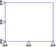
*Figure: the Dirichlet conditions of `predefined_bc` (figure of the Akantu manual).*

`user_defined_bc` writes its own functor, a type implementing
`DirichletFunctor`: on `Fixed_x` it imposes

$$
u_x(y) = -A \sin(\varphi\, y), \qquad A = 0.2, \quad \varphi = 10,
$$

with `FixedValue` on `Fixed_y` and the predefined Neumann functor
`FromTraction` (traction $(0.2, 0.2)$) on `Traction`
([Custom functors](solid-mechanics.md#custom-functors)). The plate is
$2 \times 2$, steel ($E = 210\ \text{GPa}$, $\nu = 0.3$). The example
dumps the state once, without a solve: the displacement is the imposed
one on the left side and zero inside.

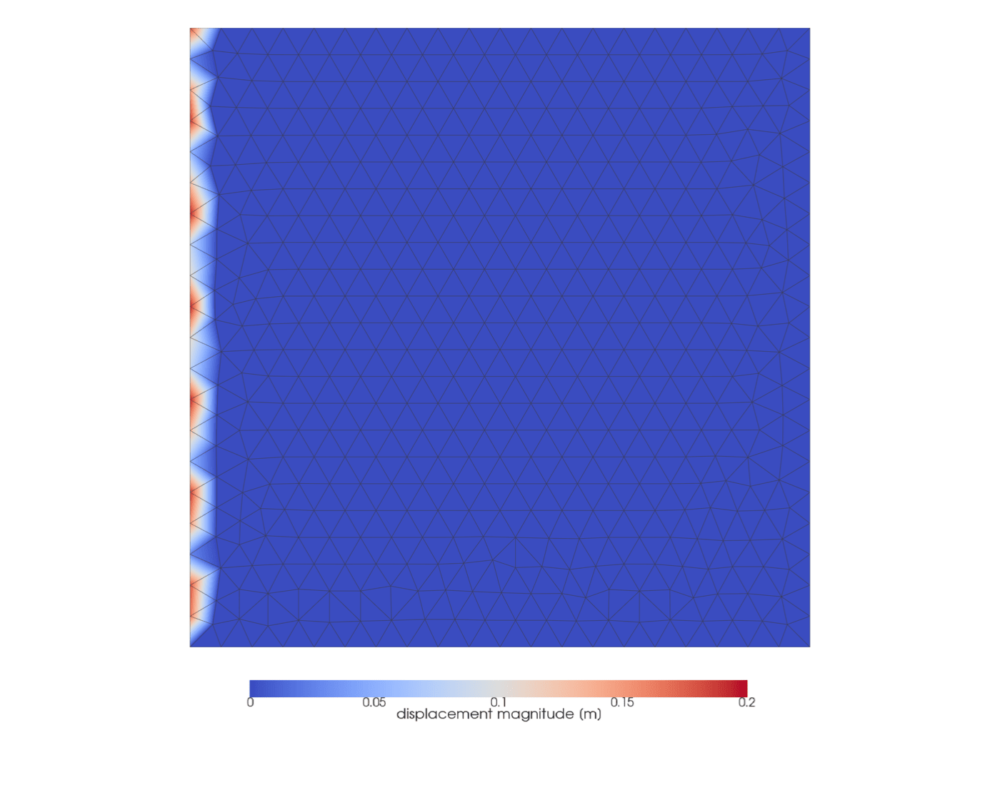
*Figure: displacement magnitude imposed by the sinusoidal functor of `user_defined_bc` (computed with akantu-rs).*

```sh
cargo run -p akantu --example predefined_bc
cargo run -p akantu --example user_defined_bc
```

### Static analysis: `static`

A square plate of quadratic triangles, $0.01 \times 0.01$, is held on
rollers on its left side ($u_x = 0$ on `Fixed_x`) and on its bottom side
($u_y = 0$ on `Fixed_y`), and the right side (group `Displacement`) is
moved by $u_x = 10^{-4}$, 1 % of the plate's length. The material is
elastic with $\nu = 0$; the input file defines $E$ and $\rho$ as
expressions of a cross-section $A = \pi\, 0.05^2 / 4$ ($E = E_t A$ with
$E_t = 200\ \text{GPa}$). The Newton–Raphson solver is limited to two
iterations with a threshold of $2 \cdot 10^{-4}$ on the solution
increment; the problem is linear and converges in one.

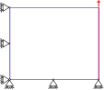
*Figure: boundary conditions of `static`; the red side is the group `Displacement`, which the example moves along $x$ (the arrow of this upstream drawing points along $y$) (figure of the Akantu manual).*

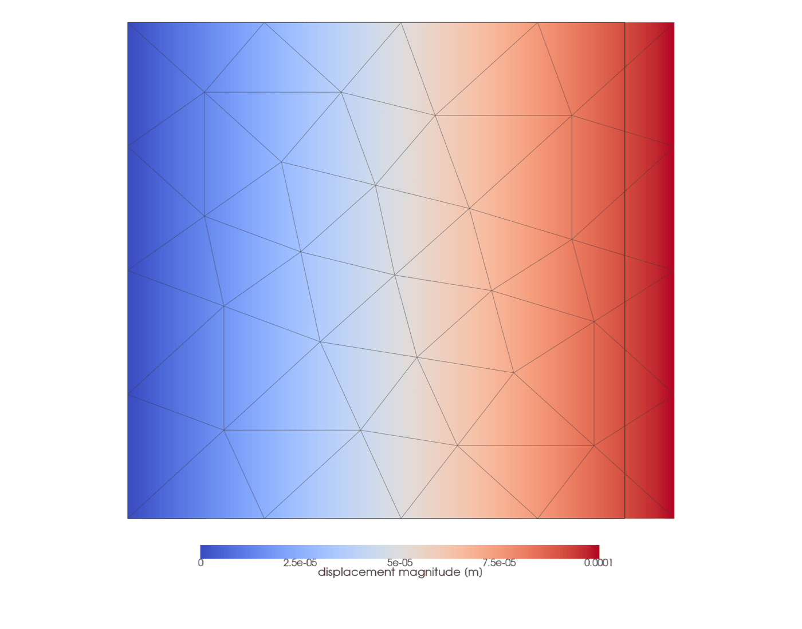
*Figure: displacement magnitude of `static` on the deformed plate, magnified 10 times; the dark line is the undeformed right side (computed with akantu-rs).*

```sh
cargo run -p akantu --example static        # add -- --solver eigen to pin Eigen's LU
```

The theory is in [Static analysis](solid-mechanics.md#static-analysis).

### Explicit dynamics: `explicit_dynamic`

A 3-D steel bar, $L = 10\ \text{m}$ long with a $1 \times 1\ \text{m}$
section (linear tetrahedra), carries an initial axial displacement pulse,
a sine times a Gaussian centred at $x_0 = 2\ \text{m}$:

$$
u_x(x, 0) = A \sin\bigl(k (x - x_0)\bigr)\,
\exp\!\left(-\frac{k^2 (x - x_0)^2}{l^2}\right),
\qquad A = 0.01\ \text{m}, \quad l = 2\ \text{m}, \quad k = \frac{0.1 \cdot 2\pi \cdot 3}{l}.
$$

The material is linear elastic ($\rho = 7800\ \text{kg/m}^3$,
$E = 210\ \text{GPa}$, $\nu = 0$). The central-difference scheme with a
lumped mass runs 1000 steps of $\Delta t = 0.8\, \Delta t_\text{crit}$;
the potential, kinetic and total energies of every step go to
`energy.csv` and every step is dumped. The pulse splits into two waves
that travel towards the ends of the bar at the speed
$c = \sqrt{E/\rho} \approx 5190\ \text{m/s}$ and are reflected there.

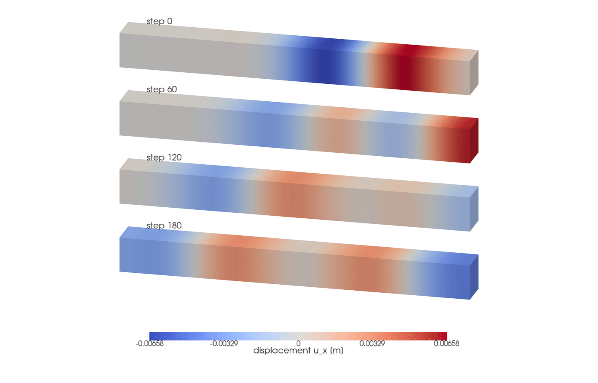
*Figure: axial displacement $u_x$ of `explicit_dynamic` at steps 0, 60, 120 and 180 (computed with akantu-rs).*

```sh
cargo run -p akantu --release --example explicit_dynamic -- --output-dir /tmp/explicit
```

The 1001 dumps take about 1 GB. The theory is in [Explicit
dynamics](solid-mechanics.md#explicit-dynamics).

### Implicit dynamics: `implicit_dynamic`

A simply supported beam of $10 \times 1\ \text{m}$ (quadratic triangles
in plane strain) is loaded by a force
$F = 5\ \text{kN}$ is applied suddenly at the middle of its span. The
material is fictitious ($\rho = 1000\ \text{kg/m}^3$,
$E = 120\ \text{MPa}$, $\nu = 0.3$), chosen so that the Euler–Bernoulli
solution is simple: with $I = 1/12\ \text{m}^4$ and a mass per length
$m = \rho A = 1000\ \text{kg/m}$, the mode $n$ of the simply supported
beam has the angular frequency

$$
\omega_n = \frac{n^2 \pi^2}{L^2} \sqrt{\frac{EI}{m}} = n^2 \pi^2\ \text{s}^{-1},
$$

and the mid-span deflection, summed over the modes 1, 3 and 5, is

$$
u\left(\frac{L}{2}, t\right) \approx \frac{2 F L^3}{\pi^4 E I}
\left[\bigl(1 - \cos(\omega_1 t)\bigr) + \frac{1 - \cos(\omega_3 t)}{81}
+ \frac{1 - \cos(\omega_5 t)}{625}\right],
$$

where $2 F L^3 / (E I) = 1\ \text{m}$ for these values, which gives
upstream's form $\frac{1}{\pi^4}\bigl(1 - \cos(\pi^2 t) + \dots\bigr)$.
The trapezoidal rule (Newmark-$\beta$ with $\beta = 1/4$, $\gamma = 1/2$)
runs 6200 steps of $\Delta t = 10^{-4}\ \text{s}$ with a threshold of
$10^{-12}$ on the solution increment; every step writes the deflection of
the loaded node and the modal solution to `position.csv`, and every 100th
step is dumped.

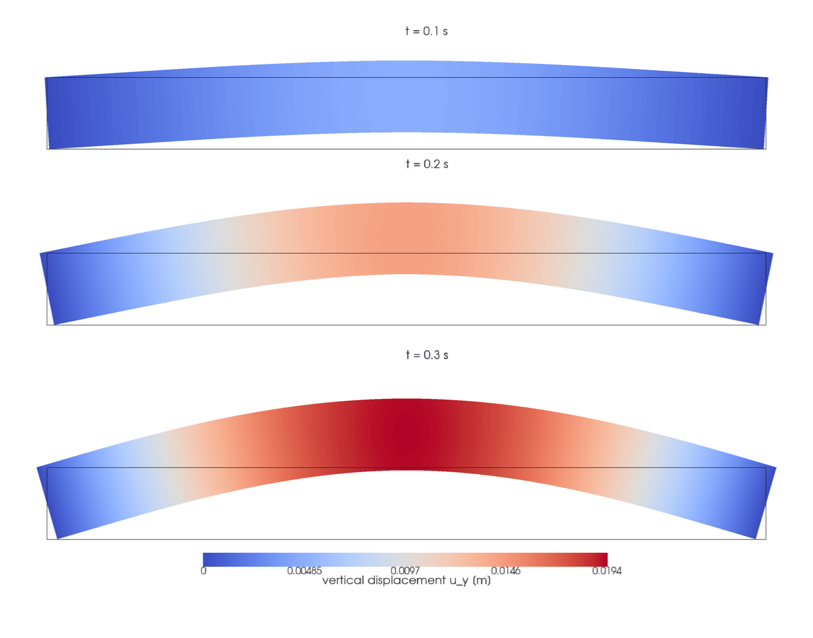
*Figure: vertical displacement of `implicit_dynamic` at $t = 0.1$, $0.2$ and $0.3\ \text{s}$ on the deformed beam, magnified 50 times; the dark rectangle is the undeformed beam (computed with akantu-rs).*

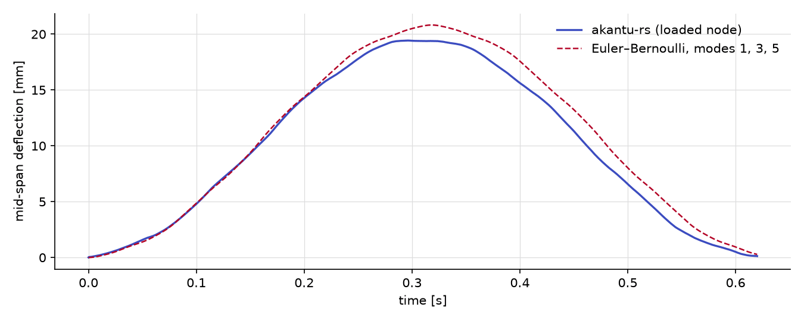
*Figure: deflection of the loaded node from `position.csv` and the three-mode Euler–Bernoulli solution of the same file; the 2-D continuum is slightly stiffer than the beam theory near the peak (computed with akantu-rs).*

```sh
cargo run -p akantu --release --example implicit_dynamic   # add -- --solver eigen to pin Eigen's LU
```

The theory is in [Implicit dynamics](solid-mechanics.md#implicit-dynamics).

### User parameters of the input file: `example_parser`

The input file has, besides its `material elastic` section, a
`user parameters` section read by the program: the spatial dimension, the
mesh file, the names of two groups, the Newton–Raphson settings and a
stress matrix written as an expression of another parameter,

```dat
user parameters [
	lactostatic_p 	  = 30e3
	stress		  = [[lactostatic_p,0],[0,lactostatic_p]]
]
```

(an excerpt). They drive a static solve of a "Swiss cheese" plate
($0.2 \times 0.2$, $E = 10^5\ \text{Pa}$, $\nu = 0.45$): the outer crust
is clamped and the faces of the holes are loaded by the stress
$p\, \boldsymbol{I}$ with $p = 30\ \text{kPa}$ (functor `FromStress`).
How the parameters are read is explained in [Input files](input-files.md).

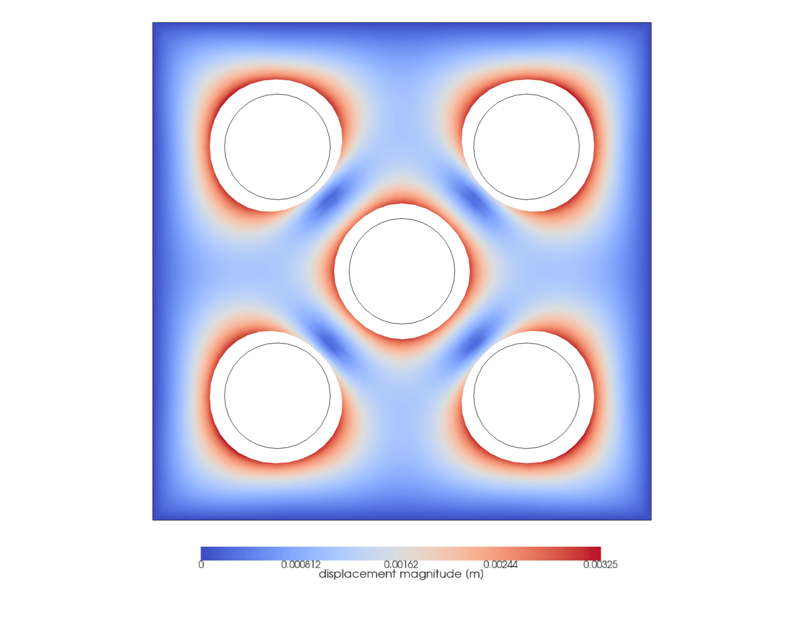
*Figure: displacement magnitude of `example_parser` on the deformed plate, magnified 2 times; the dark circles are the undeformed holes (computed with akantu-rs).*

```sh
cargo run -p akantu --example example_parser   # add -- --solver eigen to pin Eigen's LU
```

### A new constitutive law: `new_local_material`

The example registers a law written in Rust, `local_damage`, in the
model's law factory before `init_full`, so that the input file's
`material local_damage [ ... ]` section creates it. The law is isotropic
linear elasticity degraded by a scalar damage $d$ at each quadrature
point:

$$
\boldsymbol{\sigma}_0 = \lambda \operatorname{tr}(\nabla \boldsymbol{u})\, \boldsymbol{I}
+ \mu \bigl(\nabla \boldsymbol{u} + \nabla \boldsymbol{u}^T\bigr), \qquad
Y = \tfrac{1}{2}\, \boldsymbol{\sigma}_0 : \nabla \boldsymbol{u}, \qquad
\boldsymbol{\sigma} = (1 - d)\, \boldsymbol{\sigma}_0,
$$

where $d$ becomes $\min\bigl((Y - Y_d)/S_d,\ 1\bigr)$ when
$Y - Y_d - S_d\, d > 0$. The plate with a hole ($10 \times 4$, concrete:
$E = 40\ \text{GPa}$, $\nu = 0.2$, $Y_d = 500$, $S_d = 5000$) is on
rollers on its left and bottom sides and loaded on its right side by the
traction of the stress $300\, \boldsymbol{I}$; explicit dynamics with
$\Delta t = \Delta t_\text{crit} / 10$ runs 10 000 steps and dumps every
1000. With this load $Y$ stays near $10^{-6}$, far below $Y_d$, so the
damage stays zero and the law behaves elastically. How to write such a
law is explained in [Writing new constitutive
laws](new-constitutive-laws.md).

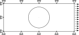
*Figure: geometry and boundary conditions of `new_local_material` (figure of the Akantu manual).*

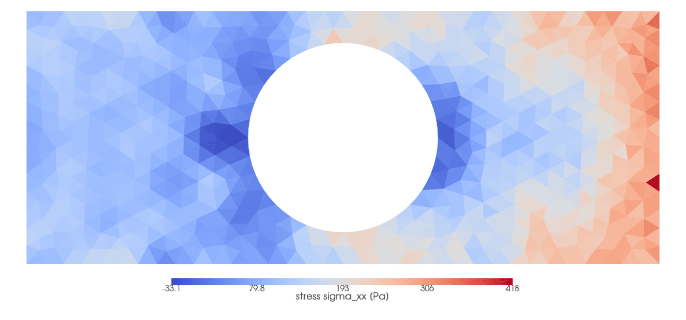
*Figure: stress $\sigma_{xx}$ of `new_local_material` after 10 000 steps; the elastic waves started by the sudden load are still travelling (computed with akantu-rs).*

```sh
cargo run -p akantu --release --example new_local_material
```

### Viscoelasticity: `material_viscoelastic_maxwell_energies`

A square of $1\ \text{mm}$ made of the generalised Maxwell law
`viscoelastic_maxwell` with one Maxwell element ($E_\infty = 15\ \text{MPa}$,
$E_v = 10\ \text{MPa}$, $\eta = 40\ \text{MPa}\cdot\text{s}$, $\nu = 0$) is given a
biaxial strain $\varepsilon(t)$ ramped linearly to $0.1$ over
$T = 10$ and held until $t = 100$ ($\Delta t = 0.1$, 1002 static
Newton–Raphson solves). Each step writes $t$, $\varepsilon$, the potential
energy $E_\text{pot}$, the dissipated energy $E_\text{diss}$ and the work
$W$ to `material_viscoelastic_maxwell_output.out`. Upstream has no page
for this example; the law is described in [Viscoelastic
laws](laws/viscoelastic.md#generalised-maxwell-model-viscoelastic_maxwell).

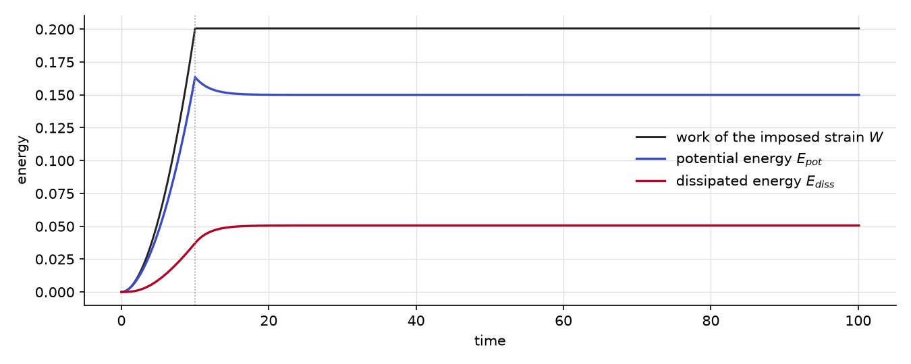
*Figure: energies of `material_viscoelastic_maxwell_energies`; during the hold the Maxwell element relaxes and the potential energy turns into dissipated energy, with $W = E_\text{pot} + E_\text{diss}$ (computed with akantu-rs).*

```sh
cargo run -p akantu --example material_viscoelastic_maxwell_energies
```

### Dumpers: `dumper_low_level` and `dumpable_interface`

Both examples dump a train (a "Swiss" carriage with four wheels) that
moves to the right while its wheels turn, 100 dumps. `dumper_low_level`
creates two ParaView dumpers directly, one on the whole mesh and one on a
filtered mesh made of the four wheel groups merged into the element group
`wheels`, and serves the displacement and an elemental `colour` from the
example's own arrays. `dumpable_interface` does the same through the
`Dumpable` registry: a default dumper on the mesh and the group dumper of
`wheels`. By default the wheels turn (UD-473 corrected: upstream's wheels
never turn); see [Output and dumpers](output.md#low-level-dumpers-and-external-data).

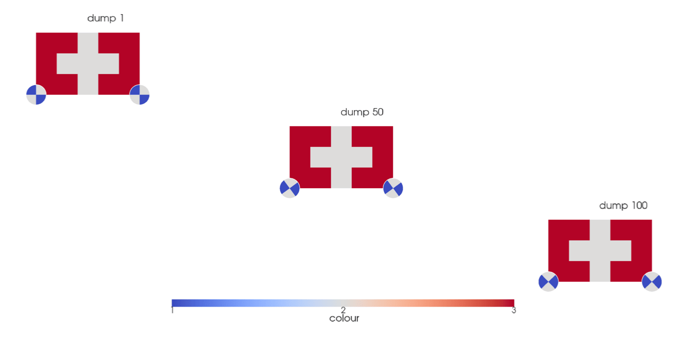
*Figure: the train of `dumper_low_level` at dumps 1, 50 and 100, coloured by its `colour` field, at its dumped position (computed with akantu-rs).*

```sh
cargo run -p akantu --example dumper_low_level
cargo run -p akantu --example dumpable_interface
```

### A distributed mesh: `parallel_2d`

The unit square (linear triangles) is read on rank 0 and distributed;
the left and right sides are pushed inwards by $10^{-6}\ \text{m}$ with
$u_x$ blocked, and explicit dynamics runs 10 000 steps of
$\Delta t = 0.8\, \Delta t_\text{crit}$ (steel), with a dump every 200
steps. Without the `mpi` feature the example runs on one rank, or on
`--local-ranks N` in-process ranks. The left part of the figure is the
partition of a run on four in-process ranks (the pure-Rust recursive
coordinate bisection; with the `scotch` feature the partition is
Scotch's, as upstream). See [Parallel computations](parallel.md).

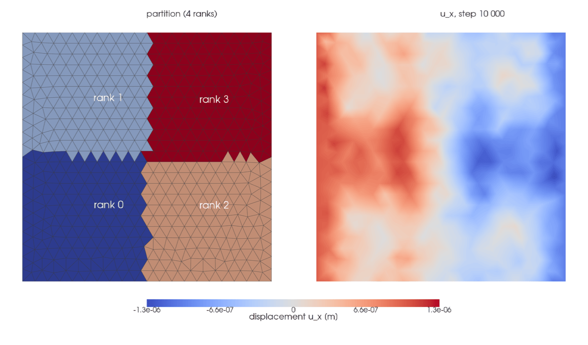
*Figure: partition of `parallel_2d` on four ranks (left) and the displacement $u_x$ after 10 000 steps of the one-rank run (right) (computed with akantu-rs).*

```sh
cargo run -p akantu --release --example parallel_2d -- --local-ranks 4
```

As upstream, the per-rank dumps also hold pure-ghost points whose nodal
values are never synchronised (UD-475, see the examples' README); restrict
ParaView's colour range to the cells when looking at them.

### Extrinsic cohesive elements: `cohesive_extrinsic`

The plate $[-1, 1]^2$ (quadratic triangles) is elastic
($E = 10^3$, $\nu = 0.001$, $\rho = 10^3$) and cohesive elements
(`cohesive_linear`, $G_c = 100$, $\sigma_c = 100$) may be inserted during
the run on the facets whose barycentre lies in $0.20 \le y \le 0.30$
(`set_limit`). The outer nodes are blocked in their normal direction, an
initial velocity $v_y = 0.5\, y$ stretches the plate and the top and
bottom nodes move by $0.5\, \Delta t\, y$ per step; 1000 explicit steps
($\Delta t = 0.05\, \Delta t_\text{crit}$), each preceded by the insertion
check `check_cohesive_stress`. The run passes when the dissipated energy is
$200\sqrt{2}$ (four cracked diagonals of length $\sqrt{2}/2$) within
0.1 %, as upstream checks. See [Cohesive elements](models/cohesive.md).

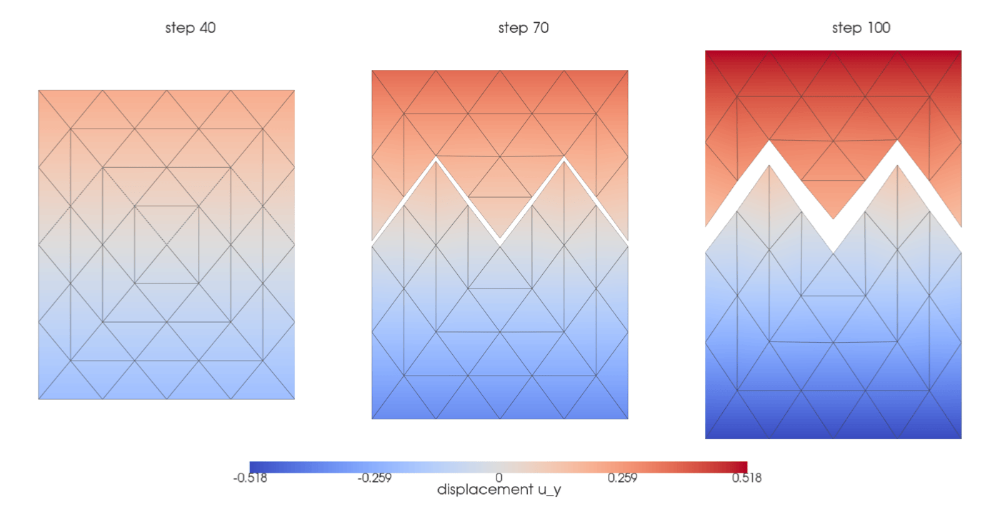
*Figure: displacement $u_y$ of `cohesive_extrinsic` at steps 40, 70 and 100, on the deformed mesh (factor 1) (computed with akantu-rs).*

```sh
cargo run -p akantu --example cohesive_extrinsic
```

### Intrinsic cohesive elements: `cohesive_intrinsic`

The same plate gets intrinsic cohesive elements, inserted at
initialisation on the facets whose barycentre lies in
$-0.26 \le x \le -0.24$, with the law `cohesive_bilinear`
($\sigma_c = 1$, $G_c = 1$, $\delta_0 = 0.1$, $\beta = 1.5$,
penalty $10^{10}$): an intrinsic law needs an elastic part before the
peak, which the linear law lacks. Every degree of freedom is blocked; the
nodes of the elements right of the crack are moved by $0.01$ along $x$
before the first step and after each of the 350 explicit steps. The run
passes when the dissipated energy is $2\sqrt{2}$ within 0.1 %.

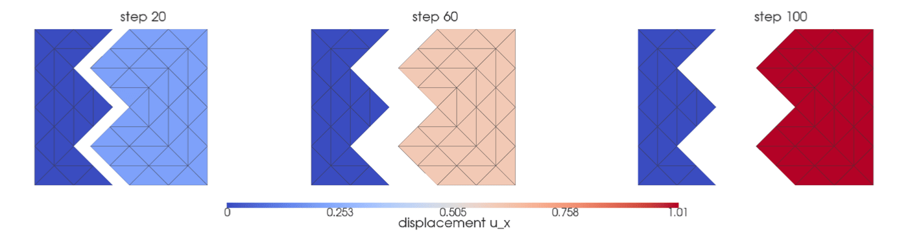
*Figure: displacement $u_x$ of `cohesive_intrinsic` at steps 20, 60 and 100, on the deformed mesh (factor 1) (computed with akantu-rs).*

```sh
cargo run -p akantu --example cohesive_intrinsic
```

### Intergranular and transgranular cracks: `cohesive_extrinsic_ig_tg`

The square $[-1, 1]^2$ has two grains, `btop` and `bbottom`. A facet
between the grains takes the strong law `tg_cohesive` ($\sigma_c = 100$),
a facet inside a grain the weak law `ig_cohesive` ($\sigma_c = 20$), both
with $G_c = 10$; the choice is made by a `MaterialCohesiveRulesSelector`
chained with a selector on the `physical_names` mesh data. The sides are
blocked in their normal direction and moved outwards at the speed
$\pm 0.1$ by a user Dirichlet functor that also sets the velocity of its
nodes; the initial velocity is $0.1\, x$, and 1000 explicit steps follow.

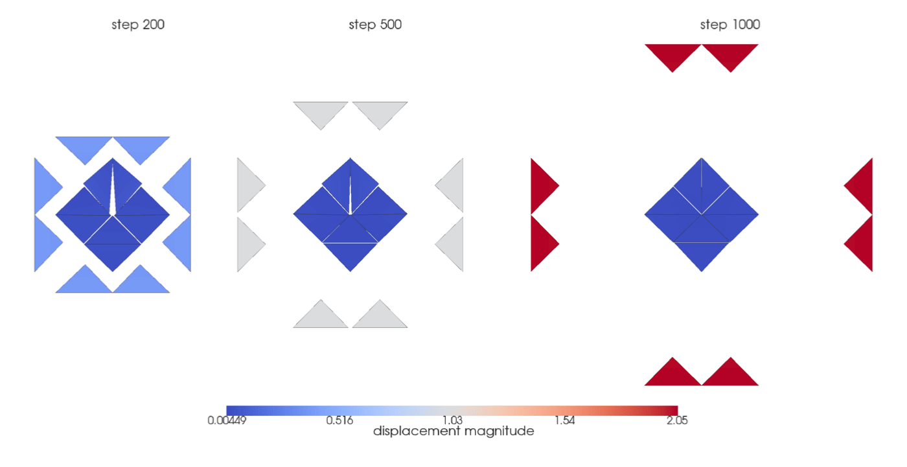
*Figure: displacement magnitude of `cohesive_extrinsic_ig_tg` at steps 200, 500 and 1000, on the deformed mesh (factor 1) (computed with akantu-rs).*

```sh
cargo run -p akantu --example cohesive_extrinsic_ig_tg
```

### Scalability test: `scalability_test`

Upstream's benchmark of the JOSS paper: a cube with a compressive force on
top and a shear force on four sides, elastic with finite deformation
($E = 70\ \text{GPa}$, $\nu = 0.22$, $\rho = 2500\ \text{kg/m}^3$) and,
with `material-cohesive.dat`, an extrinsic `cohesive_linear` law
($\sigma_c = 70\ \text{MPa}$, $G_c = 7.6\ \text{J/m}^2$). A static solve
gives the initial state, then explicit dynamics runs with the shear
growing every 100 steps. Everything is set by the `user` section of the
input file. Upstream's `cube.geo` gives about 4.5 million elements; the
committed `cube.msh` is a tiny cube meant to test the code, and the
figure below is a run on it.

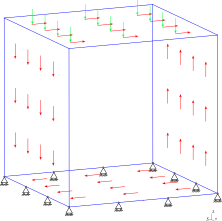
*Figure: loading of the scalability test (figure of the Akantu manual).*

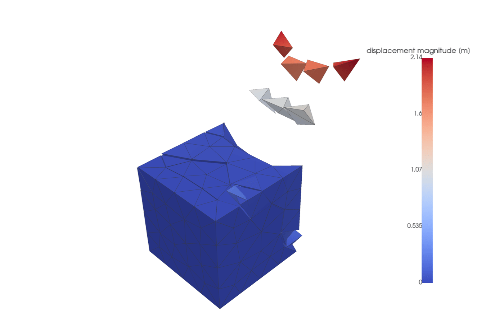
*Figure: displacement magnitude of `scalability_test` with `material-cohesive.dat` on the committed tiny cube after 5000 steps, deformed shape at factor 1 (computed with akantu-rs).*

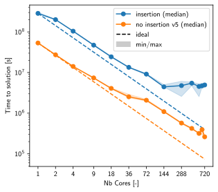
*Figure: time to solution of upstream's scalability study on the full mesh (computed with the C++ library; figure of the Akantu manual).*

```sh
cargo run -p akantu --release --example scalability_test -- \
  --aka_input_file crates/akantu/examples/scalability_test/material-cohesive.dat
```

Both input files set `output_paraview = false`; the figure comes from a
copy of `material-cohesive.dat` with `output_paraview = true`. The
dissipated energy this run prints is upstream's bookkeeping, not a
physical dissipation (UD-803, see the examples' README).

### Heat diffusion: `heat_diffusion_static_2d`, `heat_diffusion_dynamics_2d`, `heat_diffusion_dynamics_3d`

The unit square (quadratic triangles) has the properties of copper:
density $\rho = 8940\ \text{kg/m}^3$, conductivity
$k = 401\ \text{W/(m}\cdot\text{K)}$, specific heat capacity
$c = 385\ \text{J/(kg}\cdot\text{K)}$. The temperature $T$ obeys

$$
\rho c\, \dot{T} = \nabla \cdot (k\, \nabla T),
$$

see [Diffusion (heat transfer)](models/diffusion.md). In
`heat_diffusion_static_2d` the boundary is held at $100\ \text{K}$ and
the nodes within $0.1$ of $(1/4, 1/4)$ at $300\ \text{K}$; one linear
solve gives the steady temperature.

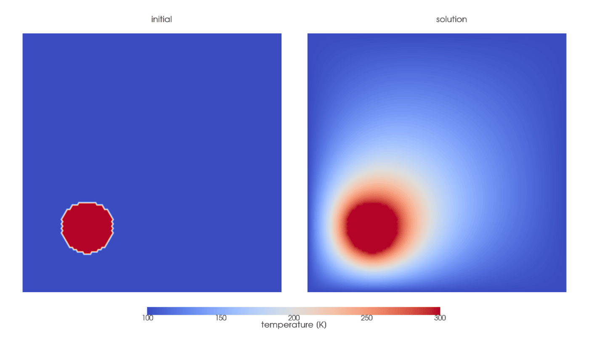
*Figure: temperature of `heat_diffusion_static_2d` before and after the solve (computed with akantu-rs).*

`heat_diffusion_dynamics_2d` solves the transient problem: every node
starts at $100\ \text{K}$, the same hot spot is held at $300\ \text{K}$,
and the explicit forward Euler scheme with a lumped capacity runs 15 000
steps of $\Delta t = 0.8\, \Delta t_\text{crit}$ ($0.12\ \text{s}$, about
30 minutes in all), with a dump every 100 steps. The outer boundary is
free (no flux), so the heat accumulates in the plate.

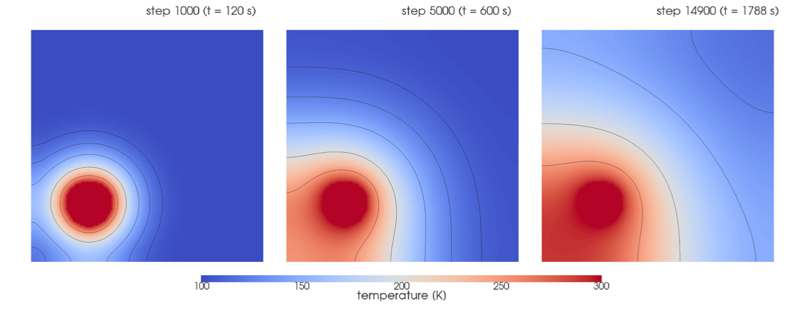
*Figure: temperature of `heat_diffusion_dynamics_2d` at steps 1000, 5000 and 14 900, with the isotherms 110, 125, 150, 200 and 250 K (computed with akantu-rs).*

`heat_diffusion_dynamics_3d` is the 3-D version: the unit cube (quadratic
tetrahedra) at $100\ \text{K}$ with the nodes within $0.1$ of the centre
held at $300\ \text{K}$, 1000 explicit steps with a dump every 100.

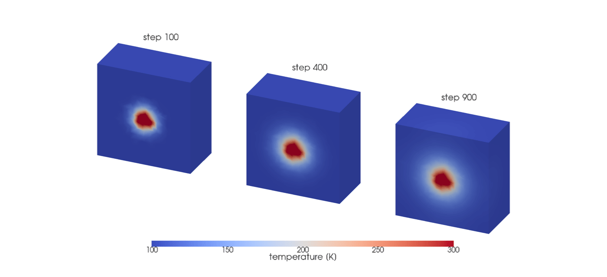
*Figure: temperature of `heat_diffusion_dynamics_3d` at steps 100, 400 and 900, on the half cube $y \le 0.5$ (computed with akantu-rs).*

```sh
cargo run -p akantu --example heat_diffusion_static_2d   # add -- --solver eigen to pin Eigen's LU
cargo run -p akantu --release --example heat_diffusion_dynamics_2d
cargo run -p akantu --release --example heat_diffusion_dynamics_3d
```

### Structural mechanics: `bernoulli_beam_2_example`

A two-span 2-D Bernoulli beam (nodes at $x = 0$, $10$ and $18$, built
through the `MeshAccessor`) with two sections, clamped at the first node
and on rollers at the others, carries a uniform load $q = 6000$ on its
first span (as equivalent nodal forces and moments), a moment
$M = -3600$ and an axial force $E_2 A_2 / 18$ on its last node. One static
solve; the example prints the rotations, the axial displacement and the
bending moments at the supports, and dumps the two elements. With three
nodes there is no field worth a picture; the printed values are the
result. Upstream runs one explicit step with a zero lumped mass instead of
the static solve it prints (UD-514); see above and [Structural mechanics
model](models/structural.md).

```sh
cargo run -p akantu --example bernoulli_beam_2_example
```

### Phase-field fracture: `phase_field_notch` and `phase_field_parallel`

A square plate $[-0.5, 0.5]^2$ with a notch from its left side is
loaded in mode I: the bottom is blocked in $y$, the left side in
$x$ and the top is moved up by $4 \cdot 10^{-6}$ per load step
(`IncrementValue`). Both models are static and coupled by
`CouplerSolidPhaseField` with ten staggered solid / phase-field solves per
step, 999 steps, a dump every 100 ($E = 210$, $\nu = 0.3$, length scale
$l_0 = 0.2$, $g_c = 2.7 \cdot 10^{-3}$). Afterwards the elements whose
damage stays below 0.15 at some quadrature point are grouped in clusters
delimited by the mesh boundaries and the damaged elements, as one would
extract fragments after crack propagation; here the notch splits the
plate into `crack_0` and `crack_1`. See [Phase-field
fracture](models/phase-field.md).

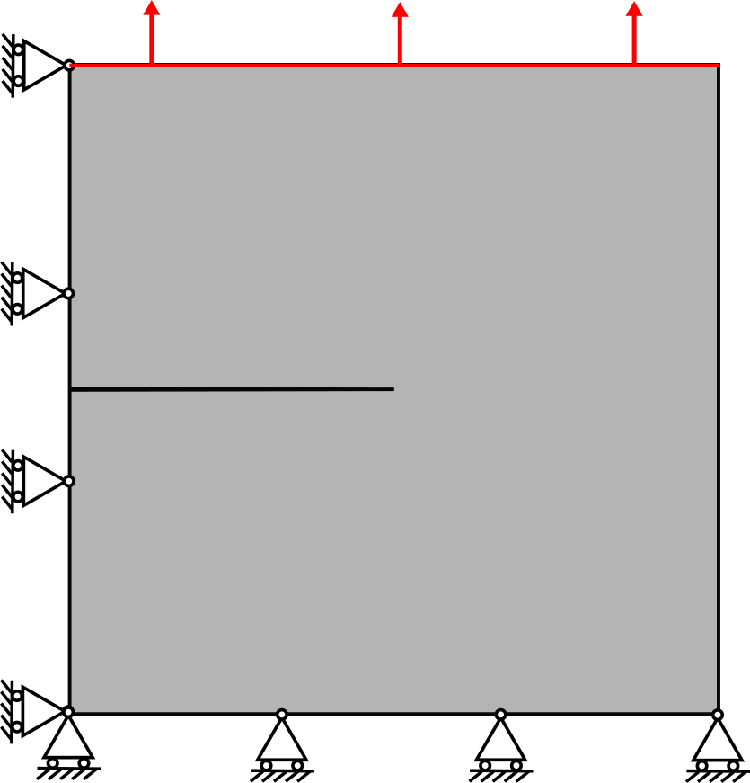
*Figure: the notched plate and its boundary conditions (figure of the Akantu manual).*

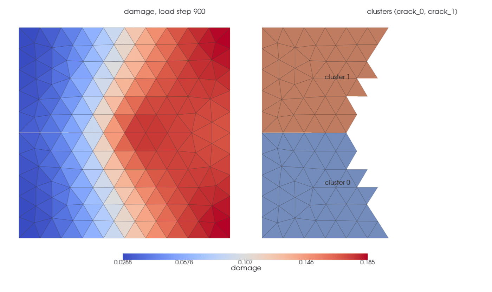
*Figure: damage of `phase_field_notch` after 900 load steps (left) and the two clusters it extracts (right) (computed with akantu-rs).*

`phase_field_parallel` solves the same plate on a distributed mesh; on
one rank its fields are those of `phase_field_notch` (the same figure),
plus the `partitions` field.

```sh
cargo run -p akantu --release --example phase_field_notch       # add -- --solver eigen for the oracle's solver
cargo run -p akantu --release --example phase_field_parallel
```

### Hertz contact: `contact_explicit_dynamic` and `contact_explicit_static`

An elastic half-disc is pressed on a block ($E = 10^3$, $\nu = 0.3$; the
block is the rigid master surface, `is_master_deformable = false`) with
the frictionless `penalty_linear` resolution ($\epsilon_n = 4 \cdot 10^5$)
of `CouplerSolidContact`. `contact_explicit_dynamic` moves the `loading`
edge down by $5 \cdot 10^{-3} / 20\,000$ per step for 20 000 explicit
steps and damps the velocities of the nodes in contact by 0.99 after each;
`contact_explicit_static` applies 100 load increments of $10^{-4}$ and
solves each statically, the contact search running in every Newton
corrector. The input file's `contact_detector` and `contact_resolution`
sections are described in [Contact mechanics](models/contact.md); the
coupling in [Model couplers](models/couplers.md).

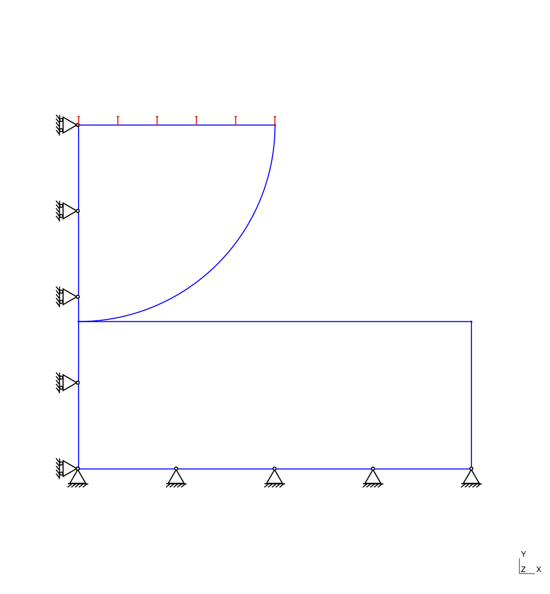
*Figure: the Hertz set-up (figure of the Akantu manual).*

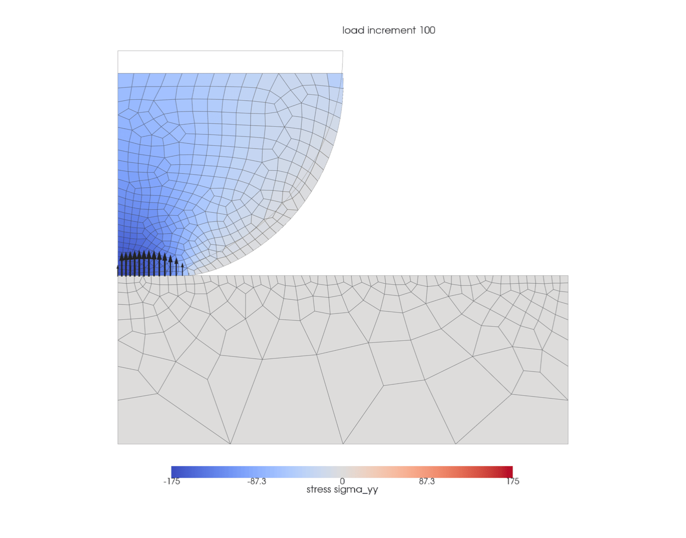
*Figure: stress $\sigma_{yy}$ of `contact_explicit_static` after the 100th increment, with the contact forces as arrows and the undeformed outline in grey (deformed shape at factor 1) (computed with akantu-rs).*

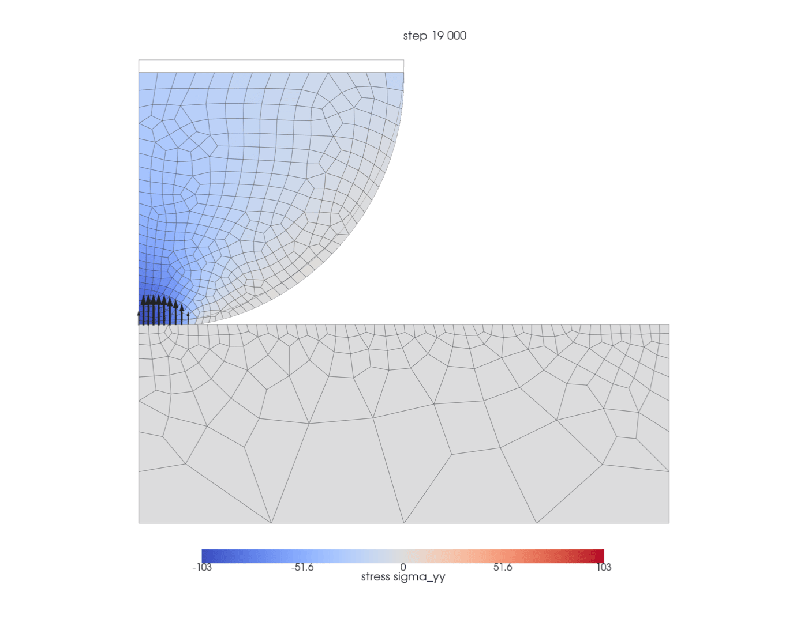
*Figure: stress $\sigma_{yy}$ of `contact_explicit_dynamic` at step 19 000 (computed with akantu-rs).*

```sh
cargo run -p akantu --release --example contact_explicit_dynamic
cargo run -p akantu --release --example contact_explicit_static   # add -- --solver eigen for the oracle's solver
```

### Contact between cohesive crack faces: `cohesive_contact_explicit_dynamic`

An elastic bar with an extrinsic cohesive interface and contact on the
crack faces (`CouplerSolidCohesiveContact`, explicit lumped mass): 25 000
steps pull the `loading` and `fixed` edges apart, cohesive elements are
inserted where the stress exceeds $\sigma_c$ and the crack opens; 25 000
steps push them back together. The input's contact penalty is
$\epsilon_n = 0$, so no contact force acts. See [Model
couplers](models/couplers.md#contact-between-cohesive-crack-faces).

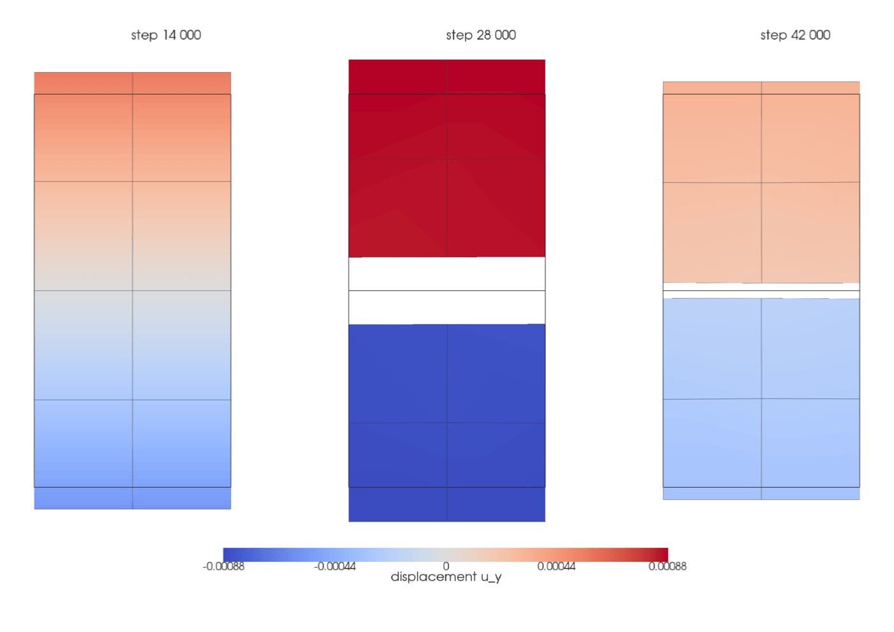
*Figure: displacement $u_y$ of `cohesive_contact_explicit_dynamic` at steps 14 000, 28 000 and 42 000 on the deformed bar, magnified 200 times; the dark lines are the undeformed bar (computed with akantu-rs).*

```sh
cargo run -p akantu --release --example cohesive_contact_explicit_dynamic
```

### Friction: `bloc_friction`

A block is compressed against a wall, then its upper surface is moved
sideways, then left free. Wall and block are steel
($E = 210\ \text{GPa}$, $\nu = 0.3$), the friction coefficient is
$\mu = 0.3$ (`penalty_linear`, $\epsilon_n = 4 \cdot 10^{13}$), and the wall
is not deformable (`is_master_deformable = false`, which saves time).
Explicit dynamics with $\Delta t = 0.1\, \Delta t_\text{crit}$: 10 000
steps pressing the `loading` edge down by $1/10\,000$ per step, 10 000
steps sliding it by $2/10\,000$ per step and 10 000 steps without load,
the velocities of the nodes in contact damped by 0.99 after each step. The
interface sticks and slips. By default the port measures the slip of a
node that passes to the next master facet on that facet; upstream measures
it on the previous one (UD-365), so the runs depart from step 1911 on and
`--upstream-compat` reproduces upstream. See [Contact
mechanics](models/contact.md#coulomb-friction-with-stick-and-slip).

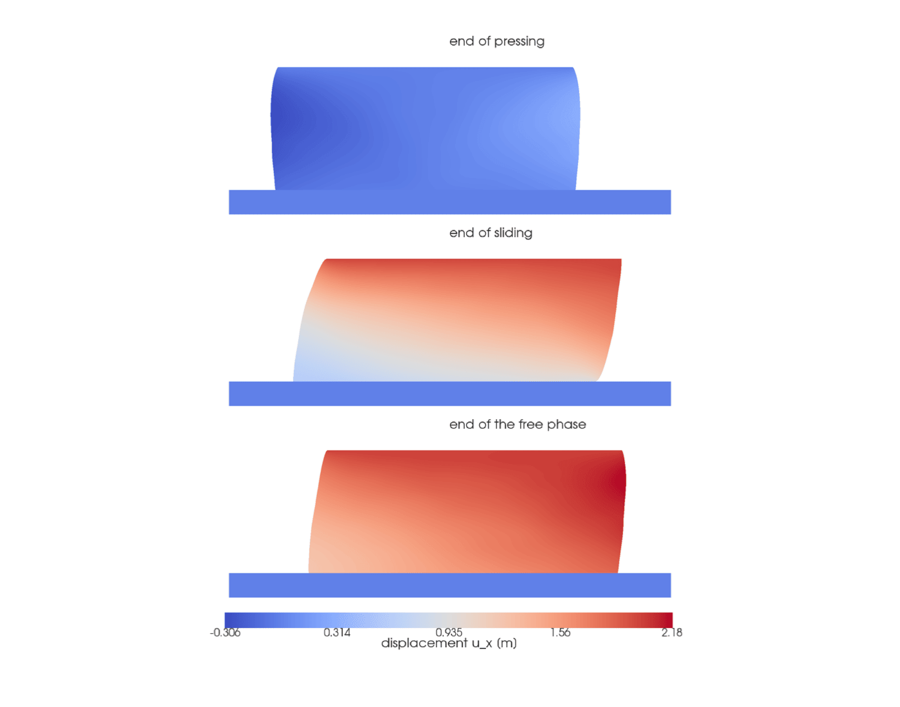
*Figure: displacement $u_x$ of `bloc_friction` at the end of the pressing, sliding and free phases, on the deformed block (factor 1) (computed with akantu-rs).*

```sh
cargo run -p akantu --release --example bloc_friction -- --output-dir /tmp/friction
```

### Embedded reinforcement: `embedded`

A $10 \times 1$ concrete beam (quadratic triangles, $E = 30\ \text{GPa}$,
$\nu = 0.1$) holds an embedded steel bar along $y = 0.25$
(`EmbeddedInterfaceModel`, $E = 210\ \text{GPa}$, area $10^{-4}$,
pre-stress $10\ \text{MPa}$). It is blocked in $x$ on `XBlocked`, in $y$
on `YBlocked` and loaded by the traction $(0, -1)$ on `Force`; one static
Newton–Raphson iteration. The pre-stressed bar compresses the concrete
below it. The reinforcement's stress (between $9.95$ and
$9.99\ \text{MPa}$) is dumped too. See [Embedded
interfaces](models/embedded.md).

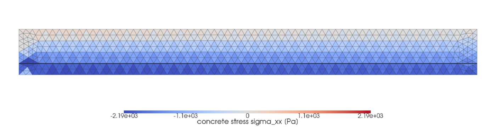
*Figure: concrete stress $\sigma_{xx}$ of `embedded` with the bar drawn as a dark line; the colour scale is clipped at the 99th percentile of $\lvert \sigma_{xx} \rvert$, one element at the left end of the bar reaching $-4.9\ \text{kPa}$ (computed with akantu-rs).*

```sh
cargo run -p akantu --features cgal --example embedded
```

### Rate-and-state friction at split nodes: `steady_state`

An elastic slider on an elastic base ($E = 7.98\ \text{GPa}$,
$\nu = 0.33$, $\rho = 1200\ \text{kg/m}^3$, plane stress), periodic in
$x$, meet at split nodes with rate-and-state friction (revised Dieterich
law, regularised ageing). The slider is pressed on the base by tractions
of $\mp 1\ \text{MPa}$; both start in the analytical static state and at
the steady sliding velocity $\pm v/2$ ($v = 2 \cdot 10^{-3}\ \text{m/s}$),
the top and bottom are driven at $\pm v/2$ for 1000 explicit steps
($\Delta t = 0.01\, \Delta t_\text{crit}$), and the friction state is
perturbed sinusoidally (1 %) along the interface at step 10. The energies
of every step go to `friction-energies-steady_state.csv`. See [Split-node
contact and rate-and-state friction](models/ntn-contact.md).

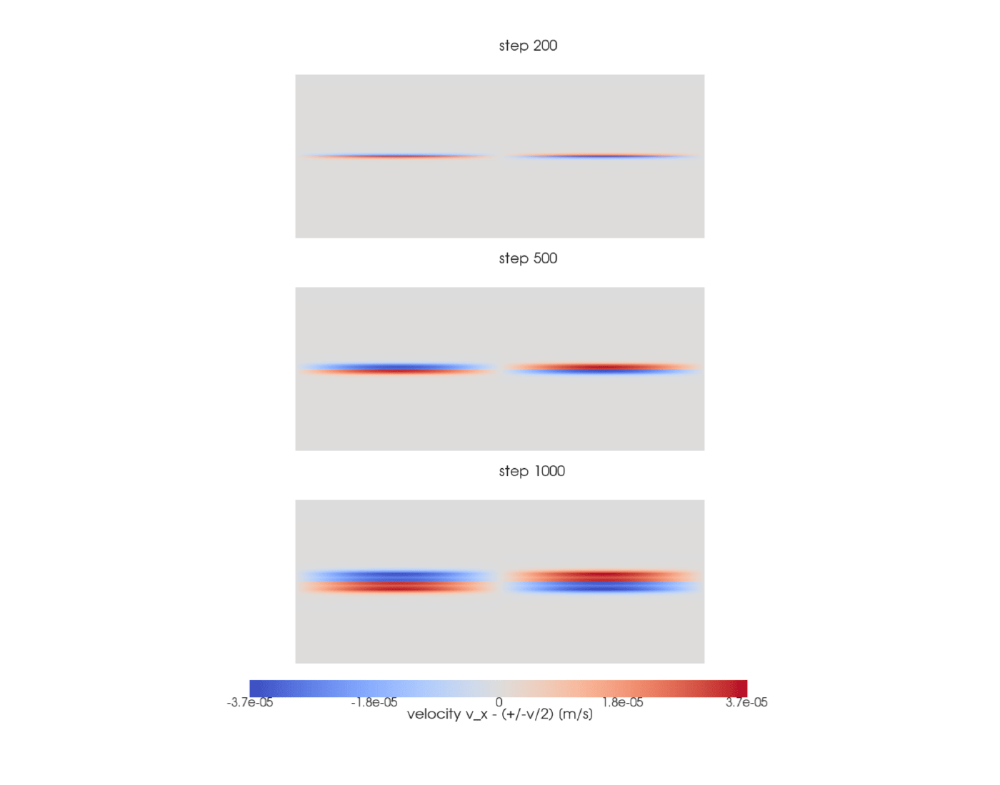
*Figure: horizontal velocity of `steady_state` minus the driving velocity $\pm v/2$ of each body, at steps 200, 500 and 1000; the perturbation spreads from the interface (computed with akantu-rs).*

```sh
cargo run -p akantu --release --example steady_state
```
