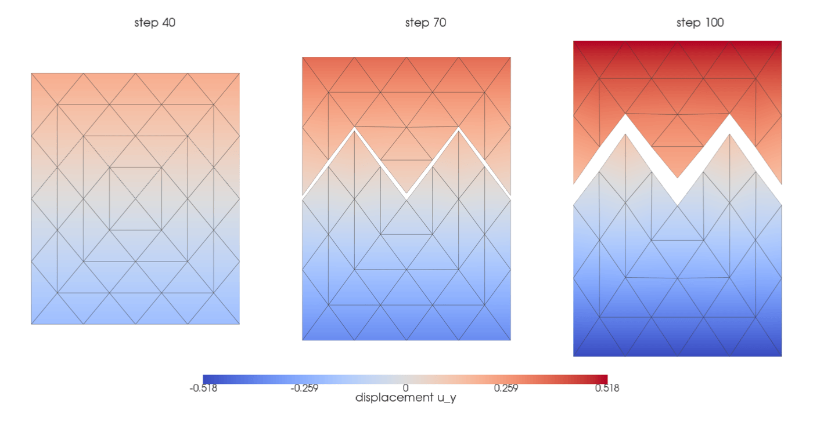
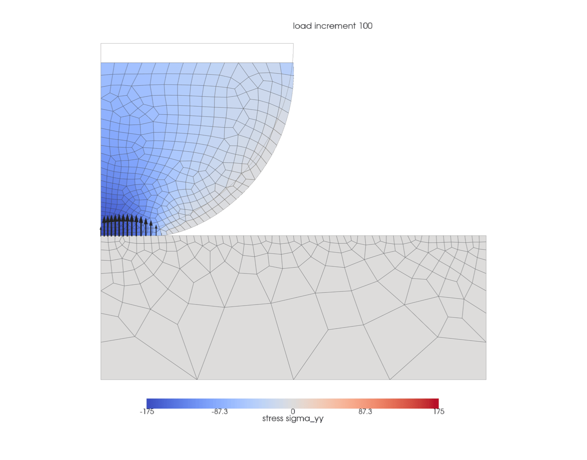
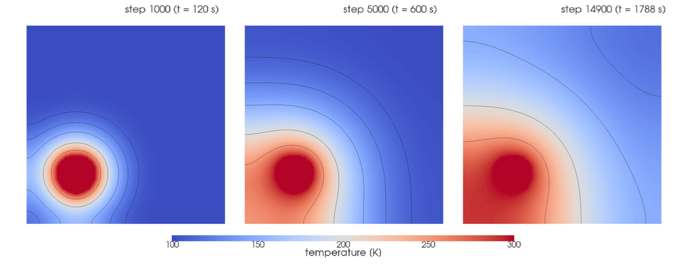
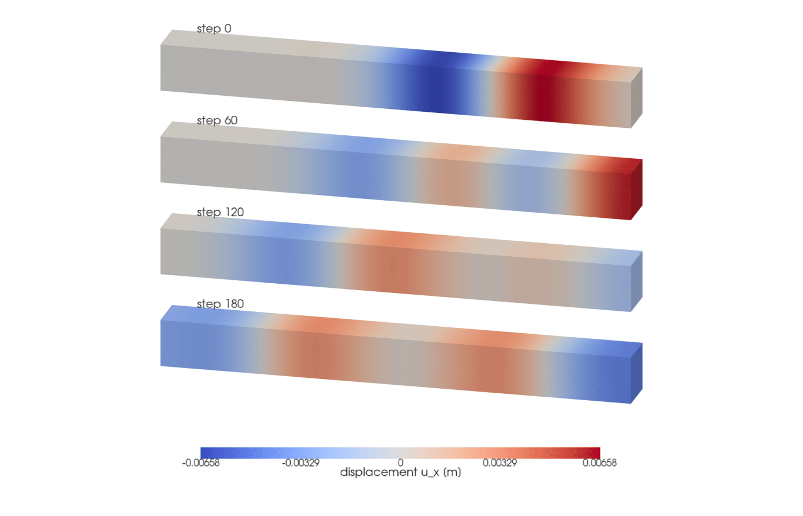
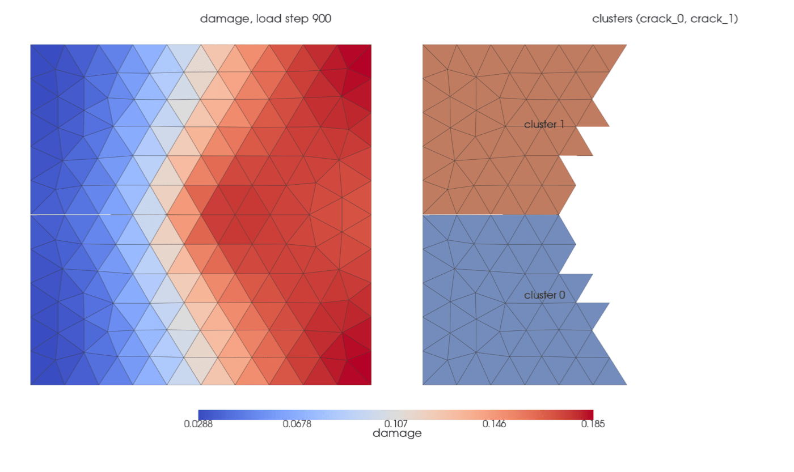
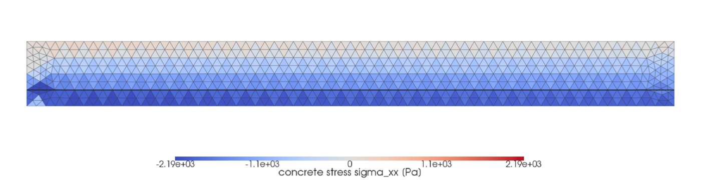

# Introduction

akantu-rs is a Rust port of [Akantu](https://gitlab.com/akantu/akantu), the
finite-element library for solid mechanics, dynamic fracture and contact
developed at EPFL (LSMS). The port tracks the upstream commit
`35a851780d0b9471d258ed53a003ae98aaa95ea0`
(`v5.0.7-post1-554-g35a851780`) and reproduces its behaviour, its input
and output formats and, where the design allows it, its floating-point
results bit for bit, against a strict build of upstream on the platform
of the committed fixtures (see [Bitwise reproducibility and
platforms](differences.md#bitwise-reproducibility-and-platforms)).

This manual follows the structure of the upstream manual
(`doc/dev-doc/manual`) and describes what this release of the port
contains. The few features that are not part of the release (none of them is
being ported) are listed in [Models not yet available](models/not-yet-available.md),
with the reason for each. A test checks that every module of the facade
crate is described either as available or on that list, according to the
crates of the workspace. The status of every upstream feature is tracked in
[`docs/FEATURE_PARITY.md`](../../FEATURE_PARITY.md): a feature documented
here is implemented, and the rows marked *Verified* there have passed the
project's independent verification.

| Dynamic fracture | Contact | Heat diffusion |
|---|---|---|
|  |  |  |
|  |  |  |
| **Wave propagation** | **Phase-field fracture** | **Embedded reinforcement** |

*Results computed with akantu-rs, from the [Examples](examples.md) chapter:
`cohesive_extrinsic`, `contact_explicit_static`,
`heat_diffusion_dynamics_2d`, `explicit_dynamic`, `phase_field_notch` and
`embedded`.*

## Formulas and figures

The model and law pages give the theory behind each feature (the equations
solved, their discretisation, the constitutive laws) as the upstream manual
does, stated for the port: where upstream's manual and the code disagree,
the formula given is the one the code evaluates. An expression whose point
is the order of its floating-point operations is shown as code.

A figure's caption says where it comes from. "Figure of the Akantu manual"
marks a figure copied from the upstream manual or from upstream's examples.
An image of a result says which library computed it: "computed with
akantu-rs" for the port's own runs (rendered by
`scripts/manual/render_figures.py` from the examples' ParaView output),
"computed with the C++ library" for the few upstream images kept. The other
figures were drawn for this manual.

## How the examples are tested

Every example of this manual is executed by the test suite:

* each `rust` code block is a doc-test of the facade crate `akantu`
  (`cargo test -p akantu --doc`); lines hidden in the rendered book (set-up,
  paths, assertions) are part of the test;
* each input-file block (marked `dat`) is parsed by
  `cargo test -p akantu --test manual` (blocks marked `dat,fails` must be
  rejected);
* the tables marked as generated (element appendix, keyword lists,
  material parameters) are produced from the code and compared with the
  committed text by the same test;
* statements about upstream behaviour (default values, accepted keywords,
  option and field names) are backed by named tests in
  `crates/akantu/tests/manual_claims.rs` and were cross-checked against the
  upstream source code. Where the upstream manual and the upstream code
  disagree, the port follows the code; the disagreements are listed in
  [Differences from the C++ library](differences.md#upstream-manual-errata).

## Reading guide

| If you want to… | Read |
|---|---|
| build the port and run a first simulation | [Getting started](getting-started.md) |
| manipulate arrays, tensors and element types | [Basic types and iteration](basic-types.md) |
| read meshes, use groups and mesh data | [Meshes](meshes.md) |
| write input files | [Input files](input-files.md), [Solver configuration](solver-configuration.md), [Materials](materials.md) |
| run static or dynamic solid mechanics | [Solid mechanics model](solid-mechanics.md) |
| write ParaView or text output | [Output and dumpers](output.md) |
| set up the cohesive, contact, phase-field, diffusion or structural model | the pages under *Models* ([Cohesive elements](models/cohesive.md), [Contact mechanics](models/contact.md), [Phase-field fracture](models/phase-field.md), [Diffusion](models/diffusion.md), [Structural mechanics model](models/structural.md), [Model couplers](models/couplers.md)) |
| run on several processes | [Parallel computations](parallel.md) |
| use the Python package | [Python interface](models/python.md) |
| port a C++ or Python Akantu program | [Differences from the C++ library](differences.md), [Upstream changes](upstream-changes.md) |
| find out what this release does not contain, and why | [Models not yet available](models/not-yet-available.md) |
| look up an element type | [Appendix: elements](appendix/elements.md) |

## Licence and attribution

akantu-rs is a derivative work of Akantu and is distributed under the GNU
Lesser General Public License, version 3 or (at your option) any later
version. One part is an exception and is off by default: the crate
`akantu-geometry-cgal` derives from GPL-licensed CGAL packages and is
licensed GPL-3.0-or-later; it is compiled only with the facade feature
`cgal` (which the feature `igfem` implies). A build with `cgal` or `igfem`
enabled is distributed under GPL-3.0-or-later as a whole; the default build
contains no GPL code. The same holds for a binary built with the PETSc
back-end (off by default) against a PETSc that links GPL libraries, such as
Debian's ([The PETSc back-end](petsc.md)). This manual adapts the structure and parts of the text of the
upstream manual (© EPFL, LSMS, LGPL-3.0-or-later); see `docs/manual/NOTICE`.
