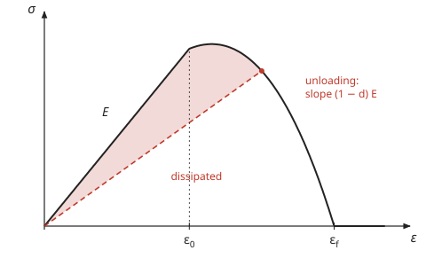
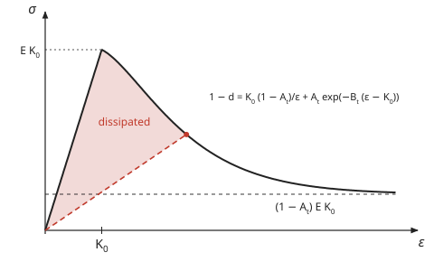

# Damage

Small-strain continuum damage laws (upstream *Damage*; code
`crates/akantu-solid/src/materials/damage.rs`, `marigo.rs`, `mazars.rs`,
`anisotropic_damage.rs`).

## Isotropic damage

In the simplest case, a linear elastic and brittle material, isotropic
damage is represented by one scalar variable $d$ that goes from $0$ (no
damage) to $1$ (a fully broken material). The stress-strain relation
becomes

$$
\boldsymbol{\sigma} = (1 - d)\, \mathbb{C} : \boldsymbol{\varepsilon}
$$

with $\mathbb{C}$ the elastic stiffness tensor. Each law below is an
evolution law for $d$: a criterion that says when the damage grows, and
the value it grows to.

`marigo`, `mazars` and `plastic_mazars` share upstream's isotropic damage
base: a scalar damage $d \in [0, 1]$ (internal `damage`, with history)
degrades the stress of the parent law,

$$
\boldsymbol{\sigma} = (1 - d)\, \boldsymbol{\sigma}_\text{parent}
$$

($\boldsymbol{\sigma}_\text{parent}$ is the elastic stress, or the von Mises stress for
`plastic_mazars`), $d$ never decreases, and the tangent is the parent's
tangent scaled by $1 - d$ (the secant stiffness; the stiffness is
reassembled at every step). After every converged step the base
accumulates the work $w = \int \boldsymbol{\sigma} : \mathrm{d}\boldsymbol{\varepsilon}$
(internal `integral of sigma`, with the trapezoidal rule) and stores the
dissipated energy density $w - \psi$ (internal `damage dissipated energy`);
`energy("dissipated")` integrates it:

$$
\begin{aligned}
w_{n+1} &= w_n + \tfrac{1}{2} \left(\boldsymbol{\sigma} + \boldsymbol{\sigma}_n\right) : \Delta\boldsymbol{\varepsilon} \\
e_\text{diss} &= w_{n+1} - \psi, \qquad
\psi = \tfrac{1}{2}\, \boldsymbol{\sigma} : \boldsymbol{\varepsilon}
  = (1 - d)\, \tfrac{1}{2}\, \boldsymbol{\varepsilon} : \mathbb{C} : \boldsymbol{\varepsilon}
\end{aligned}
$$

$\psi$ is the potential energy of the law, the elastic energy stored at
the current damage (for an elastic parent and without a thermal strain;
`plastic_mazars` below). In a uniaxial test the work is the area under the
loading curve and $\psi$ the triangle under the unloading line, so the
dissipated energy is the area between them (the shaded areas of the
figures below).

Common to the three laws (switches of `LawOptions`):

* `finite_strain_damage` (UD-142): upstream evaluates `finite_deformation`
  with the small-strain kernel on the raw `∇u` (a rotation creates
  stress); the default refuses it (`Error::Unsupported`),
  `FiniteStrainDamage::UpstreamLegacy` reproduces upstream (`plastic_mazars`
  also needs `finite_strain_plasticity`, UD-030).
* `committed_trial_state` (UD-138): the damage of a trial is computed from
  the damage committed at the beginning of the step (upstream: from the
  previous evaluation, so rejected Newton trials influence later ones).
* `damage_thermal_refresh` (UD-038): with a temperature change upstream
  never refreshes the thermal stress of these laws; the default does,
  and with `thermal_energy = StoredElastic` (UD-109) the stored energy and
  `damage_thermal_work` (UD-160) the thermal work are consistent with it.

### `marigo`

Energy-based damage (Marigo, 1981; Lemaitre, 1996). With the elastic
stress $\boldsymbol{\sigma}_\text{el} = \mathbb{C} : \boldsymbol{\varepsilon}$
of the strain $\boldsymbol{\varepsilon}$, the energy release rate is
$Y = \tfrac{1}{2}\, \boldsymbol{\sigma}_\text{el} : \boldsymbol{\varepsilon}
= \tfrac{1}{2}\, \boldsymbol{\varepsilon} : \mathbb{C} : \boldsymbol{\varepsilon}$,
the elastic energy the undamaged material would store; the damage grows
when it exceeds the threshold:

$$
\begin{aligned}
Y &\leftarrow (1 - d_n)\, Y && \text{if } \texttt{damage\_in\_y} \\
Y &\leftarrow \min(Y, Y_c) && \text{if } \varepsilon_c \neq 0, \quad Y_c = \tfrac{1}{2} E \varepsilon_c^2 \\
F &= Y - Y_d - S_d\, d_n \\
d &= \begin{cases}
  \min\left(\max\left(\dfrac{Y - Y_d}{S_d},\ d_n\right),\ 1\right) & \text{if } F > 0 \\
  d_n & \text{otherwise}
\end{cases} \\
\boldsymbol{\sigma} &= (1 - d)\, \boldsymbol{\sigma}_\text{el}
\end{aligned}
$$

$d_n$ is the damage at the beginning of the step, $Y_d$ (`Yd`) the
threshold below which the material stays undamaged (the rupture
criterion), $S_d$ (`Sd`) the damage energy: the increase of $Y$ above
$Y_d$ that brings the damage from $0$ to $1$. $F \le 0$ is the elastic
domain; during loading $F = 0$ holds, i.e. $Y = Y_d + S_d\, d$,
so the damage is a linear function of the energy release rate. The cap
$Y_c$ of `epsilon_c` ($\varepsilon_c$) stops the damage growth once the
strain energy reaches that of the critical strain.

`Yd` is a random internal field: a value per quadrature point drawn at
`init_full` (`Yd = 50 uniform [0, 10]`; [Input files](../input-files.md)
for the distributions).

In uniaxial stress ($\nu = 0$, or the 1-D law), $Y = \tfrac{1}{2} E
\varepsilon^2$, so the damage starts at $\varepsilon_0 = \sqrt{2 Y_d / E}$,
reaches $1$ at $\varepsilon_f = \sqrt{2 (Y_d + S_d) / E}$, and in between
the stress of a monotonic loading is

$$
\sigma = \left(1 - \frac{\tfrac{1}{2} E \varepsilon^2 - Y_d}{S_d}\right) E \varepsilon,
\qquad \varepsilon_0 \le \varepsilon \le \varepsilon_f .
$$

An unloading keeps the damage and follows the secant line of slope
$(1 - d) E$ back to the origin; a reloading follows it up to the loading
curve again.


*Figure: uniaxial response of `marigo` ($Y_d$ uniform, $S_d = 3 Y_d$), with an unloading from the softening part; the shaded area is the dissipated energy.*

<!-- law-keywords: marigo inherits=elastic -->
| Keyword | Meaning | Unit | Default |
|---|---|---|---|
| `Yd` | damage threshold on `Y` (random parameter) | stress | `0` |
| `Sd` | damage softening: `Y − Yd` needed per unit of damage | stress | `5000` |
| `epsilon_c` | critical strain of the cap `Yc = ½ E epsilon_c²` (0: no cap) | 1 | `0` |
| `damage_in_y` | use `(1 − d_n) Y` | bool | `false` |

<!-- law-internals: marigo -->
Internal fields: `damage`, `damage dissipated energy`, `integral of sigma`
(the damage base), `Y` (energy release rate) and `Yd` (the threshold at
each point).

### `mazars`

Mazars' damage for concrete (Mazars, 1984), a model that evaluates the
damage directly from the strain, driven by the equivalent strain

$$
\hat{\varepsilon} = \sqrt{\langle \boldsymbol{\varepsilon} \rangle_+ : \langle \boldsymbol{\varepsilon} \rangle_+}
  = \sqrt{\textstyle\sum_i \langle \varepsilon_i \rangle_+^2}
$$

($\varepsilon_i$ the principal strains, $\langle \cdot \rangle_+$ the positive
part): only the extensions damage the material. When $\hat{\varepsilon} > K_0$:

$$
\begin{aligned}
d_t &= 1 - \frac{K_0 (1 - A_t)}{\hat{\varepsilon}} - A_t\, e^{-B_t (\hat{\varepsilon} - K_0)} \\
d_c &= 1 - \frac{K_0 (1 - A_c)}{\hat{\varepsilon}} - A_c\, e^{-B_c (\hat{\varepsilon} - K_0)} \\
\tilde{\sigma}_i &= C_d\, \varepsilon_i + \lambda\, (\varepsilon_j + \varepsilon_k),
  \qquad C_d = \frac{E (1 - \nu)}{(1 + \nu)(1 - 2\nu)} \\
\varepsilon_{t,i} &= \frac{(1 + \nu)\, \langle \tilde{\sigma}_i \rangle_+ - \nu \sum_j \langle \tilde{\sigma}_j \rangle_+}{E} \\
\alpha_t &= \min\left(\frac{\sum_i \varepsilon_{t,i}\, \langle \varepsilon_i \rangle_+}{\hat{\varepsilon}^2},\ 1\right),
  \qquad \alpha_c = 1 - \alpha_t \\
d &= \min\left(\max\left(\alpha_t^\beta\, d_t + \alpha_c^\beta\, d_c,\ d_n\right),\ 1\right)
\end{aligned}
$$

and $\boldsymbol{\sigma} = (1 - d)\, \boldsymbol{\sigma}_\text{el}$. The
$\tilde{\sigma}_i$ are the principal effective (undamaged) stresses
($j, k$ the two other indices) and the $\varepsilon_{t,i}$ the strains of
their tensile parts. $d_t$ and $d_c$ are the damages of a pure tension
and a pure compression; the weight $\alpha_t$ couples them ($\alpha_t = 1$
in uniaxial tension, $\alpha_t = 0$ when no principal effective stress is
tensile), and the shear parameter $\beta$ (`beta`) reduces the damage of the
mixed (shear) states, where $0 < \alpha_t < 1$ and
$\alpha_t^\beta + \alpha_c^\beta < 1$ for $\beta > 1$. $K_0$ (`K0`) is the damage threshold; $A_t$, $A_c$ (`At`, `Ac`) set
the post-peak asymptote, $B_t$, $B_c$ (`Bt`, `Bc`) the rate of decay
(Mazars' "post-peak asymptotic value and decay shape" parameters).

`K0` is a random internal field. The strain is
the mechanical strain (total minus thermal $\alpha\, \Delta T$, and minus plastic for
`plastic_mazars`), and in 2-D it is embedded in the 3-D strain it
represents (plane strain $\varepsilon_{33} = 0$; plane stress
$\varepsilon_{33} = -\frac{\nu}{1 - \nu} (\varepsilon_{11} + \varepsilon_{22})$)
before the principal strains are computed.

In uniaxial tension ($\nu = 0$, as the 1-D law sets it) $\hat{\varepsilon} =
\varepsilon$ and $\alpha_t = 1$, so $d = d_t$ and the stress of a
monotonic loading beyond $K_0$ is

$$
\sigma = (1 - d_t)\, E \varepsilon
  = E \left( K_0 (1 - A_t) + A_t\, \varepsilon\, e^{-B_t (\varepsilon - K_0)} \right),
$$

which tends to the residual stress $(1 - A_t) E K_0$ for large strains.
The same 1-D law in compression has no positive principal strain,
$\hat{\varepsilon} = 0$, and stays elastic: the compressive damage $d_c$
appears through the lateral extensions of a 2-D or 3-D state.


*Figure: uniaxial tensile response of `mazars` ($A_t = 0.8$, $B_t K_0 = 1.2$, e.g. the defaults `At`, `Bt` with $K_0 = 10^{-4}$), with an unloading; the shaded area is the dissipated energy.*

<!-- law-keywords: mazars inherits=elastic -->
| Keyword | Meaning | Unit | Default |
|---|---|---|---|
| `K0` | damage threshold on `ε̂` (random parameter) | 1 | `0` |
| `At` | tension: asymptotic parameter | 1 | `0.8` |
| `Bt` | tension: decay parameter | 1 | `12000` |
| `Ac` | compression: asymptotic parameter | 1 | `1.4` |
| `Bc` | compression: decay parameter | 1 | `1900` |
| `beta` | shear parameter `β` (exponent of `α_t`, `α_c`) | 1 | `1.06` |

<!-- law-internals: mazars -->
Internal fields: `damage`, `damage dissipated energy`, `integral of sigma`,
`K0` (the threshold at each point) and `Ehat` ($\hat{\varepsilon}$ of the last
evaluation; upstream keeps it as one scalar member, UD-067).

Differences from upstream: `LawOptions::mazars_mechanical_strain`
(UD-140; upstream: total minus plastic strain, so free heating damages)
and `mazars_out_of_plane_strain` (UD-141; upstream: $\varepsilon_{33} = 0$ and the
plane-stress $\lambda$ in 2-D). Upstream's manual describes the weights $\alpha_t$
with "the strains of the undamaged material" and without the cap at 1;
the code (upstream and port) uses the strains of the tensile principal
effective stresses and the cap (UD-1132).

### `plastic_mazars`

Mazars' damage on the von Mises plasticity of
`plastic_linear_isotropic_hardening` (upstream `MaterialVonMisesMazars`):
the radial return of [Plasticity](plasticity.md) gives the undamaged
(effective) stress, the Mazars damage is evaluated on the elastic strain
$\boldsymbol{\varepsilon} - \boldsymbol{\varepsilon}^p$, and the stress is
$(1 - d)\, \boldsymbol{\sigma}_\text{eff}$. The potential energy is
$(1 - d)\, \tfrac{1}{2}\, \boldsymbol{\sigma}_\text{eff} : (\boldsymbol{\varepsilon} - \boldsymbol{\varepsilon}^p)$;
both `dissipated` and `plastic` are defined.

<!-- law-keywords: plastic_mazars inherits=elastic -->
| Keyword | Meaning | Unit | Default |
|---|---|---|---|
| `sigma_y` | initial yield stress | stress | `0` |
| `h` | hardening modulus | stress | `0` |
| `K0` | damage threshold on `ε̂` (random parameter) | 1 | `0` |
| `At` | tension: asymptotic parameter | 1 | `0.8` |
| `Bt` | tension: decay parameter | 1 | `12000` |
| `Ac` | compression: asymptotic parameter | 1 | `1.4` |
| `Bc` | compression: decay parameter | 1 | `1900` |
| `beta` | shear parameter | 1 | `1.06` |

<!-- law-internals: plastic_mazars -->
Internal fields: those of the von Mises law (`iso_hardening`,
`inelastic_strain`, `plastic_energy`, `d_plastic_energy`), those of
Mazars' damage (`damage`, `damage dissipated energy`, `integral of
sigma`, `K0`, `Ehat`) and `effective_stress` (the undamaged stress, with
history).

Difference from upstream: `LawOptions::plastic_mazars_effective_stress`
(UD-139): upstream's next return mapping starts from the damaged
stress (the stress decays at a fixed strain); the default runs the
return on the undamaged stress history `effective_stress`.

Tests of the isotropic damage laws:
`crates/akantu-solid/tests/inelastic_properties.rs`
(`damage_monotone_bounded_and_dissipation_nonnegative`,
`damage_unloading_is_secant_elastic_with_constant_dissipation`,
`plastic_mazars_uses_the_elastic_strain`,
`ud038_thermal_state_of_inelastic_laws`), `test_damage_materials.rs`
(Mazars in 1-D, 2-D and 3-D, compression softening),
`upstream_material_mazars.rs` (upstream's test, and its bitwise
reproduction in the upstream mode), `review_v32_regressions.rs`
(UD-138…142) and the oracle fixtures of `inelastic_material_fixtures.rs`.

## Anisotropic damage: `anisotropic_damage`

A second-order damage tensor $\boldsymbol{D}$ for quasi-brittle materials (upstream
`MaterialAnisotropicDamage`, options `mazars` (the default) and
`mazars-drucker-prager`, which adds the keyword `k`). By default the
law refuses to compute a stress: upstream's code is not a usable
constitutive law (UD-031: it never writes the stress it degrades, so its
stress is zero, and its threshold is met at every evaluation; UD-058 for
the specification). `LawOptions::anisotropic_damage` selects:

* `AnisotropicDamageModel::Unsupported` (default): the stress and the
  tangent are `Error::Unsupported`;
* `AnisotropicDamageModel::Upstream`: the reference code, with its
  uninitialised entries defined as zero (for comparisons with the
  oracle);
* `AnisotropicDamageModel::Corrected`: the corrected model of the UD-058
  specification (decision D-066 in `docs/DECISIONS.md`), an
  opt-in until its independent review. Its damage grows in the direction
  of the positive strains, $\boldsymbol{D}_{n+1} - \boldsymbol{D}_n$ is positive semi-definite and
  the principal damages stay at most $D_c$ (`Dc`). Limitation: once a principal
  damage has reached $D_c$, a load that opens that direction again stops
  the damage evolution in every direction for as long as it lasts;
  loading orthogonal to the saturated direction keeps damaging. Plane
  stress and `finite_deformation` are refused by it;
* `AnisotropicDamageModel::DesmoratExperimental`: a
  formulation rejected at review (its damage is not monotone), kept as
  an explicitly selected opt-in.

The threshold function of the accumulated damage trace $T$: with
`Corrected` (and `DesmoratExperimental`) it is

$$
\kappa(T) = a \tan\left(\frac{T}{a A} + \arctan\frac{K_0}{a}\right)
$$

(so $\kappa(0) = K_0$); upstream's code (`Upstream`) uses

$$
K(T) = a \tan\left(\arctan\frac{T}{a} - \arctan\frac{K_0}{a}\right),
$$

so $K(0) = -K_0$ (UD-031). The equivalent
strain is $\sqrt{\boldsymbol{\varepsilon}^+ : \boldsymbol{\varepsilon}^+}$
(plus $k \operatorname{tr} \boldsymbol{\varepsilon}$ with `mazars-drucker-prager`).

<!-- law-keywords: anisotropic_damage inherits=elastic -->
| Keyword | Meaning | Unit | Default |
|---|---|---|---|
| `Dc` | critical (maximal) principal damage | 1 | `0.99` |
| `a` | threshold function: strain scale `a` | 1 | `0.000293` |
| `A` | threshold function: damage scale `A` | 1 | `5000` |
| `K0` | initial threshold `κ(0)` | 1 | `0.00005` |

<!-- law-keywords: anisotropic_damage option=mazars-drucker-prager inherits=elastic -->
| Keyword | Meaning | Unit | Default |
|---|---|---|---|
| `k` | Drucker–Prager coefficient of `tr ε` in the equivalent strain | 1 | `0` |
| `Dc` | as above | 1 | `0.99` |
| `a` | as above | 1 | `0.000293` |
| `A` | as above | 1 | `5000` |
| `K0` | as above | 1 | `0.00005` |

<!-- law-internals: anisotropic_damage -->
Internal fields: `damage` (the tensor $\boldsymbol{D}$, dim² components),
`elastic_stress` (dim² components), `equivalent_strain` and
`trace_damage` ($T$, with history).

Tests: `crates/akantu-solid/tests/test_material_anisotropic_damage.rs`
(`mv01_default_is_unsupported`, `upstream_mode_defects`,
`drucker_prager_variant_through_the_factory`,
`anisotropic_damage_parameters`, and the `ud058_*` checks of the
corrected model: irreversibility, saturation, dissipation on random
paths), `review_v100_regressions.rs` and the fixtures of the UD-031
oracle variant (`fixtures/material/anisotropic_damage_mazars/variant_ud031`).

## Example

`marigo` under the uniaxial strain $\varepsilon_{xx} = 0.5$ (`nu = 0`, plane strain:
$\sigma_{\text{el},xx} = E \varepsilon_{xx} = 8$) has
$Y = \tfrac{1}{2}\, \boldsymbol{\sigma}_\text{el} : \boldsymbol{\varepsilon} = 2$, so with `Yd = 1` and
`Sd = 4` the damage is $d = (Y - Y_d)/S_d = 0.25$ and $\sigma_{xx} = 6$; the
default `anisotropic_damage` refuses to compute:

```rust
# use akantu::core::enums::{AnalysisMethod, MeshIoType};
# use akantu::core::{ElementType, GhostType};
# use akantu::mesh::{Mesh, SharedMesh};
# use akantu::model::constitutive_law::{ConstitutiveLaw, InternalFieldRef};
# use akantu::model::ModelOptions;
# use akantu::parser::Parser;
# use akantu::solid::SolidMechanicsModel;
# fn model_on(mesh: &str, input: &str) -> akantu::core::Result<SolidMechanicsModel> {
#     let dim = if mesh == "cube.msh" { 3 } else { 2 };
#     let file = std::path::Path::new(env!("CARGO_MANIFEST_DIR"))
#         .join("../../docs/manual/src/meshes")
#         .join(mesh);
#     let mut m = Mesh::new(dim, "mesh")?;
#     akantu::io::read_mesh(&mut m, &file, MeshIoType::Auto)?;
#     let parser = Parser::parse_str(input, "material.dat")?;
#     let mut model =
#         SolidMechanicsModel::with_parser(SharedMesh::new(m), None, "solid_mechanics_model", parser)?;
#     model.init_full(&ModelOptions::new(AnalysisMethod::Static))?;
#     Ok(model)
# }
# fn impose_gradient(model: &mut SolidMechanicsModel, h: &[f64]) -> akantu::core::Result<()> {
#     let dim = if h.len() == 9 { 3 } else { 2 };
#     let x: Vec<f64> = model.physics.base.mesh.read()?.nodes().as_slice().to_vec();
#     for (u, x) in model.displacement_mut()?.tuples_mut().zip(x.chunks(dim)) {
#         for i in 0..dim {
#             u[i] = (0..dim).map(|j| h[i * dim + j] * x[j]).sum();
#         }
#     }
#     Ok(())
# }
# fn internal(model: &SolidMechanicsModel, name: &str, ty: ElementType) -> akantu::core::Result<Vec<f64>> {
#     let mut out = None;
#     model.material(0)?.for_each_internal(&mut |n, f| {
#         if let (true, InternalFieldRef::Real(f)) = (n == name, f) {
#             out = f.get(ty, GhostType::NotGhost).ok().map(|a| a.as_slice().to_vec());
#         }
#     });
#     out.ok_or_else(|| akantu::core::Error::invalid(format!("no internal {name}")))
# }
let input = "material marigo [
    name = concrete
    rho  = 1
    E    = 16
    nu   = 0
    Yd   = 1     # a plain number: no random part
    Sd   = 4
]";
let mut model = model_on("square.msh", input)?;
impose_gradient(&mut model, &[0.5, 0.0, 0.0, 0.0])?;
model.assemble_internal_forces()?;

let quad = ElementType::Quadrangle4;
for y in internal(&model, "Y", quad)? {
    assert!((y - 2.0).abs() <= 1e-12 * 2.0);
}
for d in internal(&model, "damage", quad)? {
    assert!((d - 0.25).abs() <= 1e-12 * 0.25);
}
let stress = model.material(0)?.base().stress.get(quad, GhostType::NotGhost)?;
for s in stress.tuples() {
    assert!((s[0] - 6.0).abs() <= 1e-12 * 6.0);
}
drop(stress);

// anisotropic_damage: the default model refuses (UD-031, UD-058)
let aniso = "material anisotropic_damage [\n name = a\n rho = 1\n E = 1\n nu = 0.2\n]\n";
let mut model = model_on("square.msh", aniso)?;
impose_gradient(&mut model, &[1e-3, 0.0, 0.0, 0.0])?;
assert!(matches!(model.assemble_internal_forces(), Err(akantu::core::Error::Unsupported(_))));
# Ok::<(), akantu::core::Error>(())
```

## References

* Lemaitre, J. (1996). *A Course on Damage Mechanics*. Springer, Berlin,
  Heidelberg.
* Marigo, J.-J. (1981). Formulation d'une loi d'endommagement d'un
  matériau élastique. *C. R. Acad. Sci. Paris, Sér. II*, 292(19),
  1309–1312.
* Mazars, J. (1984). *Application de la mécanique de l'endommagement au
  comportement non linéaire et à la rupture du béton de structure*. PhD
  thesis, Université Paris 6.
