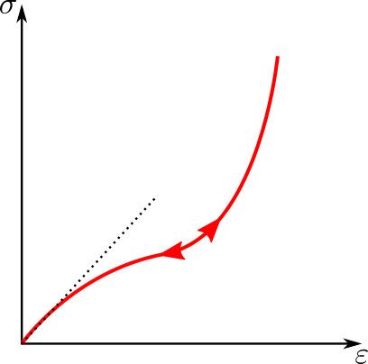

# Neo-Hookean hyperelasticity

Keyword `neohookean` (upstream *Neo-Hookean*; parity rows MAT-025,
MAT-026; code `crates/akantu-solid/src/materials/neohookean.rs`). A
compressible Neo-Hookean law for large deformations: the law always
works in finite deformation (its constructor sets
`finite_deformation = true`), so the model assembles the
total-Lagrangian internal forces and tangent
([Finite deformation](../solid-mechanics.md#finite-deformation)).

The Neo-Hookean law extends Hooke's law to large deformations, and
predicts a nonlinear stress-strain response. Under small strains it is
very close to the linear elastic law of the same `E` and `nu` (its
tangent at $\boldsymbol{F} = \boldsymbol{I}$ is the isotropic elastic
tangent), and its response becomes nonlinear as the stretches grow.
This compressible form is a modification of the law proposed by Rivlin
(Belytschko, Liu and Moran, 2000).

## Equations

With $\boldsymbol{F} = \boldsymbol{I} + \nabla\boldsymbol{u}$,
$\boldsymbol{C} = \boldsymbol{F}^T \boldsymbol{F}$, $J = \det\boldsymbol{F}$
and the Lamé constants $\lambda = \nu E/((1 + \nu)(1 - 2\nu))$,
$\mu = E/(2(1 + \nu))$ (the 3-D formulas in every dimension; $\nu = 0$ in
1-D):

$$
\begin{aligned}
\Psi(\boldsymbol{C}) &= \frac{\lambda}{2} (\ln J)^2 - \mu \ln J
  + \frac{\mu}{2} \left(\operatorname{tr} \boldsymbol{C}_3 - 3\right) \\
\boldsymbol{S} &= 2 \frac{\partial \Psi}{\partial \boldsymbol{C}}
  = \mu \boldsymbol{I} + (\lambda \ln J - \mu)\, \boldsymbol{C}^{-1} \\
\mathbb{C}_{ijkl} &= \lambda\, C^{-1}_{ij} C^{-1}_{kl}
  + (\mu - \lambda \ln J) \left(C^{-1}_{ik} C^{-1}_{jl} + C^{-1}_{il} C^{-1}_{kj}\right)
\end{aligned}
$$

$\boldsymbol{S}$ is the second Piola–Kirchhoff stress and
$\mathbb{C} = 2\, \partial \boldsymbol{S}/\partial \boldsymbol{C}$ the
material tangent (on Voigt engineering strains, as every tangent of the
port). $\boldsymbol{C}_3$ is the 3-D right Cauchy–Green tensor of the state
the element represents: $\operatorname{tr} \boldsymbol{C}_3 =
\operatorname{tr} \boldsymbol{C} + 2$ in 1-D (lateral stretches 1),
$\operatorname{tr} \boldsymbol{C} + C_{33}$ in 2-D,
$\operatorname{tr} \boldsymbol{C}$ in 3-D.


*Figure: stress-strain curve of the Neo-Hookean law in uniaxial loading (figure of the Akantu manual).*

* 2-D plane strain (the default): $C_{33} = 1$.
* 2-D plane stress (`Plane_Stress = true`): before the stress, $C_{33} > 0$
  solves $S_{33} = 0$, i.e.
  $\frac{\lambda}{2} (\ln C_{33} + \ln \det \boldsymbol{C}_2) + \mu (C_{33} - 1) = 0$,
  by a bracketed Newton iteration to machine precision (upstream: plain
  Newton stopped at $|f| \le 10^{-5}$); $J = \det \boldsymbol{F}_2 \sqrt{C_{33}}$,
  and the tangent is the in-plane tangent condensed on $S_{33} = 0$
  ($\tilde{\mathbb{C}}_{mn} = \mathbb{C}_{mn} - \mathbb{C}_{m33}\, \mathbb{C}_{33n} / \mathbb{C}_{3333}$).

The law's stress is $\boldsymbol{S}$; the Cauchy stress
$\boldsymbol{\sigma} = \boldsymbol{F} \boldsymbol{S} \boldsymbol{F}^T / J$ of the
`stress` internal field is computed when the model is dumped, as for
every finite-deformation law. The potential energy is $\Psi$.

## Keywords

The law inherits the common keywords only (not the thermal keywords of
`elastic`: it registers no `alpha` and no `delta_T`).

<!-- law-keywords: neohookean inherits=base -->
| Keyword | Meaning | Unit | Default |
|---|---|---|---|
| `E` | Young's modulus of the small-strain limit | stress | `0` |
| `nu` | Poisson's ratio of the small-strain limit | 1 | `0.5` |
| `Plane_Stress` | 2-D only: plane stress (`S33 = 0`) instead of plane strain | bool | `false` |

`E` must be set, and `nu` must be below `0.5` (the default `0.5` makes
$\lambda$ infinite, as upstream).

Internal fields (besides the common ones):

<!-- law-internals: neohookean -->
Internal fields: `piola_kirchhoff_2` and `green_strain` (the
finite-deformation storage of the material base, present because the law
always works in finite deformation).

## Example

A uniaxial stretch $\lambda_1 = 1.2$ of the unit cube
($\boldsymbol{F} = \operatorname{diag}(\lambda_1, 1, 1)$,
so $\boldsymbol{C} = \operatorname{diag}(\lambda_1^2, 1, 1)$ and $J = \lambda_1$) gives
$S_{11} = \mu + (\lambda \ln \lambda_1 - \mu)/\lambda_1^2$ and $S_{22} = S_{33} = \lambda \ln \lambda_1$:

```rust
# use akantu::core::enums::{AnalysisMethod, MeshIoType};
# use akantu::core::{ElementType, GhostType};
# use akantu::mesh::{Mesh, SharedMesh};
# use akantu::model::ModelOptions;
# use akantu::parser::{ParamValue, ParameterRegistry, Parser};
# use akantu::solid::SolidMechanicsModel;
# fn model_on(mesh: &str, input: &str) -> akantu::core::Result<SolidMechanicsModel> {
#     let dim = if mesh == "cube.msh" { 3 } else { 2 };
#     let file = std::path::Path::new(env!("CARGO_MANIFEST_DIR"))
#         .join("../../docs/manual/src/meshes")
#         .join(mesh);
#     let mut m = Mesh::new(dim, "mesh")?;
#     akantu::io::read_mesh(&mut m, &file, MeshIoType::Auto)?;
#     let parser = Parser::parse_str(input, "material.dat")?;
#     let mut model =
#         SolidMechanicsModel::with_parser(SharedMesh::new(m), None, "solid_mechanics_model", parser)?;
#     model.init_full(&ModelOptions::new(AnalysisMethod::Static))?;
#     Ok(model)
# }
# /// u = H X at every node (`h` row-major): a uniform displacement gradient
# fn impose_gradient(model: &mut SolidMechanicsModel, h: &[f64]) -> akantu::core::Result<()> {
#     let dim = if h.len() == 9 { 3 } else { 2 };
#     let x: Vec<f64> = model.physics.base.mesh.read()?.nodes().as_slice().to_vec();
#     for (u, x) in model.displacement_mut()?.tuples_mut().zip(x.chunks(dim)) {
#         for i in 0..dim {
#             u[i] = (0..dim).map(|j| h[i * dim + j] * x[j]).sum();
#         }
#     }
#     Ok(())
# }
let input = "material neohookean [\n name = rubber\n rho = 1\n E = 10\n nu = 0.25\n]\n";
let mut model = model_on("cube.msh", input)?;
// the constructor sets finite_deformation
assert_eq!(model.material(0)?.get_param("finite_deformation")?, ParamValue::Bool(true));

let stretch: f64 = 1.2;
impose_gradient(&mut model, &[stretch - 1.0, 0.0, 0.0, 0.0, 0.0, 0.0, 0.0, 0.0, 0.0])?;
model.assemble_internal_forces()?; // the law computes S at every quadrature point

let (e, nu) = (10.0, 0.25);
let lambda = nu * e / ((1.0 + nu) * (1.0 - 2.0 * nu));
let mu = e / (2.0 * (1.0 + nu));
let s11 = mu + (lambda * stretch.ln() - mu) / (stretch * stretch);
let s22 = lambda * stretch.ln();
let law = model.material(0)?;
let pk2 = law.base().piola_kirchhoff_2.as_ref().unwrap();
for s in pk2.get(ElementType::Hexahedron8, GhostType::NotGhost)?.tuples() {
    // column-major 3 × 3: s[0] = S11, s[4] = S22, s[8] = S33
    assert!((s[0] - s11).abs() <= 1e-12 * s11.abs());
    assert!((s[4] - s22).abs() <= 1e-12 * s22.abs());
    assert!((s[8] - s22).abs() <= 1e-12 * s22.abs());
    assert!(s[1].abs() <= 1e-12 * s11.abs());
}
# Ok::<(), akantu::core::Error>(())
```

## Differences from upstream

* Upstream's law does not compute. Upstream's `computeStress`,
  `computeTangentModuli` and `computePotentialEnergy` of `neohookean`
  reach `AKANTU_TO_IMPLEMENT` (UD-026), although upstream's manual
  documents the law; its energy kernel has wrong factors and omits $C_{33}$,
  and its plane-stress tangent is not condensed (UD-057). The port
  implements the documented law. `LawOptions::neohookean =
  NeohookeanMode::UpstreamNotImplemented` reproduces upstream's errors
  (part of `LawOptions::upstream()`).
* An inverted element ($J = \det(\boldsymbol{F}) \sqrt{C_{33}} \le 0$, or not finite) is
  `Error::Numerical`; upstream's `log(J)` gives NaN.
* Upstream's `updateInternalParameters` of this law skips the material
  base's update, so a parsed `eigen_grad_u` never reaches the internal
  field; the port runs the base update (upstream's behaviour in the
  `UpstreamNotImplemented` mode).

Tests: `crates/akantu-solid/tests/test_finite_def_materials.rs`
(`neohookean_compute_stress_stretches`, `neohookean_plane_stress_s33_vanishes`,
`neohookean_zero_stress_under_rotation_and_frame_indifference`,
`neohookean_energy_density_is_the_potential_of_the_stress`,
`neohookean_tangent_is_the_derivative_of_the_stress`,
`neohookean_small_strain_limit_is_linear_elasticity`,
`neohookean_upstream_mode_is_not_implemented`),
`crates/akantu-solid/tests/model_neohookean.rs` (the assembled forces and
tangent) and `neohookean_kernel_fixtures.rs` (oracle kernel fixtures).

## References

* Belytschko, T., Liu, W. K. and Moran, B. (2000). *Nonlinear Finite
  Elements for Continua and Structures*. Wiley.
