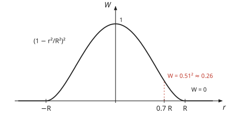

# Non-local laws

Softening damage laws lose objectivity under mesh refinement: the damage
localises in one row of elements and the dissipated energy depends on
the element size. The cause is the softening itself: once the damage
grows fast enough, the equations of equilibrium lose ellipticity and the
local problem has no length scale that would fix the width of the damaged
band. The non-local laws replace a local quantity by its
weighted average over a neighbourhood whose size is a material length
(upstream *Non-local constitutive laws*; the size of that neighbourhood
stands for the material's microstructure, for instance the aggregates of
a concrete; upstream package
`damage_non_local`, the crate feature `damage-non-local` of
`akantu-solid`, on by default; code
`crates/akantu-solid/src/materials/non_local/` and the non-local manager
`akantu::model::non_local`).

| Keyword | Local law | Averaged quantity → non-local internal field |
|---|---|---|
| `marigo_non_local` | `marigo` | `Y` → `Y non local` |
| `mazars_non_local` | `mazars` | `Ehat` ($\hat{\varepsilon}$, default) or `damage` (`average_on_damage = true`) → `non_local_variable` |
| `plastic_mazars_non_local` | `plastic_mazars` | as `mazars_non_local` |

The keywords, equations and internal fields are those of the local law
([Damage](damage.md)), plus the averaged field, and `average_on_damage`
for the two Mazars laws. During `assemble_internal_forces` (every
residual) the model computes the local quantities of every law, averages
them over each neighbourhood, and then completes the stress with the
averaged value:

* `marigo_non_local`: the damage update of `marigo` with $Y$ replaced by
  its average $\bar{Y}$ ($F = \bar{Y} - Y_d - S_d\, d_n$, …);
* `mazars_non_local`: the damage update of `mazars` with $\hat{\varepsilon}$ replaced by
  its average; with `average_on_damage = true` the stress is
  $(1 - \bar{d})\, \boldsymbol{\sigma}_\text{el}$ with the averaged damage $\bar{d}$ (the law's own `damage`
  field keeps the local value).

<!-- law-keywords: marigo_non_local inherits=elastic -->
| Keyword | Meaning | Unit | Default |
|---|---|---|---|
| `Yd` | damage threshold on `Ȳ` (random parameter) | stress | `0` |
| `Sd` | damage softening | stress | `5000` |
| `epsilon_c` | critical strain of the cap on `Y` | 1 | `0` |
| `damage_in_y` | use `(1 − d_n) Y` | bool | `false` |

<!-- law-internals: marigo_non_local -->
Internal fields: those of the local law (`damage`, `damage dissipated
energy`, `integral of sigma`, `Y`, `Yd`) and `Y non local`.

<!-- law-keywords: mazars_non_local inherits=elastic -->
| Keyword | Meaning | Unit | Default |
|---|---|---|---|
| `average_on_damage` | average the damage instead of `ε̂` | bool | `false` |
| `K0` | damage threshold on `ε̂` (random parameter) | 1 | `0` |
| `At` | tension: asymptotic parameter | 1 | `0.8` |
| `Bt` | tension: decay parameter | 1 | `12000` |
| `Ac` | compression: asymptotic parameter | 1 | `1.4` |
| `Bc` | compression: decay parameter | 1 | `1900` |
| `beta` | shear parameter | 1 | `1.06` |

<!-- law-internals: mazars_non_local -->
Internal fields: those of the local law (`damage`, `damage dissipated
energy`, `integral of sigma`, `K0`, `Ehat`) and `non_local_variable`.

<!-- law-keywords: plastic_mazars_non_local inherits=elastic -->
| Keyword | Meaning | Unit | Default |
|---|---|---|---|
| `average_on_damage` | average the damage instead of `ε̂` | bool | `false` |
| `sigma_y` | initial yield stress | stress | `0` |
| `h` | hardening modulus | stress | `0` |
| `K0` | damage threshold on `ε̂` (random parameter) | 1 | `0` |
| `At` | tension: asymptotic parameter | 1 | `0.8` |
| `Bt` | tension: decay parameter | 1 | `12000` |
| `Ac` | compression: asymptotic parameter | 1 | `1.4` |
| `Bc` | compression: decay parameter | 1 | `1900` |
| `beta` | shear parameter | 1 | `1.06` |

<!-- law-internals: plastic_mazars_non_local -->
Internal fields: those of the local law (`iso_hardening`,
`inelastic_strain`, `plastic_energy`, `d_plastic_energy`, `damage`,
`damage dissipated energy`, `integral of sigma`, `K0`, `Ehat`,
`effective_stress`) and `non_local_variable`.

## The `non_local` section

Each non-local law needs a neighbourhood, given by a `non_local` section
whose name is the material's name and whose option is the weight
function:

```dat
material mazars_non_local [
    name = concrete
    rho  = 2400
    E    = 30e9
    nu   = 0.2
    K0   = 1e-4
]

non_local concrete base_wf [
    radius = 0.05
    weight_function weight_parameter [
        update_rate = 1
    ]
]
```

`radius` is the non-local radius $R$. In the continuum, the non-local
counterpart $\bar{v}$ of a local quantity $v$ (upstream writes it for the
damage, $\bar{d}$) is a weighted integral over the body $V$,

$$
\bar{v}(\boldsymbol{x}) = \frac{\int_V W(\boldsymbol{x}, \boldsymbol{y})\, v(\boldsymbol{y})\, \mathrm{d}V(\boldsymbol{y})}
  {\int_V W(\boldsymbol{x}, \boldsymbol{y})\, \mathrm{d}V(\boldsymbol{y})},
$$

where the weight $W$ vanishes beyond the distance $R$. The model
evaluates it with the quadrature rule of the elements: the average of $v$
at the quadrature point $\boldsymbol{x}_i$ is

$$
\bar{v}_i = \frac{\sum_j W(r_{ij})\, J_j\, v_j}{\sum_j W(r_{ij})\, J_j}
$$

over the quadrature points $\boldsymbol{x}_j$ within $R$ of $\boldsymbol{x}_i$
($r_{ij} = \lVert \boldsymbol{x}_i - \boldsymbol{x}_j \rVert$,
$J_j$ the integration weight of point $j$), so a uniform field is its own
average. The weight functions registered (the option of the section):

| Option | Weight $W$ |
|---|---|
| `base_wf` | $\max(0,\ 1 - r^2/R^2)^2$ (bell shape) |
| `damage_wf` | $\max(0,\ 1 - r^2/R^4)^b$ with an even exponent $b$ that grows with the damage $D$ of the neighbour ($b$ is $\lfloor e \rfloor$ rounded up to even, $e = 2 \ln 0.51 / \ln\left(1 - 0.49\, (1 - D)^2\right)$), so a damaged neighbour weighs less; the $R^4$ is upstream's formula, kept (UD-557) |
| `remove_wf` | $\max(0,\ 1 - r^2/R^2)^2$ for the neighbours whose damage is below `damage_limit`, 0 for the others (1 for the point itself) |


*Figure: the weight of `base_wf` over the distance $r$ between two points; it vanishes beyond the radius $R$, and $W = 0.51^2$ at $r = 0.7 R$ is the value that `damage_wf` keeps at its shrunken radius.*

For `damage_wf`, the constant $0.51$ comes from the bell: at an undamaged
neighbour ($D = 0$) the exponent is $e = 2$ and $W = (1 - r^2/R^4)^2$,
the bell of `base_wf` with $R^4$ in place of $R^2$ (the two agree for
$R = 1$), which equals $0.51^2$ at $r^2 = 0.49 R^4$. For a damaged
neighbour the exponent is chosen so that $(1 - 0.49\, (1 - D)^2)^e = 0.51^2$:
$W$ takes about that value (up to the rounding of $e$ to $b$) at
$r^2 = 0.49\, (1 - D)^2 R^4$ instead: the
interaction radius shrinks with the damage, and a fully damaged point
keeps only itself. `remove_wf` cuts the neighbours that have reached the
damage limit out of the average altogether.

The sub-section `weight_function weight_parameter [ … ]` holds the
parameters of the weight function: `update_rate` (default 1: the weights
are recomputed at every `update_rate`-th stress computation; 0: never
after the first) and, for `remove_wf`, `damage_limit` (default 1). The neighbour search uses a spatial grid; the pairs of
quadrature points are built at `init_full`.

Differences from upstream:

* UD-027. Upstream registers the *local* `marigo` law under the
  keyword `marigo_non_local`, so its non-local Marigo law is unreachable
  from input files and the `non_local` section is ignored. The port
  registers the non-local law;
  `akantu::solid::materials::non_local::register_upstream_marigo_non_local(&mut model.physics.factory)`
  (before `init_full`) restores upstream's registration for comparisons
  with the oracle.
* Weight-function names (UD-1133). Upstream's manual names the weight
  functions `base_weight_function`, `damaged_weight_function`,
  `remove_damaged_weight_function`,
  `remove_damaged_with_damage_rate_weight_function` and
  `stress_based_weight_function`; the options that upstream's code
  registers, and the port with it, are `base_wf`, `damage_wf` and
  `remove_wf`. The other two classes are not registered upstream (one is a
  header only, the other's computations are commented out); the port has
  them as types (`RemoveDamagedWithDamageRateWeightFunction`,
  `StressBasedWeightFunction`, the ellipsoidal weight built from the
  stress state of Giry and Dufour, 2013), not as options.
* What is averaged (UD-1133). Upstream's manual presents the non-local
  model as $\boldsymbol{\sigma} = (1 - \bar{d})\, \mathbb{C} : \boldsymbol{\varepsilon}$
  with the averaged damage $\bar{d}$; in the code
  (upstream and port) only `average_on_damage = true` of the Mazars laws
  averages the damage: by default `mazars_non_local` averages $\hat{\varepsilon}$ and
  `marigo_non_local` always averages `Y`.
* On a distributed mesh `init_full` refuses a model with a non-local law
  (`Error::Unsupported`, the same error on every rank; test
  `crates/akantu-solid/tests/non_local_parallel.rs::non_local_laws_refuse_a_distributed_mesh`).

A user law can be non-local too: see
[Writing a non-local law](../new-constitutive-laws.md#writing-a-non-local-law).

Tests: `crates/akantu-solid/tests/non_local_materials.rs`
(`non_local_laws_follow_their_local_law_under_uniform_strain`,
`average_on_damage_selects_the_variable`,
`ud027_marigo_non_local_registration`, `weight_function_formulas`),
`upstream_material_non_local.rs` (upstream's `test_material_non_local`
and `test_material_damage_non_local`), `non_local_fixtures.rs` (oracle
replays) and `upstream_non_local_toolbox.rs`.

## Example

Under a uniform strain the averaged $Y$ equals the local one, so
`marigo_non_local` gives the damage of the `marigo` example of
[Damage](damage.md#example), $d = 0.25$:

```rust
# use akantu::core::enums::{AnalysisMethod, MeshIoType};
# use akantu::core::{ElementType, GhostType};
# use akantu::mesh::{Mesh, SharedMesh};
# use akantu::model::constitutive_law::{ConstitutiveLaw, InternalFieldRef};
# use akantu::model::ModelOptions;
# use akantu::parser::Parser;
# use akantu::solid::SolidMechanicsModel;
# fn model_on(mesh: &str, input: &str) -> akantu::core::Result<SolidMechanicsModel> {
#     let dim = if mesh == "cube.msh" { 3 } else { 2 };
#     let file = std::path::Path::new(env!("CARGO_MANIFEST_DIR"))
#         .join("../../docs/manual/src/meshes")
#         .join(mesh);
#     let mut m = Mesh::new(dim, "mesh")?;
#     akantu::io::read_mesh(&mut m, &file, MeshIoType::Auto)?;
#     let parser = Parser::parse_str(input, "material.dat")?;
#     let mut model =
#         SolidMechanicsModel::with_parser(SharedMesh::new(m), None, "solid_mechanics_model", parser)?;
#     model.init_full(&ModelOptions::new(AnalysisMethod::Static))?;
#     Ok(model)
# }
# fn impose_gradient(model: &mut SolidMechanicsModel, h: &[f64]) -> akantu::core::Result<()> {
#     let dim = if h.len() == 9 { 3 } else { 2 };
#     let x: Vec<f64> = model.physics.base.mesh.read()?.nodes().as_slice().to_vec();
#     for (u, x) in model.displacement_mut()?.tuples_mut().zip(x.chunks(dim)) {
#         for i in 0..dim {
#             u[i] = (0..dim).map(|j| h[i * dim + j] * x[j]).sum();
#         }
#     }
#     Ok(())
# }
# fn internal(model: &SolidMechanicsModel, name: &str, ty: ElementType) -> akantu::core::Result<Vec<f64>> {
#     let mut out = None;
#     model.material(0)?.for_each_internal(&mut |n, f| {
#         if let (true, InternalFieldRef::Real(f)) = (n == name, f) {
#             out = f.get(ty, GhostType::NotGhost).ok().map(|a| a.as_slice().to_vec());
#         }
#     });
#     out.ok_or_else(|| akantu::core::Error::invalid(format!("no internal {name}")))
# }
let input = "material marigo_non_local [
    name = concrete
    rho  = 1
    E    = 16
    nu   = 0
    Yd   = 1
    Sd   = 4
]

non_local concrete base_wf [
    radius = 0.6
]";
let mut model = model_on("square.msh", input)?;
assert!(model.non_local_manager().is_some()); // created because a law is non-local

impose_gradient(&mut model, &[0.5, 0.0, 0.0, 0.0])?;
model.assemble_internal_forces()?; // local Y, average, then the damage

let quad = ElementType::Quadrangle4;
for y in internal(&model, "Y non local", quad)? {
    assert!((y - 2.0).abs() <= 1e-12 * 2.0);
}
for d in internal(&model, "damage", quad)? {
    assert!((d - 0.25).abs() <= 1e-12 * 0.25);
}
# Ok::<(), akantu::core::Error>(())
```

## References

* Giry, C. and Dufour, F. (2013). Stress-based non-local damage model.
  In *Damage Mechanics of Cementitious Materials and Structures*, John
  Wiley & Sons, pp. 51–88.
