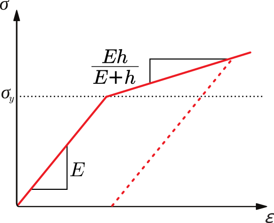

# Plasticity

Two small-strain elasto-plastic laws with an additive split of the
strain, $\boldsymbol{\varepsilon} = \boldsymbol{\varepsilon}^e + \boldsymbol{\varepsilon}^p$, and an elastic stress $\boldsymbol{\sigma} = \mathbb{C}:(\boldsymbol{\varepsilon} - \boldsymbol{\varepsilon}^p)$ (upstream
*Plastic*; code `crates/akantu-solid/src/materials/plastic.rs` and
`drucker_prager.rs`). Both are incremental: the stress of a step starts
from the stress and plastic strain committed at the end of the previous
converged step.

The additive decomposition is valid for infinitesimal deformations. With
the isotropic elastic operator the elastic part of the law is

$$
\boldsymbol{\sigma} = 2\mu\, \boldsymbol{\varepsilon}^e + \lambda \operatorname{tr}(\boldsymbol{\varepsilon}^e) \boldsymbol{I},
$$

with the Lamé coefficients $\lambda$ and $\mu$ of `E` and `nu`
([Materials](../materials.md#isotropic-hooke-law)).

## Von Mises plasticity with linear isotropic hardening: `plastic_linear_isotropic_hardening`

In this law plastic flow is a shearing process: the hydrostatic stress
does not contribute to yielding, and the plastic flow does not change the
volume. Yielding occurs when the elastic shear energy reaches a critical
value, which is the von Mises criterion.


*Figure: uniaxial stress-strain curve of small-deformation plasticity with linear isotropic hardening (figure of the Akantu manual).*

Yield function $f = \sigma_{eq} - (\sigma_y + r)$, with the von Mises stress
$\sigma_{eq} = \sqrt{\tfrac{3}{2}\, \boldsymbol{s}:\boldsymbol{s}}$ of the deviator $\boldsymbol{s} = \boldsymbol{\sigma} - (\operatorname{tr} \boldsymbol{\sigma}/3) \boldsymbol{I}$ and the
isotropic hardening $r$ (internal `iso_hardening`), and associated flow.
The deformation is elastic while $f < 0$ and plastic when $f = 0$. After
yielding, the normality rule gives the direction of the plastic flow,
normal to the yield surface at the stress point,

$$
\Delta\boldsymbol{\varepsilon}^p = \Delta p\, \frac{\partial f}{\partial \boldsymbol{\sigma}}
= \frac{3}{2}\, \Delta p\, \frac{\boldsymbol{s}}{\sigma_{eq}},
$$

and the plastic multiplier $\Delta p$ (the increment of the accumulated
plastic strain $p$) follows from the consistency condition, which keeps
the stress on the yield surface during plastic loading. The hardening is
linear in $p$: $r = h\, p$ with the hardening modulus $h$ (`h`). In
uniaxial stress the slope of the curve after yield is $E h / (E + h)$.

The radial return of one step, with the committed values $\boldsymbol{\sigma}_n$, $r_n$,
$\boldsymbol{\varepsilon}^p_n$, the strain increment $\Delta\boldsymbol{\varepsilon}$ and the shear modulus $\mu$:

$$
\begin{aligned}
\boldsymbol{\sigma}^{tr} &= \boldsymbol{\sigma}_n + \mathbb{C}:\Delta\boldsymbol{\varepsilon} && \text{(trial stress)} \\
f^{tr} &= \sigma_{eq}(\boldsymbol{\sigma}^{tr}) - \sigma_y - r_n \\
\text{if } f^{tr} > 0: \quad \Delta p &= \frac{f^{tr}}{3\mu + h}, \qquad
\Delta\boldsymbol{\varepsilon}^p = \frac{3}{2}\, \Delta p\, \frac{\boldsymbol{s}^{tr}}{\sigma_{eq}(\boldsymbol{\sigma}^{tr})}, \qquad
r = r_n + h\, \Delta p \\
\text{else:} \quad \Delta p &= 0, \qquad \Delta\boldsymbol{\varepsilon}^p = \boldsymbol{0}, \qquad r = r_n \\
\boldsymbol{\sigma} &= \boldsymbol{\sigma}_n + \mathbb{C}:(\Delta\boldsymbol{\varepsilon} - \Delta\boldsymbol{\varepsilon}^p), \qquad
\boldsymbol{\varepsilon}^p = \boldsymbol{\varepsilon}^p_n + \Delta\boldsymbol{\varepsilon}^p
\end{aligned}
$$

The plastic strain increment is deviatoric and parallel to
$\boldsymbol{s}^{tr}$, so it scales the trial deviator without turning it
(hence "radial" return): $\boldsymbol{s} = \boldsymbol{s}^{tr}\,(1 - 3\mu\,\Delta p / \sigma_{eq}(\boldsymbol{\sigma}^{tr}))$
and $\sigma_{eq}(\boldsymbol{\sigma}) = \sigma_{eq}(\boldsymbol{\sigma}^{tr}) - 3\mu\,\Delta p$.
The consistency condition
$\sigma_{eq}(\boldsymbol{\sigma}^{tr}) - 3\mu\,\Delta p = \sigma_y + r_n + h\,\Delta p$
gives the $\Delta p$ above. The return is an implicit (backward Euler)
integration: unconditionally stable, with an accuracy that depends on the
size of the step.

In 3-D this is upstream's algorithm; with linear hardening the
return is exact in one step (upstream's manual writes it as an
iteration on $\Delta p$,
$\mathrm{d}\Delta p = (\sigma^{tr}_{eq} - 3\mu\,\Delta p^{(k)} - \sigma_y^{(k)})/(3\mu + h)$,
whose first iterate is already the solution). In 1-D and 2-D the port returns the represented 3-D
state consistently (`LawOptions::j2_reduced_return =
J2ReducedReturn::Consistent`, UD-137): 1-D uniaxial stress with
$\Delta p = f^{tr}/(E + h)$, plane strain with the out-of-plane stress tracked
(isochoric flow, $\varepsilon^p_{33} = -\operatorname{tr} \boldsymbol{\varepsilon}^p$), plane stress with the plane-stress
projection ($\sigma_{33} = 0$ exactly), so the returned stress lies on the yield
surface; upstream truncates the 3-D return to the in-plane block
(`J2ReducedReturn::UpstreamTruncated` reproduces it).

The tangent is the elastic tangent $\mathbb{C}$ (not the consistent elasto-plastic
tangent: UD-079, kept as upstream), so a Newton solve of a plastic step
converges linearly. Energies: `potential` $\frac{1}{2} \boldsymbol{\sigma}:(\boldsymbol{\varepsilon} - \boldsymbol{\varepsilon}^p)$, and `plastic`,
the plastic work $\sum \frac{1}{2}(\boldsymbol{\sigma} + \boldsymbol{\sigma}_n):\Delta\boldsymbol{\varepsilon}^p$ accumulated after converged steps.

<!-- law-keywords: plastic_linear_isotropic_hardening inherits=elastic -->
| Keyword | Meaning | Unit | Default |
|---|---|---|---|
| `sigma_y` | initial yield stress $\sigma_y$ | stress | `0` |
| `h` | hardening modulus (slope of $r$ against the accumulated plastic strain $p$) | stress | `0` |

<!-- law-internals: plastic_linear_isotropic_hardening -->
Internal fields: `iso_hardening` ($r$, with history), `inelastic_strain`
($\boldsymbol{\varepsilon}^p$, $\text{dim}^2$ components, with history), `plastic_energy` (accumulated
plastic work) and `d_plastic_energy` (plastic work of the last converged
step).

Differences from upstream (switches of `LawOptions`):

* `finite_strain_plasticity` (UD-030): with `finite_deformation = true`
  upstream runs a finite-strain computation and then overwrites its result
  with the small-strain kernel on the raw $\nabla\boldsymbol{u}$; the default refuses the
  combination (`Error::Unsupported` from the stress computation),
  `FiniteStrainPlasticity::UpstreamLegacy` reproduces upstream.
* `plastic_thermal_increment` (UD-038): with a temperature change
  upstream's trial stress uses the thermal increment with the wrong sign
  and the final stress drops it; the default uses $\sigma_{th} - \sigma_{th,n}$ in
  both.
* `committed_trial_state` (UD-138): upstream's yield test of a trial
  uses the hardening of the previous evaluation, so the rejected trials
  of a Newton step influence the next ones; the default uses the
  committed state.
* `j2_reduced_return` (UD-137): see above.

Tests: `crates/akantu-solid/tests/inelastic_properties.rs`
(`j2_return_mapping_unloading_and_plastic_work`,
`j2_uniaxial_1d_upstream_return_formula`,
`ud030_finite_strain_plasticity_is_unsupported_by_default`,
`ud038_thermal_state_of_inelastic_laws`),
`upstream_material_elasto_plastic_linear_isotropic_hardening.rs` (upstream's
test, bitwise against the oracle, and the corrected return),
`test_plastic_materials.rs` and `review_v32_regressions.rs` (UD-137,
UD-138).

## Drucker–Prager plasticity: `plastic_drucker_prager`

Perfect plasticity (no hardening) with the Drucker–Prager yield function

$$
\begin{aligned}
f(\boldsymbol{\sigma}) &= \sqrt{3 J_2} + \alpha \operatorname{tr} \boldsymbol{\sigma} - k, \qquad
J_2 = \tfrac{1}{2}\, \boldsymbol{s}:\boldsymbol{s}, \qquad
\boldsymbol{s} = \boldsymbol{\sigma} - (\operatorname{tr} \boldsymbol{\sigma} / \text{dim})\, \boldsymbol{I} \\
\alpha &= \frac{6 \sin\varphi}{3 - \sin\varphi}, \qquad
c = \frac{f_c (1 - \sin\varphi)}{2 \cos\varphi}, \qquad
k = \frac{6 c \cos\varphi}{3 - \sin\varphi}
\end{aligned}
$$

with the friction angle $\varphi$ (given in degrees) and the compressive
strength $f_c$; the deviator subtracts $\operatorname{tr} \boldsymbol{\sigma} / \text{dim}$ (the $\text{dim}$-dimensional
deviator, as upstream). The trial stress is $\boldsymbol{\sigma}_n + \mathbb{C}:\Delta\boldsymbol{\varepsilon}$; if $f > 0$ the
stress is projected on the yield surface by the closed-form
closest-point projection for the isotropic elastic operator: the regular
return on the cone, or the apex $\boldsymbol{\sigma} = k/(\text{dim} \cdot \alpha)\, \boldsymbol{I}$ when the exact
criterion selects it; with `radial_return = true` the return keeps the
pressure fixed. The tangent is the elastic tangent; `finite_deformation`
is refused (`Error::NotImplemented`, as upstream). The keywords `h` and
`sigma_y` are registered (the law shares the plastic base of the von
Mises law) but the yield function does not use them.

<!-- law-keywords: plastic_drucker_prager inherits=elastic -->
| Keyword | Meaning | Unit | Default |
|---|---|---|---|
| `phi` | friction angle $\varphi$ | degree | `0` |
| `fc` | compressive strength | stress | `1` |
| `radial_return` | return at fixed pressure | bool | `true` |
| `sigma_y` | registered, unused by this law | stress | `0` |
| `h` | registered, unused by this law | stress | `0` |

<!-- law-internals: plastic_drucker_prager -->
Internal fields: `iso_hardening` (unused, 0), `inelastic_strain`
($\boldsymbol{\varepsilon}^p$), `plastic_energy`, `d_plastic_energy`, as the von Mises law.

Differences from upstream: `LawOptions::drucker_prager_return`
(UD-144…146): upstream's return is an iteration (an apex loop without
iteration limit, a Newton loop stopped after 100 iterations, a Voigt
Kronecker vector whose shear components are uninitialised); the default
is the closed-form projection above, and degenerate yield surfaces or
non-finite results are `Error::Numerical`.
`DruckerPragerReturn::UpstreamIteration` reproduces upstream's iterations
where they give a finite result. The thermal increment follows
`plastic_thermal_increment` (UD-038), as for the von Mises law.

Tests: `crates/akantu-solid/tests/inelastic_properties.rs`
(`drucker_prager_projection_and_unloading`,
`drucker_prager_apex_projection_matches_upstream_formula`),
`review_v32_regressions.rs` (UD-144…146) and the oracle fixtures of
`inelastic_material_fixtures.rs`.

## Example

Simple shear $u_x = \gamma y$ of the unit cube beyond yield: the trial
stress $\sigma_{xy} = \mu\gamma$ has the von Mises stress $\sqrt{3}\, \mu\gamma$, the return gives
$\Delta p = (\sqrt{3}\, \mu\gamma - \sigma_y)/(3\mu + h)$, the hardening $r = h\, \Delta p$ and the shear
stress $\sigma_{xy} = (\sigma_y + h\, \Delta p)/\sqrt{3}$ (back on the yield surface):

```rust
# use akantu::core::enums::{AnalysisMethod, MeshIoType};
# use akantu::core::{ElementType, GhostType};
# use akantu::mesh::{Mesh, SharedMesh};
# use akantu::model::constitutive_law::{ConstitutiveLaw, InternalFieldRef};
# use akantu::model::ModelOptions;
# use akantu::parser::Parser;
# use akantu::solid::SolidMechanicsModel;
# fn model_on(mesh: &str, input: &str) -> akantu::core::Result<SolidMechanicsModel> {
#     let dim = if mesh == "cube.msh" { 3 } else { 2 };
#     let file = std::path::Path::new(env!("CARGO_MANIFEST_DIR"))
#         .join("../../docs/manual/src/meshes")
#         .join(mesh);
#     let mut m = Mesh::new(dim, "mesh")?;
#     akantu::io::read_mesh(&mut m, &file, MeshIoType::Auto)?;
#     let parser = Parser::parse_str(input, "material.dat")?;
#     let mut model =
#         SolidMechanicsModel::with_parser(SharedMesh::new(m), None, "solid_mechanics_model", parser)?;
#     model.init_full(&ModelOptions::new(AnalysisMethod::Static))?;
#     Ok(model)
# }
# fn impose_gradient(model: &mut SolidMechanicsModel, h: &[f64]) -> akantu::core::Result<()> {
#     let dim = if h.len() == 9 { 3 } else { 2 };
#     let x: Vec<f64> = model.physics.base.mesh.read()?.nodes().as_slice().to_vec();
#     for (u, x) in model.displacement_mut()?.tuples_mut().zip(x.chunks(dim)) {
#         for i in 0..dim {
#             u[i] = (0..dim).map(|j| h[i * dim + j] * x[j]).sum();
#         }
#     }
#     Ok(())
# }
# /// The values of the internal field `name` of the first law on `ty`.
# fn internal(model: &SolidMechanicsModel, name: &str, ty: ElementType) -> akantu::core::Result<Vec<f64>> {
#     let mut out = None;
#     model.material(0)?.for_each_internal(&mut |n, f| {
#         if let (true, InternalFieldRef::Real(f)) = (n == name, f) {
#             out = f.get(ty, GhostType::NotGhost).ok().map(|a| a.as_slice().to_vec());
#         }
#     });
#     out.ok_or_else(|| akantu::core::Error::invalid(format!("no internal {name}")))
# }
let input = "material plastic_linear_isotropic_hardening [
    name    = steel
    rho     = 1
    E       = 2.5    # μ = E/(2(1 + ν)) = 1
    nu      = 0.25
    sigma_y = 1
    h       = 0.5
]";
let mut model = model_on("cube.msh", input)?;
let gamma = 2.0;
impose_gradient(&mut model, &[0.0, gamma, 0.0, 0.0, 0.0, 0.0, 0.0, 0.0, 0.0])?;
model.assemble_internal_forces()?; // one return from the virgin state

let (mu, sigma_y, h) = (1.0_f64, 1.0_f64, 0.5_f64);
let dp = (3f64.sqrt() * mu * gamma - sigma_y) / (3.0 * mu + h);
let tau = (sigma_y + h * dp) / 3f64.sqrt();
let hex = ElementType::Hexahedron8;
let stress = model.material(0)?.base().stress.get(hex, GhostType::NotGhost)?;
for s in stress.tuples() {
    // column-major 3 × 3: s[1] = σyx, s[3] = σxy
    assert!((s[1] - tau).abs() <= 1e-12 * tau && (s[3] - tau).abs() <= 1e-12 * tau);
    assert!(s[0].abs() <= 1e-12 * tau && s[4].abs() <= 1e-12 * tau);
}
drop(stress);
for r in internal(&model, "iso_hardening", hex)? {
    assert!((r - h * dp).abs() <= 1e-12 * h * dp);
}
for ep in internal(&model, "inelastic_strain", hex)?.chunks(9) {
    // Δεᵖ_xy = (3/2) Δp s_xy / σ_eq = (√3/2) Δp
    assert!((ep[3] - 3f64.sqrt() / 2.0 * dp).abs() <= 1e-12 * dp);
}
# Ok::<(), akantu::core::Error>(())
```
