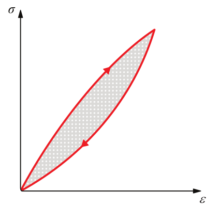
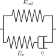
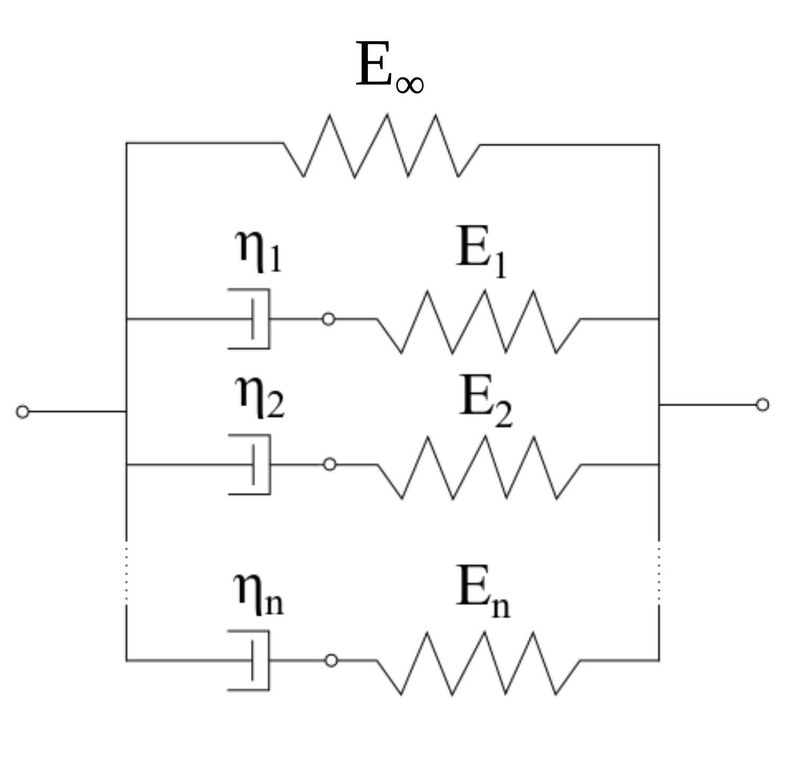

# Viscoelastic laws

Two small-strain viscoelastic laws (upstream *Visco-Elastic*; code
`crates/akantu-solid/src/materials/sls_deviatoric.rs` and `maxwell.rs`).
Both read the model's time step $\Delta t$: set it with
`model.set_time_step(dt, None)` before the first solve, also in a static
analysis (a quasi-static loading history).

Viscoelasticity is a strain-rate dependent behaviour: the stress depends
on how fast the strain was applied, and a material loaded at constant
strain relaxes (its stress decreases) while one loaded at constant stress
creeps (its strain increases). A viscoelastic material dissipates energy
when it deforms, which shows as a hysteresis loop in the stress-strain
curve of every loading cycle. Every material behaves viscoelastically
under some conditions (high temperatures, for instance). Both laws are
rheological models: springs, which store energy, and dashpots, whose
stress is proportional to their strain rate, $\sigma = \eta \dot{\varepsilon}$
with the viscosity $\eta$.


*Figure: characteristic stress-strain behaviour of a viscoelastic material, with its hysteresis loop (figure of the Akantu manual).*

## Standard linear solid: `sls_deviatoric`

A spring $E_\infty$ in parallel with a Maxwell arm (a spring $E_v$ (`Ev`) in series
with a dashpot $\eta$ (`Eta`)), acting on the deviatoric strain only; the
volumetric response is elastic with the long-term modulus. `E` is the
instantaneous modulus $E_\infty + E_v$, so $E_\infty = E - E_v$ (readable as `Einf`,
recomputed whenever the parameters change). The model describes both
creep and stress relaxation (Simo and Hughes, 1992, sections 10.2 and
10.3).


*Figure: the standard linear solid, a spring in parallel with a spring and a dashpot in series (figure of the Akantu manual).*

In 1-D the law is (upstream's manual)

$$
\frac{\mathrm{d}\varepsilon}{\mathrm{d}t} = \left( E_\infty + E_v \right)^{-1}
\left[ \frac{\mathrm{d}\sigma}{\mathrm{d}t} + \frac{E_v}{\eta} \sigma - \frac{E_\infty E_v}{\eta} \varepsilon \right]
$$

and the port integrates the arm with the exponential midpoint rule.
At equilibrium, reached in the limit $t \to \infty$, the dashpot carries
no stress and the response is elastic with the modulus $E_\infty$; a
loading much faster than the relaxation time sees the modulus $E$.
With $\tau = \eta/E_v$, $\gamma_\infty = E_\infty/E$, $\gamma_v = E_v/E$, the bulk coefficient $\kappa$
and shear modulus $\mu$ of $E$, $\nu$ (plane strain or plane stress in 2-D),
per quadrature point and step:

$$
\begin{aligned}
\boldsymbol{\varepsilon} &= \tfrac{1}{2}\left(\nabla\boldsymbol{u}^T + \nabla\boldsymbol{u}\right), \qquad
\Theta = \operatorname{tr} \boldsymbol{\varepsilon}, \qquad
\boldsymbol{\varepsilon}_d = \boldsymbol{\varepsilon} - \frac{\Theta}{3} \boldsymbol{I}, \qquad
\boldsymbol{s} = 2\mu\, \boldsymbol{\varepsilon}_d \\
\boldsymbol{h} &\leftarrow e^{-\Delta t/\tau}\, \boldsymbol{h} + e^{-\Delta t/(2\tau)} \left(\boldsymbol{s} - \boldsymbol{s}_{\text{old}}\right), \qquad
\boldsymbol{s}_{\text{old}} \leftarrow \boldsymbol{s} \\
\boldsymbol{\sigma} &= \gamma_\infty \kappa\, \Theta\, \boldsymbol{I} + \gamma_\infty \boldsymbol{s} + \gamma_v \boldsymbol{h}
\end{aligned}
$$

$\boldsymbol{h}$ is the arm stress (internal `history_integral`), $\boldsymbol{s}$ the elastic
deviatoric stress (`stress_dev`). The midpoint factor $e^{-\Delta t/(2\tau)}$
replaces the exact $(1 - e^{-x})/x$ of a strain linear over the step
($x = \Delta t/\tau$), a second-order approximation. In 1-D and 2-D the deviator
keeps the 3-D $\Theta/3$ (uniaxial strain in 1-D, plane-strain kinematics in
2-D); with `Plane_Stress = true` only the bulk coefficient $\kappa$ changes:
no $\sigma_{33} = 0$ condition acts on the arm (UD-328). The tangent is the
instantaneous elastic tangent (modulus $E$).

<!-- law-keywords: sls_deviatoric inherits=elastic -->
| Keyword | Meaning | Unit | Default |
|---|---|---|---|
| `Eta` | viscosity $\eta$ of the dashpot | stress·time | `1` |
| `Ev` | stiffness of the viscous arm | stress | `1` |

`E` must be larger than or equal to `Ev` (the defaults `E = 0`, `Ev = 1`
are refused, see below).

<!-- law-internals: sls_deviatoric -->
Internal fields: `stress_dev` (the elastic deviatoric stress $\boldsymbol{s}$),
`history_integral` (the arm stress $\boldsymbol{h}$) and `dissipated_energy` (per
point, accumulated).

Energies: `potential` is the free energy of the two springs,

$$
\psi = \frac{1}{2} \boldsymbol{\sigma}_\infty : \boldsymbol{\varepsilon} + \frac{\gamma_v}{4\mu}\, \boldsymbol{h} : \boldsymbol{B}^{-1} : \boldsymbol{h},
\qquad
\boldsymbol{\sigma}_\infty = \gamma_\infty \left( \kappa \operatorname{tr}(\boldsymbol{\varepsilon}) \boldsymbol{I} + 2\mu\, \boldsymbol{\varepsilon}_d \right)
$$

($\boldsymbol{B}^{-1}\boldsymbol{h} = \boldsymbol{h} + \boldsymbol{I} \operatorname{tr}(\boldsymbol{h})/(3 - D)$
on the $D \times D$ block in 1-D and 2-D,
$\boldsymbol{B} = \boldsymbol{I}$ on 3-D deviators), and `dissipated` the energy dissipated in the
dashpot, $\sum \frac{\gamma_v}{2\mu\tau}\, \boldsymbol{h} : \boldsymbol{B}^{-1} : \boldsymbol{h}\, \Delta t$.

Differences from upstream (switches of `LawOptions`):

* `sls_energy` (UD-161): upstream's potential energy is
  $\frac{1}{2}\boldsymbol{\sigma}:\nabla\boldsymbol{u}$ with the total stress, which misses the
  energy of the arm spring; the default
  `SlsEnergy::TwoSpring` is the free energy above and refuses
  `finite_deformation` and `alpha` $\neq 0$ (upstream ignores both).
* `sls_dissipation` (UD-029): upstream sums the entries of the matrix
  product $(\boldsymbol{\varepsilon}_d - \alpha \boldsymbol{q})\, \dot{\boldsymbol{q}}$ (not rotation invariant); the default is the
  double contraction.
* `sls_committed_state` (UD-063): upstream advances $\boldsymbol{h}$, $\boldsymbol{s}_{\text{old}}$ and the
  dissipation at every stress evaluation, so the repeated evaluations of a
  Newton step evolve the history several times; the default evaluates
  every trial from the state committed at the beginning of the step.
* `sls_degenerate_branch` (UD-762): upstream evaluates `Ev = 0` or
  `Eta = 0` as written (a NaN dissipated energy); the default takes the
  limits (no arm, instantaneous relaxation) and refuses negative or
  non-finite `Ev`, `Eta` and $E_v > E$ (a negative $E_\infty$).

Tests: `crates/akantu-solid/tests/test_material_viscoelastic.rs`
(`test_material_standard_linear_solid_deviatoric_relaxation`,
`creep_converges_to_closed_form`, `ud029_sls_dissipation_frame_invariance`,
`ud063_sls_committed_state`, `viscoelastic_elastic_limits`),
`upstream_material_standard_linear_solid_deviatoric_relaxation.rs` (the
ports of upstream's relaxation tests) and `review_v40_regressions.rs`
(the 1-D and 2-D energy balance).

## Generalised Maxwell model: `viscoelastic_maxwell`

A spring $E_\infty$ (`Einf`) in parallel with $N$ Maxwell arms (spring $E_k$ (`Ev`) in
series with a dashpot $\eta_k$ (`Eta`)), on the whole strain tensor: the
law does not separate the deviatoric and volumetric parts. `Ev` and `Eta`
are vectors of the same length $N$ (`Ev = [1e9, 2e9]`). `init_full`
overwrites `E` with the instantaneous modulus $E_\infty + \sum_k \lvert E_k \rvert$ before the
Lamé constants are computed.


*Figure: the generalised Maxwell chain (figure of the Akantu manual).*

The model is the generalised Maxwell chain (de Borst and van den
Boogaard, 1994; section 46.7.4 of the Diana user's manual). The stress
is the hereditary integral of the strain rate,

$$
\boldsymbol{\sigma}(t) = \int_{-\infty}^{t} E(t, \tau)\, \boldsymbol{C}\, \dot{\boldsymbol{\varepsilon}}(\tau)\, \mathrm{d}\tau,
$$

where $\tau$ is the loading age, $\boldsymbol{C}$ the dimensionless matrix
that turns the 1-D relaxation function into a 3-D state (defined below),
and the relaxation function $E(t, \tau)$ is the exponential series of the
chain,

$$
E(t, \tau) = E_\infty + \sum_{k=1}^{N} E_k\, e^{-(t - \tau)/\lambda_k},
\qquad \lambda_k = \frac{\eta_k}{E_k},
$$

$\lambda_k$ being the relaxation time of arm $k$. The stress of arm $k$ is
$\boldsymbol{\sigma}_{v,k}(t) = \boldsymbol{C} \int_0^t E_k\, e^{-(t - \tau)/\lambda_k}\, \dot{\boldsymbol{\varepsilon}}\, \mathrm{d}\tau$.
Assuming a constant strain rate within each time step, the integral over
the step is analytical, and the stress at the end of a step is the
stress of the parallel spring plus that of the arms, each the decayed
stress of the previous step plus the response to the strain increment.

With the unit-modulus isotropic stiffness
$\boldsymbol{C}$ (Voigt, engineering shears; plane strain in 2-D, whatever
`Plane_Stress` says; $\boldsymbol{C} = 1$ in 1-D), the relaxation times
$\lambda_k = \eta_k/E_k$, $e_k = \exp(-\Delta t/\lambda_k)$ and the effective arm
stiffnesses $E_k^{\text{eff}} = (1 - e_k)\, E_k \lambda_k / \Delta t$ ($E_k$ if $e_k = 1$):

$$
\begin{aligned}
\boldsymbol{\sigma} &= E_\infty \boldsymbol{C} \boldsymbol{\varepsilon} + \sum_k \left( E_k^{\text{eff}}\, \boldsymbol{C}\, \Delta\boldsymbol{\varepsilon} + e_k\, \boldsymbol{\sigma}_{v,k} \right)
  && \Delta\boldsymbol{\varepsilon}\text{: strain increment of the step} \\
\text{tangent} &= \Big( E_\infty + \sum_k E_k^{\text{eff}} \Big) \boldsymbol{C} \\
\text{after a converged step:} \quad \boldsymbol{\sigma}_{v,k} &\leftarrow e_k\, \boldsymbol{\sigma}_{v,k} + E_k^{\text{eff}}\, \boldsymbol{C}\, \Delta\boldsymbol{\varepsilon}
\end{aligned}
$$

So a slow loading ($\Delta t \gg \lambda_k$) sees the modulus $E_\infty$ and a fast one
$E_\infty + \sum_k E_k$: the effective stiffness tends to 0 when
$\Delta t \to \infty$ and to $E_k$ when $\Delta t \to 0$, so the time step
controls the rate dependence of the response.

<!-- law-keywords: viscoelastic_maxwell inherits=elastic -->
| Keyword | Meaning | Unit | Default |
|---|---|---|---|
| `Einf` | long-term modulus (the parallel spring) | stress | `1` |
| `Eta` | viscosities of the arms (a vector) | stress·time | `[]` |
| `Ev` | stiffnesses of the arms (a vector, same length as `Eta`) | stress | `[]` |

`previous_dt` (the time step of the last evaluation) is readable only.

<!-- law-internals: viscoelastic_maxwell -->
Internal fields: `sigma_v` and `epsilon_v` (the stress and strain of every
arm: $\text{dim}^2 \cdot N$ components, registered at initialisation),
`dissipated_energy` and `mechanical_work` (per point, accumulated).

Energies: `potential` (the stored internal, refreshed after every
converged step: it lags by one step in the middle of a step, as
upstream), `dissipated` and `work`
($W \mathrel{+}= \frac{1}{2}(\boldsymbol{\sigma} + \boldsymbol{\sigma}_{\text{prev}}) : \Delta\boldsymbol{\varepsilon}$,
`dissipated` $= W - \psi$).

Differences from upstream (switches of `LawOptions`):

* `maxwell_update` (UD-029): upstream computes the new arm stresses
  after a converged step into a temporary that is discarded
  (`material_viscoelastic_maxwell.cc:253-260`), so the arm stresses stay
  at their initial zero and the arms keep no stress history (its manual
  describes the recurrence); the default
  `MaxwellUpdate::Recurrence` commits the recurrence above, and the stored
  arm strains are the tensorial strains with the compliance $\boldsymbol{C}^{-1}$
  (upstream doubles the shear terms and mixes plane-stress compliance with
  plane-strain stiffness in 2-D).
* `maxwell_thermal` (UD-327): upstream adds the thermal stress of the
  instantaneous modulus to a law whose arms and energy ignore the
  thermal strain; the default refuses `alpha` $\neq 0$.
* `maxwell_stiffness_invalidation` (UD-157): a parameter change flags the
  stiffness as changed (upstream only compares the time step).
* `Eta` and `Ev` of different lengths and `finite_deformation` are
  refused by `init_full` (upstream: debug assertions only).
* `Plane_Stress` has no effect on the stress and the tangent of this law
  ($\boldsymbol{C}$ is the plane-strain stiffness, in the port as upstream), where
  upstream's manual lists it as the plane-stress switch of the law
  (UD-1131).

Tests: `crates/akantu-solid/tests/test_material_viscoelastic.rs`
(`test_material_viscoelastic_maxwell_relaxation`,
`maxwell_relaxation_matches_closed_form_3d_two_branches`,
`maxwell_dissipation_and_energy_balance`,
`maxwell_tangent_and_stiffness_flag`,
`maxwell_rejects_inconsistent_branches`),
`upstream_material_viscoelastic_maxwell_relaxation.rs` (upstream's test,
which fails in the upstream mode as it does upstream) and the example
`material_viscoelastic_maxwell_energies`
(`crates/akantu/tests/examples_material_viscoelastic_maxwell_energies.rs`).

## Example

One step of `viscoelastic_maxwell` from rest with two arms: the
stress of a uniaxial strain $\varepsilon$ is
$(E_\infty + E_1^{\text{eff}} + E_2^{\text{eff}})\, \varepsilon$
(`nu = 0`, so $C_{11} = 1$); and `sls_deviatoric` refuses $E_v > E$:

```rust
# use akantu::core::enums::{AnalysisMethod, MeshIoType};
# use akantu::core::{ElementType, GhostType};
# use akantu::mesh::{Mesh, SharedMesh};
# use akantu::model::ModelOptions;
# use akantu::parser::{ParamValue, ParameterRegistry, Parser};
# use akantu::solid::SolidMechanicsModel;
# fn model_on(mesh: &str, input: &str) -> akantu::core::Result<SolidMechanicsModel> {
#     let dim = if mesh == "cube.msh" { 3 } else { 2 };
#     let file = std::path::Path::new(env!("CARGO_MANIFEST_DIR"))
#         .join("../../docs/manual/src/meshes")
#         .join(mesh);
#     let mut m = Mesh::new(dim, "mesh")?;
#     akantu::io::read_mesh(&mut m, &file, MeshIoType::Auto)?;
#     let parser = Parser::parse_str(input, "material.dat")?;
#     let mut model =
#         SolidMechanicsModel::with_parser(SharedMesh::new(m), None, "solid_mechanics_model", parser)?;
#     model.init_full(&ModelOptions::new(AnalysisMethod::Static))?;
#     Ok(model)
# }
# fn impose_gradient(model: &mut SolidMechanicsModel, h: &[f64]) -> akantu::core::Result<()> {
#     let dim = if h.len() == 9 { 3 } else { 2 };
#     let x: Vec<f64> = model.physics.base.mesh.read()?.nodes().as_slice().to_vec();
#     for (u, x) in model.displacement_mut()?.tuples_mut().zip(x.chunks(dim)) {
#         for i in 0..dim {
#             u[i] = (0..dim).map(|j| h[i * dim + j] * x[j]).sum();
#         }
#     }
#     Ok(())
# }
let input = "material viscoelastic_maxwell [
    name = polymer
    rho  = 1
    nu   = 0
    Einf = 1
    Ev   = [1, 2]
    Eta  = [1, 4]
]";
let mut model = model_on("square.msh", input)?;
// init_full sets the instantaneous modulus E = Einf + Σ|Ev_k|
assert_eq!(model.material(0)?.get_param("E")?, ParamValue::Real(4.0));

let dt = 0.5;
model.set_time_step(dt, None)?;
let eps = 1e-3;
impose_gradient(&mut model, &[eps, 0.0, 0.0, 0.0])?; // u_x = ε x
model.assemble_internal_forces()?;

let effective = |ev: f64, eta: f64| {
    let lambda = eta / ev;
    (1.0 - (-dt / lambda).exp()) * ev * lambda / dt
};
let expected = (1.0 + effective(1.0, 1.0) + effective(2.0, 4.0)) * eps;
let stress = model.material(0)?.base().stress.get(ElementType::Quadrangle4, GhostType::NotGhost)?;
for s in stress.tuples() {
    // [σxx, σyx, σxy, σyy]
    assert!((s[0] - expected).abs() <= 1e-12 * expected);
    assert!(s[3].abs() <= 1e-12 * expected);
}
drop(stress); // release the read guard before building another model

// the standard linear solid: E∞ = E − Ev is readable; Ev > E is refused (UD-762)
let sls = model_on("square.msh", "material sls_deviatoric [\n name = a\n rho = 1\n E = 3\n nu = 0.3\n Ev = 1\n Eta = 2\n]\n")?;
assert_eq!(sls.material(0)?.get_param("Einf")?, ParamValue::Real(2.0));
assert!(model_on("square.msh", "material sls_deviatoric [\n name = a\n rho = 1\n E = 1\n nu = 0.3\n Ev = 2\n]\n").is_err());
# Ok::<(), akantu::core::Error>(())
```

## References

* de Borst, R. and van den Boogaard, A. H. (1994). Finite-element
  modeling of deformation and cracking in early-age concrete. *Journal of
  Engineering Mechanics*, 120(12), 2519–2534.
  doi:10.1061/(ASCE)0733-9399(1994)120:12(2519).
* Diana User's Manual. https://dianafea.com/manuals/d105/Diana.html
* Simo, J. C. and Hughes, T. J. R. (1992). *Computational Inelasticity*.
  Springer.
