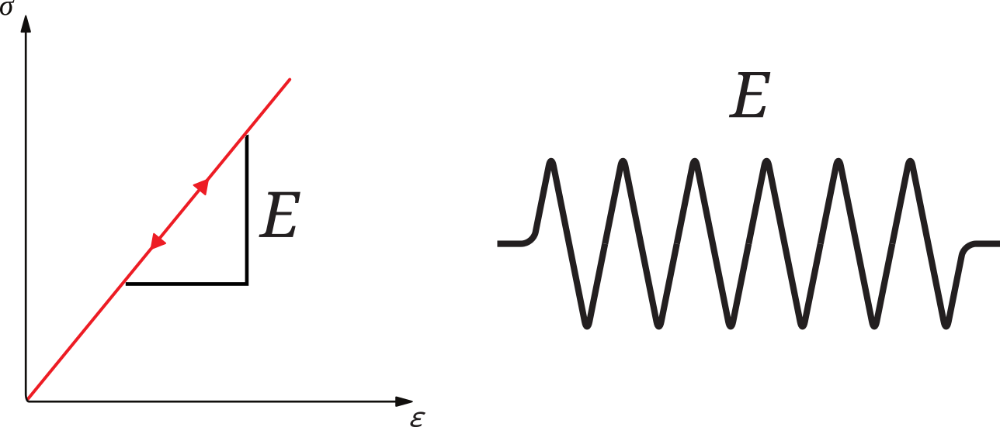

<!-- availability: available akantu::solid -->
# Materials

This chapter corresponds to *Material section* (`io.rst`) and to the
elastic part of *Constitutive laws* (`constitutive-laws.rst`) of the
upstream manual: the material sections, the assignment of materials to
elements and the elastic family (`elastic` with its thermal part,
`elastic_orthotropic`, `elastic_anisotropic`) in detail. The other laws
are in its sub-chapter [Constitutive laws](constitutive-laws.md).

## Registered laws

The laws registered in this release, generated from the factories of
every model of the facade crate that has one (the input file selects
them by these names; `tests/manual.rs::registered_laws_cover_every_model_factory`
fails when a model with a new factory is added without being listed
here):

<!-- BEGIN GENERATED: registered-laws -->
| Model | Section | Registered laws |
|---|---|---|
| `SolidMechanicsModel` | `material` | `anisotropic_damage`, `elastic`, `elastic_anisotropic`, `elastic_orthotropic`, `marigo`, `marigo_non_local`, `mazars`, `mazars_non_local`, `neohookean`, `phasefield`, `plastic_drucker_prager`, `plastic_linear_isotropic_hardening`, `plastic_mazars`, `plastic_mazars_non_local`, `sls_deviatoric`, `viscoelastic_maxwell` |
| `SolidMechanicsModelCohesive` (in addition) | `material` | `cohesive_bilinear`, `cohesive_exponential`, `cohesive_linear`, `cohesive_linear_fatigue`, `cohesive_linear_friction`, `cohesive_linear_uncoupled` |
| `ContactMechanicsModel` | `contact_resolution` | `penalty_linear`, `penalty_quadratic` |
| `PhaseFieldModel` | `phasefield` | `linear`, `quadratic` |
| `HeatTransferModel` | `constitutive_law` | `heat_diffusion` |
<!-- END GENERATED: registered-laws -->

The laws beyond the elastic family are described law by law in
[Constitutive laws](constitutive-laws.md): equations, keywords with
their defaults and units, internal fields, energies and the differences
from upstream (plasticity, damage, the non-local laws and their
`non_local` section, viscoelasticity, `neohookean` and the `phasefield`
material). The cohesive laws belong to the [cohesive
model](models/cohesive.md#cohesive-laws), the `phasefield` laws of the
phase-field model to [Phase-field fracture](models/phase-field.md);
custom laws are described in [Writing new constitutive
laws](new-constitutive-laws.md).

Two of these laws need a choice before they compute anything (details
in [Damage](laws/damage.md#anisotropic-damage-anisotropic_damage) and
[Viscoelastic laws](laws/viscoelastic.md#standard-linear-solid-sls_deviatoric)):

- `anisotropic_damage` refuses `computeStress` by default: upstream's code
  is not a usable law (UD-031, UD-058). `LawOptions::anisotropic_damage`
  selects `Upstream` (the reference code with its undefined values
  defined, for comparisons with the oracle) or the corrected model
  `Corrected` (an opt-in until its independent review; specification
  decision D-066 in `docs/DECISIONS.md`). Limitation of the
  corrected model: once a principal damage has reached `Dc`, a load that
  opens that direction again stops the damage evolution in every
  direction for as long as it lasts (the increment is scaled to keep all
  principal damages at most `Dc`); loading orthogonal to the saturated
  direction keeps damaging. Plane stress and `finite_deformation` are
  refused by it.
- `sls_deviatoric` refuses $E_v > E$ (`Ev` larger than `E`) by default
  (its long-term modulus $E_\infty = E - E_v$, readable as `Einf`, would
  be negative; UD-762); `Ev = 0` and `Eta = 0` take
  the limits of the viscous element instead of upstream's NaN dissipated
  energy.

## Material sections

A material is a `material <law> [ … ]` section. Materials are read from the
model's `model solid_mechanics_model [ … ]` section when the file has one
(preferred), else from the top level of the file:

```dat
model solid_mechanics_model [
    material elastic [
        name = steel
        rho  = 7800
        E    = 210e9
        nu   = 0.3
    ]
]
```

```dat
# no model section: top-level materials
material elastic [
    name = steel
    rho  = 7800
    E    = 210e9
    nu   = 0.3
]
```

When the file has a model section, top-level materials are ignored (as
upstream). Every material needs a `name`; a section without one is an
error ("A constitutive_law of type 'elastic' in the input file has been
defined without a name!"). Materials are numbered in file order; the
option word of the section header (`material elastic flavor [`) is passed
to the law's factory, which the elastic laws ignore.

Parameters unknown to the law are errors, unless the file sets
`permissive_parser = true` (then warnings). Parameters that the law
registers as not parsable (the derived quantities `lambda`, `mu`, `kapa`,
…) are errors in both modes.

```rust
use akantu::core::enums::{AnalysisMethod, MeshIoType};
use akantu::mesh::{Mesh, SharedMesh};
use akantu::model::ModelOptions;
use akantu::parser::{ParamValue, Parser};
use akantu::solid::SolidMechanicsModel;
# let mesh_file = std::path::Path::new(env!("CARGO_MANIFEST_DIR"))
#     .join("../../docs/manual/src/meshes/square.msh");
# let mesh = || -> akantu::core::Result<SharedMesh> {
#     let mut m = Mesh::new(2, "mesh")?;
#     akantu::io::read_mesh(&mut m, &mesh_file, MeshIoType::Auto)?;
#     Ok(SharedMesh::new(m))
# };
let model_with = |input: &str| -> akantu::core::Result<SolidMechanicsModel> {
    let parser = Parser::parse_str(input, "material.dat")?;
    let mut model = SolidMechanicsModel::with_parser(mesh()?, None, "solid_mechanics_model", parser)?;
    model.init_full(&ModelOptions::new(AnalysisMethod::Static))?;
    Ok(model)
};

let model = model_with("material elastic [\n name = steel\n rho = 7800\n E = 210e9\n nu = 0.3\n]\n")?;
let steel = model.material_by_name("steel")?;
assert_eq!(steel.get_param("E")?, ParamValue::Real(210e9));
// derived parameters are readable
let mu = match steel.get_param("mu")? { ParamValue::Real(x) => x, _ => unreachable!() };
assert!((mu - 210e9 / 2.6).abs() < 1e-6 * mu);

assert!(model_with("material elastic [\n rho = 1\n E = 1\n nu = 0.3\n]\n").is_err()); // no name
assert!(model_with("material elastic [\n name = a\n E = 1\n nu = 0.3\n Young = 1\n]\n").is_err());
assert!(model_with("permissive_parser = true\nmaterial elastic [\n name = a\n E = 1\n nu = 0.3\n Young = 1\n]\n").is_ok());
assert!(model_with("permissive_parser = true\nmaterial elastic [\n name = a\n E = 1\n nu = 0.3\n mu = 1\n]\n").is_err());
# Ok::<(), akantu::core::Error>(())
```

## Assigning materials to elements

By default every element is assigned to the first material. To assign
materials by mesh data (typically the Gmsh physical names) use the
element-data selector (upstream `MeshDataMaterialSelector<std::string>`):
the material whose `name` equals the element's value is chosen.

```rust
use akantu::core::enums::{AnalysisMethod, MeshIoType};
use akantu::core::{Element, ElementType, GhostType};
use akantu::mesh::{Mesh, SharedMesh};
use akantu::model::constitutive_law::ElementDataSelector;
use akantu::model::ModelOptions;
use akantu::parser::Parser;
use akantu::solid::SolidMechanicsModel;
# let mesh_file = std::path::Path::new(env!("CARGO_MANIFEST_DIR"))
#     .join("../../docs/manual/src/meshes/square.msh");
# let mut mesh = Mesh::new(2, "mesh")?;
# akantu::io::read_mesh(&mut mesh, &mesh_file, MeshIoType::Auto)?;

// the four quadrangles of square.msh belong to the physical group "body"
let input = "\
material elastic [\n name = other\n rho = 1\n E = 1\n nu = 0.3\n]
material elastic [\n name = body\n rho = 2\n E = 2\n nu = 0.3\n]";
let parser = Parser::parse_str(input, "material.dat")?;
let mut model = SolidMechanicsModel::with_parser(SharedMesh::new(mesh), None, "solid_mechanics_model", parser)?;
model.set_material_selector(Box::new(ElementDataSelector::new("physical_names")));
model.init_full(&ModelOptions::new(AnalysisMethod::Static))?;

let el = Element::new(ElementType::Quadrangle4, 0, GhostType::NotGhost);
assert_eq!(model.material_of(el)?.name(), "body");
assert_eq!(model.material_index("body")?, 1);
# Ok::<(), akantu::core::Error>(())
```

Materials can also be created from code (`register_new_material(name,
law, option)`) and selectors written in Rust (trait
`akantu::model::constitutive_law::ConstitutiveLawSelector`).

## Parameters of the elastic family

Generated from the laws of the port (`r` readable, `w` writable from code,
`p` parsable from an input file; upstream's access flags):

<!-- BEGIN GENERATED: elastic-parameters -->
#### `elastic`

| Parameter | Type | Access | 2-D | 3-D |
|---|---|---|---|---|
| `name` | ByteString | r-p | ✓ | ✓ |
| `rho` | Real | rwp | ✓ | ✓ |
| `finite_deformation` | Bool | r-p | ✓ | ✓ |
| `inelastic_deformation` | Bool | --- | ✓ | ✓ |
| `eigen_grad_u` | MatrixReal | --p | ✓ | ✓ |
| `Plane_Stress` | Bool | rwp | ✓ | — |
| `E` | Real | rwp | ✓ | ✓ |
| `nu` | Real | rwp | ✓ | ✓ |
| `alpha` | Real | rwp | ✓ | ✓ |
| `delta_T` | Real | rwp | ✓ | ✓ |
| `lambda` | Real | r-- | ✓ | ✓ |
| `mu` | Real | r-- | ✓ | ✓ |
| `kapa` | Real | r-- | ✓ | ✓ |

#### `elastic_orthotropic`

| Parameter | Type | Access | 2-D | 3-D |
|---|---|---|---|---|
| `name` | ByteString | r-p | ✓ | ✓ |
| `rho` | Real | rwp | ✓ | ✓ |
| `finite_deformation` | Bool | r-p | ✓ | ✓ |
| `inelastic_deformation` | Bool | --- | ✓ | ✓ |
| `eigen_grad_u` | MatrixReal | --p | ✓ | ✓ |
| `n1` | VectorReal | rwp | ✓ | ✓ |
| `n2` | VectorReal | rwp | ✓ | ✓ |
| `C11` | Real | rwp | ✓ | ✓ |
| `C12` | Real | rwp | ✓ | ✓ |
| `C13` | Real | rwp | ✓ | ✓ |
| `C22` | Real | rwp | ✓ | ✓ |
| `C23` | Real | rwp | ✓ | ✓ |
| `C33` | Real | rwp | ✓ | ✓ |
| `E1` | Real | rwp | ✓ | ✓ |
| `E2` | Real | rwp | ✓ | ✓ |
| `nu12` | Real | rwp | ✓ | ✓ |
| `G12` | Real | rwp | ✓ | ✓ |
| `n3` | VectorReal | rwp | — | ✓ |
| `C14` | Real | rwp | — | ✓ |
| `C15` | Real | rwp | — | ✓ |
| `C16` | Real | rwp | — | ✓ |
| `C24` | Real | rwp | — | ✓ |
| `C25` | Real | rwp | — | ✓ |
| `C26` | Real | rwp | — | ✓ |
| `C34` | Real | rwp | — | ✓ |
| `C35` | Real | rwp | — | ✓ |
| `C36` | Real | rwp | — | ✓ |
| `C44` | Real | rwp | — | ✓ |
| `C45` | Real | rwp | — | ✓ |
| `C46` | Real | rwp | — | ✓ |
| `C55` | Real | rwp | — | ✓ |
| `C56` | Real | rwp | — | ✓ |
| `C66` | Real | rwp | — | ✓ |
| `E3` | Real | rwp | — | ✓ |
| `nu13` | Real | rwp | — | ✓ |
| `nu23` | Real | rwp | — | ✓ |
| `G13` | Real | rwp | — | ✓ |
| `G23` | Real | rwp | — | ✓ |

#### `elastic_anisotropic`

| Parameter | Type | Access | 2-D | 3-D |
|---|---|---|---|---|
| `name` | ByteString | r-p | ✓ | ✓ |
| `rho` | Real | rwp | ✓ | ✓ |
| `finite_deformation` | Bool | r-p | ✓ | ✓ |
| `inelastic_deformation` | Bool | --- | ✓ | ✓ |
| `eigen_grad_u` | MatrixReal | --p | ✓ | ✓ |
| `n1` | VectorReal | rwp | ✓ | ✓ |
| `n2` | VectorReal | rwp | ✓ | ✓ |
| `C11` | Real | rwp | ✓ | ✓ |
| `C12` | Real | rwp | ✓ | ✓ |
| `C13` | Real | rwp | ✓ | ✓ |
| `C22` | Real | rwp | ✓ | ✓ |
| `C23` | Real | rwp | ✓ | ✓ |
| `C33` | Real | rwp | ✓ | ✓ |
| `n3` | VectorReal | rwp | — | ✓ |
| `C14` | Real | rwp | — | ✓ |
| `C15` | Real | rwp | — | ✓ |
| `C16` | Real | rwp | — | ✓ |
| `C24` | Real | rwp | — | ✓ |
| `C25` | Real | rwp | — | ✓ |
| `C26` | Real | rwp | — | ✓ |
| `C34` | Real | rwp | — | ✓ |
| `C35` | Real | rwp | — | ✓ |
| `C36` | Real | rwp | — | ✓ |
| `C44` | Real | rwp | — | ✓ |
| `C45` | Real | rwp | — | ✓ |
| `C46` | Real | rwp | — | ✓ |
| `C55` | Real | rwp | — | ✓ |
| `C56` | Real | rwp | — | ✓ |
| `C66` | Real | rwp | — | ✓ |

<!-- END GENERATED: elastic-parameters -->

Defaults (upstream `registerParam` defaults, checked by
`crates/akantu/tests/manual_claims.rs`): `rho = 0`, `E = 0`,
`nu = 0.5`, `alpha = 0`, `delta_T = 0`, `Plane_Stress = false`,
`finite_deformation = false`; the orthotropic moduli and the anisotropic
coefficients `Cij` default to 0; the axes `n1`, `n2`, `n3` to the global
axes.

### `elastic`

Linear isotropic elasticity,
$\boldsymbol{\sigma} = \lambda \operatorname{tr}(\boldsymbol{\varepsilon}) \boldsymbol{I} + 2 \mu \boldsymbol{\varepsilon}$
with the Lamé
coefficients computed from `E` and `nu`. In 2-D the default is plane
strain; `Plane_Stress = true` selects plane stress. With
`finite_deformation = true` the law is evaluated on the Green–Lagrange
strain and returns the second Piola–Kirchhoff stress (Saint
Venant–Kirchhoff), and the model assembles the total-Lagrangian forms
([Solid mechanics model](solid-mechanics.md#finite-deformation)).

#### Isotropic Hooke law

The elastic laws relate the stress to the strain linearly,
$\boldsymbol{\sigma} = \mathbb{C} : \boldsymbol{\varepsilon}$, where
$\boldsymbol{\sigma}$ is the Cauchy stress, $\boldsymbol{\varepsilon}$ the
infinitesimal strain and $\mathbb{C}$ the elastic modulus tensor. They
suit a wide range of engineering materials (metals, concrete, rock, wood,
glass) as long as the strains remain small and the stress stays below the
yield strength. The isotropic law behaves like an ideal spring: the
stress is proportional to the strain, and unloading follows the loading
path back.


*Figure: stress-strain curve of an elastic material and Hooke's law represented as a spring (figure of the Akantu manual).*

The strain is computed at every quadrature point from the displacement
gradient with respect to the initial configuration,

$$
\boldsymbol{\varepsilon} = \frac{1}{2} \left( \nabla_0 \boldsymbol{u} + \nabla_0 \boldsymbol{u}^T \right),
$$

and the stress of a homogeneous isotropic medium is

$$
\boldsymbol{\sigma} = \lambda \operatorname{tr}(\boldsymbol{\varepsilon}) \boldsymbol{I} + 2 \mu \boldsymbol{\varepsilon},
\qquad
\lambda = \frac{\nu E}{(1 + \nu)(1 - 2\nu)}, \quad \mu = \frac{E}{2(1 + \nu)},
$$

with the Young modulus $E$ (`E`), the Poisson ratio $\nu$ (`nu`) and the
Lamé coefficients $\lambda$ (`lambda`) and $\mu$ (`mu`, the shear
modulus); `kapa` is $\lambda + \frac{2}{3}\mu$. In Voigt notation, with
engineering shear strains, the 3-D law reads

$$
\begin{bmatrix} \sigma_{11} \\ \sigma_{22} \\ \sigma_{33} \\ \sigma_{23} \\ \sigma_{13} \\ \sigma_{12} \end{bmatrix}
= \frac{E}{(1 + \nu)(1 - 2\nu)}
\begin{bmatrix}
1 - \nu & \nu & \nu & 0 & 0 & 0 \\
\nu & 1 - \nu & \nu & 0 & 0 & 0 \\
\nu & \nu & 1 - \nu & 0 & 0 & 0 \\
0 & 0 & 0 & \frac{1 - 2\nu}{2} & 0 & 0 \\
0 & 0 & 0 & 0 & \frac{1 - 2\nu}{2} & 0 \\
0 & 0 & 0 & 0 & 0 & \frac{1 - 2\nu}{2}
\end{bmatrix}
\begin{bmatrix} \varepsilon_{11} \\ \varepsilon_{22} \\ \varepsilon_{33} \\ 2\varepsilon_{23} \\ 2\varepsilon_{13} \\ 2\varepsilon_{12} \end{bmatrix}
$$

and this matrix is the tangent of the law. In 2-D the tangent is the
$3 \times 3$ block on $(\varepsilon_{11}, \varepsilon_{22}, 2\varepsilon_{12})$,

$$
\begin{bmatrix} \sigma_{11} \\ \sigma_{22} \\ \sigma_{12} \end{bmatrix}
=
\begin{bmatrix}
\lambda + 2\mu & \lambda & 0 \\
\lambda & \lambda + 2\mu & 0 \\
0 & 0 & \mu
\end{bmatrix}
\begin{bmatrix} \varepsilon_{11} \\ \varepsilon_{22} \\ 2\varepsilon_{12} \end{bmatrix},
$$

with the $\lambda$ above in plane strain ($\varepsilon_{33} = 0$) and
$\lambda = \nu E / ((1 + \nu)(1 - \nu))$ in plane stress
($\sigma_{33} = 0$), $\mu$ being the same in both. In 1-D the law is
$\sigma_{11} = E\, \varepsilon_{11}$ (the port sets $\nu = 0$ in 1-D).

This isotropic law cannot represent materials with preferred
directions; the anisotropic laws below take a general modulus tensor.

#### Thermal strain

A temperature change `delta_T` with expansion coefficient `alpha` adds the
thermal strain $\varepsilon_{th}$ and the stress offset $\sigma_{th}$:
$\varepsilon_{th} = \alpha \Delta T$ in 1-D,
in 2-D plane stress and in 3-D (upstream multiplies the 3-D value by
$1 + \nu$, UD-038, corrected by default, `ThermalStrain::Upstream` restores
it), and $\varepsilon_{th} = (1 + \nu) \alpha \Delta T$ in 2-D plane strain (the in-plane
eigenstrain of the plane-strain reduction, the same upstream and in the
port); $\sigma_{th}$ is $-E \alpha \Delta T$ (1-D), $-E \alpha \Delta T / (1 - \nu)$ (plane stress) and
$-E \alpha \Delta T / (1 - 2\nu)$ (plane strain, 3-D) in both (checked by
`akantu-solid` `tests/elastic_family_properties.rs::ud038_thermal_eigenstrain_and_free_expansion`
and the `material_thermal` unit tests); the potential energy is the stored elastic
energy
$\frac{1}{2} (\boldsymbol{\varepsilon} - \boldsymbol{\varepsilon}_{th}) : \mathbb{C} : (\boldsymbol{\varepsilon} - \boldsymbol{\varepsilon}_{th})$
(upstream integrates $\frac{1}{2} \boldsymbol{\sigma} : \nabla \boldsymbol{u}$,
which is not a potential of the computed stress, UD-109).

### `elastic_orthotropic`

Orthotropic elasticity defined by `E1`, `E2`, `nu12`, `G12` (2-D) and
additionally `E3`, `nu13`, `nu23`, `G13`, `G23` (3-D) in the material
axes `n1`, `n2` (, `n3`). The stiffness coefficients `Cij` it computes are
readable (and writable) as for `elastic_anisotropic`.

Orthotropy is the particular case of anisotropy where the material has
three orthogonal planes of symmetry: in the material axes the modulus
matrix has 9 independent coefficients,

$$
\begin{bmatrix} \sigma_{11} \\ \sigma_{22} \\ \sigma_{33} \\ \sigma_{23} \\ \sigma_{13} \\ \sigma_{12} \end{bmatrix}
=
\begin{bmatrix}
c_{11} & c_{12} & c_{13} & 0 & 0 & 0 \\
 & c_{22} & c_{23} & 0 & 0 & 0 \\
 & & c_{33} & 0 & 0 & 0 \\
 & & & c_{44} & 0 & 0 \\
 & \text{sym.} & & & c_{55} & 0 \\
 & & & & & c_{66}
\end{bmatrix}
\begin{bmatrix} \varepsilon_{11} \\ \varepsilon_{22} \\ \varepsilon_{33} \\ 2\varepsilon_{23} \\ 2\varepsilon_{13} \\ 2\varepsilon_{12} \end{bmatrix},
$$

which the law computes from the engineering constants (Young moduli
$E_i$ (`E1`, `E2`, `E3`), Poisson ratios $\nu_{ij}$ (`nu12`, `nu13`,
`nu23`), shear moduli $G_{ij}$ (`G12`, `G13`, `G23`)):

$$
\begin{aligned}
c_{11} &= E_1 (1 - \nu_{23}\nu_{32})\Gamma, \qquad
c_{22} = E_2 (1 - \nu_{13}\nu_{31})\Gamma, \qquad
c_{33} = E_3 (1 - \nu_{12}\nu_{21})\Gamma \\
c_{12} &= E_1 (\nu_{21} + \nu_{31}\nu_{23})\Gamma, \qquad
c_{13} = E_1 (\nu_{31} + \nu_{21}\nu_{32})\Gamma, \qquad
c_{23} = E_2 (\nu_{32} + \nu_{12}\nu_{31})\Gamma \\
c_{44} &= G_{23}, \qquad c_{55} = G_{13}, \qquad c_{66} = G_{12} \\
\Gamma &= \frac{1}{1 - \nu_{12}\nu_{21} - \nu_{23}\nu_{32} - \nu_{31}\nu_{13} - 2\nu_{21}\nu_{32}\nu_{13}}
\end{aligned}
$$

The other Poisson ratios follow from symmetry,
$\nu_{21} = \nu_{12} E_2 / E_1$, $\nu_{31} = \nu_{13} E_3 / E_1$ and
$\nu_{32} = \nu_{23} E_3 / E_2$ (that is, $\nu_{ij} = \nu_{ji} E_i / E_j$).
In 2-D the out-of-plane constants are zero and the matrix is the
plane-stress orthotropic stiffness on
$(\varepsilon_{11}, \varepsilon_{22}, 2\varepsilon_{12})$:
$c_{11} = E_1 \Gamma$, $c_{22} = E_2 \Gamma$, $c_{12} = E_1 \nu_{21} \Gamma$,
$c_{33} = G_{12}$ with $\Gamma = 1/(1 - \nu_{12}\nu_{21})$ (the law has no
`Plane_Stress` keyword). In 1-D the law is an error (orthotropy has no
meaning there). The matrix is then rotated from the material axes to the
global axes as for `elastic_anisotropic`. Upstream's manual prints minus
signs in $c_{12}$, $c_{13}$ and $c_{23}$; upstream's code and the port use
the plus signs above.

### `elastic_anisotropic`

General linear elasticity given by the symmetric Voigt matrix `Cij`
($i \le j$, $3 \times 3$ in 2-D, $6 \times 6$ in 3-D) in the material axes `n1`, `n2`
(, `n3`).

$$
\begin{bmatrix} \sigma_{11} \\ \sigma_{22} \\ \sigma_{33} \\ \sigma_{23} \\ \sigma_{13} \\ \sigma_{12} \end{bmatrix}
=
\begin{bmatrix}
c_{11} & c_{12} & c_{13} & c_{14} & c_{15} & c_{16} \\
c_{21} & c_{22} & c_{23} & c_{24} & c_{25} & c_{26} \\
c_{31} & c_{32} & c_{33} & c_{34} & c_{35} & c_{36} \\
c_{41} & c_{42} & c_{43} & c_{44} & c_{45} & c_{46} \\
c_{51} & c_{52} & c_{53} & c_{54} & c_{55} & c_{56} \\
c_{61} & c_{62} & c_{63} & c_{64} & c_{65} & c_{66}
\end{bmatrix}
\begin{bmatrix} \varepsilon_{11} \\ \varepsilon_{22} \\ \varepsilon_{33} \\ 2\varepsilon_{23} \\ 2\varepsilon_{13} \\ 2\varepsilon_{12} \end{bmatrix}
$$

with $c_{ji} = c_{ij}$: only the coefficients with $i \le j$ are keywords,
and those left out are zero. In 2-D the matrix is the $3 \times 3$ block on
$(\varepsilon_{11}, \varepsilon_{22}, 2\varepsilon_{12})$ (`C11`, `C12`,
`C13`, `C22`, `C23`, `C33`, the index 3 standing for the shear).

The coefficients are given in the material basis
$\Omega_{\text{mat}} = \{\boldsymbol{n}_1, \boldsymbol{n}_2, \boldsymbol{n}_3\}$,
which keeps input files short. The law normalises the axes, builds the
rotation $R_{ij} = \boldsymbol{n}_j \cdot \boldsymbol{e}_i$ (the columns of
$\boldsymbol{R}$ are the unit axes) and checks that the basis is
right-handed ($\lVert \boldsymbol{n}_1 \times \boldsymbol{n}_2 - \boldsymbol{n}_3 \rVert$
must vanish; in 2-D $\boldsymbol{n}_3$ is the normalised
$\boldsymbol{n}_1 \times \boldsymbol{n}_2$, so the check asks for
orthogonal axes, and parallel axes are refused). The modulus tensor in
the global basis
$\Omega = \{\boldsymbol{e}_1, \boldsymbol{e}_2, \boldsymbol{e}_3\}$ is then

$$
\mathbb{C}^{\Omega}_{ijkl} = R_{ip} R_{jq} R_{kr} R_{ls}\, \mathbb{C}^{\Omega_{\text{mat}}}_{pqrs},
$$

which upstream's manual writes as a product of Voigt matrices,
$\boldsymbol{C}_{\Omega} = \boldsymbol{R}_1 \boldsymbol{C}_{\Omega_{\text{mat}}} \boldsymbol{R}_2$,
whose entries are the products $R_{ij} R_{kl}$. This is the port's
default; upstream's code applies the inverse rotation (UD-104, below).

The material axes are the directions `n1`, `n2`, `n3` themselves: a
stiffness `E1` along `n1 = (0.8, 0.6)` acts in the direction
`(0.8, 0.6)`. Upstream applies the inverse rotation (UD-104: its stiff
direction is `(0.8, −0.6)`). The stable time step uses an upper bound of
the wave speeds (the largest eigenvalue of the stiffness in Mandel form);
upstream takes the first eigenvalue in Eigen's unsorted order (UD-033).

## Upstream compatibility switches

The corrected behaviours above are the defaults. `LawOptions::upstream()`
reproduces upstream for comparisons with the C++ library (category B of
decision D-003); set it on the model before `init_full`:

```rust
use akantu::core::enums::{AnalysisMethod, MeshIoType};
use akantu::mesh::{Mesh, SharedMesh};
use akantu::model::ModelOptions;
use akantu::parser::Parser;
use akantu::solid::material::LawOptions;
use akantu::solid::SolidMechanicsModel;
# let mesh_file = std::path::Path::new(env!("CARGO_MANIFEST_DIR"))
#     .join("../../docs/manual/src/meshes/square.msh");
# let mut mesh = Mesh::new(2, "mesh")?;
# akantu::io::read_mesh(&mut mesh, &mesh_file, MeshIoType::Auto)?;
let parser = Parser::parse_str("material elastic [\n name = a\n rho = 1\n E = 1\n nu = 0.3\n]\n", "m.dat")?;
let mut model = SolidMechanicsModel::with_parser(SharedMesh::new(mesh), None, "smm", parser)?;

assert!(LawOptions::default().material_axes_as_directions); // corrected
model.physics.law_options = Some(LawOptions::upstream()); // every switch as upstream
model.init_full(&ModelOptions::new(AnalysisMethod::Static))?;
# Ok::<(), akantu::core::Error>(())
```

| Field of `LawOptions` | Default (corrected) | `upstream()` | Defect |
|---|---|---|---|
| `thermal_strain` | `ThermalStrain::Corrected` ($\alpha \Delta T$) | `ThermalStrain::Upstream` ($(1 + \nu) \alpha \Delta T$ in 3-D) | UD-038 |
| `thermal_energy` | `ThermalEnergy::StoredElastic` | `ThermalEnergy::Upstream` ($\frac{1}{2} \boldsymbol{\sigma} : \nabla \boldsymbol{u}$) | UD-109 |
| `celerity` | `CelerityMode::KelvinBound` | `CelerityMode::UpstreamFirstEigenvalue` | UD-033 |
| `orthotropic_parent_update` | `true` (parsed `eigen_grad_u` applied, stiffness flagged changed) | `false` | UD-105 |
| `material_axes_as_directions` | `true` | `false` (inverse rotation) | UD-104 |
| `damage_thermal_refresh` | `true` (`marigo`, `mazars`, `plastic_mazars` refresh the thermal state first) | `false` (thermal stress never refreshed) | UD-038 |
| `plastic_thermal_increment` | `true` ($\Delta\sigma_{th} = \sigma_{th} - \sigma_{th,\text{prev}}$ in the trial and the final stress) | `false` (wrong sign in the trial, none in the final stress) | UD-038 |
| `finite_strain_plasticity` | `FiniteStrainPlasticity::Unsupported` (refused) | `FiniteStrainPlasticity::UpstreamLegacy` | UD-030 |
| `neohookean` | `NeohookeanMode::Documented` | `NeohookeanMode::UpstreamNotImplemented` (the error) | UD-026, UD-057 |
| `j2_reduced_return` | `J2ReducedReturn::Consistent` | `J2ReducedReturn::UpstreamTruncated` | UD-137 |
| `committed_trial_state` | `true` (trials from the committed hardening or damage) | `false` | UD-138 |
| `plastic_mazars_effective_stress` | `true` | `false` (J2 parent continues from the damaged stress) | UD-139 |
| `mazars_mechanical_strain` | `true` | `false` (total minus plastic strain) | UD-140 |
| `mazars_out_of_plane_strain` | `true` | `false` ($\varepsilon_{33} = 0$, plane-stress $\lambda$) | UD-141 |
| `finite_strain_damage` | `FiniteStrainDamage::Unsupported` (refused) | `FiniteStrainDamage::UpstreamLegacy` | UD-142 |
| `drucker_prager_return` | `DruckerPragerReturn::ClosedForm` | `DruckerPragerReturn::UpstreamIteration` | UD-144, UD-145, UD-146 |
| `sls_dissipation` | `SlsDissipation::Contraction` | `SlsDissipation::UpstreamMatrixProduct` | UD-029, UD-329 |
| `sls_committed_state` | `true` | `false` (history advanced at every evaluation) | UD-063 |
| `sls_energy` | `SlsEnergy::TwoSpring` | `SlsEnergy::UpstreamElastic` ($\frac{1}{2} \boldsymbol{\sigma} : \nabla \boldsymbol{u}$) | UD-161, UD-329 |
| `sls_degenerate_branch` | `SlsDegenerateBranch::Limit` | `SlsDegenerateBranch::Upstream` | UD-762 |
| `maxwell_update` | `MaxwellUpdate::Recurrence` | `MaxwellUpdate::Upstream` (the stresses of the Maxwell elements never updated) | UD-029, UD-162, UD-163 |
| `maxwell_stiffness_invalidation` | `true` | `false` | UD-157 |
| `maxwell_thermal` | `MaxwellThermal::Unsupported` (`alpha` $\neq 0$ refused) | `MaxwellThermal::Upstream` | UD-327 |
| `anisotropic_damage` | `AnisotropicDamageModel::Unsupported` (refused) | `AnisotropicDamageModel::Upstream` | UD-031, UD-058 |
| `phasefield_tangent` | `PhaseFieldTangent::Consistent` | `PhaseFieldTangent::Upstream` | UD-164, UD-165 |
| `finite_strain_work` | `FiniteStrainWork::Conjugate` | `FiniteStrainWork::UpstreamMixed` | UD-158, UD-159 |
| `damage_thermal_work` | `true` | `false` | UD-160 |

The table lists every field of `LawOptions`. The law chapters explain what
each switch changes: [Plasticity](laws/plasticity.md),
[Damage](laws/damage.md), [Viscoelastic laws](laws/viscoelastic.md),
[The phase-field material](laws/phasefield.md) and
[Neo-Hookean hyperelasticity](laws/neohookean.md). The refused
configurations are listed in
[Differences from the C++ library](differences.md#refused-by-default).

The model-level switch `SmmUpstreamCompat` and the solver switches
`akantu::solver::UpstreamCompat` are described in
[Differences from the C++ library](differences.md).
