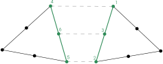
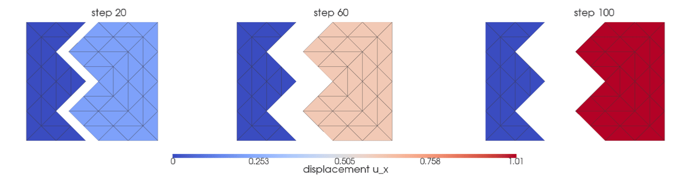
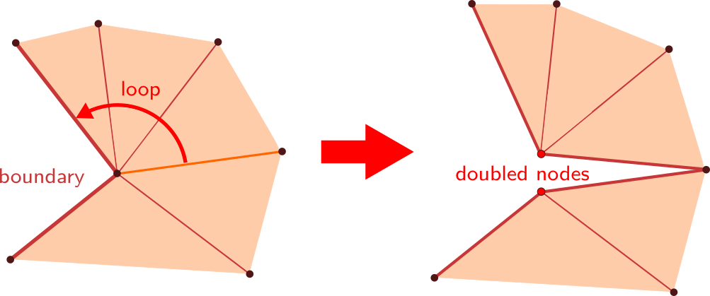
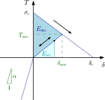
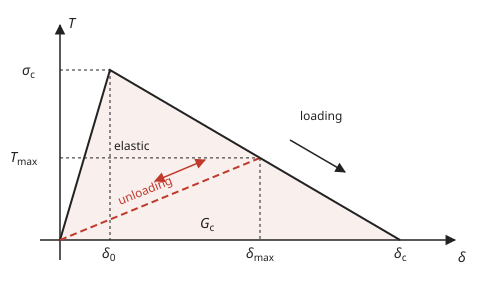
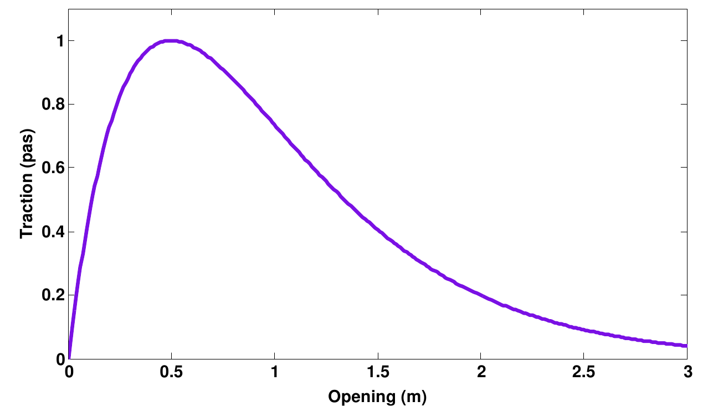

<!-- availability: available akantu::cohesive -->
# Cohesive elements and fragmentation

<!-- BEGIN GENERATED: availability-status cohesive -->
**Available in this release** (facade module `akantu::cohesive`, crate `akantu-cohesive`, feature `cohesive`, on by default).
<!-- END GENERATED: availability-status cohesive -->

The cohesive model is `akantu::cohesive::SolidMechanicsModelCohesive`
(crate `akantu-cohesive`, feature `cohesive`, on by default): a solid
mechanics model whose mesh can receive cohesive elements, with the
cohesive element inserter, the six cohesive laws of upstream
(`cohesive_linear`, `cohesive_bilinear`, `cohesive_exponential`,
`cohesive_linear_fatigue`, `cohesive_linear_friction`,
`cohesive_linear_uncoupled`; [below](#cohesive-laws)) and the fragment
manager (`FragmentManager`). This chapter corresponds to the cohesive
part of upstream's *Solid mechanics model* chapter
(`solidmechanicsmodel.rst`), the cohesive laws of *Constitutive laws*
and the cohesive output of *Input/Output* (`io.rst`); parity rows
DOC-023 and DOC-007.

## The cohesive approach

A cohesive element is an interface element of zero thickness placed
between two bulk elements, on the facet they share. Its two faces carry
their own nodes (the nodes of the facet, doubled), so the displacement
may jump across it; the element resists the jump with a traction that
a cohesive law (a traction-separation law, [below](#cohesive-laws))
gives as a function of the jump. A crack is the set of facets whose
cohesive elements are fully damaged: their traction is zero and the two
sides move apart freely. Cracks can therefore only follow the facets of
the mesh.


*Figure: a six-node cohesive element (`_cohesive_2d_6`) between two quadratic triangles; the dashed lines pair the nodes of its two faces, which coincide in the undeformed mesh and are drawn apart here (figure of the Akantu manual).*

### The weak form with the cohesive term

Let $\Gamma_c$ be the union of the facets that hold a cohesive element,
and $\boldsymbol{\Delta} = \boldsymbol{u}^+ - \boldsymbol{u}^-$ the
opening, the jump of the displacement between the two faces of the
element (in the port, the second face minus the first). The principle
of virtual work of the solid mechanics model gains one term: for every
admissible virtual displacement $\delta\boldsymbol{u}$, with
$\delta\boldsymbol{\Delta}$ its jump across $\Gamma_c$,

$$
\int_\Omega \rho\, \ddot{\boldsymbol{u}} \cdot \delta\boldsymbol{u}\, \mathrm{d}V
+ \int_\Omega \boldsymbol{\sigma} : \delta\boldsymbol{\varepsilon}\, \mathrm{d}V
+ \int_{\Gamma_c} \boldsymbol{T}(\boldsymbol{\Delta}) \cdot \delta\boldsymbol{\Delta}\, \mathrm{d}A
= \int_\Omega \boldsymbol{b} \cdot \delta\boldsymbol{u}\, \mathrm{d}V
+ \int_{\Gamma_t} \bar{\boldsymbol{t}} \cdot \delta\boldsymbol{u}\, \mathrm{d}A
$$

where $\boldsymbol{T}$ is the cohesive traction (including the contact
traction of a law in compression). After discretisation, the opening at
a quadrature point of a cohesive element is
$\boldsymbol{\Delta} = \boldsymbol{N}\boldsymbol{A}\,\boldsymbol{u}_e$,
with $\boldsymbol{N}$ the shape functions of one face and
$\boldsymbol{A}$ the operator that takes the difference of the two
faces' nodal displacements. The cohesive term adds to the internal
forces the vector $\int_{\Gamma_c} \boldsymbol{N}^T \boldsymbol{T}\,
\mathrm{d}A$, with a minus sign on the nodes of the first face and a plus
sign on those of the second, and, in a static or implicit analysis, the
stiffness

$$
\boldsymbol{K}_c = \int_{\Gamma_c} (\boldsymbol{N}\boldsymbol{A})^T\,
\frac{\partial \boldsymbol{T}}{\partial \boldsymbol{\Delta}}\,
(\boldsymbol{N}\boldsymbol{A})\, \mathrm{d}A .
$$

The opening is split into its normal part
$\Delta_n = \boldsymbol{\Delta} \cdot \boldsymbol{n}$, with
$\boldsymbol{n}$ the normal of the facet, and its tangential part
$\boldsymbol{\Delta}_t = \boldsymbol{\Delta} - \Delta_n \boldsymbol{n}$.
The laws combine them into a scalar effective opening $\delta$ and the
traction into an effective traction $T$.

### Intrinsic and extrinsic insertion

There are two ways to put cohesive elements in a mesh.

* Intrinsic: the cohesive elements are inserted on every allowed facet
  before the simulation starts. Until a crack forms they must transmit
  the load, so their law starts with an elastic part (an initial
  stiffness) before it softens. That part adds compliance to the
  structure, the more so the finer the mesh, which is the price of the
  approach.
* Extrinsic: the mesh starts without cohesive elements and the facets
  are checked during the simulation; a cohesive element is inserted on
  a facet only when the stress there reaches the strength of the
  material. The law then needs no elastic part: it starts at the
  strength and softens from there, and the uncracked body is exactly the
  bulk model.


*Figure: the example `cohesive_intrinsic`: intrinsic `cohesive_bilinear` elements inserted on the facets of a vertical band at the start, the elements to the right of it pulled to the right until the band opens (displacement along x at steps 20, 60 and 100 on the deformed mesh, true scale; computed with akantu-rs).*

Inserting a cohesive element on a facet doubles the facet and the nodes
it needs: the elements on the two sides then use different copies of
the shared nodes. A node is doubled only when the facets inserted around
it separate its neighbouring elements into groups, which the inserter
finds by walking through the elements around the node from facet to
facet (a port of upstream's `CohesiveElementInserterHelper` that keeps
its order, so the new nodes, facets and cohesive elements are numbered
as upstream numbers them).


*Figure: insertion of a cohesive element; the loop around a node that reaches the boundary through inserted facets doubles the node (figure of the Akantu manual).*

The extrinsic insertion criterion compares an effective stress of the
facet with its strength $\sigma_c$:

$$
\sigma_\text{eff} = \sqrt{\langle \sigma_n \rangle_+^2 + \frac{\tau^2}{\beta^2}}
> \sigma_c
$$

with $\sigma_n$ the normal traction of the facet stress, $\tau$ the norm
of its tangential traction and $\beta$ the weight of the tangential part
(the details of the port's check are under
[Using the model](#using-the-model)). The fracture energy $G_c$, the
work needed per unit area to open a facet completely, is the area under
the traction-separation curve of the law; together with $\sigma_c$ it
fixes the critical opening $\delta_c$ at which the traction vanishes.

## Using the model

The model is built like the solid mechanics model, from a mesh and an
input file, and keeps the solid model in its public field `smm` (nodal
arrays, boundary conditions, solvers, dumpers: [Solid mechanics
model](../solid-mechanics.md)). The constructor builds the facet mesh
(the mesh of the element boundaries, `mesh.mesh_facets()`), on which
insertion works. The `material` sections hold the bulk laws and the
cohesive laws in one list; the bulk elements take the bulk laws by the
model's selector (by default the first law), the cohesive elements the
first cohesive law by default (upstream
`DefaultMaterialCohesiveSelector`; another one per mesh data with
`akantu::cohesive::selector::MeshDataMaterialCohesiveSelector`). The
input file may have a `model solid_mechanics_model_cohesive [ … ]`
section: the materials and the optional `cohesive_inserter` section
(below) are read from it.

`init_full(options, is_extrinsic)` takes the analysis method and the
kind of insertion:

* intrinsic (`is_extrinsic = false`): every allowed facet receives a
  cohesive element during `init_full`, so the cohesive elements are part
  of the mesh from the start and their law must have an initial elastic
  part: `cohesive_bilinear` (its `delta_0`) or `cohesive_exponential`.
  The laws without one (`cohesive_linear`, `cohesive_linear_fatigue`,
  `cohesive_linear_friction`, `cohesive_linear_uncoupled`) get their
  strength from the extrinsic insertion check only; an intrinsic
  insertion that would give them elements is refused (UD-224: upstream
  inserts them with a zero strength, i.e. broken at once;
  `CohesiveUpstreamCompat::intrinsic_linear_zero_strength` reproduces
  it). The [first example of the output section](#cohesive-elements-data)
  is an intrinsic model.
* extrinsic (`is_extrinsic = true`): no cohesive element at the
  start; `check_cohesive_stress()`, called by the user (typically before
  every `solve_step`), interpolates the bulk stresses to the quadrature
  points of the checked facets and inserts a cohesive element on every
  facet whose effective stress exceeds its strength:

  $$
  \sigma_\text{eff} = \sqrt{\langle t_n \rangle_+^2 + \frac{\lVert \boldsymbol{t}_t \rVert^2}{\beta^2}} > \sigma_c
  $$

  ($t_n$, $\boldsymbol{t}_t$ the normal and tangential parts of the
  traction $\boldsymbol{t} = \boldsymbol{\sigma}\boldsymbol{n}$ of the
  facet stress, the stress being the mean of the stresses of the two
  neighbouring elements interpolated to the facet's quadrature points;
  $\langle \cdot \rangle_+$ the positive part; with $\beta = 0$, the
  default, the tangential part is left out; the mean over the facet's
  quadrature points, or their maximum with `max_quad_stress_insertion`,
  compared with the mean of the facet's strengths, UD-040). It returns
  the number of new cohesive elements. A new element starts at the
  traction of the facet (no initial elastic part), with the facet's
  stress as its strength (`sigma_c_eff`), so that its traction starts
  at the strength and only softens. The insertion check belongs to
  the linear family: on an extrinsic model with a `cohesive_exponential`
  law every `check_cohesive_stress` returns `Error::NotImplemented`,
  whatever the facets (test
  `manual_claims_3.rs::doc023_extrinsic_check_refuses_cohesive_exponential`),
  as upstream's `checkInsertion` raises "not implemented".

The bulk stresses that `check_cohesive_stress` interpolates are those of
the last residual assembly (a solve step, or `assemble_internal_forces`).
On an intrinsic model it is an error, as upstream (same test).

```rust
# use akantu::cohesive::SolidMechanicsModelCohesive;
# use akantu::core::enums::{AnalysisMethod, MeshIoType};
# use akantu::core::{ElementType, GhostType};
# use akantu::mesh::{Mesh, SharedMesh};
# use akantu::model::constitutive_law::{ConstitutiveLaw, InternalFieldRef};
# use akantu::model::ModelOptions;
# use akantu::parser::Parser;
# let mesh_file = std::path::Path::new(env!("CARGO_MANIFEST_DIR")).join(
#     "../../fixtures/meshes/gmsh-4.13.1/test/test_model/test_solid_mechanics_model/\
#      test_cohesive/_cohesive_2d_4_triangle_3.msh",
# );
# let mut mesh = Mesh::new(2, "mesh")?;
# akantu::io::read_mesh(&mut mesh, &mesh_file, MeshIoType::Gmsh)?;
// a 2 × 1 plate, y ∈ [−0.5, 0.5], with the physical line `insertion` at y = 0
let input = "model solid_mechanics_model_cohesive [
  cohesive_inserter [
    cohesive_surfaces = [insertion]  # check only the facets of this group
  ]
  material elastic [
    name = body
    rho  = 1e3
    E    = 1e9
    nu   = 0.2
  ]
  material cohesive_linear [
    name    = interface
    beta    = 1
    G_c     = 10
    sigma_c = 1e6
  ]
]";
let parser = Parser::parse_str(input, "material.dat")?;
let mesh = SharedMesh::new(mesh);
let mut model = SolidMechanicsModelCohesive::with_parser(
    mesh.clone(),
    None,
    "solid_mechanics_model_cohesive",
    parser,
)?;
model.init_full(&ModelOptions::new(AnalysisMethod::ExplicitLumpedMass), true)?;
let cohesive = (ElementType::Cohesive2d4, GhostType::NotGhost);
assert_eq!(mesh.read()?.nb_element(cohesive.0, cohesive.1), 0);

// a uniform vertical strain ε_yy = 1e-3: plane strain σ_yy = E(1 − ν)/((1 + ν)(1 − 2ν)) ε_yy
// ≈ 1.11e6 > σc on the horizontal facets
let x: Vec<f64> = mesh.read()?.nodes().as_slice().to_vec();
for (u, x) in model.smm.displacement_mut()?.tuples_mut().zip(x.chunks(2)) {
    u[1] = 1e-3 * x[1];
}
model.assemble_internal_forces()?; // the bulk stresses
let inserted = model.check_cohesive_stress()?;
assert_eq!(inserted, 5); // the five segments of `insertion`
assert_eq!(mesh.read()?.nb_element(cohesive.0, cohesive.1), 5);
assert_eq!(model.check_cohesive_stress()?, 0); // an opened facet is not checked again

// the new elements took the facet stress as their strength
let mut sigma_c_eff = Vec::new();
let law = model.smm.material(model.smm.material_index("interface")?)?;
law.for_each_internal(&mut |name, field| {
    if let (true, InternalFieldRef::Real(f)) = (name == "sigma_c_eff", field) {
        sigma_c_eff = f.get(cohesive.0, cohesive.1).map(|a| a.as_slice().to_vec()).unwrap_or_default();
    }
});
let expected = 1e9 * 0.8 / (1.2 * 0.6) * 1e-3;
assert_eq!(sigma_c_eff.len(), 5 * 2); // two quadrature points per element
assert!(sigma_c_eff.iter().all(|s| (s - expected).abs() <= 1e-12 * expected));
# Ok::<(), akantu::core::Error>(())
```

### Restricting the insertion

Insertion can be restricted, for both kinds, by the `cohesive_inserter`
section of the model section:

```dat
model solid_mechanics_model_cohesive [
  cohesive_inserter [
    cohesive_surfaces = [interface_1, interface_2]   # facet groups (lines in 2-D, surfaces in 3-D)
    cohesive_zones    = [grain_1]                    # element groups whose facets may open
    bounding_box      = [[-1.5, 1.5], [-1, 1]]       # one [min, max] row per axis
  ]
  material elastic [
    name = body
    rho  = 1
    E    = 1
    nu   = 0.3
  ]
]
```

and from code through the inserter, `model.ext.inserter`:
`set_limit(axis, min, max)` (upstream `setLimit`; axis 0, 1, 2 for x, y,
z), `add_physical_surface(name)` and `add_physical_volume(name)`, set
before `init_full`, or followed by `model.update_automatic_insertion()`
afterwards (extrinsic). With `cohesive_zones`, a facet whose neighbour is
a cohesive element counts as outside every zone (upstream raises an
error there, UD-808; `CohesiveUpstreamCompat::zones_unnamed_neighbour_error`
reproduces it).

### Facets-only insertion

`insert_facets_only()` (upstream `insertElements(true)`) doubles the
nodes and facets of the facets flagged for insertion without creating
cohesive elements: the mesh is cut, nothing holds the two sides together
(for example to pre-crack a mesh). It returns the doubled nodes and
facets; the nodal arrays of the model follow the new nodes. After it a
`check_cohesive_stress` still works (the port resizes the facet stresses,
upstream writes past them, UD-250); the doubled facets are not checked
(test `crates/akantu-cohesive/tests/cohesive_fixtures.rs`, replay of the
oracle case `va3_facets_only_triangle_3`).

### Static and implicit analyses: the symmetry of the stiffness

The cohesive tangent $\partial \boldsymbol{T}/\partial \boldsymbol{\Delta}$
is not symmetric in general (mixed-mode openings with $\kappa \ne 1$,
the friction and fatigue laws). Upstream declares
the stiffness matrix symmetric and keeps only the upper triangle of the
cohesive blocks (UD-034); the port, by default, switches the stiffness
to unsymmetric storage when an unsymmetric block arrives, so Newton uses
the consistent tangent. For bitwise comparisons with upstream,
`model.set_symmetry_policy(akantu::linalg::SymmetryPolicy::UpstreamUpperSelection)`
selects upstream's assembly; it must be called before `init_full` (it
recreates the DOF manager). The static cohesive cases of the oracle are
replayed both ways in `crates/akantu-cohesive/tests/cohesive_fixtures.rs`
(`implicit_cases`).

### Energies

`model.energy(id)` adds to the solid model's energies those of the
cohesive laws: `dissipated`, `reversible`
($\tfrac{1}{2} \boldsymbol{T} \cdot \boldsymbol{\Delta}$) and
`cohesive contact` (the penalty energy in compression). Upstream's manual
calls the last one `getEnergy("contact")`; upstream's code (and the
port) knows it as `"cohesive contact"` and returns 0 for `"contact"`
(UD-1134).

Dissipated energy (UD-803). As upstream, `energy("dissipated")` of a
cohesive law is the integral over the cohesive elements of the
trapezoidal sum of the work increments minus the reversible energy:

$$
E_\text{diss} = \int_{\Gamma_c} \left( \sum_\text{steps} \tfrac{1}{2}
(\boldsymbol{\Delta} - \boldsymbol{\Delta}_\text{old}) \cdot
(\boldsymbol{T}_\text{old} + \boldsymbol{T})
- \tfrac{1}{2} \boldsymbol{T} \cdot \boldsymbol{\Delta} \right) \mathrm{d}A
$$

When the time step does not resolve the softening (a point goes from
its insertion traction to broken in one or two explicit steps, as in the
`scalability_test` example) it is not a physical dissipation and can be
negative; the linear law's exact dissipation is
$\tfrac{1}{2} \sigma_{c,\text{eff}} \min(\delta_\text{max}, \delta_{c,\text{eff}})$
per unit area at each quadrature point ($G_c$ once broken), computable
from its internals `sigma_c_eff`, `delta_c_eff` and `delta max`.

### Upstream compatibility switches

The corrected defaults of the cohesive model and laws have switches in
`akantu::cohesive::CohesiveUpstreamCompat`, set on `model.ext.compat`
before `init_full` (`CohesiveUpstreamCompat::upstream()` sets them all):
among them `sigma_c_zipped_per_quad` (UD-040), `delta_max_without_history`
(UD-028), `tangent_rotation_2d_in_3d` (UD-217: 3-D facet tangents not
orthogonal to the normal), `tangent_base_sigma_c` (UD-220),
`intrinsic_linear_zero_strength` (UD-224), `delta_max_per_iterate`
(UD-241: an unconverged Newton iterate leaves damage upstream),
`tangent_failed_secant` (UD-1160: the negative unloading secant of a point
failed past $\delta_c$), `doubled_node_keeps_external_force` (UD-1280, below) and
`zones_unnamed_neighbour_error` (UD-808). The list with every entry is
the type's documentation and
[`docs/UPSTREAM_DEFECTS.md`](../../../UPSTREAM_DEFECTS.md).

### When a crack reaches a loaded face

When the insertion doubles a node of a face loaded by a Neumann boundary
condition (`apply_neumann_bc`, Python's `applyBC` with a traction or stress
functor), each copy of the node carries, by default, the load of its own
boundary elements: the solid mechanics model records the nodal forces of
every Neumann application per boundary element (a model that applies none
keeps no record), and the doubling moves each element's recorded
contribution to the copy the element now uses, on every rank of a
distributed mesh (UD-1280, D-105). Upstream gives the new copy a zero
external force and leaves the whole accumulated load on the original copy;
which copy is the original follows from the element numbering and, on a
distributed mesh, from the partition, so a distributed run could apply the
load to another lip of the crack than the serial run. The switch
`doubled_node_keeps_external_force` of `CohesiveUpstreamCompat` (included in
`upstream()`, hence in Python's `setUpstreamCompat(True)`) keeps upstream's
placement.

The record follows the nodes of each boundary element, not the positions in
its connectivity row. The insertion first gives every boundary
element the connectivity of its facet, as upstream does: usually the same
nodes in another order, with the new copies in place of the doubled nodes.
Each copy then receives the share integrated for the node it was doubled
from, whatever the element type, the quadrature rule or the traction:
checked on the four-node quadrangle faces of a distorted hexahedral mesh, on
quadratic segments and triangles under a traction that varies along the
face, at 1, 2 and 4 processes (test `doubled_node_unequal_shares.rs`; its
linear-triangle case has equal shares with the one-point rule and shows
rounding only). A change that gives a loaded boundary
element other nodes than a reordering of its own or the copies doubled from
them is refused (`Unsupported`) before it is committed while the element
holds a recorded load (or, if made without a mesh event, by the next
Neumann application or doubling). To make such a change, zero the external
force before it and apply the loads again after it. A mutation that first
renumbers nodes and then adds nodes is also refused while loads are
recorded: make the renumbering a mutation of its own.

The loads are placed as they were integrated. The boundary FE engine keeps
the jacobians and normals it computed when it was created, as upstream's
does, also for a boundary element whose row the insertion reordered
(UD-1296). A load applied after such a reordering on a boundary element
that is not affine and has more than one quadrature point (a four-node
quadrangle that is not a parallelogram, a curved quadratic segment or
triangle) is therefore integrated with the jacobians of the old node order:
$1.7 \times 10^{-3}$ of the largest nodal load on a distorted hexahedral test mesh.
Linear triangles and two-node segments with their default one-point rules
are not affected. The stored normals keep the orientation the rows had when
the engine was created: an insertion that reverses a boundary row does not
reverse the normal a load receives.

The record knows only the loads that went through a Neumann application,
so the model compares the external force with its own view of it before
each application and each doubling (D-108):

* a node whose external force another path set to zero is a reset:
  the recorded contributions at that node are forgotten, so the usual
  "zero the external force, apply the tractions again" loop moves only the
  loads applied since then;
* a node whose external force another path changed to any other value
  is taken as carrying an added force (a point load written by hand,
  for instance): that part stays with the original copy, and the recorded
  Neumann loads of the node still move.

Rescaling or replacing Neumann loads by writing the external force (a
load ramp `f ← λ f`, hand-computed values) is therefore not supported by
the corrected default on a model that may insert cohesive elements at
loaded faces: the record still holds the loads as they were applied, and
a doubling moves them in full. Zero the external force and apply the loads
again instead, or set `doubled_node_keeps_external_force`. A doubling that
moves a record from a node written that way since it was recorded is
counted (`NeumannStoreStats::moved_from_written_nodes`, in
`SolidMechanicsModel::neumann_store()`) and prints one warning
(`dblWarning`, prefix `/!\`) per insertion, on a distributed mesh one on
each process whose move took such a record; the count also includes forces
that were added, which are handled correctly.

The cohesive element types themselves (shape functions, quadrature) are
documented in the [element appendix](../appendix/elements.md#cohesive-elements).

## Distributed meshes

The cohesive model runs on one process or on a distributed mesh (test
`manual_claims_2.rs::doc023_cohesive_model_runs_on_a_distributed_mesh`).
It is built exactly as in serial, after
the mesh was distributed (see [Parallel computations](../parallel.md)):
the facet mesh is built collectively, the cohesive elements get their own
synchronizer, and intrinsic and extrinsic insertion work across rank
boundaries (the insertion decision of a facet is its owner's; the doubled
nodes get global ids and owners; the ghost cohesive elements receive their
owner's law and tractions). As upstream, `check_cohesive_stress` returns
the number of new cohesive elements summed over the ranks with the ghost
copies (an element on a rank boundary counts twice). The results are
bitwise those of upstream at 1, 2 and 4 ranks on the oracle scenarios
(`crates/akantu-cohesive/tests/parallel_cohesive.rs`); the ghost facets are
put in their owner's node order by default, upstream's inverse permutation
(`FacetFlipMode::UpstreamInverse`, set up with
`akantu::mesh::utils::init_mesh_facets_with` before the model is built) is
what those replays use. A mesh of spatial dimension 1 distributed over more
than one rank has no facet mesh, hence no cohesive model: upstream stops
with an exception while it builds the facet mesh (its own test skips these
cases on more than one process), and the port refuses it on every rank with
an ordinary error, leaving the mesh unchanged (UPSTREAM_DEFECTS UD-1141;
`upstream_cohesive.rs::two_ranks_1d_facet_mesh_refused`). On one process
the 1-D cohesive model works as everywhere else.

Also on a distributed mesh: `insert_facets_only` (upstream
`insertElements(true)`: the flagged facets and their nodes are doubled,
no cohesive element is created) runs with upstream's decision (a facet's
flag is its owner's, one global doubling order), and its doubled nodes get
global ids and owners, except that an insertion which doubles a node
shared with another rank is refused on every rank and rolled back
(UD-1043: upstream leaves such a copy without global id
and owner and stops on an assertion). The fragment manager (below) works on
a distributed mesh too: the clusters are numbered over all ranks (every
rank holds every fragment, possibly with no element of its own), each
rank integrates its own (not ghost) elements and the integrals are summed
over the ranks, so every rank holds the global masses, centres, velocities
and moments (`parallel_cohesive.rs::fragments_tri_matches_the_oracle`,
bitwise against upstream at 1 and 2 ranks; at 4 ranks the port's sums are
the rank-order fold of the same per-rank contributions, D-039).

## Cohesive laws

A cohesive law gives the traction $\boldsymbol{T}$ across a cohesive
element as a function of the opening $\boldsymbol{\Delta}$ (the jump of
the displacement between its two faces), split into the normal opening
$\Delta_n = \boldsymbol{\Delta} \cdot \boldsymbol{n}$ ($\boldsymbol{n}$
the facet normal) and the tangential opening
$\boldsymbol{\Delta}_t = \boldsymbol{\Delta} - \Delta_n \boldsymbol{n}$.
Every law is irreversible: it keeps the maximal effective opening
$\delta_\text{max}$ (internal `delta max`) and a damage $d$ from 0
(intact) to 1 (broken). In compression ($\Delta_n < 0$) the laws add a
penalty contact traction. The cohesive laws are
`material` sections like the bulk laws; they register the common
keywords `name`, `rho`, `finite_deformation` and `eigen_grad_u` of every
law ([Constitutive laws](../constitutive-laws.md#common-keywords)), which
they do not use. Their internal fields (`opening`, `tractions`,
`damage`, `delta max`, the law-specific ones) are listed in the
[fields table](#fields) of the dumper. Tests of the laws:
`crates/akantu-cohesive/tests/independent_checks.rs` (closed-form
traction–separation curves, unloading, energies per law),
`cohesive_fixtures.rs` (the oracle replays of parity rows CMAT-*) and the
unit tests of `crates/akantu-cohesive/src/laws/`.

### `cohesive_linear`

The linear irreversible law of Snozzi and Molinari (2013), an extension
of Camacho and Ortiz's law (1996) that makes the dissipated fracture
energy depend on the loading path. The law has no free energy
potential; instead an independent parameter weights the shear fracture
energy:

$$
\kappa = \frac{G_{c,\text{II}}}{G_{c,\text{I}}}
$$

with $G_{c,\text{I}}$ and $G_{c,\text{II}}$ the works of separation per
unit area that open a cohesive zone completely in mode I and in mode II.
With the effective opening

$$
\begin{aligned}
\delta &= \sqrt{\frac{\beta^2}{\kappa^2} \lVert \boldsymbol{\Delta}_t \rVert^2 + \Delta_n^2}
  \qquad (\Delta_n \text{ left out under penetration}) \\
\delta_\text{max} &\leftarrow \max(\delta_\text{max}, \delta), \qquad
d = \min\left(\frac{\delta_\text{max}}{\delta_c}, 1\right) \\
\boldsymbol{T} &= \left(\frac{\beta^2}{\kappa} \boldsymbol{\Delta}_t + \Delta_n \boldsymbol{n}\right)
  \frac{\sigma_c}{\delta_\text{max}} (1 - d)
\end{aligned}
$$

so that the traction decreases linearly from $\sigma_c$ at $\delta = 0$
to 0 at $\delta = \delta_c$ along the loading path and unloads linearly
towards the origin ($\delta < \delta_\text{max}$);
$\kappa = G_{c,\text{II}}/G_{c,\text{I}}$ weights the shear fracture
energy. The parameter $\beta$ says how much the tangential opening
counts in $\delta$; with $\beta = 0$ (the default) the law sees the
normal opening only. On the loading path ($\delta = \delta_\text{max}$)
the traction is upstream's

$$
\boldsymbol{T} = \hat{\boldsymbol{T}}\, \frac{\sigma_c}{\delta}
\left(1 - \frac{\delta}{\delta_c}\right), \qquad
\hat{\boldsymbol{T}} = \frac{\beta^2}{\kappa} \boldsymbol{\Delta}_t + \Delta_n \boldsymbol{n},
$$

and below $\delta_\text{max}$ (unloading and reloading) the components
are

$$
\begin{aligned}
T_n &= \Delta_n\, \frac{\sigma_c}{\delta_\text{max}} \left(1 - \frac{\delta_\text{max}}{\delta_c}\right) \\
\boldsymbol{T}_t &= \frac{\beta^2}{\kappa}\, \boldsymbol{\Delta}_t\, \frac{\sigma_c}{\delta_\text{max}} \left(1 - \frac{\delta_\text{max}}{\delta_c}\right)
\end{aligned}
$$

and vary linearly between the origin and the largest traction reached,
$T_\text{max} = \sigma_c (1 - \delta_\text{max}/\delta_c)$. The damage
can only grow. The energies per unit area of a point, drawn in the
figure, are the dissipated and the reversible energy

$$
E_\text{diss} = \tfrac{1}{2} \sigma_c\, \delta_\text{max}, \qquad
E_\text{rev} = \tfrac{1}{2} T \delta
$$

($T$ the effective traction, for $\delta_\text{max} \le \delta_c$; past
$\delta_c$ the dissipated energy stays at
$\tfrac{1}{2} \sigma_c \delta_c$, that is $G_c$).


*Figure: the linear irreversible law: loading along the softening line from $\sigma_c$ to $\delta_c$, linear unloading and reloading towards the origin from $\delta_\text{max}$, the dissipated and reversible energies, and the contact penalty $\alpha$ (`penalty`) in compression (figure of the Akantu manual).*

In implicit runs the tangent below $\delta_\text{max}$ is the unloading
secant $\sigma_c (1 - \delta_\text{max}/\delta_c)/\delta_\text{max}$, and
once a point has failed ($\delta_\text{max} \ge \delta_c$) it is zero,
the derivative of the zero traction, for this law and the laws built on
it (`cohesive_bilinear`, `cohesive_linear_fatigue`,
`cohesive_linear_friction`); upstream keeps the secant, which turns
negative past $\delta_c$, so its Newton iterations on failed points use
a wrong stiffness (UD-1160, switch `tangent_failed_secant`). The
critical opening is `delta_c`, or, when `delta_c` is 0 (its default),
the opening that makes the area under the loading line,
$\tfrac{1}{2} \sigma_c \delta_c$, equal to the mode-I fracture energy:

$$
\delta_c = \frac{2 G_c}{\sigma_c} .
$$

Under penetration the normal traction is the penalty contact traction

$$
T_n = \alpha\, \Delta_n \quad \text{if} \quad \Delta_n / \delta_c < -\text{tol}
$$

with $\alpha$ = `penalty` and $\text{tol} = 100\,\epsilon$ ($\epsilon$ the
machine epsilon; upstream's `Math::getTolerance()`), so an opening that is
negative only by rounding does not count as penetration. After complete
failure the contact traction is applied only with
`contact_after_breaking = true`. Its energy, the reversible energy in
compression, is the `cohesive contact` energy. For an extrinsic element
$\sigma_c$ is the strength given to it at insertion (`sigma_c_eff`), and
$\delta_c$ follows (`delta_c_eff`): $2 G_c/\sigma_{c,\text{eff}}$ when
`delta_c` is 0, so that every element dissipates $G_c$, and otherwise
$\delta_c\, \sigma_c/\sigma_{c,\text{eff}}$ with $\sigma_c$ the strength
of the facet. A random distribution of `sigma_c` gives every facet its
own strength ([Input files](../input-files.md#random-parameters)). With
`volume_s > 0` the strength of every facet is scaled by
$(V_s/V)^{1/m_s}$, with $V_s$ = `volume_s`, $m_s$ = `m_s` and $V$ the
volume of the facet's two neighbouring elements (Zhou and Molinari's
size effect, 2004).

<!-- law-keywords: cohesive_linear -->
| Keyword | Meaning | Unit | Default |
|---|---|---|---|
| `sigma_c` | strength $\sigma_c$ (random parameter: one value per facet) | stress | `0` |
| `delta_c` | critical opening $\delta_c$ | length | `0` |
| `G_c` | mode-I fracture energy $G_{c,\text{I}}$ (gives $\delta_c = 2 G_c/\sigma_c$) | energy/area | `0` |
| `beta` | weight $\beta$ of the tangential opening | 1 | `0` |
| `kappa` | ratio $\kappa$ of the mode-II to the mode-I fracture energy | 1 | `1` |
| `penalty` | contact stiffness $\alpha$ in compression | stress/length | `0` |
| `contact_after_breaking` | keep the contact penalty after complete failure | bool | `false` |
| `max_quad_stress_insertion` | insert when the largest, not the mean, effective stress of the facet's points exceeds the strength | bool | `false` |
| `volume_s` | reference volume $V_s$ of the strength scaling (0: no scaling) | volume | `0` |
| `m_s` | exponent $m_s$ of the strength scaling | 1 | `1` |
| `recompute` | registered as upstream, unused by the law | bool | `false` |

### `cohesive_bilinear`

The linear law with an initial elastic part, for intrinsic elements: the
traction grows linearly up to $\sigma_c$ at the opening $\delta_0$
(`delta_0`), then decreases linearly to 0 at $\delta_c$. The law starts
with $\delta_\text{max} = \delta_0$; for every new element
$\delta_c = 2 G_c/\sigma_c$ and the linear law's $\sigma_c$ becomes
$\sigma_c \delta_c/(\delta_c - \delta_0)$, and the damage is
$d = (\delta_\text{max} - \delta_0)/(\delta_c - \delta_0)$ clamped to
$[0, 1]$. With $\sigma_c' = \sigma_c \delta_c/(\delta_c - \delta_0)$ the
linear law's traction becomes

$$
\boldsymbol{T} = \hat{\boldsymbol{T}}\, \frac{\sigma_c'}{\delta_\text{max}}
\left(1 - \frac{\delta_\text{max}}{\delta_c}\right),
\qquad \delta_\text{max} \ge \delta_0 ,
$$

with $\hat{\boldsymbol{T}}$ and $\delta$ as in `cohesive_linear`. While
$\delta \le \delta_0$, $\delta_\text{max}$ stays at $\delta_0$ and the
traction is the elastic $\hat{\boldsymbol{T}}\, \sigma_c/\delta_0$
(initial stiffness $\sigma_c/\delta_0$), which reaches $\sigma_c$ at
$\delta = \delta_0$; beyond it the effective traction follows the
softening line from $\sigma_c$ at $\delta_0$ to 0 at $\delta_c$, and
unloading goes back linearly to the origin as in the linear law. The
area under the whole curve is $\tfrac{1}{2} \sigma_c \delta_c = G_c$, as
for the linear law: the elastic part does not change the fracture
energy. The creation of an element is refused when
$\delta_0 \ge \delta_c$.


*Figure: the bilinear law `cohesive_bilinear`: the elastic part up to $\sigma_c$ at $\delta_0$, the softening line to $\delta_c$, unloading and reloading along the secant from $\delta_\text{max}$; the shaded area is $G_c$.*

<!-- law-keywords: cohesive_bilinear inherits=cohesive_linear -->
| Keyword | Meaning | Unit | Default |
|---|---|---|---|
| `delta_0` | opening $\delta_0$ at the end of the elastic part | length | `0` |

The keywords of `cohesive_linear` apply.

### `cohesive_exponential`

The exponential law of Ortiz and Pandolfi (1999), for intrinsic
elements. With
$\delta = \sqrt{\beta^2 \lVert \boldsymbol{\Delta}_t \rVert^2 + \Delta_n^2}$
and $\delta_\text{max} \leftarrow \max(\delta_\text{max}, \delta)$:

$$
\boldsymbol{T} = \left(\beta^2 \boldsymbol{\Delta}
  + (1 - \beta^2) (\boldsymbol{\Delta} \cdot \boldsymbol{n})\, \boldsymbol{n}\right)
  \frac{e\, \sigma_c}{\delta_c} \exp\left(-\frac{\delta_\text{max}}{\delta_c}\right)
$$

On the loading path the effective traction
$\sqrt{\lVert \boldsymbol{T}_t \rVert^2/\beta^2 + T_n^2}$ is

$$
T = e\, \sigma_c \frac{\delta}{\delta_c} \exp\left(-\frac{\delta}{\delta_c}\right)
$$

(maximum $\sigma_c$ at $\delta = \delta_c$), and unloading is linear
towards the origin. The traction never vanishes exactly; the area under
the loading curve, the fracture energy of the law, is
$\int_0^\infty T\, \mathrm{d}\delta = e\, \sigma_c \delta_c$. Here
$\delta_c$ is the opening of the peak, not an opening of complete
failure as in the linear laws. In compression only the tangential part
is used in $\delta$ ($\delta = \beta \lVert \boldsymbol{\Delta}_t \rVert$,
the coupled traction taken on $\boldsymbol{\Delta}_t$), and the normal
penalty traction is
$\Delta_n\, e\, \sigma_c/\delta_c \exp(-\Delta_n/\delta_c)$ with
`exponential_penalty = true` (a stiffness that follows the law and grows
with the penetration), or the constant stiffness
$\text{contact\_tangent} \cdot e\, \sigma_c/\delta_c$ otherwise, a
multiple of the law's tangent at the origin (`contact_tangent` is forced
to 1 when `exponential_penalty = true`).


*Figure: the exponential law on the loading path for $\sigma_c = 1$ and $\delta_c = 0.5$ (figure of the Akantu manual).*

Upstream's manual also gives the law's tangent; the port's tangent is
the derivative of the traction above (UD-248, below), which differs from
upstream's expression.

<!-- law-keywords: cohesive_exponential -->
| Keyword | Meaning | Unit | Default |
|---|---|---|---|
| `sigma_c` | strength $\sigma_c$ (random parameter) | stress | `0` |
| `delta_c` | opening $\delta_c$ of the traction peak | length | `0` |
| `beta` | weight $\beta$ of the tangential opening | 1 | `0` |
| `exponential_penalty` | contact stiffness following the exponential law | bool | `true` |
| `contact_tangent` | ratio of the constant contact stiffness to the initial tangent $e\, \sigma_c/\delta_c$ | 1 | `1` |

Upstream's law cannot run (its `delta max` history is not enabled and
the law reads it: UD-028); the port enables it and uses the consistent
tangent (UD-248).

### `cohesive_linear_fatigue`

The linear law with a fatigue model for unloading–reloading cycles
(Nguyen, Repetto, Ortiz and Radovitzky, 2001): unloading follows the
stiffness $K^- = T_\text{max}/\delta_\text{max}$ of the last loading; on
reloading the stiffness $K^+$ decreases,
$\Delta K^+ = -K^+ \Delta\delta/\delta_f$, and while unloading it
recovers, $\Delta K^+ = (K^+ - K^-) \Delta\delta/\delta_f$, so every
cycle dissipates energy; the traction never exceeds the envelope
$\sigma_c (1 - \delta/\delta_c)$ of the linear law. Once
$\delta_\text{max} > \text{fatigue\_ratio} \cdot \delta_c$ the law
returns to the linear law's regime.

The law removes the linear law's assumption of elastic unloading and
reloading. In rate form, as upstream writes it, the effective traction
and the reloading stiffness evolve as

$$
\dot{T} =
\begin{cases}
K^- \dot{\delta} & \text{if } \dot{\delta} < 0 \\
K^+ \dot{\delta} & \text{if } \dot{\delta} > 0
\end{cases}
\qquad
\dot{K}^+ =
\begin{cases}
-K^+ \dot{\delta}/\delta_f & \text{if } \dot{\delta} > 0 \\
(K^+ - K^-)\, \dot{\delta}/\delta_f & \text{if } \dot{\delta} < 0
\end{cases}
$$

with $\delta_f$ a material parameter (Vocialta, Richart and Molinari,
2015, give more details): during unloading $K^+$ tends to $K^-$, during
reloading it decreases at every step. The port applies these updates
once per step with the increment $\Delta\delta$ of the effective opening
since the previous step, and the traction vector is
$\boldsymbol{T} = K^- \hat{\boldsymbol{T}}$, with $\hat{\boldsymbol{T}}$
as in `cohesive_linear` and $K^-$ the effective traction divided by
$\delta$ (internals `K_minus`, `K_plus` and `T_1d` for $T$). When the
reloading traction would exceed the envelope it is set back on it (the
traction of the linear law for that opening) and $K^+$ becomes $K^-$.

<!-- law-keywords: cohesive_linear_fatigue inherits=cohesive_linear -->
| Keyword | Meaning | Unit | Default |
|---|---|---|---|
| `delta_f` | opening scale $\delta_f$ of the stiffness changes (negative: $\delta_c$; must be at least $\delta_c$) | length | `-1` |
| `progressive_delta_f` | use the current $\delta_\text{max}$ as $\delta_f$ | bool | `false` |
| `count_switches` | count the opening/closing switches per point (internals `switches`, `delta_dot_prec`) | bool | `false` |
| `fatigue_ratio` | $\delta_\text{max}/\delta_c$ beyond which the law leaves the fatigue regime | 1 | `1` |

### `cohesive_linear_friction`

The linear law with Coulomb friction under penetration: the tangential
friction traction is elasto-plastic, with the elastic slope
`penalty_for_friction` on the tangential opening beyond the residual
sliding, and the
plateau $\tau_\text{max} = \mu\, \alpha\, \lvert \Delta_n \rvert$ ($\mu$ =
`mu`, $\alpha$ = `penalty`: the friction coefficient times the penalty
contact traction). The coefficient is `mu` whatever the
damage: upstream's manual says that it grows linearly with the damage up
to `mu`, but that factor is commented out in upstream's code
(`Real mu = mu_max; // * damage;`), which the port follows (UD-1135).
The residual sliding is a history internal (`residual_sliding`); by
default it is updated with the signed friction stress (the play operator,
UD-249 below), and upstream's update is the switch
`friction_residual_sliding_abs`. As upstream notes, the approach is a
node-to-node friction, acceptable for small displacements. The friction
cases of the oracle are replayed bitwise in
`crates/akantu-cohesive/tests/cohesive_fixtures.rs`, each in a stated
mode: the three `law_linear_friction_*` cases that never slide backwards
under penetration in both modes; `law_linear_friction_mode_ii_tetrahedron_4`,
`va3_friction_prescribed_quadrangle_4` and
`cmf_friction_prescribed_tetrahedron_4` under
`friction_residual_sliding_abs` (their default runs follow the play
operator and leave the oracle at the first reverse sliding); the implicit
`cmf_implicit_friction_prestressed_sliding` under the whole upstream switch
set (with the `delta max` history the probe enables, UD-028).

<!-- law-keywords: cohesive_linear_friction inherits=cohesive_linear -->
| Keyword | Meaning | Unit | Default |
|---|---|---|---|
| `mu` | friction coefficient $\mu$ | 1 | `0` |
| `penalty_for_friction` | elastic slope $k_f$ of the friction law | stress/length | `0` |

Corrected defaults. Under penetration the law adds the friction force

$$
\boldsymbol{T}_f = \tau \frac{\boldsymbol{\Delta}_t}{\lVert \boldsymbol{\Delta}_t \rVert},
\qquad
\tau = \operatorname{sign}(g) \min(k_f \lvert g \rvert, \tau_\text{max}),
\qquad
g = \lVert \boldsymbol{\Delta}_t \rVert - s,
\qquad
\tau_\text{max} = \mu\, \alpha\, \lvert \Delta_n \rvert
$$

with the residual sliding $s$ as history, $g$ the elastic slip and
$k_f$ = `penalty_for_friction`. Three defaults differ from upstream
(the switches of `CohesiveUpstreamCompat` reproduce it;
[`docs/UPSTREAM_DEFECTS.md`](../../../UPSTREAM_DEFECTS.md)):

* UD-249: the residual sliding is updated with the signed $\tau$,
  $s = \lVert \boldsymbol{\Delta}_t \rVert - \tau/k_f$: the play
  operator, the exact solution of rate-independent penalty friction.
  Upstream's $\lVert \boldsymbol{\Delta}_t \rVert - \lvert \tau \rvert/k_f$
  moves the rest point to the wrong side when the tangential opening
  decreases (reverse sliding): its friction force then alternates
  between $\approx 0$ and a value below $\tau_\text{max}$ instead of
  reaching $-\tau_\text{max}$. Results change only where reverse sliding
  occurs. Switch: `friction_residual_sliding_abs`.
* UD-247: in implicit runs contact is decided from the converged damage
  (a Newton trial depends only on its opening and the converged state),
  and the tangent is the derivative of the traction, including the
  dependence of $\tau_\text{max}$ on the normal opening and, in 3-D, of
  the force direction on $\boldsymbol{\Delta}_t$; after failure past
  $\delta_c$ its linear part is zero, the derivative of the zero traction
  (UD-1160). Upstream decides contact from the damage of the previous
  Newton trial and its tangent misses these terms (its stick stiffness
  $k_f (\boldsymbol{I} - \boldsymbol{n} \otimes \boldsymbol{n})$ is even
  decided from the previous step's normal opening, which is zero after a
  penetrating step), so its Newton iterations converge slowly or not at
  all in sustained frictional contact. Switch:
  `friction_upstream_implicit`.
* UD-225: at zero tangential opening (always in 1-D) the friction force
  is zero; upstream divides 0 by 0 (NaN). No switch. In 3-D the
  direction term
  $\frac{\tau}{\lVert \boldsymbol{\Delta}_t \rVert} (\boldsymbol{I} - \boldsymbol{n} \otimes \boldsymbol{n} - \hat{\boldsymbol{t}} \otimes \hat{\boldsymbol{t}})$
  of the tangent grows like $1/\lVert \boldsymbol{\Delta}_t \rVert$ when
  $\lVert \boldsymbol{\Delta}_t \rVert \to 0$ with a residual sliding: it
  is the derivative of the traction, but the tangent becomes
  ill-conditioned near the point where the traction itself is
  discontinuous.

The law is scalar in $\lVert \boldsymbol{\Delta}_t \rVert$, as upstream's: when the sliding direction changes, the rest point follows the new direction. Upstream's implicit friction cannot run at all without the `delta max` history (UD-028), which the port enables by default.

### `cohesive_linear_uncoupled`

The linear law with separate normal and tangential damage: the normal
and tangential effective openings

$$
\delta_n = \sqrt{\frac{\beta^2}{\kappa^2} \lVert \boldsymbol{\Delta}_t \rVert^2 + \Delta_n^2},
\qquad
\delta_t = \sqrt{\frac{\beta^2}{\kappa^2} \lVert \boldsymbol{\Delta}_t \rVert^2 + \Delta_n^2 \frac{\delta_c^2}{R^2}}
$$

($R$ = `roughness`) have their own maxima and damages (`delta_n_max`,
`damage_n`; `delta_t_max`, `damage_t`), and the traction is

$$
\boldsymbol{T} = \Delta_n \boldsymbol{n} \frac{\sigma_c}{\delta_{n,\text{max}}} (1 - d_n)
+ \frac{\beta^2}{\kappa} \boldsymbol{\Delta}_t \frac{\sigma_c}{\delta_{t,\text{max}}} (1 - d_t) .
$$

<!-- law-keywords: cohesive_linear_uncoupled inherits=cohesive_linear -->
| Keyword | Meaning | Unit | Default |
|---|---|---|---|
| `roughness` | length scale $R$ of the normal opening in the tangential damage ($\delta_t$ uses $\Delta_n \delta_c/R$) | length | `1` |

## Cohesive elements' data

<!-- BEGIN GENERATED: availability-status cohesive-dumper -->
**Available in this release** (crate `akantu-cohesive`).
<!-- END GENERATED: availability-status cohesive-dumper -->

As upstream, the model constructor registers a ParaView dumper named
`"cohesive elements"` ([`akantu::cohesive::COHESIVE_DUMPER`]) that writes
the cohesive elements of the model's dimension (not the bulk ones) and
every node of the mesh. Fields are added to it by name, exactly as to
any other dumper; the port's calls take the dumper name as upstream's
`…ToDumper` variants do:

| Upstream | akantu-rs |
|---|---|
| `model.addDumpFieldVectorToDumper("cohesive elements", "displacement")` | `model.add_dump_field_vector_to_dumper(COHESIVE_DUMPER, "displacement")?` |
| `model.addDumpFieldToDumper("cohesive elements", "damage")` | `model.add_dump_field_to_dumper(COHESIVE_DUMPER, "damage")?` |
| `model.setBaseNameToDumper("cohesive elements", "cohesive")` | `model.set_base_name_to_dumper(COHESIVE_DUMPER, "cohesive")?` |
| `mesh.setTextModeToDumper("cohesive elements")` | `model.set_text_mode_to_dumper(COHESIVE_DUMPER)?` |
| `model.dump("cohesive elements")` | `model.dump_named(COHESIVE_DUMPER, None, None)?` |

Dumping it, or the facets dumper below, through the solid model
(`model.smm.dump_named(COHESIVE_DUMPER, …)`) writes the same files: the
cohesive model routes its two dumpers to its own resolver, as upstream's
`Model::dump(name)` writes the dumper's own mesh whichever model is called
(test `cohesive_dump.rs::solid_model_dump_named_routes_the_cohesive_dumpers`).

```rust
# use akantu::cohesive::{COHESIVE_DUMPER, SolidMechanicsModelCohesive};
# use akantu::core::enums::{AnalysisMethod, MeshIoType};
# use akantu::mesh::{Mesh, SharedMesh};
# use akantu::model::ModelOptions;
# use akantu::parser::Parser;
# let mesh_file = std::path::Path::new(env!("CARGO_MANIFEST_DIR")).join(
#     "../../fixtures/meshes/gmsh-4.13.1/test/test_model/test_solid_mechanics_model/\
#      test_cohesive/_cohesive_2d_4_triangle_3.msh",
# );
# let mut mesh = Mesh::new(2, "mesh")?;
# akantu::io::read_mesh(&mut mesh, &mesh_file, MeshIoType::Gmsh)?;
# let input = "model solid_mechanics_model_cohesive [
#   cohesive_inserter [
#     cohesive_surfaces = [insertion]
#   ]
#   material elastic [
#     name = body
#     rho = 1e3
#     E = 1e9
#     nu = 0.2
#   ]
#   material cohesive_bilinear [
#     name = insertion
#     beta = 1
#     G_c = 10
#     sigma_c = 1e6
#     delta_0 = 1e-7
#   ]
# ]
# ";
# let parser = Parser::parse_str(input, "material.dat")?;
# let output_dir =
#     std::env::temp_dir().join(format!("akantu-manual-cohesive-{}", std::process::id()));
// an intrinsic model: the cohesive elements of the `insertion` surface are
// inserted by `init_full`
let mut model = SolidMechanicsModelCohesive::with_parser(
    SharedMesh::new(mesh),
    None,
    "solid_mechanics_model_cohesive",
    parser,
)?;
model.init_full(&ModelOptions::new(AnalysisMethod::ExplicitLumpedMass), false)?;
let dt = 0.01 * model.stable_time_step()?;
model.set_time_step(dt, None)?; // also the time step of the cohesive dumper (.pvd)

model.set_directory_to_dumper(COHESIVE_DUMPER, &output_dir)?;
model.set_base_name_to_dumper(COHESIVE_DUMPER, "cohesive")?; // default: the model id
model.add_dump_field_vector_to_dumper(COHESIVE_DUMPER, "displacement")?; // 3 components
model.add_dump_field_to_dumper(COHESIVE_DUMPER, "damage")?;
model.add_dump_field_to_dumper(COHESIVE_DUMPER, "opening")?; // 2 components in 2-D
model.add_dump_field_to_dumper(COHESIVE_DUMPER, "material_index")?;

model.dump_named(COHESIVE_DUMPER, None, None)?; // step 0
model.solve_step(None)?;
model.dump_named(COHESIVE_DUMPER, None, None)?; // step 1, t = dt

let vtu = std::fs::read_to_string(output_dir.join("cohesive-VTU/cohesive_0001.vtu"))?;
assert!(vtu.contains(r#"NumberOfCells="5""#)); // the five cohesive elements
let pvd = std::fs::read_to_string(output_dir.join("cohesive.pvd"))?;
assert!(pvd.contains(r#"file="cohesive_0001.pvtu""#));
# std::fs::remove_dir_all(&output_dir)?;
# Ok::<(), Box<dyn std::error::Error>>(())
```

The files follow upstream's names and layout and are byte-identical to
upstream's output in the oracle corpus (`fixtures/model/cohesive_dump`:
2-D and 3-D, intrinsic and extrinsic, linear and bilinear laws, base64 and
text, time series; corrected default layout as for every dumper, see
[Output and dumpers](../output.md)).

### Fields

| Name | Values | Components |
|---|---|---|
| `displacement`, `velocity`, `acceleration`, `internal_force`, `external_force`, `mass`, `increment`, `blocked_dofs` | every node | spatial dimension (3 with the `_vector` variants; `blocked_dofs` is never padded) |
| `damage`, `delta max`, `reversible_energy`, `total_energy` | per cohesive element, averaged over its quadrature points | 1 |
| `opening`, `tractions`, `contact_opening`, `contact_tractions`, `normal` | per cohesive element, averaged | spatial dimension (never padded, also with the `_vector` variants, as upstream) |
| law-specific internals: `sigma_c_eff`, `delta_c_eff` (1), `insertion_stress` (dim) of the linear family; `delta_n_max`, `delta_t_max`, `damage_n`, `damage_t` (`cohesive_linear_uncoupled`); `residual_sliding`, `friction_force` (`cohesive_linear_friction`); `delta_prec`, `K_plus`, `K_minus`, `T_1d` (`cohesive_linear_fatigue`) | per cohesive element, averaged; 0 on elements whose law has no such internal | as stored |
| `material_index` | per cohesive element | 1 (the law index) |
| `partitions` | per cohesive element | 1 (the writing rank) |

With extrinsic insertion the dumper follows the mesh: every dump writes
the cohesive elements and nodes that exist at that time (zero cells
before the first insertion), so a time series grows from step to step.

### Differences from upstream

- File base name. As upstream, the dumper's default base name is the
  model id, which is also the default base name of the solid model's own
  dumper: if both are dumped without a base name, their files overwrite
  each other (`<id>_0000.pvtu`, `<id>.pvd`, …). Set a base name on one of
  them (UD-753).
- Names that are not fields of this dumper are refused when they are
  added, with a message naming the right dumper or field: `sigma_c` is a
  facet strength (use `sigma_c_eff` for the strength of each cohesive
  element, or `sigma_c` on the facets dumper below), `delta_c` is a law
  parameter (use `delta_c_eff`), and the bulk internals (`stress`,
  `grad_u`, `strain`, …) live on the bulk elements. Upstream accepts these
  names (it silently creates an empty mesh-data array of that name) and
  its next dump raises (UD-754).
- `material_index` before the first insertion (extrinsic model) is
  written as an empty array; upstream's dump raises there and its next
  dump reuses the step number (UD-756).
- Fields restricted to a group are refused on this dumper and on the
  facets dumper (only whole-mesh fields, group `"all"`); upstream
  registers group fields on the group's own dumper, which has neither,
  and fails (UD-1080).
- Names that resolve to nothing (a misspelt name, or a law's `bool`
  internal such as the fatigue law's `normal_regime`: only `Real`
  internals are dumpable, as upstream) are refused when they are added;
  upstream accepts them and every later dump of the dumper raises
  (UD-1081).
- Elements without an internal (several cohesive laws with different
  internals) get zeros on every dump. Upstream fills the arrays with zeros
  when the field is added; every dump, the first included, then
  re-flattens them into freshly allocated, uninitialised memory, so its
  values there are undefined and change from run to run, and a law
  without elements writes an empty array beside the cells (UD-752).

## The facets dumper

Upstream's `addDumpFieldToDumper` knows a dumper named `"facets"`
(fields of dimension $d - 1$) but never registers one; the port's
`register_facets_dumper` registers it the way an upstream user would, on
the facet mesh. Its fields are the nodal fields and the facet internal
`sigma_c` (the strength of every facet; 0 on facets outside every law's
facet filter, e.g. the facets added by an insertion). Facet internals
exist only with extrinsic insertion: on an intrinsic model (no facet
filter) a dump with `sigma_c` is refused, where upstream raises in the
middle of the file. The dumper gets its time step from
`set_time_step_to_dumper`, not from `set_time_step` (UD-755):

```rust
# use akantu::cohesive::{FACETS_DUMPER, SolidMechanicsModelCohesive};
# use akantu::core::enums::{AnalysisMethod, MeshIoType};
# use akantu::mesh::{Mesh, SharedMesh};
# use akantu::model::ModelOptions;
# use akantu::parser::Parser;
# let mesh_file = std::path::Path::new(env!("CARGO_MANIFEST_DIR")).join(
#     "../../fixtures/meshes/gmsh-4.13.1/test/test_model/test_solid_mechanics_model/\
#      test_cohesive/_cohesive_2d_4_triangle_3.msh",
# );
# let mut mesh = Mesh::new(2, "mesh")?;
# akantu::io::read_mesh(&mut mesh, &mesh_file, MeshIoType::Gmsh)?;
# let input = "model solid_mechanics_model_cohesive [
#   cohesive_inserter [
#     cohesive_surfaces = [insertion]
#   ]
#   material elastic [
#     name = body
#     rho = 1e3
#     E = 1e9
#     nu = 0.2
#   ]
#   material cohesive_linear [
#     name = insertion
#     beta = 1
#     G_c = 10
#     sigma_c = 1e6
#   ]
# ]
# ";
# let parser = Parser::parse_str(input, "material.dat")?;
# let output_dir =
#     std::env::temp_dir().join(format!("akantu-manual-facets-{}", std::process::id()));
// an extrinsic model
let mut model = SolidMechanicsModelCohesive::with_parser(
    SharedMesh::new(mesh),
    None,
    "solid_mechanics_model_cohesive",
    parser,
)?;
model.init_full(&ModelOptions::new(AnalysisMethod::ExplicitLumpedMass), true)?;

model.register_facets_dumper(None)?; // base name "facets"
model.set_directory_to_dumper(FACETS_DUMPER, &output_dir)?;
model.add_dump_field_to_dumper(FACETS_DUMPER, "sigma_c")?;
model.add_dump_field_vector_to_dumper(FACETS_DUMPER, "displacement")?;
model.dump_named(FACETS_DUMPER, None, None)?;

// "damage" is a cohesive-element internal, not a facet one
assert!(model.add_dump_field_to_dumper(FACETS_DUMPER, "damage").is_err());
assert!(output_dir.join("facets-VTU/facets_0000.vtu").exists());
# std::fs::remove_dir_all(&output_dir)?;
# Ok::<(), Box<dyn std::error::Error>>(())
```

On the facets dumper the bulk-element fields (`material_index`,
`partitions`, bulk internals and the strain/stress measures) are refused:
upstream builds them over the bulk mesh, inconsistently with the facet
cells (UD-755).

## Fragmentation data

`FragmentManager` (upstream `FragmentManager`) groups the bulk elements
into fragments (clusters connected through facets or through cohesive
elements that are not fully damaged) and computes, for each fragment,
its mass, centre of mass, mean velocity, principal moments of inertia and
directions, and number of elements. `compute_all_data(&mut model,
damage_limit)` does everything at once (upstream `computeAllData`; it
takes the model mutably because, on a distributed mesh, the ghost cohesive
elements first receive their owners' damage); the results are
public arrays of the manager (one tuple of $d$ values per fragment, $d^2$
for the principal directions):

```rust
# use akantu::cohesive::{FragmentManager, SolidMechanicsModelCohesive};
# use akantu::core::enums::{AnalysisMethod, MeshIoType};
# use akantu::mesh::{Mesh, SharedMesh};
# use akantu::model::ModelOptions;
# use akantu::parser::Parser;
# let mesh_file = std::path::Path::new(env!("CARGO_MANIFEST_DIR")).join(
#     "../../fixtures/meshes/gmsh-4.13.1/test/test_model/test_solid_mechanics_model/\
#      test_cohesive/_cohesive_2d_4_triangle_3.msh",
# );
# let mut mesh = Mesh::new(2, "mesh")?;
# akantu::io::read_mesh(&mut mesh, &mesh_file, MeshIoType::Gmsh)?;
# let input = "model solid_mechanics_model_cohesive [
#   cohesive_inserter [
#     cohesive_surfaces = [insertion]
#   ]
#   material elastic [
#     name = body
#     rho = 1e3
#     E = 1e9
#     nu = 0.2
#   ]
#   material cohesive_bilinear [
#     name = insertion
#     beta = 1
#     G_c = 10
#     sigma_c = 1e6
#     delta_0 = 1e-7
#   ]
# ]
# ";
# let parser = Parser::parse_str(input, "material.dat")?;
# let mut model = SolidMechanicsModelCohesive::with_parser(
#     SharedMesh::new(mesh),
#     None,
#     "solid_mechanics_model_cohesive",
#     parser,
# )?;
# model.init_full(&ModelOptions::new(AnalysisMethod::ExplicitLumpedMass), false)?;
// `model`: the intrinsic model of the first example of this section (2 x 1 plate,
// rho = 1e3), its cohesive elements undamaged
let mut fragments = FragmentManager::new(&model)?;
fragments.compute_all_data(&mut model, 1.0)?;
assert_eq!(fragments.nb_fragment(), 1); // nothing is broken yet
assert_eq!(fragments.nb_elements_per_fragment, vec![fragments.fragments[0].len() - 5]);
let mass = fragments.mass[0]; // every component holds the fragment's mass
assert!((mass - 2000.0).abs() <= 1e-9 * 2000.0, "{mass}");
# Ok::<(), Box<dyn std::error::Error>>(())
```

Upstream also stores the per-element fragment index for its dumpers, but
in copies that are never dumped; the port exposes it directly
(`fragment_index_of(element)`). The port accumulates a fragment's
integrals over all its element types where upstream keeps only the last
type's (UD-036, compat switch `upstream_compat_per_type_reset`), and each
fragment's moments of inertia use its own centre of mass (upstream mixes
up fragments from the eleventh on; compat switch
`upstream_compat_inertia_name_order`).

## References

- Camacho, G. T. and Ortiz, M. (1996). Computational modelling of impact
  damage in brittle materials. *International Journal of Solids and
  Structures* 33(20–22), 2899–2938.
- Nguyen, O., Repetto, E. A., Ortiz, M. and Radovitzky, R. A. (2001). A
  cohesive model of fatigue crack growth. *International Journal of
  Fracture* 110(4), 351–369.
- Ortiz, M. and Pandolfi, A. (1999). Finite-deformation irreversible
  cohesive elements for three-dimensional crack-propagation analysis.
  *International Journal for Numerical Methods in Engineering* 44,
  1267–1282.
- Snozzi, L. and Molinari, J.-F. (2013). A cohesive element model for
  mixed mode loading with frictional contact capability. *International
  Journal for Numerical Methods in Engineering* 93(5), 510–526.
- Vocialta, M., Richart, N. and Molinari, J.-F. (2015). 3D dynamic
  fragmentation with parallel dynamic insertion of cohesive elements.
  Submitted to the *International Journal for Numerical Methods in
  Engineering* (as cited by the Akantu manual).
- Zhou, F. and Molinari, J.-F. (2004). Dynamic crack propagation with
  cohesive elements: a methodology to address mesh dependency.
  *International Journal for Numerical Methods in Engineering*.
