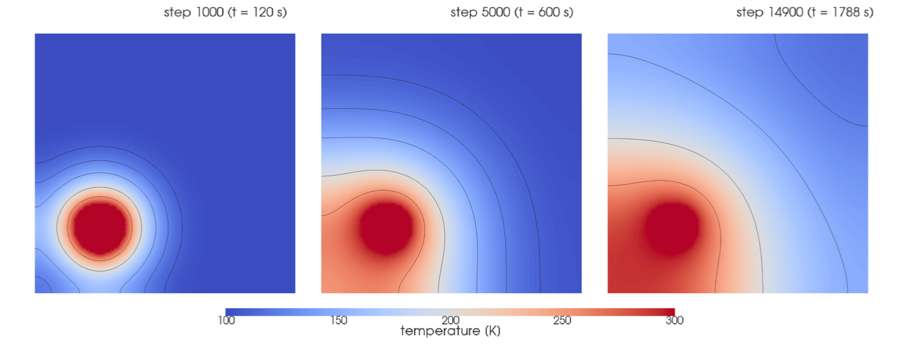

<!-- availability: available akantu::diffusion -->
# Diffusion (heat transfer)

<!-- BEGIN GENERATED: availability-status diffusion -->
**Available in this release** (facade module `akantu::diffusion`, crate `akantu-diffusion`, feature `diffusion`, on by default).
<!-- END GENERATED: availability-status diffusion -->

This chapter corresponds to *Diffusion model* (`diffusion.rst`) of the
upstream manual. The model is `akantu::diffusion::HeatTransferModel`: a
`DiffusionModel` whose degree of freedom is the temperature (crate
`akantu-diffusion`, feature `diffusion`, on by default), driven by the law
`heat_diffusion` (parameters `density`, `capacity`, `conductivity`, and the
optional `conductivity_variation` and `temperature_reference`). It solves
$\rho c \dot{T} = \nabla \cdot (\boldsymbol{\kappa} \nabla T)$ with the three analysis methods of upstream: `Static`,
`ImplicitDynamic` and `ExplicitLumpedMass`. It also runs on a distributed
mesh (upstream throws there, UD-275).

## Theory

### Strong form

The temperature $T(\boldsymbol{x}, t)$ in the domain $\Omega$ satisfies
the heat equation

$$
\rho c \dot{T} - \nabla \cdot (\boldsymbol{\kappa} \nabla T) = b
\quad \text{in } \Omega
$$

with the density $\rho$ (`density`), the specific heat capacity $c$
(`capacity`), the conductivity tensor $\boldsymbol{\kappa}$
(`conductivity`) and the heat generated per unit volume $b$. The boundary
$\Gamma = \partial\Omega$ is split into a part $\Gamma_T$ where the
temperature is imposed and a part $\Gamma_q$ where the heat flux
$\boldsymbol{q} = -\boldsymbol{\kappa} \nabla T$ is imposed:

$$
T = \bar{T} \ \text{on } \Gamma_T, \qquad
\boldsymbol{q} \cdot \boldsymbol{n} = \bar{q} \ \text{on } \Gamma_q,
$$

with $\boldsymbol{n}$ the outward normal; $\bar{q} > 0$ is heat leaving
the body. A boundary with no condition is insulated
($\boldsymbol{q} \cdot \boldsymbol{n} = 0$).

The law `heat_diffusion` keeps the top-left $d \times d$ block of the
`conductivity` matrix ($d$ the spatial dimension; a smaller matrix is
refused, UD-285), so `conductivity = [[401]]` is enough in 1-D and the
$3 \times 3$ matrix of upstream's input files works in every dimension.
With `conductivity_variation` $= \kappa'$ and `temperature_reference`
$= T_\text{ref}$ the conductivity at a quadrature point is

$$
\kappa_{ij}(T) = \kappa_{ij} + \kappa' \, (T - T_\text{ref})
$$

for every entry, off-diagonal entries included, as upstream (UD-282).

### Weak form and discretisation

Multiplying by a test function $v$ that vanishes on $\Gamma_T$ and
integrating by parts gives

$$
\int_\Omega \rho c \dot{T} v \, \mathrm{d}\Omega
+ \int_\Omega \nabla v \cdot \boldsymbol{\kappa} \nabla T \, \mathrm{d}\Omega
= \int_\Omega b v \, \mathrm{d}\Omega
- \int_{\Gamma_q} \bar{q} v \, \mathrm{d}\Gamma .
$$

With $T = \sum_j N_j T_j$ and $v = N_i$ this becomes, for every free node
$i$,

$$
\sum_j C_{ij} \dot{T}_j + \sum_j K_{ij} T_j = Q^\text{ext}_i,
\qquad
C_{ij} = \int_\Omega \rho c N_i N_j \, \mathrm{d}\Omega,
\qquad
K_{ij} = \int_\Omega \nabla N_i \cdot \boldsymbol{\kappa} \nabla N_j \, \mathrm{d}\Omega,
$$

that is

$$
\boldsymbol{C} \dot{\boldsymbol{T}} = \boldsymbol{Q}^\text{ext} - \boldsymbol{K} \boldsymbol{T},
$$

with the capacity matrix $\boldsymbol{C}$, the conductivity matrix
$\boldsymbol{K}$ and the nodal heat rates
$\boldsymbol{Q}^\text{ext}$. In the port $\boldsymbol{C}$ is the matrix
`M` of the DOF manager (`assemble_capacity_matrix`, a Gauss rule of order
twice the polynomial degree of the element), $\boldsymbol{K}$ the matrix
`K` (`assemble_diffusivity_matrix`, $\int \boldsymbol{B}^T
\boldsymbol{\kappa} \boldsymbol{B}$ per element), and the internal heat
rate $\boldsymbol{Q}^\text{int} = -\boldsymbol{K}\boldsymbol{T}$ is
assembled element by element as $-\int \boldsymbol{B}^T
(\boldsymbol{\kappa} \nabla T)$ without forming $\boldsymbol{K}$. The
residual is
$\boldsymbol{r} = \boldsymbol{Q}^\text{ext} + \boldsymbol{Q}^\text{int} - \boldsymbol{C}\dot{\boldsymbol{T}}$.

The upstream manual writes the strong form with
$+\nabla \cdot \boldsymbol{\kappa} \nabla T$ and defines
$\boldsymbol{K}$ with a minus sign; both codes assemble the positive
$\boldsymbol{K}$ above, with the internal heat rate
$-\boldsymbol{K}\boldsymbol{T}$.

### Nodal arrays and boundary conditions

| Array | Symbol | Meaning |
|---|---|---|
| `temperature()`, `temperature_mut()` | $\boldsymbol{T}$ | nodal temperature (zero after `init_full`) |
| `temperature_rate()` | $\dot{\boldsymbol{T}}$ | nodal rate (zero after `init_full`; dynamic methods) |
| `blocked_dofs()`, `blocked_dofs_mut()` | | `true`: the temperature of the node is imposed |
| `external_heat_rate()`, `external_heat_rate_mut()` | $\boldsymbol{Q}^\text{ext}$ | nodal heat rates: sources and boundary fluxes |
| `internal_heat_rate()` | $\boldsymbol{Q}^\text{int}$ | $-\boldsymbol{K}\boldsymbol{T}$, after a solve or `assemble_residual` |
| `lumped_capacity()` | $\boldsymbol{C}_L$ | diagonal of the lumped capacity (a copy) |

A Dirichlet condition $\bar{T}$ is set by writing the value into the
temperature and `true` into `blocked_dofs`; the solvers keep the
temperature (and the rate) of blocked nodes and compute the others.
`apply_dirichlet_bc(functor, group)` does both on the nodes of an element
group (a port extension: upstream's diffusion model has no `applyBC`).
The model has no Neumann functor: a heat source or a boundary flux is
given by its consistent nodal values
$Q^\text{ext}_i = \int_\Omega b N_i - \int_{\Gamma_q} \bar{q} N_i$,
written into `external_heat_rate_mut()`.

### Analysis methods

* `Static` (solver `static`): $\boldsymbol{K}\boldsymbol{T} =
  \boldsymbol{Q}^\text{ext}$, solved with the Newton–Raphson solver.
* `ExplicitLumpedMass` (solver `explicit_lumped`): forward Euler with the
  lumped capacity (below).
* `ImplicitDynamic` (solver `implicit`): backward Euler, the generalised
  trapezoidal rule
  $\boldsymbol{T}_{n+1} = \boldsymbol{T}_n + \Delta t \left[(1 - \alpha)\dot{\boldsymbol{T}}_n + \alpha \dot{\boldsymbol{T}}_{n+1}\right]$
  with $\alpha = 1$ and the temperature as unknown, so that each step
  solves with the matrix
  $\boldsymbol{J} = \boldsymbol{C}/(\alpha \Delta t) + \boldsymbol{K}$
  ([Implicit schemes and their default](#implicit-schemes-and-their-default)).

## Explicit time integration

The explicit method uses the lumped capacity $\boldsymbol{C}_L$: the
capacity $\int \rho c$ of each element is distributed onto its nodes
(row-sum lumping or diagonal scaling, chosen per element type by the FE
engine as for the lumped mass of the solid mechanics model), so that
$\boldsymbol{C}_L$ is diagonal and the step needs no linear solve. The
scheme is forward Euler ($\alpha = 0$; Curnier, 1992):

$$
\begin{aligned}
\boldsymbol{T}_{n+1} &= \boldsymbol{T}_n + \Delta t \, \dot{\boldsymbol{T}}_n
&& \text{(predictor)} \\
\boldsymbol{R}_{n+1} &= \boldsymbol{Q}^\text{ext}_{n+1} - \boldsymbol{K} \boldsymbol{T}_{n+1}
&& \text{(residual)} \\
\dot{\boldsymbol{T}}_{n+1} &= \boldsymbol{C}_L^{-1} \boldsymbol{R}_{n+1}
&& \text{(corrector)}
\end{aligned}
$$

on the free nodes. With $\alpha = 0$ the matrix $\boldsymbol{K}$ is
neither read nor needed (UD-195).

### Stable time step

Forward Euler is conditionally stable. `stable_time_step()` returns

$$
\Delta t_\text{crit} = \frac{2 h^2}{4} \, \frac{\rho c}{\kappa_\text{max}}
= \frac{h^2 \rho c}{2 \kappa_\text{max}}
$$

with $h$ the smallest characteristic size of the model's elements (the
length of a segment, twice the inradius of a triangle or a tetrahedron,
the shortest edge of a quadrangle), $\kappa_\text{max}$ the largest real
part of the eigenvalues of the `conductivity` matrix (at least $0$), and
the minimum taken over the laws and, on a distributed mesh, over the
ranks. The conductivity used is the parameter, without the temperature
variation $\kappa'$. The time step given to `set_time_step` must be
smaller: the example below takes $0.5\,\Delta t_\text{crit}$, upstream's
examples $0.8\,\Delta t_\text{crit}$. The upstream manual prints
$\Delta t_\text{crit} = 2 \Delta x^2 \rho c / \lVert \boldsymbol{\kappa} \rVert_\infty$;
both codes compute the formula above.

### A worked set-up: the hot point

The example `heat_diffusion_dynamics_2d` ([Examples](../examples.md))
is upstream's explicit set-up: a square plate of $1\ \text{m}^2$
(`square.msh`) of a fictitious material with
$\rho = 8940\ \text{kg}/\text{m}^3$,
$\kappa = 401\ \text{W}/(\text{m}\,\text{K})$ and
$c = 385\ \text{J}/(\text{kg}\,\text{K})$, everywhere at $100\ \text{K}$
except the nodes closer than $0.1\ \text{m}$ to the point
$(1/4, 1/4)$, which are blocked at $300\ \text{K}$; the time step is
$0.8\,\Delta t_\text{crit}$ and the run makes 15 000 steps. Its input
file:

```dat
model heat_transfer_model [
  constitutive_law heat_diffusion [
     name = test
     density = 8940
     capacity = 385
     conductivity = [[401,   0,   0], \
                     [0,   401,   0], \
                     [0,     0, 401]]
  ]
]
```


*Figure: temperature field of the hot-point example (`heat_diffusion_dynamics_2d`) at steps 1000, 5000 and 14 900, with the isotherms 110, 125, 150, 200 and 250 K (computed with akantu-rs).*

The port's run of this example matches upstream's dumps byte for byte
(`crates/akantu/tests/examples_heat_diffusion_dynamics_2d.rs`). The
static variant `heat_diffusion_static_2d` solves the same set-up with
`AnalysisMethod::Static`.

## Set-up and one explicit step

The example builds a bar of three segments, reads the law from an input
string, starts from a hot middle node and makes one explicit step at half
the stable time step. The rate of the insulated bar satisfies
$\sum_i M_i \dot{T}_i = 0$, so the lumped thermal content $\sum_i M_i T_i$ is unchanged by
the step. Guards on the model's arrays are scoped by a block and never
kept across a `solve_step`.

```rust
use akantu::core::enums::AnalysisMethod;
use akantu::core::{ElementType, GhostType, Idx, Real};
use akantu::diffusion::HeatTransferModel;
use akantu::mesh::{Mesh, MeshAccessor, SharedMesh};
use akantu::parser::Parser;

# fn main() -> akantu::core::Result<()> {
let mut mesh = Mesh::new(1, "bar")?;
{
    let mut a = MeshAccessor::new(&mut mesh);
    for i in 0..4 {
        a.push_node(&[0.25 * i as Real])?;
    }
    let mut c = a.connectivity_mut(ElementType::Segment2, GhostType::NotGhost);
    for i in 0..3 {
        c.push_tuple(&[i as Idx, (i + 1) as Idx]);
    }
}
mesh.compute_bounding_box()?;
let parser = Parser::parse_str(
    "model heat_transfer_model [\n\
     constitutive_law heat_diffusion [\n\
     name = copper\n density = 8940\n capacity = 385\n conductivity = [[401]]\n\
     ]\n]\n",
    "heat.dat",
)?;
let mut model =
    HeatTransferModel::with_parser(SharedMesh::new(mesh), None, "heat_transfer", parser)?;
model.init_full_with(AnalysisMethod::ExplicitLumpedMass)?;
{
    // the write guard lives until the end of this block
    let mut t = model.temperature_mut()?;
    t.as_mut_slice().copy_from_slice(&[20.0, 100.0, 20.0, 20.0]);
}
let dt = 0.5 * model.stable_time_step()?;
model.set_time_step(dt, None)?;
model.solve_step(None)?;
let m = model.lumped_capacity()?;
let content = |t: &[Real]| t.iter().zip(m.as_slice()).map(|(t, m)| t * m).sum::<Real>();
let t1 = model.temperature()?.as_slice().to_vec();
let rate = model.temperature_rate()?.as_slice().to_vec();
// the hot node cools, its neighbours warm, the insulated bar keeps its heat
assert!(rate[1] < 0.0 && rate[0] > 0.0 && rate[2] > 0.0);
let before = content(&[20.0, 100.0, 20.0, 20.0]);
assert!((content(&t1) - before).abs() <= 1e-12 * before);
# Ok(())
# }
```

## Implicit schemes and their default

`ImplicitDynamic` uses backward Euler with the temperature as unknown, as
upstream's `getDefaultSolverOptions` does. Upstream's generalized
trapezoidal predictor keeps the rate of the previous step, so upstream's
backward Euler stops evolving after its first step under constant loads
and its trapezoidal rule 1 is not Crank–Nicolson (UD-287). The port
corrects the predictor by default; the switch
`generalized_trapezoidal_keeps_rate_in_predictor` of
`akantu::solver::UpstreamCompat` (set on the DOF manager) reproduces
upstream. The corrected trapezoidal rule 1 is second order in time from a
consistent initial rate $\boldsymbol{M} \dot{\boldsymbol{T}}^0 = \boldsymbol{f} - \boldsymbol{K} \boldsymbol{T}^0$ and first order from the default
$\dot{\boldsymbol{T}}^0 = \boldsymbol{0}$ (what upstream always starts from);
`DiffusionModel::set_consistent_initial_rate` sets the consistent rate.

The other differences from upstream (each with a default that corrects it
and, where it changes results, a switch of `DiffusionUpstreamCompat`) are
listed with the entries UD-275…290 and UD-811 of
`docs/UPSTREAM_DEFECTS.md`.

## References

* Curnier, A. (1992). *Méthodes numériques en mécanique des solides*.
  EPFL.
