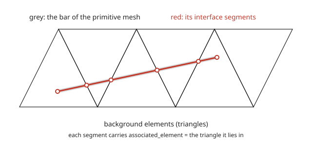
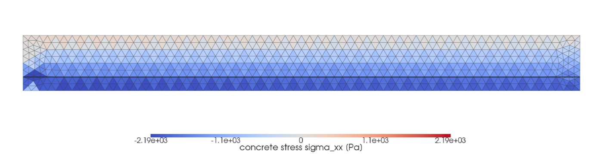

<!-- availability: available akantu::embedded -->
# Embedded interfaces

<!-- BEGIN GENERATED: availability-status embedded -->
**Available in this release** (facade module `akantu::embedded`, crate `akantu-embedded`, feature `embedded`, on by default).
<!-- END GENERATED: availability-status embedded -->

Upstream: the embedded interface model (`EmbeddedInterfaceModel`,
reinforcement laws; parity rows EMB-*).
The port's crate `akantu-embedded` is reached as `akantu::embedded`
(facade feature `embedded`, on by default as upstream's package) or
directly as `akantu_embedded`.

Per-feature descriptions are kept in the EMB rows of
[`docs/FEATURE_PARITY.md`](../../../FEATURE_PARITY.md); the departures from
upstream's code are the entries of
[`docs/UPSTREAM_DEFECTS.md`](../../../UPSTREAM_DEFECTS.md) that name them.

## The idea of embedded reinforcement

A reinforced solid (steel bars in concrete, fibres in a matrix) is
described by two meshes that do not have to conform: the *background*
mesh of the solid, on which the model solves for the displacement
$\boldsymbol{u}$, and a *primitive* mesh of `_segment_2` elements that
draws the bars. The bars have no degrees of freedom of their own. Each
bar is assumed perfectly bonded to the solid, so its displacement is the
background displacement interpolated along it, and its axial stiffness is
added to the stiffness of the background elements it crosses. The port
follows upstream's formulation, which takes the reinforcement stiffness
from Gomes and Awruch (2001).


*Figure: a reinforcement bar of the primitive mesh crossing the background
mesh; the intersector cuts it into one interface segment per background
element crossed (in red), each tied to that element (figure made for
akantu-rs).*

The model's initialisation (`EmbeddedInterfaceModel::init_full`) does the
geometry once:

1. `EmbeddedInterfaceIntersector` intersects every segment of the
   primitive mesh with the background elements (`_triangle_3`,
   `_triangle_6` or `_tetrahedron_4`; any other type is refused). Each
   intersection becomes a `_segment_2` element of the *interface mesh*,
   with the element data `associated_element` (the background element it
   lies in) and `physical_names` (the name of the bar it comes from). By
   default the pieces of one bar are assembled along it so that they cover
   the part of the bar inside the background mesh exactly once (no
   duplicate on a shared edge, no lost piece at a vertex; UD-599,
   UD-601).
2. The interface segments are assigned to the reinforcement law named by
   their `physical_names` (`InterfaceMeshDataMaterialSelector`), the bulk
   elements to their laws by the `physical_names` of the background mesh.
3. Each reinforcement law precomputes, at every Gauss point of its
   interface segments, the derivatives of the background element's shape
   functions at that point (the point is mapped back into the background
   element's reference element) and the directing cosines of the segment.

The background mesh must not change after `init_full`: the interface mesh
is not rebuilt, and the model checks the mesh revision before every
solve. The model runs on one process.

## Kinematics of a bar segment

Let $\boldsymbol{t} = (l, m, n)$ be the unit tangent of an interface
segment, computed from its end points $\boldsymbol{x}_0$,
$\boldsymbol{x}_1$ ($\boldsymbol{t} = \Delta\boldsymbol{x} /
\lVert \Delta\boldsymbol{x} \rVert$ with $\Delta\boldsymbol{x} =
\boldsymbol{x}_1 - \boldsymbol{x}_0$; $n = 0$ in 2-D). Its directing
cosines form a row vector in the Voigt order of the port:

$$
\begin{aligned}
\boldsymbol{C} &= \begin{bmatrix} l^2 & m^2 & lm \end{bmatrix} && \text{in 2-D,} \\
\boldsymbol{C} &= \begin{bmatrix} l^2 & m^2 & n^2 & mn & ln & lm \end{bmatrix} && \text{in 3-D.}
\end{aligned}
$$

The code forms the products of the components of $\Delta\boldsymbol{x}$
and divides them by $\lVert \Delta\boldsymbol{x} \rVert^2$. At a Gauss
point $q$ of the segment lying in the background element $e$, let
$\boldsymbol{B}$ be the strain-displacement matrix of $e$ evaluated at
that point (Voigt strains with engineering shears) and $\boldsymbol{u}_e$
the nodal displacements of $e$. The axial strain of the bar is the
projection of the background strain on its direction:

$$
\varepsilon_s = \boldsymbol{C}\, \boldsymbol{B}\, \boldsymbol{u}_e
  = \boldsymbol{t}^T \boldsymbol{\varepsilon}(\boldsymbol{u})\, \boldsymbol{t} .
$$

The law stores $\varepsilon_s$ as its $1 \times 1$ `grad_u` and the
background gradient $\nabla\boldsymbol{u}$ at the point as
`gradu_embedded`. The stress of the bar is that of a 1-D elastic law of
Young modulus $E$ (`E`), plus the uniform pre-stress $\sigma_{\text{pre}}$
(`pre_stress`):

$$
\sigma_s = E\, \varepsilon_s + \sigma_{\text{th}} + \sigma_{\text{pre}} ,
$$

where $\sigma_{\text{th}}$ is the thermal stress of the 1-D elastic law
(zero unless its thermal keywords are set).

The law's `eigen_grad_u` is not subtracted, as upstream (UD-594), and
finite deformation is refused (UD-592).

## Internal forces and stiffness

The bar of cross-sectional area $A$ (`area`) adds to the background
element $e$ the integrals along the interface segments $s$ that lie in
it:

$$
\begin{aligned}
\boldsymbol{f}^{\text{int}}_e &= A \int_s \boldsymbol{B}^T \boldsymbol{C}^T \sigma_s \,\mathrm{d}s , \\
\boldsymbol{K}_e &= A \int_s \boldsymbol{B}^T \boldsymbol{C}^T E\, \boldsymbol{C}\, \boldsymbol{B} \,\mathrm{d}s .
\end{aligned}
$$

The integrals are evaluated with the Gauss points and the Jacobians of
the interface mesh's FE engine (element dimension 1), and the results are
assembled on the nodes of $e$ with the sign convention of the bulk
internal forces; the stiffness blocks are symmetric. A segment therefore
stiffens the background element along the bar's direction only, in
proportion to $E A$ and to the length of bar inside the element. The
potential energy of the bar is

$$
E_{\text{pot}} = A \int \tfrac{1}{2}\, \sigma_s\, \varepsilon_s \,\mathrm{d}s ,
$$

the integral running over all its interface segments
(`energy("potential")`).

The code evaluates these products in the order of upstream's Eigen
expressions (left to right; in the stiffness, $E$ multiplies the outer
product of $\boldsymbol{B}^T\boldsymbol{C}^T$ with
$\boldsymbol{C}\boldsymbol{B}$), which the bitwise comparison with the
patched oracle variant needs (D-060).

## Input

A reinforcement law is the section `material reinforcement elastic` of
the input file, with the keywords of the 1-D elastic law (`E`, …) and the
two of the reinforcement, `area` (default `1`) and `pre_stress` (default
`0`). Its `name` is the physical name of the bars it applies to. The port
of upstream's example `embedded_model` (a pre-stressed bar in a concrete
beam) shows the set-up:

```text
material elastic [
  name = concrete
  E = 30e9
  nu = 0.1
]

material reinforcement elastic [
  name = reinforcement
  E = 210e9
  area = 1e-4
  pre_stress = 10e6
]
```

The program is `crates/akantu/examples/embedded/main.rs` ([Examples](../examples.md));
the dumper `"reinforcement"` writes the fields of the interface mesh.


*Figure: concrete stress $\sigma_{xx}$ of the example `embedded`, the pre-stressed bar drawn as a dark line: the bar compresses the concrete around it; the colour scale is clipped at the 99th percentile of $\lvert \sigma_{xx} \rvert$ (computed with akantu-rs).*

## Search structure of the intersection

The interface mesh is built by cutting every reinforcement segment by the
background elements. The port searches the elements near each segment with
a uniform grid (`akantu_geometry::GridIndex`), where upstream uses CGAL's
AABB tree; `EmbeddedInterfaceIntersector::exhaustive_search = true` tests
every element instead (`LinearScan`, quadratic cost). Both use upstream's
predicates. They differ only where the exhaustive scan reports a distant
element through rounding noise (a segment lying, up to rounding, on the line
of a distant edge or in the plane of a distant face): the grid, like
upstream's tree, does not test that element. With the default assembly of
the pieces (`remove_near_duplicates = true`) no difference was found; with
upstream's collected set the scan can attach a piece to the distant element
where the grid and upstream keep the element containing it. The
documentation of `akantu_embedded::intersector` gives the details and the
tests.

## References

Gomes, H. M. and Awruch, A. M. (2001). Some aspects on three-dimensional
numerical modelling of reinforced concrete structures using the finite
element method. *Advances in Engineering Software*, 32(4), 257–277.
