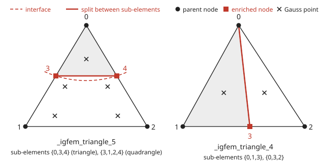

<!-- availability: available akantu::igfem -->
# IGFEM (interface-enriched finite elements)

<!-- BEGIN GENERATED: availability-status igfem -->
**Available behind the Cargo feature `igfem`**, off by default (facade module `akantu::igfem`, crate `akantu-igfem`).
<!-- END GENERATED: availability-status igfem -->

Upstream: the package `igfem` of `extra_packages/` (parity rows IGFEM-*,
ELEM-024…026). The port's crate `akantu-igfem` is reached as `akantu::igfem`
with the facade feature `igfem`, or directly as `akantu_igfem`. The feature
is off by default, as upstream's package, and it implies the feature
`cgal`: the interface generation uses CGAL's spherical kernel, which the
port keeps in the GPL-3.0-or-later crate `akantu-geometry-cgal` (decision
D-042). A build that enables `igfem` is therefore GPL-3.0-or-later as a
whole ([Geometry and the `cgal` feature](../geometry.md)).

```toml
[dependencies]
akantu = { path = "…/akantu-rs/crates/akantu", features = ["igfem"] }
```

The crate provides the IGFEM element types (`_igfem_segment_3`,
`_igfem_triangle_4`, `_igfem_triangle_5`), their FE engine, the materials
`igfem_elastic`, `igfem_saw_tooth_damage` and
`igfem_iterative_stiffness_reduction`, the growing-gel mesh generation and
the solid mechanics model `SolidMechanicsModelIgfem`.

The materials combine two sub-materials named in the input file
(`name_sub_mat_1`, `name_sub_mat_2`): each integration point of an IGFEM
element takes the elastic constants of the sub-material of its side of the
interface. The damage laws take their damage parameters from their second
sub-material, a `damage_iterative` or `iterative_stiffness_reduction` law of
the extra materials, and are driven between solves like those laws
(`norm_max_equivalent_stress`, `update_damage`). A sub-material must be an
elastic law or one built on it: the model recognises it by its real
parameters `lambda`, `mu` and `kapa` and refuses `neohookean` and laws
without them, which also lets through laws that upstream refuses but that
register the same three parameters (UD-1210).

`SolidMechanicsModelIgfem::update` creates the IGFEM elements of an
interface; later calls, and `move_interface`, move them on the live model:
the replaced elements' damage, strength and other transferred internals are
copied into the new elements (upstream's `transferInternalValues`), and the
enriched nodes of the previous position are removed with their degrees of
freedom. Each update is two mesh mutations: the additions with the erasure
of the replaced elements, then the removal of the previous enriched nodes.

The model registers the dumper `"igfem elements"` as upstream: it writes
every IGFEM element as its two sub-elements, with `real_displacement` (the
displacement at the interface nodes) and the IGFEM material fields per
sub-element. With a non-local law, the non-local manager counts the
integration points of both element kinds (upstream's
`NonLocalManagerIGFEM`). The IGFEM model runs on one process: a
distributed mesh is refused (the parallel part of upstream's package is an
approved exception, decision D-085).

The reference is the crate documentation of `akantu::igfem` and the ports
of upstream's tests in `crates/akantu-igfem/tests/`, which show the use of
the model (for example `test_solid_mechanics_model_igfem.rs`); the
departures from upstream's code are the entries of
[`docs/UPSTREAM_DEFECTS.md`](../../../UPSTREAM_DEFECTS.md) that name them.

## The interface-enriched formulation

IGFEM, the interface-enriched generalised finite element method of
Soghrati et al. (2012), solves problems with material interfaces (here
the boundaries of spherical gel pockets) on a mesh that does not follow
them. Across such an interface the displacement is continuous but its
gradient jumps; standard shape functions on elements cut by the
interface cannot represent that kink. IGFEM adds *enriched nodes* where
the interface crosses the edges of the mesh and attaches one enrichment
function to each of them.

In an IGFEM element with $p$ parent nodes and $m$ enriched nodes, the
displacement is

$$
\boldsymbol{u}^h(\boldsymbol{x}) = \sum_{i=1}^{p} N_i(\boldsymbol{x})\, \boldsymbol{u}_i
  + \sum_{j=1}^{m} \psi_j(\boldsymbol{x})\, \boldsymbol{\alpha}_j ,
$$

where $N_i$ are the shape functions of the linear parent element
(`_segment_2` or `_triangle_3`) and $\psi_j$ is, at a point of a
sub-element, that sub-element's Lagrange shape function of the enriched
node $j$ (the element is split along the interface into two
sub-elements, below). Each $\psi_j$ is continuous, equal to 1 at its
node, zero at every parent node and on the sub-element edges that do
not contain node $j$, so the enriched element stays conforming with its
regular neighbours. Its gradient is discontinuous across the interface:

$$
\nabla \boldsymbol{u}^h = \sum_{i=1}^{p} \boldsymbol{u}_i \otimes \nabla N_i
  + \sum_{j=1}^{m} \boldsymbol{\alpha}_j \otimes \nabla \psi_j ,
$$

and the enriched degrees of freedom $\boldsymbol{\alpha}_j$ carry the jump
of the gradient. They are not displacements: the physical displacement
at the enriched node $j$, at position $\boldsymbol{x}_j$, is

$$
\boldsymbol{u}(\boldsymbol{x}_j) = \sum_{i=1}^{p} N_i(\boldsymbol{x}_j)\, \boldsymbol{u}_i + \boldsymbol{\alpha}_j ,
$$

which `SolidMechanicsModelIgfem::compute_values_on_enriched_nodes`
evaluates by interpolating the element's displacement at the node's
coordinates; the result is the field `real_displacement` (the
displacement itself at the standard nodes).

## Element types and sub-elements

An IGFEM element lists the nodes of its parent element first, then its
enriched nodes. The port's element tables (from upstream's
`aka_element_classes_info`) define:

| Type | Parent | Sub-elements | Sub-connectivities | Enriched nodes |
|---|---|---|---|---|
| `_igfem_segment_3` | `_segment_2` | `_segment_2`, `_segment_2` | `{0,2}`, `{2,1}` | node 2 |
| `_igfem_triangle_4` | `_triangle_3` | `_triangle_3`, `_triangle_3` | `{0,1,3}`, `{0,3,2}` | node 3 |
| `_igfem_triangle_5` | `_triangle_3` | `_triangle_3`, `_quadrangle_4` | `{0,3,4}`, `{3,1,2,4}` | nodes 3, 4 |


*Figure: an `_igfem_triangle_5` cut by an interface through its edges
(0, 1) and (2, 0), and an `_igfem_triangle_4` split along the segment
from node 0 to the enriched node 3 on edge (1, 2); the crosses are the
integration points of the sub-elements (figure made for akantu-rs).*

The growing-gel mesh generation (`MeshIgfemSphericalGrowingGel`, feature
`cgal`) builds these elements from the spheres of the interface: it
intersects the edges of every triangle with the spheres (CGAL's exact
spherical kernel, in the GPL crate), adds the intersection points as
new nodes and turns every triangle with one new node into an
`_igfem_triangle_4`, renumbered so that the cut edge is its local edge
(1, 2), and every triangle with two new nodes into an
`_igfem_triangle_5`, with the vertex isolated by the interface first
(node 3 then lies on edge (0, 1), node 4 on edge (2, 0)). An IGFEM
element whose edges are no longer cut becomes a `_triangle_3` again.

The material of each sub-element is chosen from the interface geometry:
for an `_igfem_triangle_4`, sub-element $s$ takes the first
sub-material (`name_sub_mat_1`) if its barycentre is inside the
interface geometry registered under that sub-material's name, and the
second (`name_sub_mat_2`) otherwise (the sub-material index is
$1 - \text{inside}$); for an `_igfem_triangle_5`, the side follows from
which parent nodes are inside that geometry.

## Integration on the sub-elements

The integrand is smooth on each side of the interface but not across
it, so the IGFEM engine (`IgfemFeEngine`) integrates sub-element by
sub-element. The integration points of an element are the Gauss points
of sub-element 0 followed by those of sub-element 1, each with the
default rule of the sub-element's type: 1 point for `_triangle_3` and
`_segment_2`, $2 \times 2$ for `_quadrangle_4`. An `_igfem_triangle_4`
therefore has 2 points, an `_igfem_triangle_5` 5 and an
`_igfem_segment_3` 2. An integral over the element is

$$
\int_{\Omega_e} f \,\mathrm{d}\Omega \approx \sum_{s=0}^{1} \sum_{q}
  f\big(\boldsymbol{x}(\boldsymbol{\xi}_{s,q})\big)\, \det \boldsymbol{J}_s(\boldsymbol{\xi}_{s,q})\, w_{s,q} ,
$$

with $\boldsymbol{\xi}_{s,q}$ and $w_{s,q}$ the Gauss points and weights
of the sub-element's reference element and $\boldsymbol{J}_s$ the
Jacobian of the sub-element's map, so integrals are exact for integrands
that are polynomials of the rule's degree on each side.

To evaluate the shape functions at a Gauss point, the engine maps the
point into the physical domain with the sub-element's interpolation of
its node coordinates, then back into the reference element of the parent
(the parent's inverse map, a Gauss–Newton iteration from
$\boldsymbol{\xi} = \boldsymbol{0}$ with tolerance $10^{-10}$ and at most
100 iterations). The shapes at the point are the parent shapes $N_i$
there followed by the sub-element's shapes of the enriched nodes
($\psi_j$); the physical derivatives are assembled in the same way from
$\boldsymbol{J}^{-1} \partial N / \partial \boldsymbol{\xi}$ of the parent
and of the sub-element. With $\boldsymbol{B}$ the strain-displacement
matrix built from these derivatives, the IGFEM materials assemble

$$
\boldsymbol{f}^{\text{int}}_e = \sum_{s,q} \boldsymbol{B}^T \boldsymbol{\sigma}\, \det \boldsymbol{J}_s\, w_{s,q} ,
\qquad
\boldsymbol{K}_e = \sum_{s,q} \boldsymbol{B}^T \boldsymbol{D}\, \boldsymbol{B}\, \det \boldsymbol{J}_s\, w_{s,q} ,
$$

where, for `igfem_elastic`, the stress at a point is

$$
\boldsymbol{\sigma} = \lambda \operatorname{tr}(\nabla\boldsymbol{u})\, \boldsymbol{I}
  + \mu \left(\nabla\boldsymbol{u} + \nabla\boldsymbol{u}^T\right)
$$

with the Lamé constants $\lambda$, $\mu$ of the point's sub-material
($\sigma = 2\mu\, \nabla u$ in 1-D, as upstream, UD-612), and
$\boldsymbol{D}$ is the isotropic Voigt tangent of $(\lambda, \mu)$.
IGFEM elements contribute no mass, so the model is used for static
analyses, as upstream's tests.

## References

Soghrati, S., Aragón, A. M., Duarte, C. A. and Geubelle, P. H. (2012).
An interface-enriched generalized FEM for problems with discontinuous
gradient fields. *International Journal for Numerical Methods in
Engineering*, 89(8), 991–1008.
