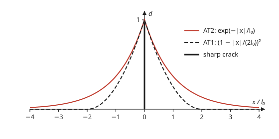
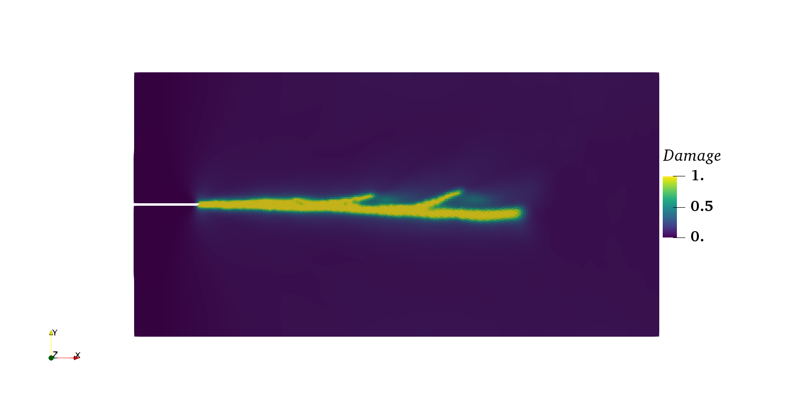

<!-- availability: available akantu::phase_field -->
# Phase-field fracture

<!-- BEGIN GENERATED: availability-status phase-field -->
**Available in this release** (facade module `akantu::phase_field`, crate `akantu-phase-field`, feature `phase-field`, on by default).
<!-- END GENERATED: availability-status phase-field -->

This chapter corresponds to *PhaseField Model* (`phasefieldmodel.rst`) of
the upstream manual. The model is `akantu::phase_field::PhaseFieldModel`
(crate `akantu-phase-field`, feature `phase-field`, on by default). The
solid side of the coupling, the material `phasefield`, is in
`akantu::solid` ([below](#the-solid-side-material-phasefield)).

The staggered coupler `CouplerSolidPhaseField` of upstream is in
`akantu::couplers` ([Model couplers](couplers.md)); a program can also
drive the two models itself, as described in [Coupling with the
solid](#coupling-with-the-solid).

The model and the coupler run on a distributed mesh ([Parallel
computations](../parallel.md)): the ghost elements receive their owner's
law at initialisation, every residual assembly sends the owners' driving
force, driving energy and damage of the ghost elements' points
(`_pfm_damage`), and the energies are reduced over the ranks (tests
`phase_field_parallel.rs`, `mpi_phase_field.rs` and
`manual_claims_2.rs::doc014_phase_field_model_runs_on_a_distributed_mesh`).
Upstream writes the damage gradient of the ghost elements into the
not-ghost storage (UD-004); the port keeps them apart by default.

What this release does not contain:

* in the default build, the bounded TAO solve of
  `irreversibility_type = tao`: it needs the PETSc back-end, off by
  default (feature `akantu-phase-field/petsc`; a build with it is
  distributed under GPL-3.0-or-later as a whole, see
  [The PETSc back-end](../petsc.md)); see
  [Irreversibility](#irreversibility).

## Theory

### Variational formulation of brittle fracture

Francfort and Marigo (1998) recast Griffith's theory as the minimisation
of a total energy. A body $\Omega$ with a crack $\Gamma$ and the
displacement $\boldsymbol{u}$ has the elastic energy and the surface
energy

$$
\Phi_e(\boldsymbol{u}, \Gamma) = \int_{\Omega \setminus \Gamma} \psi(\boldsymbol{\varepsilon}(\boldsymbol{u})) \, \mathrm{d}\Omega,
\qquad
\Phi_s(\Gamma) = \int_\Gamma \mathcal{G}_c \, \mathrm{d}\mathcal{H}^{d-1},
$$

with $\mathcal{H}^{d-1}$ the $(d-1)$-dimensional Hausdorff measure (the
length of a curve in 2-D, the area of a surface in 3-D), $\mathcal{G}_c$
the critical energy release rate and, for small strains and linear
elasticity, the energy density

$$
\psi(\boldsymbol{\varepsilon}) = \frac{1}{2} \lambda (\operatorname{tr} \boldsymbol{\varepsilon})^2
+ \mu \, \boldsymbol{\varepsilon} : \boldsymbol{\varepsilon} .
$$

The crack path is the one that minimises $\Phi_e + \Phi_s$ under the
loading, which needs no criterion for the initiation, the direction or the
branching of a crack.

### Regularised crack and the two laws

Bourdin, Francfort and Marigo (2000) approximate the sharp crack by a
nodal damage field $d(\boldsymbol{x})$ ($0$ intact, $1$ broken) spread
over the length scale $l_0$ (parameter `l0`), and the energy by

$$
E(\boldsymbol{u}, d) = \int_\Omega g(d) \, \psi^+(\boldsymbol{\varepsilon})
+ \psi^-(\boldsymbol{\varepsilon}) \, \mathrm{d}\Omega
+ \int_\Omega \frac{g_c}{c_w} \left( \frac{w(d)}{l_0} + l_0 \, \nabla d \cdot \nabla d \right) \mathrm{d}\Omega ,
$$

with the degradation function $g(d) = (1 - d)^2$, the split
$\psi = \psi^+ + \psi^-$ of the elastic energy (below), $g_c$ the
critical energy release rate (parameter `gc`) and a local dissipation
$w(d)$ normalised by $c_w$: $w = d^2$, $c_w = 2$ for the `quadratic` law
(AT2) and $w = d$, $c_w = 8/3$ for the `linear` law (AT1). As $l_0 \to 0$
the second integral tends to the crack length times $g_c$. In one
dimension, a crack at $x = 0$ ($d(0) = 1$) without load has the profile
$d = e^{-|x|/l_0}$ with AT2 and, when the damage is bounded to
$[0, 1]$ (the `tao` irreversibility below),
$d = (1 - |x|/(2 l_0))^2$ for $|x| \le 2 l_0$ and $0$ beyond with AT1;
the ports of upstream's tests check both
(`test_phase_field_model.rs`, `petsc_models.rs::test_phase_field_optimal_linear`).


*Figure: one-dimensional damage profiles around a crack at $x = 0$: AT2 decays exponentially over $l_0$, AT1 (with bounds) vanishes beyond $2 l_0$; the sharp crack is the limit $l_0 \to 0$.*

For a given strain field, $d$ solves the stationarity condition of $E$
with respect to $d$. The port registers the two laws that
upstream's code registers (`instantiatePhaseField<…>("quadratic")` and
`("linear")`):

| | `quadratic` (AT2) | `linear` (AT1) |
|---|---|---|
| fracture energy density | $\frac{g_c d^2}{2 l_0} + \frac{1}{2} g_c l_0 \nabla d \cdot \nabla d$ | $\frac{3 g_c d}{8 l_0} + \frac{3}{8} g_c l_0 \nabla d \cdot \nabla d$ |
| driving force (per point) | $-2\phi + d \left(2\phi + \frac{g_c}{l_0}\right)$ | $-2\phi + \frac{3 g_c}{8 l_0} + 2\phi \, d$ |
| gradient coefficient (`damage_energy`) | $g_c l_0 \boldsymbol{I}$ | $\frac{3}{4} g_c l_0 \boldsymbol{I}$ |
| initial history $\phi_\text{prev}$ | $0$ | $\frac{3 g_c}{16 l_0}$ |

Here $\phi$ is the driving energy density computed from the strain by the
energy split (below) and $g_c$ the critical energy release rate (parameter
`gc`). The driving force is the derivative of the point's energy
$(1 - d)^2 \phi + \frac{g_c}{c_w l_0} w(d)$ with respect to $d$, and the
gradient coefficient twice the factor of $\nabla d \cdot \nabla d$.

### Energy split and degradation

The energy split decides which part of the elastic energy drives the
damage and is degraded by it. It is the option of the `phasefield`
section ([Using the model](#using-the-model)) and computes, from the
strain $\boldsymbol{\varepsilon}$ of each quadrature point, the driving
energy density $\phi = \psi^+$:

$$
\begin{aligned}
\texttt{no\_split}: \quad & \phi = \frac{1}{2} \lambda (\operatorname{tr} \boldsymbol{\varepsilon})^2 + \mu \, \boldsymbol{\varepsilon} : \boldsymbol{\varepsilon} \\
\texttt{volumetric\_deviatoric}: \quad & \phi = \frac{1}{2} \kappa \langle \operatorname{tr} \boldsymbol{\varepsilon} \rangle_+^2
+ \mu \left( \boldsymbol{\varepsilon} : \boldsymbol{\varepsilon} - \frac{(\operatorname{tr} \boldsymbol{\varepsilon})^2}{3} \right)
\end{aligned}
$$

with the Lamé constants $\lambda$, $\mu$ of `E`, `nu` and `Plane_Stress`
and the bulk modulus $\kappa = \lambda + \frac{2}{3}\mu$. With
`volumetric_deviatoric` a volumetric compression
($\operatorname{tr} \boldsymbol{\varepsilon} < 0$) does not drive the
damage. The second formula is the port's default in 1-D and 2-D (UD-387,
[Differences from upstream](#differences-from-upstream)); in 3-D it is
upstream's.

The degradation of the stress is the solid's side: the material
`phasefield` computes
$\boldsymbol{\sigma} = \left((1 - d)^2 + \eta\right) \boldsymbol{\sigma}^+ + \boldsymbol{\sigma}^-$
with the same split and a residual stiffness $\eta$ (parameter `eta`)
that keeps the broken material from losing all stiffness; its formulas
are on the page [The phase-field material](../laws/phasefield.md). The
phase-field laws use $g(d) = (1 - d)^2$ without $\eta$.

### History field and strong form

The damage must not heal when the load decreases. With the default
`irreversibility_type = history` the laws replace $\phi$ by the history
field

$$
\mathcal{H}(\boldsymbol{x}, t) = \max\left(\phi(\boldsymbol{x}, t), \ \phi_\text{prev}(\boldsymbol{x})\right),
$$

where $\phi_\text{prev}$ is the largest $\phi$ saved by
`save_previous_state()` (Miehe, Hofacker and Welschinger, 2010); the
other choices are described in [Irreversibility](#irreversibility). The
stationarity of $E$ with $\phi$ replaced by $\mathcal{H}$ gives the strong
forms

$$
\begin{aligned}
\text{AT2}: \quad & 2 (1 - d) \mathcal{H} = \frac{g_c}{l_0} \left( d - l_0^2 \Delta d \right) \\
\text{AT1}: \quad & 2 (1 - d) \mathcal{H} = \frac{3 g_c}{8 l_0} \left( 1 - 2 l_0^2 \Delta d \right)
\end{aligned}
\qquad \text{in } \Omega, \qquad \nabla d \cdot \boldsymbol{n} = 0 \ \text{on } \partial\Omega .
$$

For AT1 the right-hand side is positive at $d = 0$: the damage starts only
when $\mathcal{H}$ exceeds $3 g_c/(16 l_0)$, which is why the initial
history of the `linear` law is that value (it keeps $d = 0$ below the
elastic limit, without bounds on $d$).

### Discretisation

The model assembles, per element,

$$
\begin{aligned}
\boldsymbol{f}^\text{int} &= -\int_{\Omega_e} \boldsymbol{N}^T f_d \, \mathrm{d}\Omega
- \int_{\Omega_e} \boldsymbol{B}^T \left( \boldsymbol{D}_d \nabla d \right) \mathrm{d}\Omega \\
\boldsymbol{K} &= \int_{\Omega_e} \boldsymbol{N}^T k_d \boldsymbol{N} \, \mathrm{d}\Omega
+ \int_{\Omega_e} \boldsymbol{B}^T \boldsymbol{D}_d \boldsymbol{B} \, \mathrm{d}\Omega
\end{aligned}
$$

with the driving force $f_d$, the gradient coefficient
$\boldsymbol{D}_d$ (`damage_energy`) and the density $k_d$
(`damage_energy_density`) of the table, in the names of the code:

```text
f_int = −∫ Nᵀ · driving_force − ∫ Bᵀ · (damage_energy · ∇d)
K     =  ∫ Nᵀ · damage_energy_density · N + ∫ Bᵀ · damage_energy · B
```

with $k_d$ = `damage_energy_density` $= 2\phi + g_c/l_0$ (AT2) or $2\phi$ (AT1), and solves
$\boldsymbol{f}^\text{ext} + \boldsymbol{f}^\text{int} = \boldsymbol{0}$ for $d$. For the `quadratic` law this is the weak form
of the strong form given by the upstream manual,
$2(1 - d)\phi = (g_c/l_0)(d - l_0^2 \Delta d)$ with $\nabla d \cdot \boldsymbol{n} = 0$ on the boundary.

### Homogeneous solutions

Under a homogeneous strain the damage is uniform ($\nabla d = 0$) and the two
laws have closed forms, which the example below checks:

* AT2: $d = 2\phi / (2\phi + g_c/l_0)$, damage at any load;
* AT1: $d = 1 - 3 g_c / (16 l_0 \phi)$ once $\phi$ exceeds the elastic limit
  $3 g_c/(16 l_0)$, and $d = 0$ below it (the initial history $\phi_\text{prev}$
  keeps $\phi$ at that limit).

### Differences from the upstream manual

Differences from the upstream manual (the code of upstream is the
reference, D-003):

* the manual describes an "exponential" law (`phasefield exponential`);
  upstream's code has no such law and refuses the keyword, as the port
  does (test `manual_claims_2.rs::doc014_upstream_law_names`);
* the manual's strong form prints $d - l_0^2 d$; the Laplacian $\Delta d$ is
  meant (it is what both codes assemble);
* the manual says the default solver "is of linear type": the default
  solver of the `static` method is a Newton–Raphson solver with the
  pseudo-time scheme (upstream `getDefaultSolverOptions`; test
  `manual_claims_2.rs::doc014_default_solver`). With `history`
  irreversibility the residual is linear in $d$ and $\boldsymbol{K}$ is its exact
  Jacobian (test
  `phase_field_checks.rs::stiffness_is_the_exact_jacobian_of_the_residual`),
  so the first Newton correction gives the solution.

## Using the model

Phase-field laws are `phasefield <law> [option] [ … ]` sections, read
from the model's `model phase_field_model [ … ]` section when the file
has one, else from the top level (as materials):

```dat
model phase_field_model [
    phasefield quadratic [
        name = plate
        E    = 210.0
        nu   = 0.3
        gc   = 5e-3
        l0   = 0.1
    ]
]
```

The option selects the energy split: empty or `no_split` (the default)
degrades the whole energy, `volumetric_deviatoric` does not degrade
volumetric compression (`phasefield quadratic volumetric_deviatoric
[ … ]`).

<!-- BEGIN GENERATED: phasefield-parameters -->
| Parameter | Type | Access | `quadratic` | `linear` |
|---|---|---|---|---|
| `name` | ByteString | r-p | ✓ | ✓ |
| `l0` | Real | r-p | ✓ | ✓ |
| `gc` | Random | r-p | ✓ | ✓ |
| `E` | Real | r-p | ✓ | ✓ |
| `nu` | Real | r-p | ✓ | ✓ |
| `irreversibility_type` | ByteString | r-p | ✓ | ✓ |
| `Plane_Stress` | Bool | r-p | ✓ | ✓ |
| `irreversibility_tol` | Real | r-p | ✓ | ✓ |
| `recovery_tol` | Real | r-p | — | ✓ |
<!-- END GENERATED: phasefield-parameters -->

(Access: `r` readable, `w` writable, `p` parsable; the table is generated
from the code.) No parameter is writable after parsing, as upstream.
Defaults: `l0 = gc = E = nu = 0`, `irreversibility_type = history`,
`Plane_Stress = false`, `irreversibility_tol = recovery_tol = 1e-2`
(tests `phase_field_checks.rs::parameters_and_defaults` and
`manual_claims_2.rs::doc014_phase_field_defaults_of_e_and_nu`). `gc` is a random
parameter (`gc = 5e-3 uniform [0, 1e-3]` draws one value per quadrature
point, see [Random parameters](../input-files.md#random-parameters)); the
penalties $\gamma$ and $\rho_\text{rec}$ below use its base value.

The model has the usual life cycle. Driving the two models by hand (the
coupler of [Model couplers](couplers.md) does it for a whole
simulation), the strain that drives
the damage is written by the program into each law's `strain` internal
(column-major `dim × dim` per quadrature point), which is exactly what
upstream's coupler writes:

```rust
use akantu::core::enums::AnalysisMethod;
use akantu::core::{ElementType, GhostType, Real};
use akantu::mesh::{Mesh, MeshAccessor, SharedMesh};
use akantu::model::ModelOptions;
use akantu::parser::Parser;
use akantu::phase_field::{PhaseField, PhaseFieldModel};

/// Two bilinear quadrangles on [0, 1] × [0, 0.5].
fn plate() -> akantu::core::Result<SharedMesh> {
    let mut mesh = Mesh::new(2, "plate")?;
    {
        let mut a = MeshAccessor::new(&mut mesh);
        for j in 0..2 {
            for i in 0..3 {
                a.push_node(&[0.5 * i as Real, 0.5 * j as Real])?;
            }
        }
        // write guard on the connectivity, dropped at the end of this block
        let mut c = a.connectivity_mut(ElementType::Quadrangle4, GhostType::NotGhost);
        c.push_tuple(&[0, 1, 4, 3]);
        c.push_tuple(&[1, 2, 5, 4]);
    }
    mesh.compute_bounding_box()?;
    Ok(SharedMesh::new(mesh))
}

/// The same strain (column-major dim × dim) at every point of every law.
fn set_strain(model: &mut PhaseFieldModel, strain: &[Real]) -> akantu::core::Result<()> {
    for i in 0..model.nb_phase_fields() {
        let law = model.phase_field_mut(i)?;
        for ty in law.base().filter_types(GhostType::NotGhost) {
            // write guard on one block of the `strain` internal, dropped at
            // the end of each iteration
            let mut s = law.base_mut().strain.get_mut(ty, GhostType::NotGhost)?;
            for point in s.as_mut_slice().chunks_exact_mut(strain.len()) {
                point.copy_from_slice(strain);
            }
        }
    }
    Ok(())
}

let (e, nu, gc, l0) = (210.0, 0.3, 5e-3, 0.2);
let lambda = nu * e / ((1.0 + nu) * (1.0 - 2.0 * nu)); // plane strain
let mu = e / (2.0 * (1.0 + nu));
// uniaxial strain ε_xx: φ = ½λ (tr ε)² + μ ε:ε
let phi = |eps: Real| (0.5 * lambda + mu) * eps * eps;

for law in ["quadratic", "linear"] {
    let input = format!(
        "phasefield {law} [\n name = plate\n E = {e}\n nu = {nu}\n gc = {gc}\n l0 = {l0}\n]\n"
    );
    let parser = Parser::parse_str(&input, "phase_field.dat")?;
    let mut model = PhaseFieldModel::with_parser(plate()?, None, "phase_field_model", parser)?;
    model.init_full(&ModelOptions::new(AnalysisMethod::Static))?;

    for eps in [4e-3, 1e-2] {
        set_strain(&mut model, &[eps, 0.0, 0.0, 0.0])?;
        model.solve_step(None)?;
        let want = match law {
            "quadratic" => 2.0 * phi(eps) / (2.0 * phi(eps) + gc / l0),
            _ => (1.0 - 3.0 * gc / (16.0 * l0 * phi(eps))).max(0.0),
        };
        for &d in model.damage()?.as_slice() {
            assert!((d - want).abs() <= 1e-12, "{law}, ε = {eps}: {d} vs {want}");
        }
        // fracture energy of the uniform damage over the area 0.5
        let density = match law {
            "quadratic" => gc * want * want / (2.0 * l0),
            _ => 3.0 * gc * want / (8.0 * l0),
        };
        let energy = model.energy("dissipated")?;
        assert!((energy - 0.5 * density).abs() <= 1e-12 * (0.5 * density).max(gc / l0));
        assert_eq!(model.energy("kinetic")?, 0.0); // any other id: 0
    }
}
# Ok::<(), akantu::core::Error>(())
```

With `eps = 4e-3` the `linear` law stays below its elastic limit
($\phi < 3 g_c/(16 l_0)$, $d = 0$, no fracture energy) while the `quadratic`
one is already damaged. The fracture energy is the integral of the
densities of the table above ($\nabla d = 0$ here).

Model functions (upstream name in parentheses):

| Port | Upstream | |
|---|---|---|
| `PhaseFieldModel::new(mesh, dim, id)`, `with_parser(…, parser)` | constructor | upstream's default id is `phase_field_model` (`DEFAULT_ID`) |
| `init_full(&ModelOptions)` | `initFull` | laws from the input file, default solver |
| `damage()`, `blocked_dofs()`, `external_force()`, `internal_force()` (+ `_mut`) | `getDamage`, `getBlockedDOFs`, … | nodal arrays, one component |
| `apply_dirichlet_bc(functor, group)` | `applyBC` | a Dirichlet condition on the damage |
| `solve_step(solver_id)` | `solveStep` | one static solve |
| `save_previous_state()` | `savePreviousState` | stores `damage` and `phi` histories |
| `energy("dissipated")`, `energy_of_element`, `energy_of_group` | `getEnergy` | fracture energy; any other id gives 0, as upstream |
| `set_phase_field_selector(…)` | `setPhaseFieldSelector` | several laws (below) |
| `add_dump_field(…)`, `dump(…)` | dumper `phase_field` | ParaView output |
| `set_upstream_compat(…)` | — | upstream defects (below) |

The nodal damage of the fixed nodes (`blocked_dofs = true`) keeps its
imposed value; a damage of `1` on a group models an initial crack (test
`phase_field_checks.rs::dirichlet_bc_and_element_filter`, which also checks
that the damage decays monotonically away from it). The per-element and
per-group energies use the `damage` and `grad_d` internals stored by the
last driving-force computation (`compute_driving_forces`, a solve or
`energy("dissipated")`), as upstream (UD-386); the energies are checked
against closed forms by `phase_field_checks.rs::dissipated_energy_of_affine_damage_is_exact`.

### Several laws

With several `phasefield` sections, elements are assigned to laws by a
selector, as materials are. Upstream's
`MeshDataPhaseFieldSelector<std::string>("physical_names", model)` is
`akantu::phase_field::selector::MeshDataPhaseFieldSelector::new("physical_names")`:
the law whose `name` equals the element's physical name. Tests:
`test_phase_field_model.rs::test_phasefield_selector` (port of upstream's
`test_phasefield_selector.cc`) and
`phase_field_checks.rs::ud377_ud380_multi_law_damage_and_element_energy`.

### Irreversibility

`irreversibility_type` selects how the damage is kept from decreasing:

* `history` (default): $\phi \leftarrow \max(\phi, \phi_\text{prev})$ at every point, with
  $\phi_\text{prev}$ updated by `save_previous_state()`; without that call the
  damage follows the load (test
  `phase_field_checks.rs::history_keeps_the_damage_of_the_maximum_load`);
* `penalization`: the driving force gains $\gamma \min(0, d - d_\text{prev})$ with
  $\gamma = \frac{g_c}{l_0} \left(\frac{1}{\text{tol}^2} - 1\right)$ (AT2) or $\frac{g_c}{l_0} \frac{27}{64\, \text{tol}^2}$ (AT1),
  tol = `irreversibility_tol`; AT1 also penalises negative damage with
  $\rho_\text{rec} = \frac{g_c}{l_0} \frac{9 (\text{diam}/l_0 - 2)}{64\, \text{tol}_\text{rec}}$ (tol<sub>rec</sub> = `recovery_tol`), diam the
  diagonal of the mesh bounding box (tests
  `phase_field_checks.rs::linear_penalization_point_problem` and
  `review_v67_regressions.rs`);
* `tao`: neither; the law adds no history and no penalty, and the bounds
  come from the solver: the model runs on the PETSc DOF manager with the
  bound-constrained TAO solver (GPCG), as upstream's
  `test_phase_field_optimal_linear.cc` and `test_phase_field_tao.cc` do.
  Without solver bounds (another solver, or `petsc_tao` without bounds)
  the damage is unconstrained and reversible, as upstream (test
  `phase_field_checks.rs::tao_mode_has_no_irreversibility_without_solver_bounds`).

  With the opt-in feature `akantu-phase-field/petsc` the model solves
  with these bounds on one process or on a distributed mesh, see
  [Bounded TAO solve](#bounded-tao-solve) below.

  The bounds act on the increment of the next solve (upstream
  `NonLinearSolverTAO::setBounds`), so a staggered loop rebuilds them
  after every step from the new damage, as above (the lower bound 0 makes
  the damage irreversible, the upper bound keeps it below 1). Upstream's
  TAO objective is exact only when the increment $\delta = 0$ satisfies the
  bounds, which $0 \le \delta \le 1 - d$ always does; other bounds are refused
  (UD-1022, see below). A serial mesh can use the PETSc DOF manager in a
  job of one MPI process only (the manager runs on `MPI_COMM_WORLD`, as
  upstream's; on more processes the request is refused), a distributed
  mesh keeps its own communicator, and PETSc options in PETSc's global
  database (upstream's `PetscOptionsSetValue(NULL, …)`) are set with
  `akantu_linalg::petsc::set_global_option`. Tests (PETSc tier):
  `petsc_models.rs::{test_phase_field_optimal_linear,
  test_phase_field_tao}` (ports of the two upstream tests with their
  checks: profile within `1e-5`, damage and stress within `1e-8`),
  `petsc_models.rs::phase_field_tao_oracle` (each law × energy split
  against the oracle, bit for bit, damage bounded in `[0, 1]` and
  non-decreasing) and
  `petsc_models.rs::test_phase_field_optimal_linear_distributed`
  (upstream's TEST-095 on a mesh distributed over 1, 2 and 4 processes:
  within upstream's `1e-5` of the analytical profile at every process
  count and bit for bit with upstream's one-process result on one
  process; on 2 and 4 processes PETSc's default preconditioner differs
  (block Jacobi instead of ILU(0)), so the result moves within the
  solver's tolerances; with the partition-independent `pc_type none` the
  2- and 4-process results agree with the one-process result within
  `1e-14`).

Any other value is refused ("Unknown irreversibility type"; test
`manual_claims_2.rs::doc014_irreversibility_types`).

#### Bounded TAO solve

The PETSc DOF manager is selected before `init_full`, then the default
solver is `petsc_tao` with the `petsc` sparse solver (upstream
`initDOFManager("petsc")` and `ModelSolverOptions{_petsc_tao, _petsc}`);
before every step the bounds $0 \le \delta \le 1 - d$ of the damage increment are
built from the current damage as upstream's tests do
(`assembleToGlobalArray("damage", d, upper, -1.)`). Without the feature
`init_dof_manager("petsc")` is refused.

The bounds must allow a zero increment: a solve whose bounds exclude
$\delta = 0$ on some row (`lower > 0` or `upper < 0`) is refused with
`Error::Unsupported` naming UD-1022, on every process alike and before
anything of the solve runs, so the model is unchanged and the next step
can be solved with other bounds (decision D-088). Upstream accepts such
bounds and returns a wrong result: its TAO objective is exact only at
$\delta = 0$, and TAO's GPCG evaluates it once, at the projection of $0$ onto
the bounds, so it minimises a shifted functional (32 % off on the
project's test bar). The phase field's $0 \le \delta \le 1 - d$ always contains
$0$. The DOF manager's upstream-compatibility switch
`UpstreamCompat::tao_bounds_excluding_zero_increment` reproduces
upstream's result (tests `petsc_mpi.rs` scenarios
`petsc_tao_ud1022_refused` and `petsc_tao_ud1022`, 1, 2 and 4
processes). An invalid PETSc option value is not detected when it is set
but at the next solve, as a fatal error ([The PETSc
back-end](../petsc.md#used-by-the-models)).

```rust,no_run
use akantu::core::enums::{AnalysisMethod, NonLinearSolverType, SparseSolverType};
use akantu::model::ModelOptions;
use akantu::parser::param::ParamValue;
use akantu::phase_field::PhaseFieldModel;

/// After the constructor: PETSc DOF manager, `petsc_tao` (GPCG) solver.
fn setup(phase: &mut PhaseFieldModel) -> akantu::core::Result<()> {
    phase.init_dof_manager("petsc")?;
    let mut options = ModelOptions::new(AnalysisMethod::Static);
    options.solver_options.non_linear_solver_type = Some(NonLinearSolverType::PetscTao);
    options.solver_options.sparse_solver_type = Some(SparseSolverType::Petsc);
    phase.init_full(&options)?;
    let nls = phase.solver.non_linear_solver_mut(None)?;
    nls.set_param("tao_type", ParamValue::String("gpcg".into()))?;
    nls.set_param("tao_gatol", ParamValue::Real(1e-9))
}

/// One step: the damage increment δ satisfies 0 ≤ δ ≤ 1 − d.
fn tao_step(phase: &mut PhaseFieldModel) -> akantu::core::Result<()> {
    let dm = &phase.solver.dof_manager;
    let n = dm.local_system_size();
    let d = dm.dofs("damage")?.as_slice().to_vec();
    let mut upper = vec![1.0; n];
    dm.assemble_to_global_array("damage", &d, &mut upper, -1.0)?;
    phase
        .solver
        .non_linear_solver_mut(None)?
        .as_native_mut()
        .ok_or_else(|| akantu::core::Error::invalid("the default solver is not petsc_tao"))?
        .set_bounds(vec![0.0; n], upper)?;
    phase.solve_step(None)
}
```

## The solid side: material `phasefield`

The solid mechanics model degrades its stress with the damage through the
material `phasefield` (upstream `MaterialPhaseField`), registered in
`akantu::solid` with the same energy-split options:

```dat
model solid_mechanics_model [
    material phasefield [
        name = plate
        rho  = 1.0
        E    = 210.0
        nu   = 0.3
        eta  = 0.0
        Plane_Stress = false
    ]
]
```

$\boldsymbol{\sigma} = \left((1 - d)^2 + \eta\right) \boldsymbol{\sigma}^+ + \boldsymbol{\sigma}^-$, where $\boldsymbol{\sigma}^+$/$\boldsymbol{\sigma}^-$ come from the split (with
`no_split`, $\boldsymbol{\sigma}^- = \boldsymbol{0}$) and $\eta$ (parameter `eta`) keeps a residual
stiffness; `degrade_mass = true` also scales the density of each point by
$\min\left(1, (1 - d)^2 + \eta\right)$. The damage is the material's `damage` internal,
written by the coupler. Tests: `crates/akantu-solid/tests/test_material_phasefield.rs`
(material-point checks: degradation bounds, split, energies, tangents,
degraded mass) and the material replays of parity rows MAT-030/031.

## Coupling with the solid

Upstream's `CouplerSolidPhaseField` alternates the two models (staggered
scheme): solve the solid with the damage of the previous iteration,
transfer the strain to the phase field, solve the damage, transfer it back.
That coupler is `akantu::couplers::CouplerSolidPhaseField` ([Model
couplers](couplers.md)). Its data contract, which a program can also
follow with the functions above, is described in the crate
documentation of `akantu::phase_field` (section *Coupling with solid
mechanics*): the strain $\frac{1}{2}(\nabla \boldsymbol{u} + \nabla \boldsymbol{u}^T) - \varepsilon_\text{th} \boldsymbol{I}$ of every solid point goes
into the `strain` internal of the phase-field laws (as in the example), and
the nodal damage interpolated on the solid's quadrature points goes into
the `damage` internal of the material with the same name. The phase-field
halves of upstream's coupled tests are ported that way, with upstream's
analytical damage and tolerances: `test_phase_field_model.rs::{test_phase_solid_coupling_phase_field,
test_phase_field_deviatoric_split_phase_field,
test_phase_field_anisotropic_phase_field, test_penalization_phase_field,
test_phase_field_linear_phase_field}`.

### Staggered scheme

The coupled problem is solved by alternate minimisation (Bourdin,
Francfort and Marigo, 2000): the energy $E(\boldsymbol{u}, d)$ is convex
in $\boldsymbol{u}$ for a fixed $d$ and in $d$ for a fixed
$\boldsymbol{u}$, though not in both together, so the two fields are
solved one after the other. At a load step with the boundary conditions
of that step, iteration $k$ computes

$$
\begin{aligned}
\boldsymbol{u}^k &: \ \text{equilibrium of the solid with the damage } d^{k-1}, \\
d^k &: \ \text{stationarity of } E(\boldsymbol{u}^k, d) \text{ with the history } \mathcal{H}(\boldsymbol{\varepsilon}(\boldsymbol{u}^k)),
\end{aligned}
$$

which is one call of `CouplerSolidPhaseField::solve(solid_id,
phase_id)`: `solid.solve_step`, the strain transfer to the phase-field
laws, `phase.solve_step`, the damage transfer to the solid's material
and the solid's internal forces with the new damage. The coupler does not
iterate by itself. A quasi-static program repeats `solve` within each load
step, either a fixed number of times (upstream's `phase_field_notch`
example and its port make 10 iterations) or until
`check_convergence(u_new, u_old, d_new, d_old)` returns `true`:

$$
\max\left( \lVert \boldsymbol{u}^k - \boldsymbol{u}^{k-1} \rVert_2, \
\lVert \boldsymbol{d}^k - \boldsymbol{d}^{k-1} \rVert_2 \right) < 10^{-8},
$$

the first norm over the solid's free DOFs (the caller keeps the copies of
the previous iterate). Under `history` irreversibility,
`phase.save_previous_state()` after a load step makes its history
$\phi_\text{prev}$ the reference of the next steps.

In a dynamic simulation the solid is integrated explicitly
(`ExplicitLumpedMass`) and the phase field solved statically, with one
`solve` per time step and no convergence check, as in upstream's
`phasefield-dynamic.py`.


*Figure: dynamic crack propagation and branching in a pre-strained notched plate, damage field (computed with the C++ library; figure of the Akantu manual).*

## Differences from upstream

Corrected defaults with a compatibility switch (D-003 category B; the
switches are the fields of `PhaseFieldUpstreamCompat`, set for the whole
model with `PhaseFieldModel::set_upstream_compat`,
`PhaseFieldUpstreamCompat::upstream()` sets them all):

| UD | Upstream defect | Port default | Switch |
|---|---|---|---|
| UD-377 | damage interpolated on every element of a type, read positionally by each law (wrong damage with several laws) | each law interpolates on its own elements | `unfiltered_damage_interpolation` |
| UD-378 | stiffness assembly stops at the first element type without elements of the law | the empty type is skipped | `stiffness_stops_at_empty_filter` |
| UD-379 | per-element energy uses the first point's `g_c` for every point | each point's `g_c` | `element_energy_first_point_gc` |
| UD-380 | per-element energy integrates over the law-local index taken as a mesh index | the element's own Jacobians | `element_energy_local_index_as_mesh_index` |
| UD-385 | AT1 with `penalization` accepts $\rho_\text{rec} \le 0$ (mesh diagonal $\le 2 l_0$): anti-penalty, Newton can diverge | refused at initialisation | `accept_nonpositive_recovery_penalty` |
| UD-387 | `volumetric_deviatoric` driving energy in 1-D/2-D uses the deviator of the 1×1 / 2×2 block ($\operatorname{tr} \boldsymbol{\varepsilon} / 3$, out-of-plane components dropped): $\phi^+$ is not the potential of the degraded stress $\boldsymbol{\sigma}^+$, and $\phi^+ + \phi^-$ is not the unsplit energy | $\phi^+ = \frac{1}{2}\kappa\langle \operatorname{tr} \boldsymbol{\varepsilon} \rangle_+^2 + \mu\left(\boldsymbol{\varepsilon}:\boldsymbol{\varepsilon} - (\operatorname{tr} \boldsymbol{\varepsilon})^2/3\right)$, the potential of $\boldsymbol{\sigma}^+$ (plane strain / uniaxial strain kinematics; 3-D unchanged) | `in_block_deviator_energy` |
| UD-388 | AT1 penalisation tangent $\gamma \, [d < d_\text{prev}]$ is singular on full unloading | one-sided derivative $\gamma \, [d \le d_\text{prev}]$ | `at1_strict_irreversibility_indicator` |

Each row is pinned by a regression test of the default and of the switch
(the tests named in [`docs/UPSTREAM_DEFECTS.md`](../../../UPSTREAM_DEFECTS.md)),
and the 39 oracle fixture cases of parity rows PF-* (generated with the
x86_64 strict oracle) are replayed bit for bit in upstream mode
(`PhaseFieldUpstreamCompat::upstream()`), each correction alone changing
exactly the quantities its case declares
(`phase_field_fixtures.rs::phase_field_fixtures_bitwise`).
Kept on purpose (category C): stale per-element energies (UD-386). With
the UD-387 correction a uniaxial plane strain $\varepsilon$ drives the damage with
$\phi^+ = \frac{1}{2}\kappa\varepsilon^2 + \frac{2}{3}\mu\varepsilon^2$ (upstream: $\frac{5}{9}\mu\varepsilon^2$); the port of upstream's
`test_phase_field_deviatoric_split` checks both values to upstream's
`1e-8`. The degraded stress, the tangent and the solid `phasefield`
material are the same in both modes.

## References

* Bourdin, B., Francfort, G. A. and Marigo, J.-J. (2000). Numerical
  experiments in revisited brittle fracture. *Journal of the Mechanics and
  Physics of Solids*, 48(4), 797–826.
* Francfort, G. A. and Marigo, J.-J. (1998). Revisiting brittle fracture
  as an energy minimization problem. *Journal of the Mechanics and Physics
  of Solids*, 46(8), 1319–1342.
* Miehe, C., Hofacker, M. and Welschinger, F. (2010). A phase field model
  for rate-independent crack propagation: Robust algorithmic
  implementation based on operator splits. *Computer Methods in Applied
  Mechanics and Engineering*, 199(45–48), 2765–2778.
