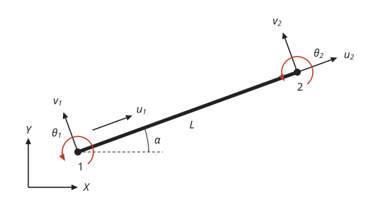
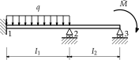

<!-- availability: available akantu::structural -->
# Structural mechanics model

<!-- BEGIN GENERATED: availability-status structural -->
**Available in this release** (facade module `akantu::structural`, crate `akantu-structural`, feature `structural`, on by default).
<!-- END GENERATED: availability-status structural -->

This chapter corresponds to the *Structural Mechanics Model* chapter of
the upstream manual (`structuralmechanicsmodel.rst`; parity rows
STRUCT-001…013, DOC-016). `akantu::structural::StructuralMechanicsModel`
(crate `akantu-structural`, feature `structural`, on by default) solves
linear structural problems on

* 2-D Bernoulli beams (`_bernoulli_beam_2`, DOFs $u, v, \theta$ per node),
* 3-D Bernoulli beams (`_bernoulli_beam_3`, DOFs $u, v, w, \theta_x, \theta_y, \theta_z$),
* discrete Kirchhoff triangles (`_discrete_kirchhoff_triangle_18`, plates
  and shells in 3-D, 6 DOFs per node),

with displacements and rotations in one DOF family `displacement`.
The upstream manual says that dynamic computations are not supported; the
upstream code supports them, and so does the port: static, implicit
dynamic and explicit (lumped or consistent mass) analyses.

Limitations of this release (details below):

* the model is serial: a distributed mesh or a communicator with more
  than one rank is refused at construction (`Error::Unsupported`);
* mesh topology changes (nodes or elements added, removed or changed) are
  refused (`Error::NotImplemented`), as upstream's structural FE engine
  cannot follow them (UD-342);
* the lumped mass exists for beams only (as upstream; [Lumped
  mass](#lumped-mass));
* no stable time-step estimate (upstream has none either).

## Theory

The model is linear in the geometry and in the material: small
displacements and rotations, linear elastic cross-sections. Upstream's
reference for the beam elements is Frey and Jirousek (2009).

### Degrees of freedom and generalised quantities

Each node carries translations and rotations in the single DOF family
`displacement` (translations first). The elements work with generalised
strains $\boldsymbol{\varepsilon}$ and stresses
$\boldsymbol{\sigma} = \boldsymbol{D} \boldsymbol{\varepsilon}$ of the
cross-section, computed in the element frame:

| Type | Nodes | DOFs per node | Generalised strains | Generalised stresses | $\boldsymbol{D}$ |
|---|---|---|---|---|---|
| `_bernoulli_beam_2` | 2 | 3: $u, v, \theta$ | $\varepsilon, \chi$ | $N, M$ | $\operatorname{diag}(EA, EI)$ |
| `_bernoulli_beam_3` | 2 | 6: $u, v, w, \theta_x, \theta_y, \theta_z$ | $\varepsilon, \chi_z, \chi_y, \theta_x'$ | $N, M_z, M_y, T$ | $\operatorname{diag}(EA, EI_z, EI_y, GJ)$ |
| `_discrete_kirchhoff_triangle_18` | 3 | 6: $u, v, w, \theta_x, \theta_y, \theta_z$ | membrane strains, curvatures | membrane forces, bending moments | $\begin{bmatrix} \boldsymbol{D}_m & \\ & \boldsymbol{D}_b \end{bmatrix}$ |

$E$, $A$, $I$, $I_z$, $I_y$ and $GJ$ are the fields `e`, `a`, `i`, `iz`,
`iy` and `gj` of the element's material ([Materials](#materials)).

### Bernoulli beams

In the frame of a beam (local $x$ along the axis from node 1 to node 2,
of length $L$), the axial displacement is interpolated linearly and the
transverse displacement by cubic Hermite polynomials; the rotation is the
slope, $\theta = \mathrm{d}v/\mathrm{d}x$ (the cross-section stays normal
to the axis: no shear deformation). With $\xi \in [-1, 1]$ and
$a = L/2$:

$$
\begin{aligned}
u &= \tfrac{1 - \xi}{2} u_1 + \tfrac{1 + \xi}{2} u_2, \\
v &= M_1(\xi) v_1 + L_1(\xi) \theta_1 + M_2(\xi) v_2 + L_2(\xi) \theta_2, \\
M_1 &= \tfrac{1}{4}(2 - 3\xi + \xi^3), \quad
M_2 = \tfrac{1}{4}(2 + 3\xi - \xi^3), \\
L_1 &= \tfrac{a}{4}(1 - \xi - \xi^2 + \xi^3), \quad
L_2 = \tfrac{a}{4}(-1 - \xi + \xi^2 + \xi^3).
\end{aligned}
$$

The generalised strains are the axial strain and the curvature,

$$
\varepsilon = \frac{\mathrm{d}u}{\mathrm{d}x}, \qquad
\chi = -\frac{\mathrm{d}^2 v}{\mathrm{d}x^2}, \qquad
N = EA\,\varepsilon, \qquad M = EI\,\chi ,
$$

so $\boldsymbol{\varepsilon} = \boldsymbol{B} \boldsymbol{u}_e$ with a
constant axial row and a curvature row linear in $\xi$.


*Figure: the six DOFs of a `_bernoulli_beam_2` in its element frame; the rotation $\boldsymbol{T}$ maps the global components to these.*

The element stiffness is
$\boldsymbol{K}_e = \int_0^L \boldsymbol{B}^T \boldsymbol{D} \boldsymbol{B} \, \mathrm{d}x$,
integrated with two Gauss points (exact, since $\boldsymbol{B}$ is at
most linear). For the 2-D beam with the DOFs
$(u_1, v_1, \theta_1, u_2, v_2, \theta_2)$ it is the classical matrix

$$
\boldsymbol{K}_e = \begin{bmatrix}
\frac{EA}{L} & 0 & 0 & -\frac{EA}{L} & 0 & 0 \\
0 & \frac{12EI}{L^3} & \frac{6EI}{L^2} & 0 & -\frac{12EI}{L^3} & \frac{6EI}{L^2} \\
0 & \frac{6EI}{L^2} & \frac{4EI}{L} & 0 & -\frac{6EI}{L^2} & \frac{2EI}{L} \\
-\frac{EA}{L} & 0 & 0 & \frac{EA}{L} & 0 & 0 \\
0 & -\frac{12EI}{L^3} & -\frac{6EI}{L^2} & 0 & \frac{12EI}{L^3} & -\frac{6EI}{L^2} \\
0 & \frac{6EI}{L^2} & \frac{2EI}{L} & 0 & -\frac{6EI}{L^2} & \frac{4EI}{L}
\end{bmatrix}
$$

(the example of [Structural element kernels and FE
engine](#structural-element-kernels-and-fe-engine) checks three of its
entries). It is assembled in global components as
$\boldsymbol{T}^T \boldsymbol{K}_e \boldsymbol{T}$, with $\boldsymbol{T}$
block diagonal and, per node of a 2-D beam at the angle $\alpha$ to the
global $X$ axis,

$$
\boldsymbol{R} = \begin{bmatrix} \cos\alpha & \sin\alpha & 0 \\ -\sin\alpha & \cos\alpha & 0 \\ 0 & 0 & 1 \end{bmatrix}.
$$

The 3-D beam adds a second bending plane and the torsion: $v$ (with
$\theta_z$) bends in the local $x$–$y$ plane with $EI_z$, $w$ (with
$\theta_y = -\mathrm{d}w/\mathrm{d}x$) in the $x$–$z$ plane with $EI_y$,
and the twist $\theta_x$ is interpolated linearly, its derivative being
the torsion strain carried by $GJ$. The local $z$ axis is the element's
`extra_normal` (below), and $\boldsymbol{R}$ is the $3 \times 3$ rotation
of the frame $(x, y = z \times x, z)$, applied to the translations and to
the rotations of each node.

### Discrete Kirchhoff triangle

`_discrete_kirchhoff_triangle_18` is a flat shell: a membrane triangle
and a plate-bending triangle in the plane of the element. The membrane
part interpolates the in-plane displacements $u, v$ linearly (constant
membrane strains). The bending part is the discrete Kirchhoff triangle
(Batoz, Bathe and Ho, 1980): the rotations are interpolated quadratically
and the Kirchhoff condition (no transverse shear) is imposed at discrete
points of the edges, so that the curvatures depend on $w$, $\theta_x$ and
$\theta_y$ of the three nodes. The rotation about the normal of the
element (the sixth DOF in the element frame) receives no stiffness: it
must be blocked or held by other elements. The tangent of a material with
thickness $t$ and Poisson's ratio $\nu$ is

$$
\boldsymbol{D}_m = \frac{E t}{1 - \nu^2}
\begin{bmatrix} 1 & \nu & 0 \\ \nu & 1 & 0 \\ 0 & 0 & \frac{1 - \nu}{2} \end{bmatrix},
\qquad
\boldsymbol{D}_b = \frac{t^2}{12} \boldsymbol{D}_m
= \frac{E t^3}{12 (1 - \nu^2)}
\begin{bmatrix} 1 & \nu & 0 \\ \nu & 1 & 0 \\ 0 & 0 & \frac{1 - \nu}{2} \end{bmatrix}
$$

(upstream multiplies by $t^3/12$ instead of $t^2/12$, UD-007). The
element has no shape functions upstream (UD-053), so it has stiffness,
stresses and internal forces but no line loads, no consistent mass and no
lumped mass.

### Mass matrices and equations of motion

The consistent mass of a beam is

$$
\boldsymbol{M}_e = \int_0^L \boldsymbol{N}_m^T \bar{\boldsymbol{\rho}} \, \boldsymbol{N}_m \, \mathrm{d}x
$$

with $\boldsymbol{N}_m$ the rows of the shape matrix of the translations
($u, v$ in 2-D; $u, v, w$ and the twist $\theta_x$ in 3-D), the weights
$\bar{\boldsymbol{\rho}} = \rho A$ for the translations and
$\rho (I_y + I_z)$ for the twist (UD-507), and four Gauss points; the
bending rotations enter only through the Hermite functions of the
transverse displacement, as upstream. The lumped
mass is described in [Lumped mass](#lumped-mass). The model solves

$$
\boldsymbol{K} \boldsymbol{u} = \boldsymbol{f}_\text{ext}
\quad \text{(static)}, \qquad
\boldsymbol{M} \ddot{\boldsymbol{u}} + \boldsymbol{K} \boldsymbol{u} = \boldsymbol{f}_\text{ext}
\quad \text{(dynamic)},
$$

with $\boldsymbol{u}$ the generalised displacements (displacements and
rotations) and $\boldsymbol{f}_\text{ext}$ the generalised forces (forces
and moments); the damping matrix exists but stays empty (UD-517).

## Creating the model

A structural mesh is read with `MeshIoType::GmshStruct` (upstream
`_miot_gmsh_struct`, see [Meshes](../meshes.md)) or built in code. The
model is created on a `SharedMesh` and initialised with an analysis
method; materials are plain parameter sets added from code (they are not
read from input files, as upstream):

```rust
use akantu::core::enums::AnalysisMethod;
use akantu::core::{ElementType, GhostType};
use akantu::mesh::{Mesh, MeshAccessor, SharedMesh};
use akantu::structural::{StructuralMaterial, StructuralMechanicsModel};

// two 2-D beams along x: nodes at x = 0, 10, 18
let ty = ElementType::BernoulliBeam2;
let mut mesh = Mesh::new(2, "beam")?;
{
    let mut acc = MeshAccessor::new(&mut mesh);
    for x in [0.0, 10.0, 18.0] {
        acc.push_node(&[x, 0.0])?;
    }
    let mut conn = acc.connectivity_mut(ty, GhostType::NotGhost);
    conn.push_tuple(&[0, 1]);
    conn.push_tuple(&[1, 2]);
}
// upstream: StructuralMechanicsModel model(mesh);
let mut model = StructuralMechanicsModel::new(SharedMesh::new(mesh), None, "beam")?;
// upstream: StructuralMaterial mat; mat.E = 3e10; mat.I = 0.0025; mat.A = 0.01;
let first = StructuralMaterial { e: 3e10, i: 0.0025, a: 0.01, ..StructuralMaterial::default() };
model.add_material(first, "first_span")?;
model.add_material(StructuralMaterial { i: 0.00128, ..first }, "second_span")?;
// upstream: model.initFull(_analysis_method = _static);
model.init_full_with(AnalysisMethod::Static)?;
// upstream: model.getElementMaterial(_bernoulli_beam_2)(1) = 1;
model.element_material_mut(ty, GhostType::NotGhost)?.as_mut_slice()[1] = 1;

assert_eq!(model.nb_degree_of_freedom(), 3); // u, v, θ
assert_eq!(model.nb_materials(), 2);
# Ok::<(), akantu::core::Error>(())
```

`StructuralMechanicsModel::new(mesh, dim, id)` uses the corrected
behaviour everywhere; `with_compat` takes the upstream-compatibility
switches ([Differences from upstream](#differences-from-upstream)) and
`with_options` also an input file, whose `model structural_mechanics_model
[ … ]` section configures the solvers ([Solver
configuration](../solver-configuration.md)). Always give the analysis
method: upstream's `initFull()` without argument (like
`ModelOptions::default()`) selects `_explicit_lumped_mass`, not `_static`
(UD-514: upstream's own `bernoulli_beam_2_example.cc` falls into this).

Normals of 3-D beams. Each `_bernoulli_beam_3` needs a unit normal in
the elemental mesh data `extra_normal` (`akantu::fe::structural::EXTRA_NORMAL`,
three values per element): it is the local $z$ axis of the cross-section
(local $x$ along the beam, $y = z \times x$; `Iz` governs the bending in the
local $x$–$y$ plane, `Iy` in the $x$–$z$ plane). Give it on the mesh before
the model is created, or with `set_extra_normals(type, normals)` (validated
before the mesh is touched; a refused normal leaves the mesh unchanged).
Without normals `init_full` fails (UD-294); a normal that is not a unit
vector orthogonal to the beam axis is refused by default (UD-343).

### Materials

`StructuralMaterial` holds the upstream fields in snake case:

| Upstream | Rust | Meaning | Default | Read by |
|---|---|---|---|---|
| `E` | `e` | Young's modulus | 0 | all types |
| `A` | `a` | cross-section area | 1 | beams |
| `I` | `i` | second moment of area | 0 | `_bernoulli_beam_2` |
| `Iz`, `Iy` | `iz`, `iy` | second moments about the local `z` and `y` axes | 0 | `_bernoulli_beam_3` |
| `GJ` | `gj` | torsional stiffness | 0 | `_bernoulli_beam_3` |
| `rho` | `rho` | density (masses) | 0 | beams |
| `t` | `t` | thickness | 0 | discrete Kirchhoff triangle |
| `nu` | `nu` | Poisson's ratio | 0 | discrete Kirchhoff triangle |

`add_material(material, name)` returns the material's index; every
element uses material `0` until `element_material_mut(type, ghost)`
assigns another one. A material or an assignment changed after an
assembly is taken into account by the next assembly (upstream keeps the
first stiffness and mass matrices, UD-508); material indices are checked
(UD-512).

## Boundary conditions and loads

The nodal arrays have `nb_degree_of_freedom` components per node
(translations first, then rotations):

| Upstream | Rust | Meaning |
|---|---|---|
| `getDisplacement()` (`displacement_rotation`) | `displacement()`, `displacement_mut()` | displacements and rotations |
| `getVelocity()`, `getAcceleration()` | `velocity()`, `acceleration()` (and `…_mut`) | dynamic analyses only |
| `getBlockedDOFs()` | `blocked_dofs()`, `blocked_dofs_mut()` | `true`: imposed DOF (Dirichlet) |
| `getExternalForce()` | `external_force()`, `external_force_mut()` | nodal forces and moments |
| `getInternalForce()` | `internal_force()` | $\boldsymbol{f}_\text{int}$ |
| `getLumpedMass()` | `lumped_mass()` | after the lumped assembly ([Lumped mass](#lumped-mass)) |

Distributed loads along beams are integrated into nodal forces with
`compute_forces_by_local_traction_array(tractions, type)` (tractions in
the element basis) or `compute_forces_by_global_traction_array` (global
basis): one traction tuple of `nb_degree_of_freedom` values per quadrature
point, `nb_element · nb_quad` tuples in element order; the sizes are
checked (UD-516) and `external_force` is unchanged on error. The upstream
manual's `computeForcesFromFunction` is compiled out of the upstream code
(`#if 0`) and has no port. The discrete Kirchhoff triangle has no line
loads (no shape functions upstream, UD-053: `Error::NotImplemented`).

## Static analysis

The equilibrium $\boldsymbol{K} \boldsymbol{u} = \boldsymbol{f}_\text{ext}$ is solved by `solve_step` with the model's
Newton–Raphson solver (the problem is linear, so the first correction is
the solution). The example
of the upstream manual (and of its test `TestStructBernoulli2`): a beam
clamped at the left end and supported by two rollers, a uniform load
$q = 6\ \text{kN/m}$ on the first span (as nodal equivalents) and a moment
$\bar{M} = 3.6\ \text{kN m}$ on the last node; the rotations of nodes 2 and 3 are
$5.6/4800 = 0.001\,167$ and $-3.7/4800 = -0.000\,771$:


*Figure: the 2-D beam of the example: spans of $L_1 = 10\ \text{m}$ and $L_2 = 8\ \text{m}$ with the second moments of area $I_1 = 250\,000\ \text{cm}^4$ and $I_2 = 128\,000\ \text{cm}^4$, load $q$ on the first span and moment $\bar{M}$ at node 3 (figure of the Akantu manual).*

The uniform load enters as its consistent nodal forces and moments, for a
span of length $L$:
$f_v = -qL/2$ at both nodes, and the moments $-qL^2/12$ at the first node
and $+qL^2/12$ at the second.

```rust
# use akantu::core::enums::AnalysisMethod;
# use akantu::core::{ElementType, GhostType};
# use akantu::mesh::{Mesh, MeshAccessor, SharedMesh};
# use akantu::structural::{StructuralMaterial, StructuralMechanicsModel};
# let ty = ElementType::BernoulliBeam2;
# let mut mesh = Mesh::new(2, "beam")?;
# {
#     let mut acc = MeshAccessor::new(&mut mesh);
#     for x in [0.0, 10.0, 18.0] {
#         acc.push_node(&[x, 0.0])?;
#     }
#     let mut conn = acc.connectivity_mut(ty, GhostType::NotGhost);
#     conn.push_tuple(&[0, 1]);
#     conn.push_tuple(&[1, 2]);
# }
# let mut model = StructuralMechanicsModel::new(SharedMesh::new(mesh), None, "beam")?;
# let first = StructuralMaterial { e: 3e10, i: 0.0025, a: 0.01, ..StructuralMaterial::default() };
# model.add_material(first, "first_span")?;
# model.add_material(StructuralMaterial { i: 0.00128, ..first }, "second_span")?;
# model.init_full_with(AnalysisMethod::Static)?;
# model.element_material_mut(ty, GhostType::NotGhost)?.as_mut_slice()[1] = 1;
// clamped first node (u, v, θ), rollers (v) on the other two
{
    // a guard of the (exportable) flags; dropped at the end of the block
    let mut blocked = model.blocked_dofs_mut()?;
    let blocked = blocked.as_mut_slice();
    blocked[..3].fill(true);
    blocked[3 + 1] = true;
    blocked[6 + 1] = true;
}
// the first span's uniform load as nodal forces and moments, the moment M
let (q, l, m) = (6000.0, 10.0, 3600.0);
{
    // a write guard on the external force, released before the solve
    let mut forces = model.external_force_mut()?;
    let f = forces.as_mut_slice();
    f[1] = -q * l / 2.0;
    f[2] = -q * l * l / 12.0;
    f[3 + 1] = -q * l / 2.0;
    f[3 + 2] = q * l * l / 12.0;
    f[6 + 2] = -m;
}

model.solve_step(None)?;
{
    // a read guard on the displacement, released before the assembly below
    let u = model.displacement()?;
    let tol = akantu::core::math::DEFAULT_TOLERANCE; // upstream Math::getTolerance()
    assert!((u.tuple(1)[2] - 5.6 / 4800.0).abs() <= tol);
    assert!((u.tuple(2)[2] + 3.7 / 4800.0).abs() <= tol);
}

// internal forces balance the external ones on the free DOFs; the
// generalised stresses (N, M per quadrature point) are computed with them
model.assemble_internal_force()?;
let (fi_guard, fe_guard) = (model.internal_force()?, model.external_force()?);
let (fi, fe) = (fi_guard.as_slice(), fe_guard.as_slice());
let scale = fe.iter().fold(0.0_f64, |s, v| s.max(v.abs()));
let blocked = model.blocked_dofs()?;
let free = blocked.as_slice().iter().map(|b| !b);
assert!(fi.iter().zip(fe).zip(free).all(|((i, e), free)| !free || (i + e).abs() <= 1e-10 * scale));
assert_eq!(model.stress(ty, GhostType::NotGhost)?.nb_component(), 2);
# Ok::<(), akantu::core::Error>(())
```

`assemble_stiffness_matrix()` assembles $\boldsymbol{K}$ explicitly (the solvers do it
when needed); `compute_stresses()` computes the generalised stresses
$\boldsymbol{\sigma} = \boldsymbol{D}\boldsymbol{B}\boldsymbol{u}_e$
alone: $N, M$ for 2-D beams, $N, M_z, M_y, T$ for 3-D beams, membrane forces
then bending moments for the discrete Kirchhoff triangle. Energies:
`potential_energy()` ($\frac{1}{2} \boldsymbol{u}^T \boldsymbol{K} \boldsymbol{u}$), `kinetic_energy()` and `energy(id)`,
which knows `"kinetic"` and `"potential"` and returns `0` for any other id,
as upstream (UD-510, an upstream API behaviour, not a defect; there is no
`"external work"` for this model).

## Dynamic analyses

| `AnalysisMethod` | Solver id | Integration scheme | Mass |
|---|---|---|---|
| `Static` | `static` | pseudo-time | — |
| `ImplicitDynamic` | `implicit` | trapezoidal rule (Newmark $\beta = 1/4$) | consistent $\boldsymbol{M}$ |
| `ExplicitLumpedMass` | `explicit_lumped` | central difference | lumped $\boldsymbol{M}$ (beams only) |
| `ExplicitConsistentMass` | `explicit` | central difference | consistent $\boldsymbol{M}$ |

The time step is set with `set_time_step(dt, None)`; the model has no
stable time-step estimate (`Model::stable_time_step` returns
`Error::NotImplemented`, upstream defines none), so choose `dt` from the
element sizes and wave speeds. Initial conditions are written into
`displacement_mut()` and `velocity_mut()`. The consistent mass is
assembled with the element mass of the FE engine; for 3-D beams its
torsion row uses the polar inertia $\rho (I_y + I_z)$ (upstream uses $\rho A$,
UD-507). As upstream, a damping matrix $\boldsymbol{C}$ exists and stays empty unless
you fill it (UD-517). Until the first lumped assembly of an explicit
lumped analysis, `kinetic_energy()` uses the consistent mass, as upstream
(UD-510).

### Lumped mass

<!-- BEGIN GENERATED: availability-status structural-rotary-inertia -->
**Available in this release** (crate `akantu-structural`).
<!-- END GENERATED: availability-status structural-rotary-inertia -->

Upstream's lumped mass is identically zero (UD-005), so the port computes
its own (beams only; other types: `Error::NotImplemented`, as upstream).
Each beam of length $L$ and mass $m = \rho A L$ adds $m/2$ to every
translational DOF of both nodes and, to the rotations, a rotary inertia
built from the element-frame coefficients of the Hinton–Rock–Zienkiewicz
diagonal scaling of the consistent beam mass:

$$
J_b = \frac{m L^2}{78} \quad \text{(bending)}, \qquad
J_t = \frac{\rho (I_y + I_z) L}{2} \quad \text{(torsion)}.
$$
 The rule is the field
`lumped_rotary_inertia` of `StructuralModelUpstreamCompat`
(`LumpedRotaryInertia`, fixed at construction; UD-059, decision D-059):

| Rule | 2-D | 3-D | Lumped matrix |
|---|---|---|---|
| `Block3x3` (default) | $J_b$ | the nodal block $\boldsymbol{J}_n = \sum_e \boldsymbol{T}_e^T \operatorname{diag}(J_t, J_b, J_b) \boldsymbol{T}_e$ on $\theta_x, \theta_y, \theta_z$ ($\boldsymbol{T}_e$ the element's global → member rotation) | a symmetric 3×3 block per node |
| `IsotropicMax` | $J_b$ | $\max(J_t, J_b)$ on the three rotations | diagonal |

`Block3x3` is objective (a rigid rotation $\boldsymbol{Q}$ of the structure maps every
block to $\boldsymbol{Q} \boldsymbol{J} \boldsymbol{Q}^T$ and leaves the spectrum unchanged) and exact HRZ in the
frame of every member. The DOF manager's lumped matrix `M` carries the
off-diagonal entries of the blocks: the explicit lumped solve solves the
3×3 rotary system of each node (a blocked rotation removes its row and
column, the remaining block is solved), the residual $\boldsymbol{r} \mathrel{-}= \boldsymbol{M} \ddot{\boldsymbol{u}}$ uses the
block product, and `kinetic_energy()` adds $\frac{1}{2} \boldsymbol{\omega}^T \boldsymbol{J}_n \boldsymbol{\omega}$ per node.
`lumped_mass()` holds the translations and the diagonal of the blocks,
`rotary_inertia()` the full blocks (9 values per node, row-major; one in
2-D).

`IsotropicMax` (the rule $\max(J_t, J_b) \boldsymbol{I}$ per node) is the diagonal
alternative for users who need a diagonal mass. A diagonal lumped mass
that does not depend on the orientation of the structure must be
isotropic at each node, so it cannot carry $J_t \ne J_b$: on elements longer
than $h^* = \sqrt{39 I_p/A}$ ($4.42\, r$ for a circular section of radius $r$),
the usual case for beam meshes, $J_b$ is the larger term, the torsional
inertia is over-estimated by $J_b/J_t = A L^2/(39 I_p)$ and the torsional
frequencies are too low by a factor about $\sqrt{J_t/J_b}$. Torsional
fundamental of a clamped–free steel shaft ($r = 0.02\ \text{m}$, length 1.5 m):

| elements | $L/r$ | $J_b/J_t$ | `Block3x3` | `IsotropicMax` |
|---|---|---|---|---|
| 3 | 25 | 32.1 | −1.14 % | −82.5 % |
| 6 | 12.5 | 8.01 | −0.29 % | −64.8 % |
| 12 | 6.25 | 2.00 | −0.071 % | −29.4 % |
| 24 | 3.12 | 0.50 | −0.018 % | −0.018 % |

With `Block3x3` the torsional fundamental is $\frac{4N}{\pi} \sin\frac{\pi}{4N}$ times
the exact one for $N$ elements (the closed form of the lumped chain), in
every orientation of the shaft (`lumped_rotary_blocks.rs`). Bending is the
same for both rules on coarse meshes; on fine meshes ($L < h^*$)
`IsotropicMax` gives the bending rotations the polar inertia, so bending
converges to the Rayleigh-beam value (an offset of $-4.4 \times 10^{-4}$ for that
shaft). The stable time step $2/\omega_\text{max}$ of that shaft is the same for the two
rules on coarse meshes ($h > h^*$), where the axial wave governs it
($9.98 \times 10^{-5}$ s, $4.86 \times 10^{-5}$ s and $2.41 \times 10^{-5}$ s at 3, 6 and 12 elements); that was
measured on a straight shaft along $x$ only. The stable step of `Block3x3`
is never longer than that of `IsotropicMax` (Loewner order: the element
block $J_t \boldsymbol{a}\boldsymbol{a}^T + J_b (\boldsymbol{I} - \boldsymbol{a}\boldsymbol{a}^T)$ is dominated by $\max(J_t, J_b) \boldsymbol{I}$), and on
meshes with $h < \sqrt{39 I_p/A}$ it is shorter: the `IsotropicMax` step is
1.39× and 2.41× longer at 24 and 48 elements of this shaft.

> Warning. A time step chosen for the diagonal rule
> (`IsotropicMax`) can be unstable with the `Block3x3` default on fine
> meshes: `Block3x3`'s stable step is never longer than `IsotropicMax`'s,
> and on meshes with $h < \sqrt{39 I_p/A}$ it is shorter (1.39× / 2.41× at
> 24 / 48 elements of the reference shaft). Recompute the step, or select
> `IsotropicMax` to keep the step.

No rule reproduces upstream's lumped values: upstream's lumped mass is
identically zero (its `node2 = conn(0)` gives zero-length elements,
UD-005), which no lumped solve can use, and the oracle replays record
those zeros as a documented difference. UD-059 is therefore corrected
without a compatibility switch; `StructuralModelUpstreamCompat::UPSTREAM`
keeps `Block3x3`.

The lumped mass of one shaft element along $x$ ($L = 0.5\ \text{m}$): the block of
a member along $x$ is $\operatorname{diag}(J_t, J_b, J_b)$, and `IsotropicMax` puts
$\max(J_t, J_b) = J_b$ on the torsion as well:

```rust
use akantu::core::enums::AnalysisMethod;
use akantu::core::{Array, ElementType, GhostType};
use akantu::fe::structural::EXTRA_NORMAL;
use akantu::mesh::{Mesh, MeshAccessor, SharedMesh};
use akantu::structural::{
    LumpedRotaryInertia, StructuralMaterial, StructuralMechanicsModel,
    StructuralModelUpstreamCompat,
};

let (r, l) = (0.02_f64, 0.5);
let ty = ElementType::BernoulliBeam3;
let shaft = || -> Result<SharedMesh, akantu::core::Error> {
    let mut mesh = Mesh::new(3, "shaft")?;
    {
        let mut acc = MeshAccessor::new(&mut mesh);
        acc.push_node(&[0.0, 0.0, 0.0])?;
        acc.push_node(&[l, 0.0, 0.0])?;
        acc.connectivity_mut(ty, GhostType::NotGhost).push_tuple(&[0, 1]);
    }
    // the local z axis of the beam
    mesh.data_mut()
        .reals_mut_or_insert(EXTRA_NORMAL)?
        .as_map_mut()
        .replace(ty, GhostType::NotGhost, Array::from_vec(vec![0.0, 0.0, 1.0], 3)?.into());
    Ok(SharedMesh::new(mesh))
};
let (area, i) = (std::f64::consts::PI * r * r, std::f64::consts::PI * r.powi(4) / 4.0);
let steel = StructuralMaterial {
    e: 210e9, a: area, iz: i, iy: i, gj: 81e9 * 2.0 * i, rho: 7800.0,
    ..StructuralMaterial::default()
};
let m = steel.rho * area * l;
let (j_b, j_t) = (m * l * l / 78.0, steel.rho * (i + i) * l / 2.0);
assert!(j_b / j_t > 32.0); // A L²/(39 I_p) = 2 L²/(39 r²)
let close = |x: f64, y: f64| (x - y).abs() <= 4.0 * f64::EPSILON * y;

// the default: the exact nodal block
let mut model = StructuralMechanicsModel::new(shaft()?, None, "shaft")?;
model.add_material(steel, "steel")?;
model.init_full_with(AnalysisMethod::ExplicitLumpedMass)?;
model.assemble_lumped_mass_matrix()?;
assert_eq!(model.lumped_rotary_inertia(), LumpedRotaryInertia::Block3x3);
for node in model.lumped_mass()?.tuples() {
    assert!(node[..3].iter().all(|&v| close(v, m / 2.0))); // translations
    assert!(close(node[3], j_t)); // θx: the torsion about the beam axis
    assert!(close(node[4], j_b) && close(node[5], j_b)); // bending
}
// the 3×3 block of node 0 (row-major θx, θy, θz): diagonal along x
let block = model.rotary_inertia()?.tuple(0).to_vec();
assert_eq!((block[1], block[2], block[5]), (0.0, 0.0, 0.0));

// the diagonal rule max(J_t, J_b)
let iso = StructuralModelUpstreamCompat {
    lumped_rotary_inertia: LumpedRotaryInertia::IsotropicMax,
    ..StructuralModelUpstreamCompat::default()
};
let mut model = StructuralMechanicsModel::with_compat(shaft()?, None, "shaft_iso", iso)?;
model.add_material(steel, "steel")?;
model.init_full_with(AnalysisMethod::ExplicitLumpedMass)?;
model.assemble_lumped_mass_matrix()?;
for node in model.lumped_mass()?.tuples() {
    assert!(node[3..].iter().all(|&v| close(v, j_b))); // θx too: max(J_t, J_b)
}
# Ok::<(), akantu::core::Error>(())
```

Every free (unblocked) DOF must get a positive, finite lumped mass, since
the explicit update divides by it: $\rho = 0$ (the default density), $A = 0$
or a node that belongs to no beam is refused with `Error::Numerical`
naming the node and DOF, instead of producing `inf`/`NaN` (UD-518). With
`Block3x3` in 3-D the free rotary block of every node must in addition be
positive definite (each pivot of its $\boldsymbol{L}\boldsymbol{D}\boldsymbol{L}^T$ factorisation above $10^{-12}$
times its largest diagonal entry, `ROTARY_BLOCK_DEFINITENESS`): beams
without polar moment ($I_y = I_z = 0$) that are collinear at a node give it
no inertia about their axis and are refused unless that rotation is
blocked (`IsotropicMax` accepts them). Blocked DOFs may have a zero mass.
The check uses the blocked flags of each call: a DOF unblocked after the
lumped assembly is refused at the next `solve_step` with the same error
(`review_v83_regressions.rs`).

## Output

The model registers a ParaView dumper `structural_mechanics_model` (file
base name: the model id) on the structural elements; fields are added by
name with `add_dump_field` / `add_dump_field_vector` (padded to 3
components) and written by `dump(time, step)` ([Output and
dumpers](../output.md)). With $n$ = 2 (2-D) or 3 (3-D) translational
components per node:

| Field | Content |
|---|---|
| `displacement`, `velocity`, `acceleration` | translational components $0, \dots, n-1$ |
| `rotation` | rotational components of the displacement |
| `force` / `external_force`, `momentum` | external forces, external moments |
| `internal_force`, `internal_momentum` | internal forces, internal moments |
| `mass` | translational lumped masses |
| `rotary_inertia` | nodal rotary blocks of the lumped mass (9 components in 3-D, row-major; 1 in 2-D; not upstream, D-059; takes precedence over mesh data of that name) |
| `blocked_dofs` | every DOF's flag |
| `stress` | generalised stresses of every quadrature point (not averaged) |
| `element_index_by_material` | mesh data of that name, as upstream |

A field whose array does not exist (`velocity` in a static analysis,
`mass` or `rotary_inertia` without a lumped mass) is an error at dump time; upstream silently
writes no field (UD-515).

## Mesh changes and normals

The model follows the mesh through events, but refuses every topology
event (UD-342). Node coordinates cannot change while the model is
registered on the mesh. Normals are changed with `set_extra_normals`
(transactional); after a data-only edit of `extra_normal` through the mesh
(no event), every operation that would use the old element frames refuses
until `refresh_geometry()` is called (the stiffness and masses are never
silently reused from the old frames).

## Differences from upstream

Corrected by default, with a switch of `StructuralModelUpstreamCompat`
that reproduces upstream (`StructuralModelUpstreamCompat::UPSTREAM` sets
them all; the oracle fixtures are replayed bit for bit in that mode, rows
STRUCT-001…013):

| Defect | Upstream | Port default | Switch |
|---|---|---|---|
| UD-293 | `_bernoulli_beam_3` $\theta_y$ shape row $+\mathrm{d}w/\mathrm{d}s$ (line-load moments) | $-\mathrm{d}w/\mathrm{d}s$ | `fe.beam3_theta_y_legacy` |
| UD-343 | any finite `extra_normal` builds the frame (non-orthogonal for non-unit or skew normals) | refused unless unit and orthogonal to the axis (1e-10, an input check) | `fe.beam3_normal_unchecked` |
| UD-007 | discrete Kirchhoff triangle bending rigidity $E t^4/(12(1-\nu^2))$ | $E t^3/(12(1-\nu^2))$ | `dkt_bending = DktBendingStiffness::Legacy` |
| UD-507 | 3-D beam consistent mass, torsion row $\rho A$ | $\rho (I_y + I_z)$ | `beam3_torsional_mass_rho_a` |

Corrected without a switch: the translational lumped mass (UD-005; see
[Lumped mass](#lumped-mass)), the rotary inertia of the lumped mass
(UD-059: HRZ coefficients, the `Block3x3` default or the `IsotropicMax`
option, which is a model option and not a switch), reassembly after material changes (UD-508),
structural elements of another dimension than the model refused (UD-511),
material indices and traction sizes checked (UD-512, UD-516), zero lumped
masses on free DOFs refused (UD-518), missing or degenerate beam normals
refused (UD-294, UD-296). Kept as upstream: the energies (UD-510), the
refusal of an unknown analysis method (UD-509, as an error instead of a
print and an exception) and the empty `C` (UD-517). The rotations of the
elements are read with `rotations(type, ghost)` (upstream's
`getRotationMatrix` always throws, UD-513). All entries are in
[`docs/UPSTREAM_DEFECTS.md`](../../../UPSTREAM_DEFECTS.md) and the
corrected defaults in [Differences](../differences.md#corrected-defaults-with-a-compatibility-switch-selection).

## Structural element kernels and FE engine

The element-level part of upstream's structural mechanics is also
available on its own (decision D-049): the types `_bernoulli_beam_2`,
`_bernoulli_beam_3` and `_discrete_kirchhoff_triangle_18`, their Hermite
and DKT shape functions, and `akantu::fe::structural::StructuralFeEngine`
(upstream `FEEngineTemplate<IntegratorGauss, ShapeStructural,
_ek_structural>`): element rotations, `det J · w`, `N·T` and `B·T`,
interpolation, generalised strains, integration, $\boldsymbol{B}^T\boldsymbol{\sigma}$, $\boldsymbol{B}^T\boldsymbol{D}\boldsymbol{B}$, $\boldsymbol{N}^T\boldsymbol{b}$,
$\boldsymbol{N}^T\boldsymbol{b}\boldsymbol{N}$, element stiffness, consistent mass and line loads. The regular FE
engine refuses structural element types and points to this one.

```rust
use akantu::core::{Array, ElementType, GhostType};
use akantu::fe::structural::StructuralFeEngine;
use akantu::fe::structural::kernels::tangent_bernoulli_beam_2;
use akantu::mesh::{Mesh, MeshAccessor};

// one 2-D Bernoulli beam of length l along x
let (l, e, a, i) = (2.0, 210e9, 1e-4, 1e-8);
let ty = ElementType::BernoulliBeam2;
let mut mesh = Mesh::new(2, "beam")?;
{
    let mut acc = MeshAccessor::new(&mut mesh);
    acc.push_node(&[0.0, 0.0])?;
    acc.push_node(&[l, 0.0])?;
    acc.connectivity_mut(ty, GhostType::NotGhost).push_tuple(&[0, 1]);
}
let fe = StructuralFeEngine::with_precomputation(&mesh, None, "beam_fem")?;

// generalised tangent D = diag(EA, EI) at every quadrature point
let nq = fe.nb_integration_points(ty, GhostType::NotGhost)?;
let d: Vec<f64> = (0..nq).flat_map(|_| tangent_bernoulli_beam_2(e, a, i)).collect();
let mut k = Array::new(1);
fe.element_stiffness(&mesh, Array::from_vec(d, 4)?.view(), &mut k, ty, GhostType::NotGhost)?;

// 6 × 6 column-major, DOFs (u, v, θ) per node: the classical entries
let k = k.tuple(0);
let close = |x: f64, y: f64| (x - y).abs() <= 1e-12 * y.abs();
assert!(close(k[0], e * a / l)); // axial
assert!(close(k[6 + 1], 12.0 * e * i / l.powi(3))); // bending, (v1, v1)
assert!(close(k[2 * 6 + 2], 4.0 * e * i / l)); // (θ1, θ1)
# Ok::<(), akantu::core::Error>(())
```

The kernel switches are `StructuralUpstreamCompat::beam3_theta_y_legacy`
(UD-293) and `beam3_normal_unchecked` (UD-343);
`StructuralUpstreamCompat::UPSTREAM` (with
`StructuralFeEngine::new_with_compat` / `with_precomputation_compat`)
sets both, and the kernel fixtures are replayed bit for bit in that mode
(parity rows ELEM-021…023, FE-016, FE-035, FE-036). Degenerate elements
(zero length or area, a normal parallel to the axis) are errors instead of
uninitialised reads or NaN (UD-294, UD-296).

## References

* Batoz, J.-L., Bathe, K.-J. and Ho, L.-W. (1980). A study of
  three-node triangular plate bending elements. *International Journal
  for Numerical Methods in Engineering*, 15(12), 1771–1812.
* Frey, F. and Jirousek, J. (2009). *Méthodes des éléments finis :
  analyse des structures et milieux continus*. Traité de génie civil de
  l'École polytechnique fédérale de Lausanne, PPUR.
