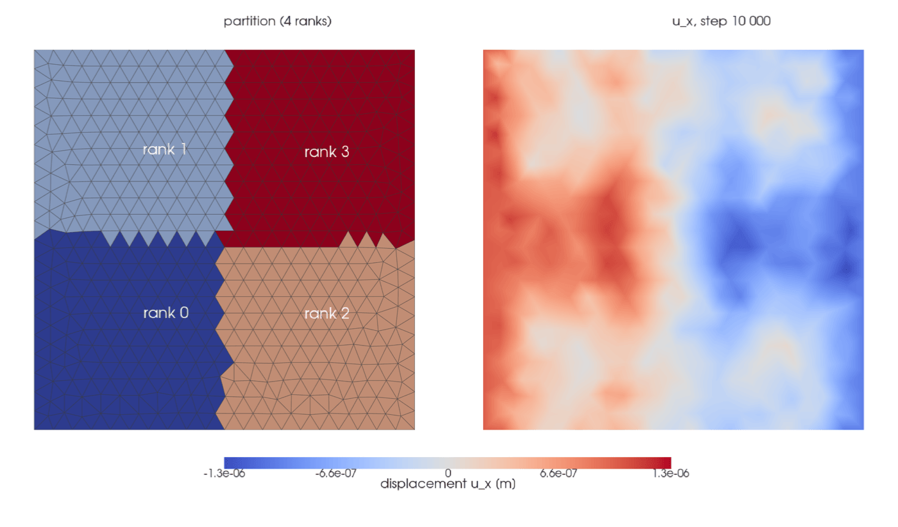

<!-- availability: available akantu::comm -->
# Parallel computations

This chapter corresponds to *Running parallel simulation*
(`getting_started.rst`) of the upstream manual. As upstream, parallelism
is distributed-memory (MPI) with a mesh partitioned among the processes
and one layer of ghost elements per process; serial and parallel runs
share every code path.

## Communicators

All parallel code takes an `akantu::comm::Communicator`:

| Constructor | Back-end | Use |
|---|---|---|
| `Communicator::serial()` | one process | the default (`Mesh::new`) |
| `Communicator::local_world(n, timeout)`, `akantu::comm::run_local(n, timeout, f)` | `n` ranks as threads of one process | tests and examples, no MPI needed |
| `Communicator::mpi_world(MpiOptions { … })` | MPI (Cargo feature `mpi` of `akantu-comm`) | production runs under `mpirun` |

Upstream's process-global `Communicator::getStaticCommunicator()` is
`akantu::runtime::global()` (serial unless set).

## Distributing a mesh

Only the root rank reads the mesh; every other rank starts from an empty
mesh with the same communicator. `distribute_with` partitions the root's
mesh and sends every rank its part (upstream `mesh.distribute()`):

```rust
use std::time::Duration;

use akantu::comm::{run_local, Communicator};
use akantu::core::enums::{AnalysisMethod, MeshIoType, SpatialDirection::{X, Y}};
use akantu::core::{ElementType, GhostType};
use akantu::mesh::distribution::{distribute_with, MeshPartitioner, RcbPartitioner};
use akantu::mesh::{Mesh, SharedMesh};
use akantu::model::boundary_condition::FixedValue;
use akantu::model::ModelOptions;
use akantu::parser::Parser;
use akantu::solid::SolidMechanicsModel;
# let mesh_file = std::path::Path::new(env!("CARGO_MANIFEST_DIR"))
#     .join("../../docs/manual/src/meshes/square.msh");

let run = |comm: Communicator| -> akantu::core::Result<(usize, usize, f64)> {
    let mut mesh = Mesh::with_communicator(2, "mesh", comm.clone())?;
    if comm.rank() == 0 {
        // upstream: if (comm.whoAmI() == 0) mesh.read("square.msh");
        akantu::io::read_mesh(&mut mesh, &mesh_file, MeshIoType::Auto)?;
    }
    // upstream: mesh.distribute();
    let mut partitioner = RcbPartitioner;
    distribute_with(&mut mesh, Some(&mut partitioner as &mut dyn MeshPartitioner), 0)?;
    let local = mesh.nb_element(ElementType::Quadrangle4, GhostType::NotGhost);
    let ghosts = mesh.nb_element(ElementType::Quadrangle4, GhostType::Ghost);

    // the model is built on the distributed mesh exactly as in serial
    let parser = Parser::parse_str(
        "material elastic [\n name = steel\n rho = 7800\n E = 210e9\n nu = 0.3\n]\n",
        "material.dat",
    )?;
    let mut model = SolidMechanicsModel::with_parser(SharedMesh::new(mesh), None, "smm", parser)?;
    model.init_full(&ModelOptions::new(AnalysisMethod::Static))?;
    model.apply_dirichlet_bc(&FixedValue { value: 0.0, axis: X }, "left")?;
    model.apply_dirichlet_bc(&FixedValue { value: 0.0, axis: Y }, "bottom")?;
    model.apply_dirichlet_bc(&FixedValue { value: 0.01, axis: X }, "right")?;
    model.solve_step(None)?;
    let energy = model.energy("potential")?; // summed over the ranks
    Ok((local, ghosts, energy))
};

let results = run_local(2, Duration::from_secs(60), run);
let results: Vec<_> = results.into_iter().collect::<Result<_, _>>()?;
// the four quadrangles are split between the ranks, each sees the other's as ghosts
assert_eq!(results.iter().map(|r| r.0).sum::<usize>(), 4);
assert!(results.iter().all(|r| r.1 > 0));
// every rank gets the same, reduced energy, equal to the serial one
let exact = 0.5 * 210e9 / 0.91 * 1e-4;
for (_, _, energy) in &results {
    assert!((energy - exact).abs() <= 1e-12 * exact);
}
# Ok::<(), akantu::core::Error>(())
```

Partitioners (`akantu::mesh::distribution`):

| Partitioner | Notes |
|---|---|
| `RcbPartitioner` | pure-Rust recursive coordinate bisection (always available) |
| `akantu::mesh::scotch::ScotchPartitioner::new(seed)` | Scotch, as upstream (feature `scotch`); unit edge and vertex weights |
| `PrescribedPartition::new(parts)` | a part per element, e.g. read from a file |
| `MeshDataPartition::new(map)` | the part stored in element data (upstream `MeshPartitionMeshData`) |

Upstream's optional edge and vertex weight functions of
`mesh.distribute(...)` are given to the Scotch partitioner with
`ScotchPartitioner::with_loads`; without them it uses unit weights, which
is what upstream's `distribute()` passes by default. As upstream, the
vertex weight of an element stands for its computational cost and the
edge weight between two neighbouring elements for the cost of the
communication between them; Scotch balances the first over the parts and
minimises the sum of the second over the cut.

The mesh must be distributed before a model uses it: distributing a
`SharedMesh` that already has a model registered is refused (upstream
test `test_dof_mesh_distribute`). The port also refuses inputs upstream
silently mishandles (a non-empty mesh on a non-root rank, a root mesh with
a facet mesh, element types without partition data; UD-235).

After distribution every rank holds its elements, one layer of ghost
elements, the nodes they use with their global numbers and flags (normal,
master, slave, pure ghost), the element and node synchronizers, the groups
and the mesh data.


*Figure: a mesh split between two ranks, each with its own elements and one layer of ghost elements; the nodes on the cut are shared (master on one rank, slave on the other).*

Models exchange ghost data through the synchronizers;
the model's global quantities (the energies of the model or of a group,
the stable time step, solver norms) are reduced over all ranks, while
per-element values (`energy_of_element`) stay local.

Clusters of connected elements (`akantu::mesh::clusters::create_clusters`,
upstream `createClusters`) are numbered over all ranks on a distributed
mesh, as upstream's `ClusterSynchronizer` does: clusters that touch across
a rank boundary become one, every rank gets every group `<prefix>_<i>`
(empty where it holds none of that cluster's elements, local or ghost) and
the returned count is the global one. A clustering of another dimension
than the distributed elements (e.g. `create_boundary_group_from_geometry`
on a distributed mesh) and a filter that rejects an element on its owner
but accepts its ghost copy are refused on every rank (UPSTREAM_DEFECTS
UD-1040, UD-1041: upstream fails or merges unrelated clusters there).

## Non-local laws and split-node contact on a distributed mesh

Non-local laws (the solid laws `mazars_non_local`,
`marigo_non_local`, …, the extra non-local laws and user laws that return
`Some` from `Material::as_non_local`) run on a distributed mesh like on one
process: `init_full` builds, per neighbourhood, a grid synchronizer that
adds the ghost elements within the radius of the owned integration points
(a mesh change the model follows), hands them their owner's law, pairs the
points, removes the added ghost elements no pair needs, and every
averaging exchanges the averaged variables and the weight-function data at
the ghost points (parity rows MPI-048…050). The averages of the owned
points then equal the serial ones up to the order of the sums
($\le 10^{-14}$ relative in the tests). Four upstream defects of that path are corrected
by default, each with a switch reproducing upstream (`docs/UPSTREAM_DEFECTS.md`
UD-1100…1103): upstream hands the added ghost elements their law only
after the ghost points were inserted, so its averages miss every
neighbour beyond the first ghost layer
(`SmmUpstreamCompat::non_local_ghost_laws_after_insertion`); its cleanup
also removes ghost elements of the distribution's own layer
(`non_local_cleanup_erases_distribution_ghosts`; with two or more
neighbourhoods upstream aborts or corrupts the mesh); and its `damage_wf`
weight function exchanges no damage (`NonLocalOptions::weight_exchange`).
On a distributed mesh the summation route `KeyOrder` is refused (its key
needs global element ids) and `reinitialize_non_local` is refused (the
grid synchronizers are built once). `SolidMechanicsModel::new_neighborhood_max_criterion`
and `find_max_quads` give the neighbourhood maximum on a distributed mesh
too (upstream's class cannot be instantiated, UD-563); the ghost elements
its own grid synchronizer adds get no constitutive law (the criterion reads
only the values it exchanges), and they stay in the mesh until the model is
rebuilt.

Split-node contact (`akantu-ntn-contact`) on a distributed mesh needs a
call of `NtnBaseContact::init_parallel(&mesh)` after the contact nodes were
added (upstream's public `initParallel()`, which upstream's own programs
never call): it builds the element synchronizer filtered on the contact
nodes, and the solver callback then exchanges the displacement, current
position and velocity (`_cf_nodal`) before the contact pressure and the
displacement increment (`_cf_incr`) before the slip (parity rows MPI-051,
MPI-052). Without it a contact step on a distributed mesh is refused with
`Error::Unsupported` (upstream then reads stale ghost data, UD-904). The
normals are updated with `NtnBaseContact::update_normals_of(&mut model)`,
which makes the `_cf_nodal` exchange first, as upstream's `updateNormals`;
after `init_parallel` on more than one process the read-only
`update_normals(&state)` is refused (it cannot exchange), and so is every
new contact node, whichever function adds it (`add_surface_pair`,
`add_node_pairs`, the low-level `add_split_node`, the rigid-flat
`add_surface` and `add_nodes`): the filtered synchronizer knows only the
nodes of `init_parallel`. Add every contact node before `init_parallel`.

The contact pairs are formed on each rank from its own nodes, as upstream
(there is no pairing across ranks), so the partition must keep both sides
of every interface node pair on the same ranks, for example vertical
strips across a horizontal interface. On a partition that separates them
upstream silently forms no pair, or pairs a slave node with an arbitrary
master node on a rank that sees only one slave node of the surface;
`init_parallel` compares each rank's pairs with the pairing of the whole
mesh and refuses such a partition with `Error::Unsupported` on every
process, before anything is exchanged (`docs/UPSTREAM_DEFECTS.md` UD-1105).
This check gathers every rank's interface nodes on every rank and pairs the
whole interface with upstream's quadratic rule, $O(N_s^2 + N_s N_m)$
distance evaluations for $N_s$ slave and $N_m$ master nodes per surface
pair, once at `init_parallel`: negligible for interfaces of tens or
thousands of nodes, about $5 \times 10^{9}$ evaluations on every rank for
$10^{5}$ slave nodes.

## Running under MPI

Enable the `mpi` feature of `akantu-comm` in the application's
`Cargo.toml` (an MPI implementation and `libclang` are needed at build
time; `akantu-mesh` and `akantu-solid` forward the feature for their MPI
test binaries), build, and start the program with the launcher of your
machine (`mpirun`, `srun`, …):

```sh
cargo build --release
mpirun -np 4 target/release/my_simulation
```

With the `mpi` feature the world communicator is created with
`Communicator::mpi_world(MpiOptions { … })`; a complete program is
`crates/akantu-solid/tests/mpi_smm.rs` (function `world_with`), run on 1,
2 and 4 ranks by `scripts/mpi/run-par-tests.sh` inside the project's
Docker image ([`docs/TESTING.md`](../../TESTING.md), MPI tier).


*Figure: the example `parallel_2d` ([Examples](examples.md)): its partition on four ranks (left) and the displacement $u_x$ after 10 000 steps of the one-rank run (right) (computed with akantu-rs).*

## Sparse solvers on several ranks

The `eigen` and `faer` sparse solvers assemble the global system on rank
0, solve it there and scatter the solution, so static and implicit
analyses work on any number of ranks without MUMPS (upstream's Eigen
solver accepts a single process only). The memory of rank 0 then grows
with the global system. The distributed MUMPS back-end needs a build with
the feature `mumps` ([The MUMPS sparse solver](mumps.md)). The PETSc
back-end (opt-in feature `petsc`) distributes its matrices over the
processes too; a model selects it with `dof_manager_type = petsc` or
`init_dof_manager("petsc")`, on a distributed mesh, or on a serial mesh in
a one-process job ([The PETSc back-end](petsc.md)).

## Reproducibility

* Reductions are folded in rank order in every back-end (decision
  D-039), so they do not depend on the back-end for a given number of
  ranks and partition; the distributed workloads measured (mesh
  distribution, explicit dynamics at 1, 2 and 4 ranks) give the same bits
  on the local world and on MPI ([`docs/NUMERICAL_VALIDATION.md`](../../NUMERICAL_VALIDATION.md)).
  Upstream reduces with MPI's own order: `ReductionPolicy::NativeMpi`
  reproduces it on real MPI ([Differences](differences.md#bitwise-reproducibility-and-platforms)).
* Results are not independent of the number of ranks or of the partition
  (different summation orders), as upstream.
* Upstream seeds Scotch with the time unless `AKA_SEED` is set (UD-086)
  and Scotch 7 is not reproducible with several threads (UD-236): with
  the `scotch` feature, set `SCOTCH_PTHREAD_NUMBER=1` for reproducible
  partitions. The port records the seed, the partitioner and the Scotch
  thread setting in the partition metadata, and its fixtures use a fixed
  seed with `SCOTCH_PTHREAD_NUMBER=1`.
* Random parameters are seeded with $s\,(r + 1)$ for the seed $s$ and
  the rank $r$ (`seed × (rank + 1)`): random fields
  depend on the number of ranks, as upstream
  ([Command-line options](command-line.md#random-seed)).
* The ParaView dumper writes one `.vtu` piece per rank
  (`<base>_<step>.proc<rank>.vtu`) listed by the root's `.pvtu`; the
  `partitions` field shows which rank owns each element.
