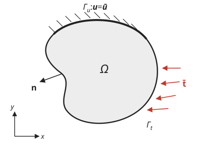
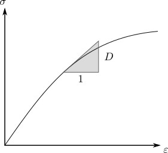
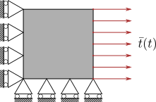
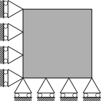
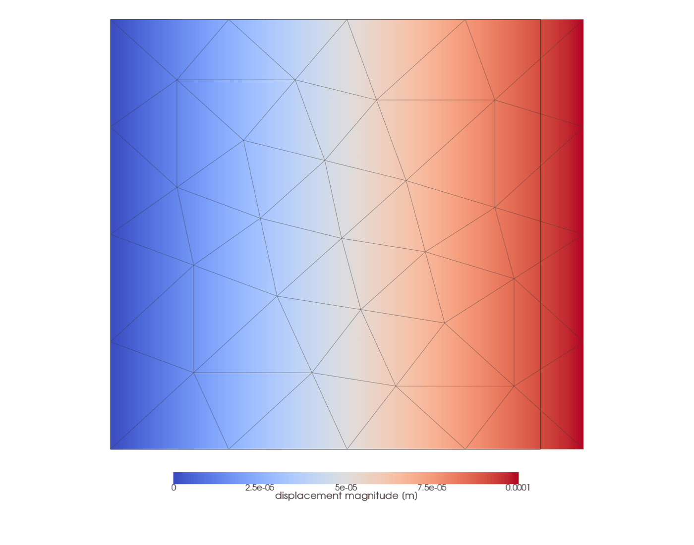
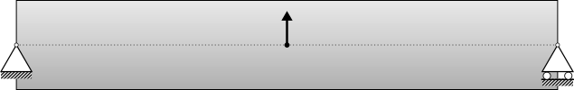
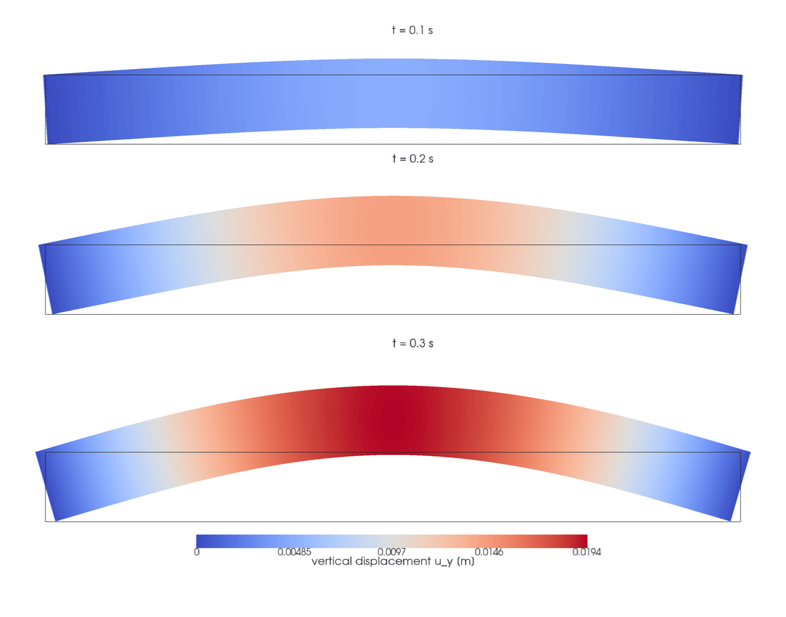
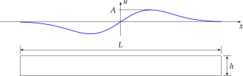
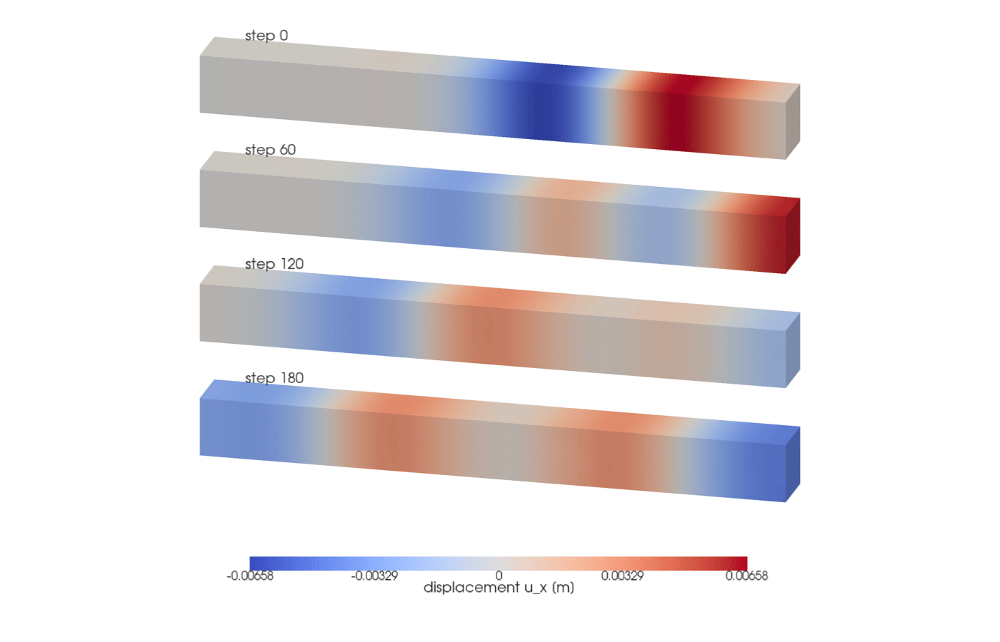

<!-- availability: available akantu::model -->
# Solid mechanics model

This chapter corresponds to the *Solid Mechanics Model* chapter of the
upstream manual (`solidmechanicsmodel.rst`) without its cohesive part
(the cohesive model is described in [Cohesive elements](models/cohesive.md)). `SolidMechanicsModel` solves
the equations of motion
$\boldsymbol{M}\ddot{\boldsymbol{u}} + \boldsymbol{f}_\text{int}(\boldsymbol{u}) = \boldsymbol{f}_\text{ext}$
(dynamics) or of equilibrium
$\boldsymbol{f}_\text{int}(\boldsymbol{u}) = \boldsymbol{f}_\text{ext}$
(statics) on a mesh, with the materials of the [Materials](materials.md)
chapter. The section [Theory](#theory) below derives these equations;
the sections after it show how each analysis is set up and what the
port computes at every step.

All examples of this chapter use the mesh `square.msh` (unit square, groups
`left`, `right`, `bottom`, `top`, `body`) and a steel-like material; the
helper hidden in each example reads them:

```rust
use akantu::core::enums::{AnalysisMethod, MeshIoType};
use akantu::mesh::{Mesh, SharedMesh};
use akantu::model::ModelOptions;
use akantu::parser::Parser;
use akantu::solid::SolidMechanicsModel;

fn square_model(method: AnalysisMethod) -> akantu::core::Result<SolidMechanicsModel> {
    let mesh_file = std::path::Path::new(env!("CARGO_MANIFEST_DIR"))
        .join("../../docs/manual/src/meshes/square.msh");
    let mut mesh = Mesh::new(2, "mesh")?;
    akantu::io::read_mesh(&mut mesh, &mesh_file, MeshIoType::Auto)?;
    let parser = Parser::parse_str(
        "material elastic [\n name = steel\n rho = 7800\n E = 210e9\n nu = 0.3\n]\n",
        "material.dat",
    )?;
    // upstream: SolidMechanicsModel model(mesh);
    let mut model =
        SolidMechanicsModel::with_parser(SharedMesh::new(mesh), None, "solid_mechanics_model", parser)?;
    // upstream: model.initFull(_analysis_method = method);
    model.init_full(&ModelOptions::new(method))?;
    Ok(model)
}

let model = square_model(AnalysisMethod::Static)?;
assert_eq!(model.spatial_dimension(), 2);
assert_eq!(model.nb_materials(), 1);
# Ok::<(), akantu::core::Error>(())
```

`SolidMechanicsModel::new(mesh, dim, id)` creates a model without an input
file (materials are then registered from code); `with_parser` passes the
parsed input file, as upstream's static parser. The second argument is the
spatial dimension of the problem (`None`: the mesh's).

## Theory

### Problem domain and strong form

A body occupies the domain $\Omega$ of dimension $d$ (1, 2 or 3) with
boundary $\Gamma = \partial\Omega$. The boundary is split into a part
$\Gamma_u$ where the displacement is imposed (Dirichlet) and a part
$\Gamma_t$ where the traction is imposed (Neumann), with
$\Gamma_u \cup \Gamma_t = \Gamma$ and $\Gamma_u \cap \Gamma_t = \emptyset$
for each component.


*Figure: the problem domain $\Omega$, the Dirichlet boundary $\Gamma_u$ (hatched), the Neumann boundary $\Gamma_t$ with the imposed traction $\bar{\boldsymbol{t}}$ and the outward normal $\boldsymbol{n}$.*

The displacement field $\boldsymbol{u}(\boldsymbol{x}, t)$ satisfies the
balance of linear momentum, the boundary conditions and the initial
conditions:

$$
\begin{aligned}
\nabla \cdot \boldsymbol{\sigma} + \boldsymbol{b} &= \rho\,\ddot{\boldsymbol{u}} && \text{in } \Omega, \\
\boldsymbol{u} &= \bar{\boldsymbol{u}} && \text{on } \Gamma_u, \\
\boldsymbol{\sigma}\boldsymbol{n} &= \bar{\boldsymbol{t}} && \text{on } \Gamma_t, \\
\boldsymbol{u}(\boldsymbol{x}, 0) &= \boldsymbol{u}_0(\boldsymbol{x}), \quad \dot{\boldsymbol{u}}(\boldsymbol{x}, 0) = \boldsymbol{v}_0(\boldsymbol{x}) && \text{in } \Omega,
\end{aligned}
$$

where $\boldsymbol{\sigma}$ is the Cauchy stress given by the constitutive
law of the material ([Constitutive laws](constitutive-laws.md)) from the
strain, $\boldsymbol{b}$ the body force per unit volume and $\rho$ the
density (`rho`). In small strain the strain is
$\boldsymbol{\varepsilon} = \tfrac{1}{2}\left(\nabla\boldsymbol{u} + \nabla\boldsymbol{u}^T\right)$;
[Finite deformation](#finite-deformation) describes the large-strain
case. In statics the inertia term $\rho\,\ddot{\boldsymbol{u}}$ is dropped
and no initial condition is needed.

### Weak form

Multiplying the balance equation by a test function
$\delta\boldsymbol{u}$ that vanishes on $\Gamma_u$, integrating over
$\Omega$ and integrating the stress term by parts gives the principle of
virtual work: find $\boldsymbol{u}$ with $\boldsymbol{u} = \bar{\boldsymbol{u}}$
on $\Gamma_u$ such that, for every admissible $\delta\boldsymbol{u}$,

$$
\int_\Omega \rho\,\ddot{\boldsymbol{u}} \cdot \delta\boldsymbol{u}\,\mathrm{d}\Omega
+ \int_\Omega \boldsymbol{\sigma} : \nabla\delta\boldsymbol{u}\,\mathrm{d}\Omega
= \int_\Omega \boldsymbol{b} \cdot \delta\boldsymbol{u}\,\mathrm{d}\Omega
+ \int_{\Gamma_t} \bar{\boldsymbol{t}} \cdot \delta\boldsymbol{u}\,\mathrm{d}\Gamma .
$$

The Neumann condition enters through the boundary integral; the
Dirichlet condition is imposed on the unknowns themselves.

### Discretisation

The displacement and the test function are interpolated with the shape
functions $N_I$ of the elements ([Elements](appendix/elements.md)):
$\boldsymbol{u}(\boldsymbol{x}, t) \approx \sum_I N_I(\boldsymbol{x})\,\boldsymbol{u}_I(t)$.
With $\boldsymbol{B}$ the matrix of the shape-function derivatives that
gives the strain from the nodal displacements, the weak form becomes, for
the vector $\boldsymbol{u}$ of all nodal displacements, the semi-discrete
equation of motion

$$
\boldsymbol{M}\ddot{\boldsymbol{u}} + \boldsymbol{C}\dot{\boldsymbol{u}} + \boldsymbol{f}_\text{int}(\boldsymbol{u}) = \boldsymbol{f}_\text{ext},
$$

with

$$
\begin{aligned}
\boldsymbol{M} &= \int_\Omega \rho\,\boldsymbol{N}^T \boldsymbol{N}\,\mathrm{d}\Omega, &
\boldsymbol{f}_\text{int} &= \int_\Omega \boldsymbol{B}^T \boldsymbol{\sigma}\,\mathrm{d}\Omega, &
\boldsymbol{f}_\text{ext} &= \int_\Omega \boldsymbol{N}^T \boldsymbol{b}\,\mathrm{d}\Omega + \int_{\Gamma_t} \boldsymbol{N}^T \bar{\boldsymbol{t}}\,\mathrm{d}\Gamma .
\end{aligned}
$$

The integrals are evaluated element by element with the Gauss quadrature
of each element type and assembled into the global arrays.
$\boldsymbol{C}$ is a damping matrix: the integration schemes include a
term in $\boldsymbol{C}$ when such a matrix exists, but the solid
mechanics model assembles none (its matrix `C` has no type and is never
created), so $\boldsymbol{C} = \boldsymbol{0}$ for this model and the
terms in $\boldsymbol{C}$ below vanish. The model has no body-force input
either: $\boldsymbol{f}_\text{ext}$ is what the Neumann functors add and
what the user writes into `external_force()`.

For a linear elastic material $\boldsymbol{f}_\text{int} = \boldsymbol{K}\boldsymbol{u}$
with the stiffness matrix
$\boldsymbol{K} = \int_\Omega \boldsymbol{B}^T \mathbb{C}\, \boldsymbol{B}\,\mathrm{d}\Omega$,
and the equation of motion is the linear system

$$
\boldsymbol{M}\ddot{\boldsymbol{u}} + \boldsymbol{C}\dot{\boldsymbol{u}} + \boldsymbol{K}\boldsymbol{u} = \boldsymbol{f}_\text{ext} .
$$

For a non-linear material $\boldsymbol{K}$ is the tangent stiffness
$\partial\boldsymbol{f}_\text{int}/\partial\boldsymbol{u}$, assembled from
the materials' tangent $\mathbb{C}$ at the current state.

The residual is the out-of-balance force

$$
\boldsymbol{r} = \boldsymbol{f}_\text{ext} - \boldsymbol{f}_\text{int}(\boldsymbol{u}) - \boldsymbol{M}\ddot{\boldsymbol{u}} - \boldsymbol{C}\dot{\boldsymbol{u}} .
$$

As upstream, the array `internal_force()` holds the internal forces with
their sign in the residual: every material assembles
$-\int_\Omega \boldsymbol{B}^T \boldsymbol{\sigma}\,\mathrm{d}\Omega$ into it,
and the model adds `external_force()` and `internal_force()` to the
residual, both with the coefficient $+1$.

The analysis method chosen at `init_full` decides how this equation is
solved:

| `AnalysisMethod` | Equation solved | Section |
|---|---|---|
| `Static` | $\boldsymbol{f}_\text{int}(\boldsymbol{u}) = \boldsymbol{f}_\text{ext}$, Newton–Raphson | [Static analysis](#static-analysis) |
| `ImplicitDynamic` | equation of motion, Newmark trapezoidal rule, Newton–Raphson | [Implicit dynamics](#implicit-dynamics) |
| `ExplicitLumpedMass` | equation of motion, central difference, lumped $\boldsymbol{M}$ | [Explicit dynamics](#explicit-dynamics) |
| `ExplicitConsistentMass` | equation of motion, central difference, consistent $\boldsymbol{M}$ | [Explicit dynamics](#explicit-dynamics) |

## Nodal arrays and initial conditions

After `init_full` the model holds, per node and component:

| Upstream | Rust | Meaning |
|---|---|---|
| `getDisplacement()` | `displacement()`, `displacement_mut()` | $\boldsymbol{u}$ (imposed on blocked DOFs) |
| `getVelocity()` | `velocity()`, `velocity_mut()` | $\dot{\boldsymbol{u}}$ |
| `getAcceleration()` | `acceleration()`, `acceleration_mut()` | $\ddot{\boldsymbol{u}}$ |
| `getBlockedDOFs()` | `blocked_dofs()`, `blocked_dofs_mut()` | `true`: Dirichlet DOF |
| `getExternalForce()` | `external_force()`, `external_force_mut()` | $\boldsymbol{f}_\text{ext}$ |
| `getInternalForce()` | `internal_force()`, `internal_force_mut()` | $\boldsymbol{f}_\text{int}$ |
| `getMass()` | `mass()` | lumped mass (after its assembly) |
| `getIncrement()` | `increment()` | last increment of $\boldsymbol{u}$ |

The displacement, velocity and acceleration of a free DOF (blocked flag
`false`) are computed by the solver; those of a blocked DOF keep the
value written into the array (the predictors and correctors of every
integration scheme skip blocked DOFs). A DOF whose flag is `false` and
on which `external_force()` is non-zero carries a Neumann load.

A unique solution of the equations of motion needs the initial
displacements and velocities of every DOF, which are the values of the
nodal arrays when the first step starts:

$$
\begin{aligned}
\boldsymbol{u}(t = 0) &= \boldsymbol{u}_0, \\
\dot{\boldsymbol{u}}(t = 0) &= \boldsymbol{v}_0 .
\end{aligned}
$$

All are zero after initialisation. Initial conditions are set by writing
into the arrays (upstream's loop over the nodes):

```rust
# use akantu::core::enums::{AnalysisMethod, MeshIoType};
# use akantu::mesh::{Mesh, SharedMesh};
# use akantu::model::ModelOptions;
# use akantu::parser::Parser;
# use akantu::solid::SolidMechanicsModel;
# fn square_model(method: AnalysisMethod) -> akantu::core::Result<SolidMechanicsModel> {
#     let mesh_file = std::path::Path::new(env!("CARGO_MANIFEST_DIR"))
#         .join("../../docs/manual/src/meshes/square.msh");
#     let mut mesh = Mesh::new(2, "mesh")?;
#     akantu::io::read_mesh(&mut mesh, &mesh_file, MeshIoType::Auto)?;
#     let parser = Parser::parse_str(
#         "material elastic [\n name = steel\n rho = 7800\n E = 210e9\n nu = 0.3\n]\n",
#         "material.dat",
#     )?;
#     let mut model =
#         SolidMechanicsModel::with_parser(SharedMesh::new(mesh), None, "solid_mechanics_model", parser)?;
#     model.init_full(&ModelOptions::new(method))?;
#     Ok(model)
# }
let mut model = square_model(AnalysisMethod::ExplicitLumpedMass)?;

// upstream: disp(node, 0) = 0.1; velo(node, 1) = 1.;
for x in model.displacement_mut()?.tuples_mut() {
    x[0] = 0.1;
}
for v in model.velocity_mut()?.tuples_mut() {
    v[1] = 1.0;
}
assert_eq!(model.velocity()?.tuple(4), &[0.0, 1.0]);
# Ok::<(), akantu::core::Error>(())
```

## Reading and writing model arrays

The nodal arrays above, the mesh's `nodes()` and `connectivity(…)` and the
internal fields of the constitutive laws are storage that the Python
interface can share with NumPy, so their accessors return guards
(`akantu::core::array_shared`) instead of references:

| Guard | Returned by | Gives |
|---|---|---|
| `ArrayRef<'_, T>` | `displacement()`, `velocity()`, …, `mesh.nodes()`, `law.base().stress.get(…)` | read access: dereferences to `Array<T>` (`tuple`, `tuples`, `as_slice`, `len`, …) |
| `ArrayMut<'_, T>` | `displacement_mut()`, `velocity_mut()`, …, `get_mut(…)` | write access: `as_mut_slice`, `tuple_mut`, `tuples_mut`, `fill`, `copy_from`, … |
| `SliceRef<'_, T>` | per-element accessors (`element_connectivity`, `elements_of`) | a read-only slice, without copy |

A guard borrows the model (or the mesh) it comes from until it is
dropped, so write every access with an explicit scope: bind the guard in
an inner block or `drop` it, and never keep one across `solve_step` or
any other call that changes the model. Values needed later are copied out
(`to_vec()`). A use within one statement needs no scope; the temporary
guard is dropped at the end of the statement (`model.displacement()?.tuple(8)[0]`,
or a `for` loop over `model.velocity_mut()?.tuples_mut()` as above):

```rust
# use akantu::core::enums::{AnalysisMethod, MeshIoType};
# use akantu::mesh::{Mesh, SharedMesh};
# use akantu::model::ModelOptions;
# use akantu::parser::Parser;
# use akantu::solid::SolidMechanicsModel;
# fn square_model(method: AnalysisMethod) -> akantu::core::Result<SolidMechanicsModel> {
#     let mesh_file = std::path::Path::new(env!("CARGO_MANIFEST_DIR"))
#         .join("../../docs/manual/src/meshes/square.msh");
#     let mut mesh = Mesh::new(2, "mesh")?;
#     akantu::io::read_mesh(&mut mesh, &mesh_file, MeshIoType::Auto)?;
#     let parser = Parser::parse_str(
#         "material elastic [\n name = steel\n rho = 7800\n E = 210e9\n nu = 0.3\n]\n",
#         "material.dat",
#     )?;
#     let mut model =
#         SolidMechanicsModel::with_parser(SharedMesh::new(mesh), None, "solid_mechanics_model", parser)?;
#     model.init_full(&ModelOptions::new(method))?;
#     Ok(model)
# }
use akantu::core::Real;
use akantu::core::array_shared::{ArrayMut, ArrayRef};

let mut model = square_model(AnalysisMethod::ExplicitLumpedMass)?;
{
    // write guard: released at the end of the block
    let mut v: ArrayMut<'_, Real> = model.velocity_mut()?;
    v.as_mut_slice().fill(1.0);
}
let dt = model.stable_time_step()?;
model.set_time_step(0.8 * dt, None)?;
model.solve_step(None)?; // no guard is alive here
let u_before: Vec<Real> = {
    // read guard: released at the end of the block, the values copied out
    let u: ArrayRef<'_, Real> = model.displacement()?;
    u.as_slice().to_vec()
};
model.solve_step(None)?;
let moved = model.displacement()?.as_slice()[0] - u_before[0]; // one statement
assert!(moved > 0.0); // the rigid motion at 1 m/s continued
# Ok::<(), akantu::core::Error>(())
```

The compiler refuses a guard that is still used after a call that
changes the model:

```rust,compile_fail
# use akantu::core::enums::{AnalysisMethod, MeshIoType};
# use akantu::mesh::{Mesh, SharedMesh};
# use akantu::model::ModelOptions;
# use akantu::parser::Parser;
# use akantu::solid::SolidMechanicsModel;
# fn square_model(method: AnalysisMethod) -> akantu::core::Result<SolidMechanicsModel> {
#     let mesh_file = std::path::Path::new(env!("CARGO_MANIFEST_DIR"))
#         .join("../../docs/manual/src/meshes/square.msh");
#     let mut mesh = Mesh::new(2, "mesh")?;
#     akantu::io::read_mesh(&mut mesh, &mesh_file, MeshIoType::Auto)?;
#     let parser = Parser::parse_str(
#         "material elastic [\n name = steel\n rho = 7800\n E = 210e9\n nu = 0.3\n]\n",
#         "material.dat",
#     )?;
#     let mut model =
#         SolidMechanicsModel::with_parser(SharedMesh::new(mesh), None, "solid_mechanics_model", parser)?;
#     model.init_full(&ModelOptions::new(method))?;
#     Ok(model)
# }
let mut model = square_model(AnalysisMethod::Static)?;
let u = model.displacement()?; // read guard borrows `model`
model.solve_step(None)?;       // error: `model` is borrowed by `u`
println!("{}", u.len());
# Ok::<(), akantu::core::Error>(())
```

and a slice taken from a temporary guard (bind the guard first):

```rust,compile_fail
# use akantu::core::enums::{AnalysisMethod, MeshIoType};
# use akantu::mesh::{Mesh, SharedMesh};
# use akantu::model::ModelOptions;
# use akantu::parser::Parser;
# use akantu::solid::SolidMechanicsModel;
# fn square_model(method: AnalysisMethod) -> akantu::core::Result<SolidMechanicsModel> {
#     let mesh_file = std::path::Path::new(env!("CARGO_MANIFEST_DIR"))
#         .join("../../docs/manual/src/meshes/square.msh");
#     let mut mesh = Mesh::new(2, "mesh")?;
#     akantu::io::read_mesh(&mut mesh, &mesh_file, MeshIoType::Auto)?;
#     let parser = Parser::parse_str(
#         "material elastic [\n name = steel\n rho = 7800\n E = 210e9\n nu = 0.3\n]\n",
#         "material.dat",
#     )?;
#     let mut model =
#         SolidMechanicsModel::with_parser(SharedMesh::new(mesh), None, "solid_mechanics_model", parser)?;
#     model.init_full(&ModelOptions::new(method))?;
#     Ok(model)
# }
let mut model = square_model(AnalysisMethod::Static)?;
let v = model.velocity_mut()?.as_mut_slice(); // error: temporary guard dropped
v[0] = 1.0;
# Ok::<(), akantu::core::Error>(())
```

With the Python interface. `model.getDisplacement()` and the other
getters of the [Python interface](models/python.md) return NumPy arrays
that view the same memory: writes from Python reach the model and a view
held by Python sees the values of later steps (Python tests
`test_mesh_model_views.py::test_model_views_are_writable_and_reach_the_model`
and `::test_a_held_view_sees_the_values_after_each_call`). An array that
has been handed to Python is checked at run time: native code that calls
back into Python (a boundary-condition functor written in Python, for
example) while it still holds a guard of such an array gets an error
instead of a NumPy view that could change under the guard
(`test_views_runtime.py::test_callback_refused_while_a_native_guard_is_alive`).
The explicit scopes above avoid both problems.

## Boundary conditions

A Dirichlet condition prescribes the displacement on the part $\Gamma_u$
of the boundary, a Neumann condition the traction on the part
$\Gamma_t$:

$$
\begin{aligned}
\boldsymbol{u} &= \bar{\boldsymbol{u}} && \forall \boldsymbol{x} \in \Gamma_u, \\
\boldsymbol{t} = \boldsymbol{\sigma}\boldsymbol{n} &= \bar{\boldsymbol{t}} && \forall \boldsymbol{x} \in \Gamma_t .
\end{aligned}
$$

In the discrete problem a Dirichlet condition blocks a DOF (its flag in
`blocked_dofs()` is `true`) and sets its value in `displacement()`; a
Neumann condition adds the nodal forces
$\int_{\Gamma_t} \boldsymbol{N}^T \bar{\boldsymbol{t}}\,\mathrm{d}\Gamma$
to `external_force()`. Both can be written directly into the nodal
arrays, node by node, as the initial conditions above.

Dirichlet and Neumann conditions are applied on element groups (for
example those created from Gmsh physical names, see [Meshes](meshes.md))
with functors, as upstream's `model.applyBC(functor, "group")`:

| Upstream | Rust (`akantu::model::boundary_condition`) | Effect |
|---|---|---|
| `BC::Dirichlet::FixedValue(v, _x)` | `FixedValue { value: v, axis: SpatialDirection::X }` | block the component, set it to $v$ |
| `BC::Dirichlet::FlagOnly(_x)` | `FlagOnly { axis: SpatialDirection::X }` | block the component, keep its value |
| `BC::Dirichlet::IncrementValue(v, _x)` | `IncrementValue { value: v, axis: … }` | block the component, add $v$ |
| `BC::Dirichlet::Increment(vec)` | `Increment { value: vec }` | block every component, add `vec` |
| `BC::Neumann::FromTraction(t)` | `FromSameDim::new(t)` | add the traction vector $\bar{\boldsymbol{t}}$ integrated over the group to $\boldsymbol{f}_\text{ext}$ |
| `BC::Neumann::FromStress(σ)` | `FromHigherDim::new(σ)` | add the traction $\boldsymbol{\sigma}\boldsymbol{n}$ integrated over the group to $\boldsymbol{f}_\text{ext}$ |
| `BC::Neumann::FreeBoundary()` | `FreeBoundary` | zero traction |

The Dirichlet functors are applied to the nodes of the group, the Neumann
functors integrated on its elements (the group's elements must be of
dimension $d - 1$). The model methods are `apply_dirichlet_bc(&functor,
group)` and `apply_neumann_bc(&functor, group)`; `…_all` apply a functor
to every element group. As upstream, a Neumann condition is added to
the external force.

### Static analysis

In a static analysis (`AnalysisMethod::Static`) the inertia and damping
terms vanish ($\ddot{\boldsymbol{u}} = \dot{\boldsymbol{u}} = \boldsymbol{0}$)
and the equation to solve is the equilibrium of the internal and external
forces,

$$
\boldsymbol{f}_\text{int}(\boldsymbol{u}) = \boldsymbol{f}_\text{ext},
\qquad \text{linear elastic: } \boldsymbol{K}\boldsymbol{u} = \boldsymbol{f}_\text{ext},
$$

where $\boldsymbol{K}$ is the global stiffness matrix, $\boldsymbol{u}$
the displacement vector and $\boldsymbol{f}_\text{ext}$ the external
forces. The time-step solver `static` combines the `pseudo_time`
integration scheme (no predictor; the corrector adds the solution
$\delta\boldsymbol{u}$ to the free DOFs of $\boldsymbol{u}$; the matrix of
the linear systems is $\boldsymbol{K}$) with a Newton–Raphson solver.
Starting from the current displacement $\boldsymbol{u}^0$, iteration $i$
solves

$$
\begin{aligned}
\boldsymbol{K}^i\,\delta\boldsymbol{u}^{i+1} &= \boldsymbol{r}^i = \boldsymbol{f}_\text{ext} - \boldsymbol{f}_\text{int}(\boldsymbol{u}^i), \\
\boldsymbol{u}^{i+1} &= \boldsymbol{u}^i + \delta\boldsymbol{u}^{i+1},
\end{aligned}
$$

with $\boldsymbol{K}^i$ the tangent stiffness at $\boldsymbol{u}^i$, the
slope of the force-displacement response of the materials.


*Figure: the tangent $D$ of a non-linear stress-strain curve, from which the tangent stiffness is assembled (figure of the Akantu manual).*

The variants of the solver differ in when $\boldsymbol{K}$ is rebuilt:
`newton_raphson` (the default) assembles it at every iteration,
`newton_raphson_modified` once before the first iteration, `linear` solves
once ([Solver configuration](solver-configuration.md)). A matrix is only
re-assembled when a material reports that its tangent changed: a linear
elastic law's $\boldsymbol{K}$ is assembled once and reused. The loop
stops when the convergence criterion `convergence_type` holds, measured
in the Euclidean norm over the free DOFs:

* `solution`: the increment is small, $\lVert \delta\boldsymbol{u}^{i+1} \rVert < \text{threshold}$;
* `residual`: the forces are balanced. The initial residual is first
  tested against the absolute threshold,
  $\lVert \boldsymbol{r}^0 \rVert < \text{threshold}$ (then nothing is
  solved); otherwise the later residuals are tested relative to it,
  $\lVert \boldsymbol{r}^{i+1} \rVert < \lVert \boldsymbol{r}^0 \rVert \cdot \text{threshold}$.

A step that reaches `max_iterations` without converging fails with an
error.

A uniaxial traction $t$ on the right side of the square, with the left
side blocked in $x$ and the bottom in $y$, gives $\sigma_{xx} = t$ and, in plane
strain, $u_x(x = 1) = (1 - \nu^2)\, t / E$, reproduced exactly by bilinear
quadrangles:


*Figure: the plate on rollers of the example below, loaded by a traction $\bar{t}$ on its right side (figure of the Akantu manual).*

```rust
# use akantu::core::enums::{AnalysisMethod, MeshIoType};
# use akantu::mesh::{Mesh, SharedMesh};
# use akantu::model::ModelOptions;
# use akantu::parser::Parser;
# use akantu::solid::SolidMechanicsModel;
# fn square_model(method: AnalysisMethod) -> akantu::core::Result<SolidMechanicsModel> {
#     let mesh_file = std::path::Path::new(env!("CARGO_MANIFEST_DIR"))
#         .join("../../docs/manual/src/meshes/square.msh");
#     let mut mesh = Mesh::new(2, "mesh")?;
#     akantu::io::read_mesh(&mut mesh, &mesh_file, MeshIoType::Auto)?;
#     let parser = Parser::parse_str(
#         "material elastic [\n name = steel\n rho = 7800\n E = 210e9\n nu = 0.3\n]\n",
#         "material.dat",
#     )?;
#     let mut model =
#         SolidMechanicsModel::with_parser(SharedMesh::new(mesh), None, "solid_mechanics_model", parser)?;
#     model.init_full(&ModelOptions::new(method))?;
#     Ok(model)
# }
use akantu::core::enums::SpatialDirection::{X, Y};
use akantu::core::{ElementType, GhostType};
use akantu::model::boundary_condition::{FixedValue, FlagOnly, FromSameDim};
use akantu::parser::ParamValue;

let mut model = square_model(AnalysisMethod::Static)?;
model.apply_dirichlet_bc(&FlagOnly { axis: X }, "left")?;
model.apply_dirichlet_bc(&FixedValue { value: 0.0, axis: Y }, "bottom")?;
let t = 1e6;
model.apply_neumann_bc(&FromSameDim::new(vec![t, 0.0]), "right")?;

// upstream: solver.set("max_iterations", 2); solver.set("convergence_type", _residual);
let newton = model.solver.non_linear_solver_mut(None)?;
newton.set_param("max_iterations", ParamValue::Int(2))?;
newton.set_param("convergence_type", ParamValue::Enum("residual".into()))?;
model.solve_step(None)?;

let (e, nu) = (210e9, 0.3);
let ux = model.displacement()?.tuple(8)[0]; // node at (1, 1)
let exact = (1.0 - nu * nu) * t / e;
assert!((ux - exact).abs() <= 1e-12 * exact);

// the Cauchy stress of the material at every quadrature point: [σxx, σyx, σxy, σyy]
let stress = model.material(0)?.base().stress.get(ElementType::Quadrangle4, GhostType::NotGhost)?;
for s in stress.tuples() {
    assert!((s[0] - t).abs() <= 1e-12 * t && s[3].abs() <= 1e-12 * t);
}
# Ok::<(), akantu::core::Error>(())
```

For a linear problem one Newton iteration solves the system; the default
non-linear solver of a static analysis is `newton_raphson` with the
`solution` criterion, threshold `1e-10` and at most 10 iterations
(upstream's `registerParam` defaults; the upstream manual says 100). The
$10^{-12}$ relative bound above is three orders of magnitude above the
round-off of an 18-unknown solve.

The example `static` of the port (`crates/akantu/examples/static`,
upstream's `static.cc`) solves the same kind of problem with an imposed
displacement instead of a traction: a square of side $0.01$ meshed with
quadratic triangles (`square.geo`), on rollers on its left side ($u_x = 0$, group
`Fixed_x`) and its bottom side ($u_y = 0$, `Fixed_y`), whose right side
is displaced by $u_x = 10^{-4}$ (`Displacement`; 1 % of the side, where
the upstream manual says 0.01 %). The Newton–Raphson
solver is limited to 2 iterations with the `solution` criterion and the
threshold $2 \times 10^{-4}$.


*Figure: set-up of the `static` example: rollers on the left and bottom sides; the right side is displaced in $x$ (figure of the Akantu manual).*


*Figure: solution of the `static` example, the displacement magnitude on the deformed plate, magnified 10 times; the dark line is the undeformed right side (computed with akantu-rs).*

### Custom functors

A functor is any type implementing `DirichletFunctor` or `NeumannFunctor`
(upstream: a class deriving from `BC::Dirichlet::DirichletFunctor` with an
`operator()`):

```rust
# use akantu::core::enums::{AnalysisMethod, MeshIoType};
# use akantu::mesh::{Mesh, SharedMesh};
# use akantu::model::ModelOptions;
# use akantu::parser::Parser;
# use akantu::solid::SolidMechanicsModel;
# fn square_model(method: AnalysisMethod) -> akantu::core::Result<SolidMechanicsModel> {
#     let mesh_file = std::path::Path::new(env!("CARGO_MANIFEST_DIR"))
#         .join("../../docs/manual/src/meshes/square.msh");
#     let mut mesh = Mesh::new(2, "mesh")?;
#     akantu::io::read_mesh(&mut mesh, &mesh_file, MeshIoType::Auto)?;
#     let parser = Parser::parse_str(
#         "material elastic [\n name = steel\n rho = 7800\n E = 210e9\n nu = 0.3\n]\n",
#         "material.dat",
#     )?;
#     let mut model =
#         SolidMechanicsModel::with_parser(SharedMesh::new(mesh), None, "solid_mechanics_model", parser)?;
#     model.init_full(&ModelOptions::new(method))?;
#     Ok(model)
# }
use akantu::core::{Idx, Real, Result};
use akantu::model::boundary_condition::DirichletFunctor;

/// Shear: u_x = γ · y on the group's nodes.
struct Shear {
    gamma: Real,
}

impl DirichletFunctor for Shear {
    fn apply(&self, _node: Idx, flags: &mut [bool], primal: &mut [Real], coord: &[Real]) -> Result<()> {
        flags[0] = true;
        primal[0] = self.gamma * coord[1];
        Ok(())
    }
}

let mut model = square_model(AnalysisMethod::Static)?;
model.apply_dirichlet_bc(&Shear { gamma: 1e-3 }, "right")?;
let blocked = model.blocked_dofs()?;
assert!(blocked.tuple(8)[0] && !blocked.tuple(8)[1]); // node (1, 1)
assert_eq!(model.displacement()?.tuple(8)[0], 1e-3);
# Ok::<(), akantu::core::Error>(())
```

## Implicit dynamics

`AnalysisMethod::ImplicitDynamic` creates a `dynamic` solver with the
trapezoidal rule (`trapezoidal_rule_2`, i.e. Newmark with Akantu's
$\alpha = \beta = 1/2$ (`alpha`, `beta`), textbook
$\beta_\mathrm{N} = 1/4$, $\gamma_\mathrm{N} = 1/2$: the average-acceleration
scheme, [Solver configuration](solver-configuration.md#integration_scheme-type---))
and Newton–Raphson. The time step is set with
`set_time_step` and every `solve_step` advances one step. For a linear
problem the trapezoidal rule conserves the total energy exactly:

```rust
# use akantu::core::enums::{AnalysisMethod, MeshIoType};
# use akantu::mesh::{Mesh, SharedMesh};
# use akantu::model::ModelOptions;
# use akantu::parser::Parser;
# use akantu::solid::SolidMechanicsModel;
# fn square_model(method: AnalysisMethod) -> akantu::core::Result<SolidMechanicsModel> {
#     let mesh_file = std::path::Path::new(env!("CARGO_MANIFEST_DIR"))
#         .join("../../docs/manual/src/meshes/square.msh");
#     let mut mesh = Mesh::new(2, "mesh")?;
#     akantu::io::read_mesh(&mut mesh, &mesh_file, MeshIoType::Auto)?;
#     let parser = Parser::parse_str(
#         "material elastic [\n name = steel\n rho = 7800\n E = 210e9\n nu = 0.3\n]\n",
#         "material.dat",
#     )?;
#     let mut model =
#         SolidMechanicsModel::with_parser(SharedMesh::new(mesh), None, "solid_mechanics_model", parser)?;
#     model.init_full(&ModelOptions::new(method))?;
#     Ok(model)
# }
use akantu::core::enums::SpatialDirection::{X, Y};
use akantu::model::boundary_condition::FixedValue;

let mut model = square_model(AnalysisMethod::ImplicitDynamic)?;
model.apply_dirichlet_bc(&FixedValue { value: 0.0, axis: X }, "left")?;
model.apply_dirichlet_bc(&FixedValue { value: 0.0, axis: Y }, "left")?;
// initial state: a uniform stretch released at t = 0
let x: Vec<f64> = model.physics.base.mesh.read()?.nodes().as_slice().to_vec();
for (u, x) in model.displacement_mut()?.tuples_mut().zip(x.chunks(2)) {
    u[0] = 1e-4 * x[0];
}

let dt = model.stable_time_step()?; // the implicit scheme is stable for any Δt
model.set_time_step(0.8 * dt, None)?;
let mut energies = Vec::new();
for _ in 0..50 {
    model.solve_step(None)?;
    energies.push(model.energy("kinetic")? + model.energy("potential")?);
}
let e0 = energies[0];
assert!(energies.iter().all(|e| (e - e0).abs() <= 1e-12 * e0));
# Ok::<(), akantu::core::Error>(())
```

(In exact arithmetic the average-acceleration scheme conserves this
energy exactly; what remains is the round-off of the linear solves,
which the bound `1e-12` covers with a wide margin.)

### Newmark-β time discretisation

The time interval is divided into steps of length $\Delta t$ (set with
`set_time_step`); $\boldsymbol{u}_n$, $\dot{\boldsymbol{u}}_n$ and
$\ddot{\boldsymbol{u}}_n$ approximate $\boldsymbol{u}(t_n)$,
$\dot{\boldsymbol{u}}(t_n)$ and $\ddot{\boldsymbol{u}}(t_n)$. The
semi-discrete equation of motion is discretised in time by the Newmark-β
family, which the port implements with upstream's parameters $\alpha$
(`alpha`) and $\beta$ (`beta`) (Curnier, 1992; Hughes and Belytschko,
1983):

$$
\begin{aligned}
\boldsymbol{M}\ddot{\boldsymbol{u}}_{n+1} + \boldsymbol{C}\dot{\boldsymbol{u}}_{n+1} + \boldsymbol{f}_\text{int}(\boldsymbol{u}_{n+1}) &= \boldsymbol{f}_{\text{ext},\,n+1}, \\
\boldsymbol{u}_{n+1} &= \boldsymbol{u}_n + (1 - \alpha)\,\Delta t\,\dot{\boldsymbol{u}}_n + \alpha\,\Delta t\,\dot{\boldsymbol{u}}_{n+1} + \left(\tfrac{1}{2} - \alpha\right)\Delta t^2\,\ddot{\boldsymbol{u}}_n, \\
\dot{\boldsymbol{u}}_{n+1} &= \dot{\boldsymbol{u}}_n + (1 - \beta)\,\Delta t\,\ddot{\boldsymbol{u}}_n + \beta\,\Delta t\,\ddot{\boldsymbol{u}}_{n+1} .
\end{aligned}
$$

Substituting the velocity update into the displacement update gives the
textbook form with $\beta_\mathrm{N} = \alpha\beta$ and
$\gamma_\mathrm{N} = \beta$:

$$
\boldsymbol{u}_{n+1} = \boldsymbol{u}_n + \Delta t\,\dot{\boldsymbol{u}}_n + \Delta t^2 \left[ \left(\tfrac{1}{2} - \alpha\beta\right) \ddot{\boldsymbol{u}}_n + \alpha\beta\, \ddot{\boldsymbol{u}}_{n+1} \right] .
$$

$\alpha$ and $\beta$ decide the stability and the accuracy of the scheme;
$\beta = 1/2$ introduces no numerical damping. The presets of the port:

| $\alpha$ | Scheme ($\beta = 1/2$) | Keyword | Type |
|---|---|---|---|
| $0$ | central difference | `central_difference` | explicit |
| $1/6$ | Fox–Goodwin (royal road) | `fox_goodwin` | implicit |
| $1/3$ | linear acceleration | `linear_acceleration` | implicit |
| $1/2$ | average acceleration (trapezoidal rule) | `trapezoidal_rule_2` | implicit |

`newmark_beta` takes $\alpha$ and $\beta$ from the input file (both $0$ by
default). With $\alpha = \beta = 1/2$ the trapezoidal rule is
unconditionally stable for a linear problem, so the time step of an
implicit analysis is chosen for accuracy, not stability.

### Predictor, solve and corrector

Every `solve_step` of a dynamic analysis splits the step into a
predictor, Newton–Raphson iterations and correctors. The predictor
extrapolates the state of step $n$ (blocked DOFs keep their values):

$$
\begin{aligned}
\boldsymbol{u}^0_{n+1} &= \boldsymbol{u}_n + \Delta t\,\dot{\boldsymbol{u}}_n + \tfrac{1}{2}\Delta t^2\,\ddot{\boldsymbol{u}}_n, \\
\dot{\boldsymbol{u}}^0_{n+1} &= \dot{\boldsymbol{u}}_n + \Delta t\,\ddot{\boldsymbol{u}}_n, \\
\ddot{\boldsymbol{u}}^0_{n+1} &= \ddot{\boldsymbol{u}}_n .
\end{aligned}
$$

Iteration $i$ then solves for an increment $\boldsymbol{w}$ of the
variable chosen as `solution_type` (displacement, velocity or
acceleration):

$$
\left(c\,\boldsymbol{M} + d\,\boldsymbol{C} + e\,\boldsymbol{K}^i_{n+1}\right) \boldsymbol{w}
= \boldsymbol{f}_{\text{ext},\,n+1} - \boldsymbol{f}_\text{int}(\boldsymbol{u}^i_{n+1}) - \boldsymbol{C}\dot{\boldsymbol{u}}^i_{n+1} - \boldsymbol{M}\ddot{\boldsymbol{u}}^i_{n+1}
= \boldsymbol{r}^i_{n+1},
$$

and corrects the three fields of the free DOFs:

$$
\begin{aligned}
\ddot{\boldsymbol{u}}^{i+1}_{n+1} &= \ddot{\boldsymbol{u}}^i_{n+1} + c\,\boldsymbol{w}, \\
\dot{\boldsymbol{u}}^{i+1}_{n+1} &= \dot{\boldsymbol{u}}^i_{n+1} + d\,\boldsymbol{w}, \\
\boldsymbol{u}^{i+1}_{n+1} &= \boldsymbol{u}^i_{n+1} + e\,\boldsymbol{w} .
\end{aligned}
$$

The coefficients follow from the Newmark relations above:

| `solution_type` | $\boldsymbol{w}$ | $e$ | $d$ | $c$ |
|---|---|---|---|---|
| `acceleration` | $\delta\ddot{\boldsymbol{u}}$ | $\alpha\beta\,\Delta t^2$ | $\beta\,\Delta t$ | $1$ |
| `velocity` | $\delta\dot{\boldsymbol{u}}$ | $\alpha\,\Delta t$ | $1$ | $\frac{1}{\beta\,\Delta t}$ |
| `displacement` | $\delta\boldsymbol{u}$ | $1$ | $\frac{1}{\alpha\,\Delta t}$ | $\frac{1}{\alpha\beta\,\Delta t^2}$ |

`ImplicitDynamic` solves for the displacement, so with the trapezoidal
rule the matrix of the linear systems is
$\boldsymbol{K} + \frac{4}{\Delta t^2}\boldsymbol{M}$ ($\boldsymbol{C} = \boldsymbol{0}$),
and an increment $\delta\boldsymbol{u}$ changes the velocity by
$\frac{2}{\Delta t}\delta\boldsymbol{u}$ and the acceleration by
$\frac{4}{\Delta t^2}\delta\boldsymbol{u}$. When $e = 0$ (the central
difference) the stiffness is left out of the matrix. The iterations stop
on the criteria of the [static analysis](#static-analysis); the linear
systems are solved by the sparse solver chosen with `sparse_solver_type`
([Solver configuration](solver-configuration.md)).

### The `implicit_dynamic` example

The example `implicit_dynamic` (`crates/akantu/examples/implicit_dynamic`,
upstream's `implicit_dynamic.cc`) is a simply supported 2-D beam
(plane strain, quadratic triangles) of length $L = 10$ and height $1$,
blocked on its left end and on a roller on its right end, loaded at
mid-span by a constant point force $F = 5 \times 10^{3}$ applied at
$t = 0$ (written into `external_force()` at the first node of the group
`traction`). The material (`material_dynamic.dat`, with $E$ and $\rho$
set again from the code) is a fictitious linear elastic one with
$\rho = 1000$, $E = 1.2 \times 10^{8}$ and $\nu = 0.3$, chosen to
simplify the analytical solution. The time step is
$\Delta t = 10^{-4}$ up to $t = 0.62$, the Newton–Raphson solver uses at
most 100 iterations and the threshold $10^{-12}$ on the solution
increment.


*Figure: set-up of the `implicit_dynamic` example (figure of the Akantu manual).*

The example writes the mid-span deflection next to the Euler–Bernoulli
solution made of the modes 1, 3 and 5,

$$
u\left(\tfrac{L}{2}, t\right) = \frac{2 F L^3}{\pi^4 E I} \left[ \left(1 - \cos\omega_1 t\right) + \frac{1}{81}\left(1 - \cos\omega_3 t\right) + \frac{1}{625}\left(1 - \cos\omega_5 t\right) \right],
\qquad
\omega_n = \frac{n^2\pi^2}{L^2}\sqrt{\frac{E I}{m}},
$$

with $I = h^3/12$ per unit depth and $m = \rho h$ the mass per unit
length. With the values above $\frac{2 F L^3}{\pi^4 E I} = \frac{1}{\pi^4}$
and $\omega_n = n^2\pi^2$, upstream's form of the formula.


*Figure: vertical displacement of the `implicit_dynamic` example at $t = 0.1$, $0.2$ and $0.3\ \text{s}$ on the deformed beam, magnified 50 times; the dark rectangle is the undeformed beam (computed with akantu-rs).*

## Explicit dynamics

`AnalysisMethod::ExplicitLumpedMass` (the default of `ModelOptions`, as
upstream's `initFull()`) uses the central-difference scheme with a lumped
mass matrix: every step is explicit and the time step must stay below the
stable time step `stable_time_step()` (upstream `getStableTimeStep()`),
the minimum over the elements of the element size divided by the wave
speed. `AnalysisMethod::ExplicitConsistentMass` uses the consistent mass
matrix.

```rust
# use akantu::core::enums::{AnalysisMethod, MeshIoType};
# use akantu::mesh::{Mesh, SharedMesh};
# use akantu::model::ModelOptions;
# use akantu::parser::Parser;
# use akantu::solid::SolidMechanicsModel;
# fn square_model(method: AnalysisMethod) -> akantu::core::Result<SolidMechanicsModel> {
#     let mesh_file = std::path::Path::new(env!("CARGO_MANIFEST_DIR"))
#         .join("../../docs/manual/src/meshes/square.msh");
#     let mut mesh = Mesh::new(2, "mesh")?;
#     akantu::io::read_mesh(&mut mesh, &mesh_file, MeshIoType::Auto)?;
#     let parser = Parser::parse_str(
#         "material elastic [\n name = steel\n rho = 7800\n E = 210e9\n nu = 0.3\n]\n",
#         "material.dat",
#     )?;
#     let mut model =
#         SolidMechanicsModel::with_parser(SharedMesh::new(mesh), None, "solid_mechanics_model", parser)?;
#     model.init_full(&ModelOptions::new(method))?;
#     Ok(model)
# }
let mut model = square_model(AnalysisMethod::ExplicitLumpedMass)?;

// a rigid translation at 1 m/s: kinetic energy ½ ρ V v², no deformation
for v in model.velocity_mut()?.tuples_mut() {
    v[0] = 1.0;
}
let critical = model.stable_time_step()?;
model.set_time_step(0.8 * critical, None)?; // safety factor, as upstream examples
for _ in 0..10 {
    model.solve_step(None)?;
}
let ek = model.energy("kinetic")?;
assert!((ek - 0.5 * 7800.0).abs() <= 1e-12 * 7800.0);
assert!(model.energy("potential")?.abs() <= 1e-12);

// the lumped mass of the x components sums to ρ V
let mass: f64 = model.mass()?.tuples().map(|m| m[0]).sum();
assert!((mass - 7800.0).abs() <= 1e-12 * 7800.0);
# Ok::<(), akantu::core::Error>(())
```

Upstream v3's `explicitPred`, `updateResidual`, `updateAcceleration` and
`explicitCorr`, still mentioned by the upstream manual, do not exist in
upstream v5 nor in the port: `solve_step` performs the predictor, the
residual, the solve and the corrector.

### Central-difference step

The explicit scheme is the Newmark scheme with $\alpha = 0$ and
$\beta = 1/2$ (`central_difference`), solved for the acceleration
(`solution_type` `acceleration`: $c = 1$, $d = \tfrac{1}{2}\Delta t$,
$e = 0$). Since $e = 0$, the matrix of the step contains no stiffness and
the displacement is not changed by the corrector. One `solve_step` of
`ExplicitLumpedMass` does, on the free DOFs:

1. the predictor, which gives the new displacement and a predicted
   velocity:

   $$
   \begin{aligned}
   \boldsymbol{u}_{n+1} &= \boldsymbol{u}_n + \Delta t\,\dot{\boldsymbol{u}}_n + \tfrac{1}{2}\Delta t^2\,\ddot{\boldsymbol{u}}_n, \\
   \dot{\boldsymbol{u}}^\text{p}_{n+1} &= \dot{\boldsymbol{u}}_n + \Delta t\,\ddot{\boldsymbol{u}}_n ;
   \end{aligned}
   $$

2. the residual, with the internal forces computed by the materials from
   $\boldsymbol{u}_{n+1}$ (the term in $\boldsymbol{C}$ vanishes for this
   model):

   $$
   \boldsymbol{r} = \boldsymbol{f}_\text{ext} - \boldsymbol{f}_\text{int}(\boldsymbol{u}_{n+1}) - \boldsymbol{C}\dot{\boldsymbol{u}}^\text{p}_{n+1} - \boldsymbol{M}\ddot{\boldsymbol{u}}_n ;
   $$

3. the solve, a division by the diagonal lumped mass (the `lumped`
   solver), $\delta\ddot{\boldsymbol{u}} = \boldsymbol{r} / \boldsymbol{M}$
   component by component;

4. the corrector:

   $$
   \begin{aligned}
   \dot{\boldsymbol{u}}_{n+1} &= \dot{\boldsymbol{u}}^\text{p}_{n+1} + \tfrac{1}{2}\Delta t\,\delta\ddot{\boldsymbol{u}}, \\
   \ddot{\boldsymbol{u}}_{n+1} &= \ddot{\boldsymbol{u}}_n + \delta\ddot{\boldsymbol{u}} .
   \end{aligned}
   $$

Together these give
$\boldsymbol{M}\ddot{\boldsymbol{u}}_{n+1} = \boldsymbol{f}_\text{ext} - \boldsymbol{f}_\text{int}(\boldsymbol{u}_{n+1})$
with no linear system to solve. `ExplicitConsistentMass` runs the same
predictor and corrector but solves
$\boldsymbol{M}\,\delta\ddot{\boldsymbol{u}} = \boldsymbol{r}$ with the
consistent mass matrix and the Newton–Raphson solver.

### Lumped mass matrix

The lumped mass matrix is diagonal and stored per node and component in
`mass()`. It is assembled element by element from the density: for the
linear element types by the row sum of the consistent mass matrix,

$$
\tilde{M}_I = \int_{\Omega_e} \rho\, N_I\,\mathrm{d}\Omega,
$$

and for the quadratic types (`_triangle_6`, `_quadrangle_8`,
`_tetrahedron_10`, `_hexahedron_20`, `_pentahedron_15`), where the row
sum can give zero or negative masses at the corner nodes, by diagonal
scaling: $\tilde{M}_I = c_I \int_{\Omega_e} \rho\,\mathrm{d}\Omega$ with
fixed nodal factors $c_I$ (for `_triangle_6`, $1/12$ at the corners and
$1/4$ at the mid-side nodes), as upstream. After the assembly, the
entries of `mass()` smaller than the machine epsilon in magnitude (or
NaN) are set to zero, as upstream does when built without
`AKANTU_NDEBUG` (the oracle's build).

### Stable time step

The central-difference scheme is conditionally stable: for a linear
problem it is stable when $\Delta t \le 2/\omega_\text{max}$, with
$\omega_\text{max}$ the highest eigenfrequency of the discrete system.
`stable_time_step()` estimates this limit with the
Courant–Friedrichs–Lewy (CFL) condition: the time step must stay below
the time the fastest wave needs to cross the smallest element,

$$
\Delta t_\text{crit} = \min_e \frac{h_e}{c_e},
$$

the minimum over the elements of the model's dimension (reduced over the
MPI ranks). $h_e$ is the characteristic length of the element, computed
on the current positions: twice the inradius for the linear triangles and
tetrahedra, the shortest edge for the linear quadrangles and hexahedra,
and a value derived from the sub-elements or the half-edges for the other
types ([Elements](appendix/elements.md)). $c_e$ is the celerity of the
element's material, its push (compressive) wave speed; for the linear
elastic law

$$
c = \sqrt{\frac{\lambda + 2\mu}{\rho}}
\quad (d = 2, 3), \qquad
c = \sqrt{\frac{E}{\rho}} \quad (d = 1),
$$

with the Lamé constants $\lambda$ and $\mu$ of the law (in plane stress
$\lambda = \nu E / ((1 + \nu)(1 - \nu))$, so that
$c = \sqrt{E / (\rho\,(1 - \nu^2))}$). The estimate is not a strict bound
for every mesh, and the examples apply a safety factor below one:

$$
\Delta t = 0.8\,\Delta t_\text{crit} .
$$

### The `explicit_dynamic` example

The example `explicit_dynamic` (`crates/akantu/examples/explicit_dynamic`,
upstream's `explicit_dynamic.cc`) models the propagation of a wave in a
3-D steel bar of length $L = 10$ and section $1 \times 1$ (linear
tetrahedra), with $\rho = 7800$, $E = 2.1 \times 10^{11}$ and $\nu = 0$
(`material.dat`; the upstream manual says $\nu = 0.3$). The initial
displacement along the bar is a sine modulated by a Gaussian of amplitude
$A = 0.01$,

$$
u_x(x) = A \sin\left(k (x - 2)\right) \exp\left(-\frac{k^2 (x - 2)^2}{l^2}\right),
\qquad l = 2, \quad k = \frac{0.1 \cdot 2\pi \cdot 3}{l},
$$

and the bar is integrated for 1000 steps with
$\Delta t = 0.8\,\Delta t_\text{crit}$; the example writes the
potential and kinetic energies of every step to `energy.csv`.


*Figure: set-up of the `explicit_dynamic` example, the initial displacement $u$ along $x$ (figure of the Akantu manual).*


*Figure: the displacement pulse of the `explicit_dynamic` example, the axial displacement $u_x$ at steps 0, 60, 120 and 180: the pulse splits in two and reflects at the ends (computed with akantu-rs).*

## Energies

| Upstream `getEnergy(id)` | Rust | Meaning |
|---|---|---|
| `"kinetic"` | `energy("kinetic")`, `kinetic_energy()` | $\tfrac{1}{2}\, \boldsymbol{v}^T \boldsymbol{M} \boldsymbol{v}$ (lumped or consistent mass) |
| `"potential"` | `energy("potential")` | elastic energy summed over the materials |
| `"external work"` | `energy("external work")`, `external_work()` | power of $\boldsymbol{f}_\text{ext}$ on free DOFs and of the reactions on blocked DOFs, times $\Delta t$ (the increment in statics) |
| any other id | `energy(id)` | summed over the materials (e.g. `dissipated` for laws that define it; for cohesive laws upstream's trapezoidal estimate, not a physical dissipation when the time step does not resolve the softening: UD-803) |
| `getEnergy(id, element)` | `energy_of_element(id, element)` | one element |
| `getEnergy(id, group)` | `energy_of_group(id, group)` | one element group |

`energy(id)` (including `kinetic_energy()` and `external_work()`) and
`energy_of_group(id, group)` are summed over all MPI ranks (in rank order,
D-039), so every rank gets the same value; `energy_of_element(id,
element)` is the value of one local element, without reduction, as
upstream (`solid_mechanics_model.cc:642-699`).

## Finite deformation

A material with `finite_deformation = true` makes the model assemble the
total-Lagrangian internal forces and tangent (geometric stiffness
included); the law computes the second Piola–Kirchhoff stress from the
Green–Lagrange strain.

$$
\boldsymbol{F} = \boldsymbol{I} + \nabla\boldsymbol{u}, \qquad
\boldsymbol{E} = \tfrac{1}{2}\left(\boldsymbol{F}^T\boldsymbol{F} - \boldsymbol{I}\right), \qquad
\boldsymbol{S} = \boldsymbol{S}(\boldsymbol{E}), \qquad
\boldsymbol{\sigma} = \frac{1}{\det\boldsymbol{F}}\, \boldsymbol{F}\boldsymbol{S}\boldsymbol{F}^T,
$$

with $\nabla$ the gradient with respect to the initial coordinates and
$\boldsymbol{\sigma}$ the Cauchy stress. The problem is non-linear, so the static solve
takes several Newton iterations:

```rust
use akantu::core::enums::SpatialDirection::{X, Y};
use akantu::core::enums::{AnalysisMethod, MeshIoType};
use akantu::mesh::{Mesh, SharedMesh};
use akantu::model::boundary_condition::FixedValue;
use akantu::model::ModelOptions;
use akantu::parser::{ParamValue, Parser};
use akantu::solid::SolidMechanicsModel;
# let mesh_file = std::path::Path::new(env!("CARGO_MANIFEST_DIR"))
#     .join("../../docs/manual/src/meshes/square.msh");
# let mut mesh = Mesh::new(2, "mesh")?;
# akantu::io::read_mesh(&mut mesh, &mesh_file, MeshIoType::Auto)?;

let input = "material elastic [\n name = rubber\n rho = 1\n E = 1\n nu = 0.3\n finite_deformation = true\n]\n";
let parser = Parser::parse_str(input, "material.dat")?;
let mut model =
    SolidMechanicsModel::with_parser(SharedMesh::new(mesh), None, "solid_mechanics_model", parser)?;
model.init_full(&ModelOptions::new(AnalysisMethod::Static))?;
model.apply_dirichlet_bc(&FixedValue { value: 0.0, axis: X }, "left")?;
model.apply_dirichlet_bc(&FixedValue { value: 0.0, axis: Y }, "bottom")?;
model.apply_dirichlet_bc(&FixedValue { value: 0.5, axis: X }, "right")?; // 50 % stretch
model.solve_step(None)?;

let newton = model.solver.non_linear_solver(None)?;
let ParamValue::Int(iterations) = newton.get_param("nb_iterations")? else { unreachable!() };
assert!(iterations > 1);
assert_eq!(newton.get_param("converged")?, ParamValue::Bool(true));
// the PK2 stress is the law's stress; the Cauchy `stress` internal is
// computed when the model is dumped (upstream onDump)
assert!(model.material(0)?.base().piola_kirchhoff_2.is_some());
# Ok::<(), akantu::core::Error>(())
```

## Upstream compatibility switch

`model.physics.upstream_compat = SmmUpstreamCompat {
stiffness_grad_u_ignores_eigen_grad_u: true }` reproduces upstream's
stiffness assembly, which stores $\nabla\boldsymbol{u}$ instead of
$\nabla\boldsymbol{u} - \boldsymbol{\varepsilon}^0$
($\boldsymbol{\varepsilon}^0$ the eigenstrain) in the
materials' `grad_u` when an eigenstrain is present (UD-208). The default
is the corrected behaviour; it only matters for laws whose tangent depends
on the strain and for reads of `grad_u` between a stiffness assembly and
the next residual.

## References

* Curnier, A. (1992). *Méthodes numériques en mécanique des solides*.
  EPFL.
* Hughes, T. J. R. and Belytschko, T. (1983). A précis of developments in
  computational methods for transient analysis. *Journal of Applied
  Mechanics (ASME)*, 50, 1033–1041.
