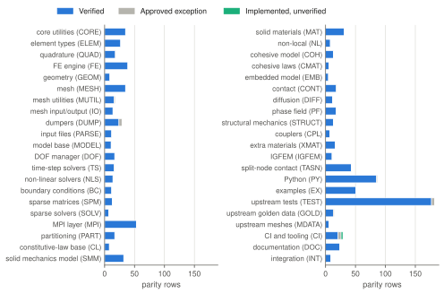
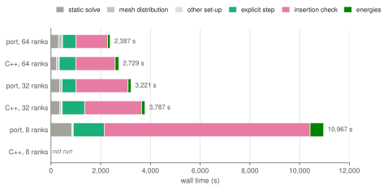

# akantu-rs: final report

akantu-rs (here "the port") is a Rust port of the Akantu finite-element
library at upstream commit `35a851780d0b9471d258ed53a003ae98aaa95ea0` (30
October 2026). It covers the core library, the extra packages, MPI
parallelism and the Python package. Of the 1,045 rows of its feature parity
matrix, 1,019 are Verified and 26 are approved exceptions; no row is open.
A row is Verified when
it has Rust tests, a golden fixture from the C++ library or an analytical
reference, a justified tolerance and an independent review. Most
comparisons with the C++ library are bit for bit. In the final measurement
campaign (8-core AWS machines, 17 November 2026) the port's cohesive
benchmark loop took 0.22 to 0.36 times the C++ time at 1 to 8 ranks. At
full size (4.39 million tetrahedra, one run per configuration, 17 and 18
November) it took 0.35 to 0.43 times the C++ time on one 128-core machine
at 32 to 128 ranks, and 0.51 to 0.52 times at 128 ranks on four 32-core
hosts after a change of its collective error protocol (1.48 to 1.51 times
before it). Comparing the two codes
produced a register of 596 defects and quirks of the C++ library. AI coding
agents, directed by Thomas Molinari, wrote the port in six days (9 to 14
November 2026). The Akantu developers have not reviewed or endorsed the
port. A performance campaign (16 to 18 November) made it faster without
changing a result bit in its default mode; it has no C API, and it refuses
a few configurations on several ranks.

## What was asked and what was delivered

The brief asked for a complete, verified Rust port of Akantu at one
upstream commit: everything in the reference source tree, including the
optional and experimental packages, MPI parallelism, the Python bindings,
the input and output formats, the examples and the tests, with reproducible
evidence for every feature in the sense of Verified above.

The delivered port has 27 crates (Rust libraries) and about 514,000 lines
of Rust (`01-migration-and-features.md`). The default build is pure Rust
and needs no native library; MPI, Scotch, MUMPS, PETSc and Python are
opt-in. The port is LGPL-3.0-or-later. Two opt-in features make a binary
GPL-3.0-or-later: `cgal` (and `igfem`, which needs it), and `petsc` when
linked against Debian's PETSc. Input files, meshes, parameter names
and output formats are upstream's, and upstream's Python examples run
unchanged on the port's `akantu` package.

## How it was verified

The C++ library, built from the reference commit in Docker, is the
oracle. Its strict build disables fused multiply-add and Eigen's vector
kernels, so that each operation has one defined result. Probe programs ran
upstream's own classes on chosen cases and recorded 2,023 golden fixture
cases, intermediate states included (element kernels, assembled operators,
per-step fields, Newton histories). The port's tests replay them and
compare every recorded value's bit pattern. Where bit identity is
impossible (the oracle solved with MUMPS, an interface order upstream does
not fix, upstream's own run-to-run variation), a written and reviewed rule
sets the tolerance; 197 of the 240 rules are exact. Independent checks
(patch tests, closed forms, convergence rates on distorted meshes) cover
what the oracle cannot, and a reviewer who did not write the code accepted
each parity row. The method is in `01-migration-and-features.md`; the
details are in `docs/NUMERICAL_VALIDATION.md` and `docs/TOLERANCE_LEDGER.md`.

## The state in numbers

| Quantity | Value | Source |
|---|---|---|
| Parity rows | 1,019 Verified, 26 approved exceptions of 1,045 | `docs/FEATURE_PARITY.md` |
| Upstream tests and examples | 182 test rows (177 Verified, 5 exceptions), 51 example rows (all Verified) | `01-migration-and-features.md` |
| Golden fixtures | 2,023 cases, plus 62 C++ example runs, 31 Python example runs, 16 dumper directories | `docs/VALIDATION_SUMMARY.md` |
| Workspace tests on the published tree | 3,769 passed, 0 failed, 25 ignored, in 462 test binaries (final gate, 14 November 2026) | `docs/TESTING.md` |
| MPI tiers | 489 runs at 1 to 8 ranks, three repetitions, 0 failed; one multi-node session on 8 hosts (13 runs, up to 64 ranks) | `docs/TESTING.md`, `docs/MPI_VALIDATION.md` |
| Tolerance rules | 240: 197 exact, 43 absolute or relative | `docs/TOLERANCE_LEDGER.md` |

x86_64 Linux with glibc is the authoritative platform: the merge gate and
the final check ran there, and every fixture was generated or regenerated
there. The test tiers also ran on ARM on 14 and 15 November 2026
(`docs/PLATFORMS.md`). On macOS arm64 (Apple M4 Pro) the workspace tests
gave 3,760 passed and 0 failed, and the Python package built and passed its
suite (302 passed); MPI was not run there. On aarch64 Linux the workspace
tests gave 3,762 passed and 0 failed, and the MPI, Scotch and MUMPS tiers
passed at 1, 2 and 4 ranks. There, one MUMPS scenario and five PETSc
scenarios do not compare their values with the C++ reference, because the
reference was recorded on x86_64 and the BLAS kernels differ by CPU. One
self-consistency check of the optional PETSc tier, between one and several
ranks, exceeds its bound on aarch64 (2.0e-14 against 1e-14) and is
documented in `docs/PLATFORMS.md` as a known failure.

The workflows of the delivered CI ran once on GitHub on 14 November 2026,
while the repository was private. Of 29 jobs, 21 passed and six failed, for
three reasons (`docs/TESTING.md`). The documentation deployment failed
because GitHub Pages was off, and the macOS wheel job was stopped at its
60-minute limit. The fixed jobs passed when replayed outside GitHub, so
three CI rows (CI-001, CI-014, CI-024) were open at delivery. After
publication, the same day, every workflow ran once on the public repository
and all 30 jobs passed, among them the macOS arm64 wheel and the deployment
of the documentation to <https://thomas0903.github.io/akantu-rs/>; the three
rows became Verified.

## Performance against C++

All ratios are the port's time over the C++ time on the same x86_64
machine, with the same meshes, partitions and MUMPS
(`02-benchmarks-and-performance.md`). The final campaign ran on four AWS
`m7a.2xlarge` (8 cores) on 17 November 2026, its full-size runs on one AWS
`m7a.32xlarge` (128 cores) and on sets of four `m7a.8xlarge` (32 cores) on
17 and 18 November, one run per configuration:

| Measurement | Port time / C++ time |
|---|---|
| Explicit step on one core, five meshes of three element types | 0.15 to 0.40 |
| Cohesive benchmark loop, 1 to 8 ranks | 0.22 to 0.36 |
| Static MUMPS solve phase, 1 to 8 ranks | 0.79 to 1.11 |
| Port's SparseLU translation against upstream's SparseLU, one thread (opt-in nested-dissection ordering) | 0.74 to 0.91 (0.17 to 0.31) |
| Sum of the ranks' memory peaks, 559 k tetrahedra, 1 to 8 ranks | 0.77 to 0.80 |
| Full-size JOSS run, loop, one 128-core machine, 32 to 128 ranks | 0.35 to 0.43 |
| Full-size JOSS run, whole wall time, one 128-core machine, 32 to 128 ranks | 0.42 to 0.51 |
| Full-size JOSS run, loop, 128 ranks on four 32-core hosts: final revision (before the protocol change) | 0.51 to 0.52 (1.48 to 1.51) |
| Full-size mesh distribution from rank 0, one 128-core machine | 0.13 to 0.17 |

At full size the containers' memory peaks were 206, 196 and 183 GiB for
the port and 217, 213 and 184 GiB for upstream at 128, 64 and 32 ranks,
most of it MUMPS's. The 128-core machine does not scale from 64 to 128
ranks (the port's loop 846 and 835 s), so the ratios at 128 ranks are
those of a saturated machine. Across four hosts the port first lost
because its collective error protocol agreed after every phase (51.6
collectives per step and rank against upstream's 8.4); with collective
checks at commit points (D-126, 20.5 per step and rank, results
unchanged) its loop at 128 ranks is 526 s against upstream's 1,019 and
1,040 s. Against the port before the performance
campaign, the explicit step takes 0.51 to 0.72 of the time and the cohesive
loop 0.36 to 0.62.

## What was found in the C++ library

The register `docs/UPSTREAM_DEFECTS.md` has 596 entries: 148 cases of
undefined behaviour (category A), 242 bugs that give wrong results
(category B), 176 quirks the port keeps (category C), 20 defects of the
test infrastructure and 10 others. 88 concern distributed runs. The port
corrects wrong results by default. The exception is UD-062: the port keeps
upstream's reuse of a stale Jacobian when only the time step changes; the
fix is decided but not implemented. For 168 entries the port offers a
switch that restores upstream's behaviour.
`03-upstream-defects.md` describes 25 of them with locations, evidence and
suggested fixes. Among those that change results silently:

- in 3-D the thermal eigenstrain is `(1 + ν) α ΔT` instead of `α ΔT`, and
  J2 plasticity uses the opposite sign of the thermal stress increment
  (UD-038);
- the anisotropic and orthotropic laws rotate the stiffness backwards
  (UD-104);
- the lumped mass of Bernoulli beams is zero, because every beam gets
  length 0 (UD-005);
- the Maxwell viscoelastic law never updates its branch stresses, so it has
  no relaxation (UD-029);
- after a MUMPS workspace retry, the solver returns `A^-(k+1) b` after `k`
  retries, with no error (UD-216);
- the distributed matrix-vector product never sums the partial products of
  shared rows across ranks (UD-003).

Upstream's test set-up lets some failures pass unnoticed: the test driver
never reaches its comparison with the `.verified` files (UD-018), and every
parallel test without an explicit level is registered with one rank
(UD-015). Three packages (IGFEM, the extra materials, embedded) do not
compile at the reference commit.

## What is not done, or validated less

- There is no C API; `akantu-capi` exports only the version string.
  Upstream has none either.
- Refused on several ranks: the generic contact model, the structural
  model, parallel IGFEM, the Python package at model level, and a few
  smaller routes (`docs/MPI_VALIDATION.md`).
- IGFEM and the extra materials have no upstream oracle, because they do
  not compile upstream. IGFEM rests on the printed outputs of its last
  working version, upstream's test criteria and closed forms; the extra
  materials on upstream's assertions, one `.verified` file and closed
  forms.
- Inputs whose upstream result is wrong or undefined, with no reviewed
  formulation, are refused by default (finite-deformation J2 and damage,
  the anisotropic damage law, Maxwell with thermal loading, among others).
- The corrected results of category B defects are compared with the
  oracle only through their switches back to upstream; the corrections
  themselves rest on analytical checks and review.
- Multi-rank MUMPS solves and the MUMPS-solved fields of the examples are
  compared under tolerances or as diagnostics, not bitwise.
- Multi-node runs used one cluster of eight hosts, up to 64 ranks (13
  November), and three sets of four 32-core hosts at up to 128 ranks (18
  November), one run per point. In the full-size rerun at 64 and 32 ranks, the two runs'
  external work differs by more than 1e-10 of the step's largest energy
  from step 2,716 on, before their insertion counts part (they agree for
  3,176 steps); the criterion written before the run asked for the reverse
  order (`docs/MPI_VALIDATION.md`).
- There is no mesh-objectivity study of the cohesive model and no
  Γ-convergence study of the phase field.

The full list is in `docs/VALIDATION_SUMMARY.md`.

## How the work was done

Thomas Molinari wrote the brief and decided scope, budgets and licence
questions. AI coding agents did the rest between 9 and 14 November 2026: an
orchestrator agent planned the work, briefed subagents and merged their
branches, and subagents implemented, reviewed each other's branches and ran
the test campaigns (4,638 commits by 14 November, 22:00 local time, and 197
review reports). Builds, tests, oracle runs and benchmarks ran on rented
cloud machines. Metered compute
cost about $85 by the project's estimates, covered by sign-up credits
except about $2. The money actually paid was the AI model and sandbox
subscriptions for one month, $240 in all. `05-ai-setup.md` gives the
details and what went wrong.

## What could come next

The first five items of the roadmap in `04-possible-improvements.md`, in
its order. Items 1 to 4 keep results bit for bit; item 5 adds a switch.

1. Release the MUMPS factors after the static solve: the memory of the
   64-rank full-size loop would fall from about 205 GiB to about 21 GiB
   (hours to a day).
2. Per-rank phase times and profiles of the insertion step, which nobody
   has profiled once fragmentation starts (days).
3. A fixed-size stress interpolation in the insertion check, estimated at
   about 30 % of the check (2 to 4 days).
4. Small fixes that keep results bit for bit, in the insertion check, the
   cohesive step, sparse assembly and the pure-Rust LU (2 to 6 days).
5. One switch, also available from the input file, that gives upstream's
   numbers (about a week).

The performance campaign did items 1 and 3 and most of item 4 (item 1 as an opt-in switch;
`04-possible-improvements.md` gives each finding's status and measured
effect). Tooling for following upstream commits, starting with the
`features/matrix_free` branch, comes next (item 6, about a week). The
final measurements leave two performance items: the port's collectives
across hosts (20.5 per step and rank against the C++ library's 8.4) and
its loop on one 128-core machine, which does not improve from 64 to 128
ranks.

## Where everything is

| Document | Content |
|---|---|
| `01-migration-and-features.md` | How the port was made and verified, its architecture and features, what is not ported |
| `02-benchmarks-and-performance.md` | Measured performance against the C++ library |
| `03-upstream-defects.md` | Defects found in the C++ library |
| `04-possible-improvements.md` | Possible improvements and a roadmap |
| `05-ai-setup.md` | How the work was organised: agents, models, machines, cost |
| `docs/reports/2026-11-12-paraview-visual-check.md` | ParaView comparison of every example's output |
| `README.md`, `docs/manual/` | Quick start and user manual, including the differences from upstream |
| `docs/FEATURE_PARITY.md` | The parity matrix, one row per feature, test and example |
| `docs/VALIDATION_SUMMARY.md`, `docs/NUMERICAL_VALIDATION.md`, `docs/TOLERANCE_LEDGER.md`, `docs/MPI_VALIDATION.md` | What is compared, how, and what is validated less |
| `docs/UPSTREAM_DEFECTS.md` | The defect register |
| `docs/BENCHMARKS.md` | Benchmark method and results |
| `docs/ARCHITECTURE.md`, `docs/DECISIONS.md` | Design of the port and its technical decisions |
| `docs/TESTING.md`, `docs/ORACLE_BUILD.md`, `docs/PLATFORMS.md` | Running the tests, building the oracle, platform results |
| `CONTRIBUTING.md`, `docs/MAINTAINING.md` | For contributors and maintainers |
