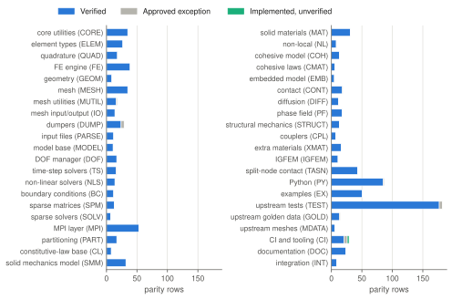
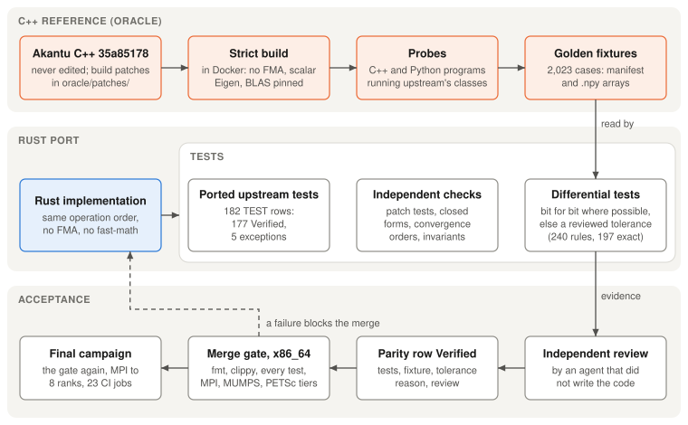
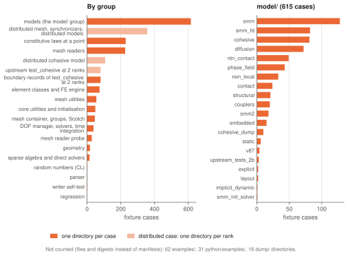
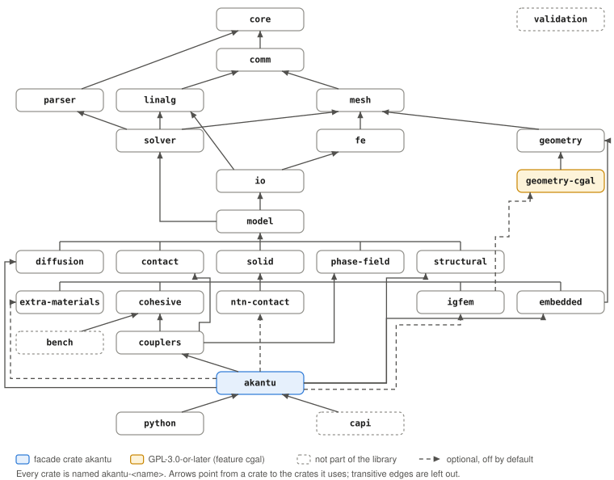

# How akantu-rs was made and verified, and what it offers

akantu-rs (here "the port") is a Rust port of Akantu at upstream commit
`35a851780d0b9471d258ed53a003ae98aaa95ea0` (`v5.0.7-post1-554-g35a851780`,
30 October 2026). It covers the extra packages, MPI parallelism, the Python
package, the input and output formats, the examples and the tests. It was
checked against the C++ library itself, which this report calls the oracle.
Small C++ and Python programs running upstream's own classes recorded 2,023
golden fixture cases. The Rust tests compare the port with them bit for bit
wherever the computation allows it, and under a written tolerance elsewhere.
Of the 1,045 rows of the feature parity matrix, 1,019 are Verified and 26
are approved exceptions; none is open. The port was written by AI coding agents directed by one
person; `05-ai-setup.md` ("How the work was organised") describes how.

## Summary

| | |
|---|---|
| Upstream | Akantu `35a85178`: 535 `.hh`/`.cc` files, about 107,000 lines in `src/` (`docs/REFERENCE.md`) |
| Port | 27 crates (a crate is Rust's unit of compilation and packaging, roughly one library); 514,305 lines of Rust in 1,002 files under `crates/` on 15 November 2026: 263,511 in `src/` (with in-file unit tests and documentation comments), 240,811 in `tests/`, the rest examples and build scripts (`docs/reports/data/crates.csv`) |
| Licence | LGPL-3.0-or-later. Two opt-in features, both off by default, make a binary GPL-3.0-or-later: `cgal` (and `igfem`, which needs it), and `petsc` when linked against Debian's PETSc (see "What the port offers") |
| Parity matrix | 1,066 rows, 21 superseded by finer rows. Of the other 1,045: 1,019 Verified, 26 approved exceptions; none implemented but unverified, in progress, blocked or not started (`scripts/parity/stats.py`) |
| Fixtures | 2,023 case directories, plus 62 recorded C++ example runs, 31 Python example runs and 16 dumper directories (`docs/VALIDATION_SUMMARY.md`) |
| Tests | 3,769 passed, 0 failed, 25 ignored on the published tree, in the 462 test binaries of a default workspace run, plus the documentation tests of the 27 crates; 87.86 % line coverage in a whole-workspace run (`docs/TESTING.md`). The 462 binaries are 433 of the 472 integration-test files (the other 39 need a feature that is off by default, such as `mpi` or `cgal`) and the unit tests of the 27 libraries and 2 binaries |
| Upstream defects | 596 register entries (`docs/UPSTREAM_DEFECTS.md`; report `03-upstream-defects.md`) |



At delivery three CI rows (CI-001, CI-014, CI-024) were still open: they
needed the delivered workflows green on GitHub (every job, the macOS arm64
wheel, the documentation deployment). The workflows first ran on 14
November 2026, while the repository was private. Of 29 jobs, 21 passed and
six failed, for three reasons (`docs/TESTING.md`). The documentation
deployment failed because GitHub Pages was off, and the macOS wheel job was
stopped at its 60-minute limit. The fixed jobs passed when replayed outside
GitHub; the replay covers 23 jobs, counting each matrix leg as one, and the
macOS wheel and the deployment can run only on GitHub. After publication,
the same day, every workflow ran once on the public repository on GitHub's
4-vCPU runners and all 30 jobs passed, including the macOS wheel (51
minutes) and the deployment of the documentation site. The three rows
became Verified.

## How the port was made

### The C++ library as the oracle

The reference library is built out of tree in Docker and never edited;
the patches needed to build it are in `oracle/patches/`
(`docs/ORACLE_BUILD.md`). The build used for comparison is strict,
`-ffp-contract=off -DEIGEN_DONT_VECTORIZE`: no fused multiply-add, and
Eigen's scalar kernels. Every probe and example run pins Eigen's cache
sizes (they set the summation order of its dense products and of
`SparseLU`) and runs OpenBLAS on one thread.



Probes (`oracle/probes/`) run upstream's classes on chosen cases. Each
case becomes a directory with a `manifest.json`, `.npy` arrays and the
inputs. Probes record intermediate states as well as results: element
kernels, assembled operators, per-step fields, Newton histories, energies.
A golden comes from at least three identical runs. Where upstream's default
solver is MUMPS, the probe pins Eigen's sparse LU so that the solve can be
compared bit for bit.

Three areas have a count of compared values, all compared bitwise:
1,620,091 values in the finite-deformation cases, 1,518,374 in the cohesive
release tier and about 2.05 million in the diffusion cases
(`docs/VALIDATION_SUMMARY.md`). There is no total for the whole corpus.

### What "bitwise" means

A bitwise comparison compares the IEEE 754 bit pattern of every recorded
quantity with the oracle's record. `+0` and `−0` differ. The one relaxation
is that the default NaNs of the two platforms, which differ in their sign
bit, count as equal. Written files are compared byte by byte. The reference
is the strict build on x86_64 Linux with glibc. Of the 2,023 manifests,
1,037 were generated on x86_64 and 986 on aarch64; the aarch64 ones were
regenerated on x86_64, found identical and kept
(`docs/manual/src/differences.md`).



On aarch64, where upstream's default build also contracts multiply-adds,
it changes 1,265 of 2,250 records of the dense layer in their last bits
(on x86_64 the default build differs from the strict one by Eigen's SSE2
code only), so it cannot be the reference. Bit identity with
the strict build rests on these rules:

- no fast-math, no fused multiply-add, no reassociation, no unordered
  parallel reductions, and numerical code on one thread;
- every accumulating loop in upstream's order, including Eigen's matrix
  product blocking, which the port hard-codes for the pinned cache sizes;
- translations of library code where the order matters: Eigen's
  `SparseLU` with COLAMD and its eigensolvers (MPL-2.0), and glibc's `log`,
  `exp`, `pow` and `tan`, which the random distributions use;
- clean-room reproduction, from public specifications and black-box tests,
  of libstdc++ behaviour whose licence does not allow porting: `<random>`
  distributions, `std::nth_element`, `std::set::insert`, `std::complex`
  division and stream formatting (`docs/DEPENDENCIES.md`);
- sums over MPI ranks folded in rank order, and compared with upstream's
  `MPI_Allreduce` through the association the oracle's Open MPI was
  observed to use (rank order at 2 ranks, `(0+1)+(2+3)` at 4).

On macOS the parser calls Apple's libm, as upstream calls the platform's.
18 one-ulp differences from glibc are listed, and any other fails the test.
Complex division differs too: the port's default reproduces the aarch64
runtime, and on x86_64 the oracle's complex eigenvectors are reproduced
bit for bit only with `ComplexDivision::Unfused`
(`docs/VALIDATION_SUMMARY.md`).

### Tolerances where bit identity is impossible

Every compared floating-point quantity resolves to a written rule, and a
quantity without one is a test error. `docs/TOLERANCE_LEDGER.md` lists 240
rules in 44 files, each accepted by a review: 197 exact, 43 absolute or
relative, none in ULPs. The non-exact rules cover three cases:

- the oracle solved with MUMPS and the port with its own direct solver
  (worst 2.9e-15 relative on the static cases, 2.9e-14 per step on an
  implicit plastic patch);
- the embedded model, where upstream's interface order cannot be reproduced
  (worst 1.45e-13);
- upstream's distributed phase field, which varies from run to run; the
  port is compared with every result of a study of at least twelve runs
  (3.55e-15 against a bound of 1e-14).

A tolerance is never loosened to make a test pass, and a change needs a
written justification and an independent
review (`docs/NUMERICAL_VALIDATION.md`).

### Checks that do not depend on upstream

Patch tests run on every element type, along with closed forms, partition
of unity, Gauss exactness, invariants and convergence studies with
manufactured solutions on distorted meshes. All 12 regular element types
converge at their theoretical orders in elasticity, diffusion and the phase
field. The studies catch planted defects, among them a wrong shape
derivative of `_quadrangle_8` that passes the patch test
(`docs/VALIDATION_SUMMARY.md`).

### When a feature counts as verified

The parity matrix (`docs/FEATURE_PARITY.md`) has one row for every
feature, upstream test and example of the reference tree. A row is Verified
only with Rust test names, a golden fixture or an analytical reference, a
justified tolerance, and an accepting review by an agent that did not write
the code (197 review reports were written). The 182 upstream tests are
ported as Rust tests of the same intent and name (177 Verified, 5
exceptions); the 51 examples are all Verified.

### Test tiers

| Tier | What it runs | Where |
|---|---|---|
| fast | `cargo test --workspace`: unit tests, ported upstream tests, every differential test on the committed fixtures, fixture checksums | any machine |
| merge gate | fast, plus formatting, lints as errors, every test binary accounted for, and 23 builds with optional features or in release mode | x86_64 Linux, project Docker images |
| medium | real MPI at 1, 2 and 4 ranks; the parallel oracle cases at their recorded rank counts; MUMPS and PETSc at 1, 2 and 4 ranks | same |
| expensive | MPI at 1, 2, 4 and 8 ranks, three repetitions; release replays of the benchmark crate; full-size and multi-node runs | cloud machines |
| delivered CI | 23 jobs, among them valgrind memcheck of the MPI, MUMPS and PETSc code and Miri on the `unsafe` code | replayed outside GitHub; all 30 jobs green on GitHub on the public repository |

The check of the finished port ran on 13 and 14 November 2026 on one commit,
and every tier of the merge gate passed. After the cleanup for publication,
a last gate on 14 November ran the pull-request tiers, the feature gates,
the release runs, MPI, MUMPS and PETSc at 1, 2 and 4 ranks and the Python
package on the published tree, and every tier passed again
(`docs/TESTING.md`, "State at release"). In the first check, MPI ran at 1 to 8 ranks three times (489 runs,
0 failed), the parallel tier 100 runs (0 failed), and all 23 replayed CI
jobs passed. Five oracle cases were regenerated from the C++ library and
were byte-identical to the committed fixtures (`docs/TESTING.md`). One
multi-node session of 13 runs used eight hosts at up to 64 ranks on 13
November (`docs/MPI_VALIDATION.md`).

### Upstream defects

Each defect found in the reference falls into a category. For A (undefined
behaviour) the port defines the behaviour. For B (wrong results) it computes
the corrected result by default, and where practical a compatibility switch
reproduces upstream; the oracle replays run with that switch on. For C
(quirks) the port keeps upstream's behaviour and documents it. The register
has 596 entries: 148 A, 242 B, 176 C, 20 defects of upstream's test
infrastructure and 10 others (build, scope, dead code, withdrawn).
`03-upstream-defects.md` ("Defects found in the C++ library") describes
them.

## Architecture

The 27 crates form layers without cycles; upstream's include cycles (mesh
and FE engine, solver and DOF manager) are broken, for example by moving
the static element tables into `akantu-core` (`docs/ARCHITECTURE.md`). The
facade crate `akantu` re-exports every subsystem and selects the optional
models with Cargo features (compile-time switches, like CMake options)
named after upstream's packages. Three crates are not library code:
`akantu-validation` (fixture comparison, for tests), `akantu-bench`, and
`akantu-capi`, a stub that exports the version string.

The C++ class hierarchy was not translated one to one:

| Upstream (C++) | akantu-rs |
|---|---|
| `Array<T>`, `ElementTypeMapArray<T>` | the same names in `akantu-core`: flat contiguous storage with a fixed number of components |
| `ElementClass<type>` specialisations | one zero-sized type per element type implementing `ElementClass` and a family trait; a `match` dispatches once per (element type, ghost type) block and the loop inside is compiled for each type |
| `Mesh &` held by models and dumpers | `SharedMesh` handle; a topology change (cohesive insertion, element removal) is a transaction that notifies every registered consumer |
| `Model`, which is a `SolverCallback` and owns its `DOFManager` | `Model` trait; a model is `{ physics, solver: ModelSolver }`, and the solver calls the physics with the DOF manager passed as an argument |
| `Material` hierarchy with `getModel()` | `ConstitutiveLaw` and `Material` traits; a law sees the model through a context valid for one phase of the computation |
| `MaterialFactory` singleton | one factory per model |
| coupler classes | `Staggered<A, B>` (two models, each with its own solver) and `Monolithic<P>` (one shared DOF manager) |
| `SparseSolverEigen`, `SparseSolverMumps`, PETSc | back-ends `eigen` (translation of Eigen's `SparseLU`), `faer`, `mumps`, `petsc` |
| static parser, static communicator, `initialize()` | `Parser` and `Communicator` values passed explicitly; process-wide defaults in `akantu::runtime` |
| `debug::Exception` | `Result<_, akantu::core::Error>`; malformed input never panics |
| dumpers referencing arrays | dumpers holding field descriptors and reading live data at dump time |



The default build is pure Rust and needs no native library, no MPI and no
Python. All code is written against one communicator interface with three
back-ends: serial (the default), in-process multi-rank (used in tests) and
MPI (feature `mpi`). Native libraries enter only through opt-in features:
MPI (through rsmpi, the Rust MPI bindings), Scotch, MUMPS and PETSc (small
C shims), and Python (through PyO3, the Rust bindings for CPython). The
`faer` back-end is a pure-Rust linear-algebra library.

Rust checks memory safety at compile time except inside blocks marked
`unsafe`, which the programmer must justify. The port confines them to the
native boundaries: the MPI, MUMPS, PETSc and Scotch bindings, the parser's
libm calls (`erf`, `erfc`, `tgamma`), the zero-copy NumPy views and model
handles of `akantu-python`, and one function of the C API stub. Every other
library crate forbids `unsafe`. Each site is listed with its invariants in
the crate's `UNSAFE.md`, and a test fails when a site changes without
review. The NumPy views are checked under Miri (an interpreter that detects
undefined behaviour in Rust code), the native bindings under valgrind.

## What the port offers

| Area | Content | Cargo feature | Status |
|---|---|---|---|
| Core, parser | containers, small tensors, dense algebra, `.dat` input files with expressions, command-line options, random parameters | always | Verified, bitwise |
| Meshes | Gmsh MSH 1, 2, 4.0, 4.1 and Diana readers, Gmsh writer, groups, mesh data, facets, periodicity, purify, distribution with ghosts | always; Scotch partitioning with `scotch` | Verified, bitwise |
| Elements | 26 types: 13 regular from `_point_1` to `_hexahedron_20`, 7 cohesive, 3 structural (Bernoulli beams 2-D and 3-D, discrete Kirchhoff triangle), 3 IGFEM | always (IGFEM with `igfem`) | Verified, bitwise (IGFEM: see "What is not ported, or validated less") |
| Solvers | DOF manager; Newton-Raphson, modified Newton-Raphson, linear; Newmark-β family, central difference, Fox-Goodwin and the other upstream schemes; sparse LU `eigen` (default) and `faer` (a pure-Rust library); MUMPS; PETSc KSP, SNES, TAO and the PETSc DOF manager | always; `mumps`, `petsc` (of `akantu-linalg` / `akantu-solver`) | Verified (bitwise; `faer` against a backward-error bound) |
| Solid mechanics | `SolidMechanicsModel`: static, explicit, implicit, finite deformation; elastic (isotropic, orthotropic, anisotropic, thermal), plastic (J2, Drucker-Prager, plastic Mazars), damage (Marigo, Mazars, anisotropic), viscoelastic (SLS, Maxwell), Neo-Hookean, phase-field material; non-local laws | `solid` (default) | Verified; a few configurations refused by default (see "Differences a user will notice") |
| Cohesive | intrinsic and extrinsic insertion, six cohesive laws, fragment manager, on one process or distributed | `cohesive` (default) | Verified |
| Contact | `ContactMechanicsModel` (one process); split-node contact with rate-and-state friction | `contact` (default); `ntn-contact` | Verified |
| Other models | diffusion (serial and distributed), phase field, structural mechanics (one process), embedded interfaces, couplers solid-contact, solid-cohesive-contact, solid-phase-field | default features | Verified |
| Extra packages | IGFEM; the extra materials and their non-local variants | `igfem`; `extra-materials`, `extra-materials-non-local` | Verified, without an upstream oracle |
| Geometry | segment intersector; sphere intersector and CGAL's AABB tree | always; `cgal` | Verified |
| Output | ParaView VTU, PVTU and PVD (base64 and ASCII), text, LAMMPS; restart files of split-node contact | always | Verified, byte for byte |
| Parallel | MPI communicator, synchronizers, distributed solid, cohesive, diffusion, phase-field, non-local and split-node contact runs | `mpi` | Verified: oracle at 1, 2 and 4 ranks and, for some scenarios, 8; the port against its own serial run at 1 to 8 |
| Python | package `akantu` with extension `py11_akantu`, upstream names; meshes, parser, FE engine, solver layer, Python materials and callbacks, dumpers, every model and coupler, NumPy views | `python` of `akantu-python` | Verified; upstream's Python examples run unchanged |

The default features are `solid`, `cohesive`, `contact`, `diffusion`,
`phase-field`, `couplers`, `structural` and `embedded`. Off by default:
`ntn-contact`, `igfem`, `extra-materials`, `cgal`, `mpi`, `scotch`,
`mumps`, `petsc` and `python` (`docs/manual/src/getting-started.md`).

The default build contains no GPL code. `akantu-geometry-cgal` holds code
derived from CGAL's GPL packages (AABB tree, spherical kernel), so a build
with `cgal`, or with `igfem`, which needs it, is GPL-3.0-or-later. A binary
built with `petsc` against Debian's PETSc is GPL-3.0-or-later too, because
that PETSc links GPL-2.0-or-later libraries (`README.md`).

## Differences a user will notice

The full list is in `docs/manual/src/differences.md`.

API. Methods are `snake_case` (`apply_dirichlet_bc`, `solve_step`). Enums
are Rust enums whose upstream spellings still parse (`"_triangle_3"`).
Errors are returned as values. The parser and the communicator are passed
explicitly.

Inputs and outputs. Input files, meshes, field and parameter names and
output files keep upstream's names and formats. The 153 input files of the
reference tree parse as they do upstream (one is rejected by both). Two
outputs are corrected: the ParaView dumper writes each cell's own tensor,
where upstream pads matrix fields to squares that ParaView misreads
(UD-110), and the Gmsh writer keeps 17 significant digits (UD-061).
`set_compat_layout(true)` and `WriteOptions::upstream_precision()` restore
upstream's files. In a ParaView comparison of every example, 12,772 of the
16,086 files both codes wrote were byte-identical, and each remaining
difference has a documented upstream cause
(`docs/reports/2026-11-12-paraview-visual-check.md`).

Corrected defaults. Category B defects are corrected by default, most with
a switch that restores upstream. Examples: the 3-D thermal strain (`α ΔT`
instead of `(1 + ν) α ΔT`, UD-038), the Maxwell law's internal stresses
(upstream discards their update, UD-029), the discrete Kirchhoff triangle's
bending rigidity (`t³`, not `t⁴`, UD-007) and, in cohesive runs, the
placement of the accumulated Neumann load on doubled nodes (UD-1280). Some
corrections have no switch, such as the structural lumped mass, which is
identically zero upstream (UD-005). Grouped switches set every switch of an
area at once (`LawOptions::upstream()`,
`StructuralModelUpstreamCompat::UPSTREAM`). Several examples reproduce
upstream's output only with `--upstream-compat`.

Refused configurations. Where upstream's result is undefined or wrong and
no reviewed formulation exists, the port returns an error by default. This
applies to finite-deformation J2 plasticity and damage, the anisotropic
damage law, Maxwell viscoelasticity with thermal loading, and intrinsic
insertion with `cohesive_linear` and the `residual_mass_wgh` criterion,
among others (`docs/VALIDATION_SUMMARY.md`).

Other deviations. The pure-Rust `eigen` solver also runs on several ranks
(it gathers the system on rank 0); upstream's accepts one process. MUMPS is
opt-in, and `auto` selects it only on an MPI communicator. Material
factories belong to a model. Reductions are folded in rank order, so
results do not depend on the MPI implementation
(`ReductionPolicy::NativeMpi` uses MPI's own).

## What is not ported, or validated less

Approved exceptions (26 rows, `docs/VALIDATION_SUMMARY.md`):

- upstream code that is never built, never called or cannot be
  instantiated (18 rows, among them the legacy restart and C facades of the
  dumpers, a dead explicit time-step solver and unused pentahedron tables);
- distributed contact search (CONT-019), for which upstream's generic
  contact model has no distributed protocol;
- byte comparison with legacy golden files written through removed APIs
  (2 rows);
- five CI rows: a script referenced nowhere, build-time Gmsh meshing
  (meshes are frozen because Gmsh gives different meshes on aarch64 and
  x86_64), Jenkins, version determination and release publication.

Refused on several ranks (`docs/MPI_VALIDATION.md`): the generic contact
model, the structural model (upstream's distributed residual is wrong,
UD-902), parallel IGFEM (it does not compile upstream), distributed 1-D
facet meshes, the non-local `KeyOrder` route, split-node contact on
partitions that separate a pair or without `init_parallel`, phase-field
element events, and the Python package at model level (it supports several
ranks at mesh level only). There is no C API.

No upstream reference as it is. IGFEM and the extra materials do not
compile at the reference commit. They are checked against the printed
outputs of their last working version, upstream's test criteria and closed
forms. The embedded model is compared with a patched oracle that restores
compilation without changing a formula; each patch hunk was reviewed.
Single features that upstream cannot run (`cohesive_exponential`,
`cohesive_linear_fatigue`, `penalty_quadratic` contact, the Neo-Hookean
stress) rest on closed forms. The corrected defaults of category B defects
are compared with the oracle only through their compatibility switches; the
corrected behaviour itself rests on analytical checks and review.

Weaker than bitwise: the tolerances above; the multi-rank MUMPS solves,
which have no multi-rank oracle because upstream's own are not repeatable;
and every field the oracle solved with MUMPS in the examples and Python
scripts, which is recorded as diagnostic only.

Other limits (`docs/VALIDATION_SUMMARY.md`):

- Multi-node runs used one cluster of eight hosts, up to 64 ranks, one run
  per point. The full-size cohesive rerun at 64 and 32 ranks met two of the
  three parts of the criterion written before the run. The third was not
  met as written: the difference of the two runs' external work first
  exceeds 1e-10 of the step's largest energy at step 2,716, before their
  insertion counts part (`docs/MPI_VALIDATION.md`).
- There is no mesh-objectivity study of the cohesive model, no
  Γ-convergence study of the phase field and no 3-D coupled study.
- Two Python example cases are bitwise only where NumPy computes `exp` with
  the same kernel as on the oracle host; elsewhere they are skipped with
  that reason.

## How to try it

```sh
cargo build --workspace                 # pure Rust, default features
cargo test --workspace                  # fast tier: unit, ported upstream and differential tests
cargo test -p akantu --doc              # the manual's examples
cargo run -p akantu --example static    # upstream's static example; writes ./paraview/static_*
cargo test -p akantu --test examples_static   # compares it with the oracle's run
```

The medium and expensive tiers need the project's Docker images
(`docs/TESTING.md`). The Python package is built with maturin (the build
tool for Rust extensions of Python) into a local virtual environment. The example tests then run upstream's unchanged
scripts and compare them with the oracle's runs:

```sh
python3 -m venv .venv && .venv/bin/pip install maturin numpy scipy pytest
cd python && ../.venv/bin/maturin develop --release
../.venv/bin/python -m pytest -q tests/examples -k plate_hole
```

Upstream's `examples/c++/solid_mechanics_model/static/static.cc` and its
port `crates/akantu/examples/static/main.rs`, copied from the files without
five of the six dump fields, the first dump and, on the Rust side, the
output set-up:

```cpp
initialize("material.dat", argc, argv);
const Int spatial_dimension = 2;
Mesh mesh(spatial_dimension);
mesh.read("square.msh");
SolidMechanicsModel model(mesh);
model.initFull(_analysis_method = _static);
model.setBaseName("static");
model.addDumpFieldVector("displacement");
model.applyBC(BC::Dirichlet::FixedValue(0.0, _x), "Fixed_x");
model.applyBC(BC::Dirichlet::FixedValue(0.0, _y), "Fixed_y");
model.applyBC(BC::Dirichlet::FixedValue(0.0001, _x), "Displacement");
auto & solver = model.getNonLinearSolver();
solver.set("max_iterations", 2);
solver.set("threshold", 2e-4);
solver.set("convergence_type", SolveConvergenceCriteria::_solution);
model.solveStep();
model.dump();
```

```rust
let spatial_dimension = 2;
let mesh = ex.read_mesh(spatial_dimension, "square.msh")?;
let mut model = SolidMechanicsModel::with_parser(
    SharedMesh::new(mesh),
    None,
    "solid_mechanics_model",
    ex.parser()?,
)?;
model.init_full(&ex.model_options(AnalysisMethod::Static))?;
model.set_base_name("static")?;
model.add_dump_field_vector("displacement")?;
let fixed = |value, axis| FixedValue { value, axis };
model.apply_dirichlet_bc(&fixed(0.0, SpatialDirection::X), "Fixed_x")?;
model.apply_dirichlet_bc(&fixed(0.0, SpatialDirection::Y), "Fixed_y")?;
model.apply_dirichlet_bc(&fixed(0.0001, SpatialDirection::X), "Displacement")?;
let solver = model.solver.non_linear_solver_mut(None)?;
solver.set_param("max_iterations", ParamValue::Int(2))?;
solver.set_param("threshold", ParamValue::Real(2e-4))?;
solver.set_param("convergence_type", ParamValue::Enum("solution".into()))?;
model.solve_step(None)?;
model.dump(None, None)?;
```

`ex` is the examples' helper for options, input file and output directory
(`crates/akantu/examples/common`); `?` passes an error up to the caller. The
manual's *Getting started* chapter has a shorter, self-contained program
that the test suite compiles and runs.
