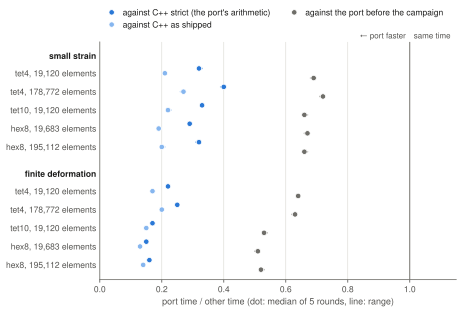
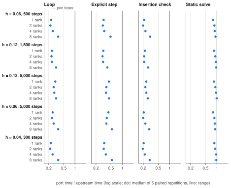
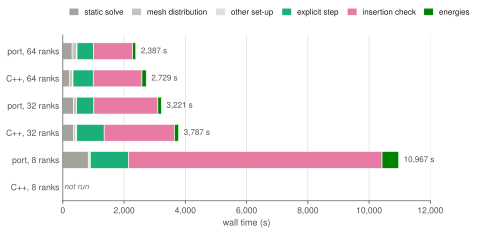
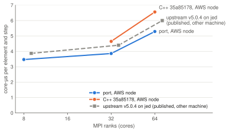
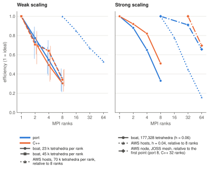

# Benchmarks and performance of akantu-rs

The Rust port of Akantu ("the port") was timed against the C++ library
("upstream", Akantu at `35a85178`) on the same x86_64 machines, with the
same meshes, partitions and solver library. Every ratio in this report is
the port's time divided by upstream's unless it says otherwise: below 1 the
port is faster. In the final measurement campaign (four AWS `m7a.2xlarge`,
AMD EPYC 9R14, 8 cores, 17 November 2026), the port's explicit step on one
core takes 0.29 to 0.40 times the time of the C++ step built with the same
arithmetic in small strain and 0.15 to 0.25 in finite deformation. In the
cohesive benchmark the explicit loop takes 0.22 to 0.30 times upstream's
time at 1 to 4 ranks and 0.31 to 0.36 at 8. The static MUMPS solve phase
takes 0.79 to 0.96 times upstream's at 1 to 4 ranks and 0.91 to 1.11 at 8.
On a 559 k-tetrahedron mesh the sum of the ranks' memory peaks is 0.77 to
0.80 times upstream's. Against the port before the performance campaign
the loop takes 0.36 to 0.62 times the time. On the JOSS mesh (4.39 million
tetrahedra, 5,000 steps with fracture; one run per configuration, 17 and 18
November) the port's loop takes 0.35 to 0.43 times upstream's on one
128-core machine at 32 to 128 ranks. Across four 32-core hosts at 128
ranks the port took 1.48 to 1.51 times upstream's loop until its
collective error protocol was changed (D-126); at the final revision it
takes 0.51 to 0.52 times (526 s against 1,019 and 1,040 s), and 0.375
times at 64 ranks on two hosts. Every number comes from
`docs/BENCHMARKS.md` and the files it names, none from a development
machine.

## Method

| Machine | CPU | Used for |
|---|---|---|
| 4 × AWS `m7a.2xlarge`, 8 cores each, 17 November 2026 | AMD EPYC 9R14 | the final campaign: explicit step, suites, cohesive benchmark at 1 to 8 ranks, static solves, memory, set-up, MPI layer |
| AWS `m7a.32xlarge`, 128 cores, two NUMA nodes, 17–18 November | AMD EPYC 9R14 | the final campaign's full-size run of both codes at 32 to 128 ranks |
| 4 × AWS `m7a.8xlarge`, 32 cores each, one placement group, three sessions on 18 November | AMD EPYC 9R14 | the final campaign's multi-node runs of both codes (128 ranks on four hosts, 64 on two), before and after D-126 |
| AWS `r7a.16xlarge`, one node, 64 cores, 12 November | AMD EPYC 9R14 | the full-size run of both codes (port before the campaign) |
| 8 × AWS `r7a.2xlarge`, one placement group, 13 November | AMD EPYC 9R14 | multi-node runs of the port (before the campaign) |

The two codes always ran on the same machine in the same session. In the
cohesive benchmark both use the same mesh file, the same Scotch partition,
the same MUMPS 5.7.3 with single-threaded OpenBLAS, and the same blocked
global node (upstream's driver blocks a rank-local node, UD-349). The C++
runs skip the `fillNodesToElements()` rebuild after each insertion, as the
JOSS runs did with their patch; the physics is unchanged.

The C++ library is built with GCC 14.2 in `RelWithDebInfo` (`-O2 -g
-DNDEBUG`) twice. The strict install adds `-ffp-contract=off
-DEIGEN_DONT_VECTORIZE` and performs the same floating-point operations as
the port; the default install keeps upstream's flags. The port uses Rust's
release profile (`opt-level = 3`, no `target-cpu`), without fast-math or
fused multiply-add. At one rank the port reproduces the strict build bit
for bit, so the serial timings compare identical computations.

The final campaign (`scripts/perf/final/`) measured three programs side by
side: upstream, the port before the performance campaign (the library of
the public `main` with the benchmark suites' final case definitions) and
the port at `53de1eeef`. Every MPI rank was bound to one core and the
binding was read back during each run; every run recorded the digest of
the binary it executed; the programs of a point were interleaved with
their order rotated, five repetitions per point, on machines where nothing
else ran. Results are medians with [min, max]; ratios are taken within one
repetition. A group counted only if its binaries, thread counts, bindings
and result digests passed their checks; every group passed. With MUMPS the
port's results at 2 ranks and more differ in the last digits from run to
run (the distributed solve); with the port's SparseLU they repeat bit for
bit.

## Explicit step on one core

The explicit step of `examples/c++/solid_mechanics_model/explicit` (an
elastic cube under a displacement pulse), in nanoseconds per element and
step, medians of 5 rounds:

| Mesh | Mode | C++ strict | C++ default | Port before | Port | Port / strict | Port / default | Port / before |
|---|---|---:|---:|---:|---:|---:|---:|---:|
| tet4, 19,120 el. | small strain | 145 | 227 | 68.2 | 47.0 | 0.32 | 0.21 | 0.69 |
| tet4, 178,772 el. | small strain | 162 | 240 | 88.9 | 63.6 | 0.40 | 0.27 | 0.72 |
| tet10, 19,120 el. | finite deformation | 2,245 | 2,530 | 706 | 377 | 0.17 | 0.15 | 0.53 |
| hex8, 195,112 el. | small strain | 1,198 | 1,862 | 573 | 380 | 0.32 | 0.20 | 0.66 |
| hex8, 195,112 el. | finite deformation | 3,565 | 4,044 | 1,087 | 562 | 0.16 | 0.14 | 0.52 |

Over all ten configurations (`docs/reports/data/explicit-step-final.csv`)
the port takes 0.29 to 0.40 times the strict time in small strain and 0.15
to 0.25 in finite deformation, and 0.51 to 0.72 times the time of the port
before the campaign. The internal-force assembly takes 0.15 to 0.41 times
the strict time, the stress computation 0.30 to 0.47. Upstream's default
install took 1.13 to 1.57 times the strict install's step time (ratio of
the medians).

With threads (the execution policy's `AKANTU_NUM_THREADS`) the step takes
0.20 to 0.47 of its one-thread time at 8 threads; the smallest mesh in
small strain gains least. Every result bit is the same at every thread
count: the state digests of all 90 program-configuration pairs equal the
recorded ones. The opt-in fast mode, which may round differently, takes
0.89 to 0.99 of the bitwise step at one thread.

Before the campaign the explicit step had one round of work (11 November):
fixed-size kernels with Eigen's reduction trees replaced a generic
emulation of Eigen's evaluation order, which took 42 % of the step. The
campaign added lane kernels, a fused per-block pass for one elastic law,
deferred history copies and threads, all bitwise
(`docs/benchmarks/perf-campaign/README.md`).

## The cohesive benchmark at 1 to 8 ranks

The JOSS scalability benchmark (an extrinsic cohesive cube under shear) ran
on 8-core machines, five repetitions per point, in five series: 500 steps
before any insertion on meshes of 23 k to 353 k tetrahedra, 1,500 steps
with insertion on 23 k, the full 5,000-step schedule on 23 k and 177 k, and
the static solve with 300 steps on 559 k.

| Point | Loop | Explicit step | Insertion check | Static solve |
|---|---:|---:|---:|---:|
| h = 0.12, 1 rank, before insertion | 0.241 | 0.306 | 0.215 | 0.837 |
| h = 0.06, 1 rank, before insertion | 0.233 | 0.319 | 0.210 | 0.790 |
| h = 0.06, 8 ranks, before insertion | 0.357 | 0.487 | 0.304 | 0.922 |
| h = 0.0476, 8 ranks, before insertion | 0.359 | 0.515 | 0.297 | 1.11 |
| h = 0.12, 1 rank, 5,000 steps | 0.299 | 0.441 | 0.239 | 0.838 |
| h = 0.12, 8 ranks, 5,000 steps | 0.315 | 0.445 | 0.262 | 0.988 |
| h = 0.06, 1 rank, 5,000 steps | 0.255 | 0.428 | 0.205 | 0.787 |
| h = 0.06, 8 ranks, 5,000 steps | 0.356 | 0.528 | 0.288 | 0.910 |

(Port time over upstream time, medians of the paired ratios; all points in
`docs/reports/data/cohesive-port-over-upstream-final.csv`.)

At 1 to 4 ranks the loop takes 0.22 to 0.30 times upstream's time and the
whole run 0.24 to 0.37; at 8 ranks 0.31 to 0.36 and 0.31 to 0.44. The
insertion check, the larger part of the loop in both codes, takes 0.19 to
0.30 times upstream's. The explicit step loses part of its lead at 8 ranks
(0.29 to 0.44 at 1 to 4 ranks, 0.40 to 0.53 at 8). The static solve phase
(the same MUMPS on the same matrix, plus the port's assembly) takes 0.79 to
0.96 times upstream's at 1 to 4 ranks; at 8 ranks 0.91 to 1.11, with a
range of [0.977, 1.60] at the largest point.

On the full fragmenting schedule on the 177 k mesh the whole run takes 0.24
to 0.35 times upstream's wall time at 1 to 8 ranks (1,952 against 498 s
at 1 rank). Per element and step the port's cost at 1 rank rises from
0.395 core-µs before insertion to 0.519 over the whole schedule, upstream's
from 1.71 to 2.03.

Against the port before the campaign the loop takes 0.36 to 0.62 times the
time; the gain is smallest at 8 ranks (0.49 to 0.62).

## The full-size run

The JOSS mesh (2,203,782 DOFs), 5,000 steps with insertion, on one AWS
`m7a.32xlarge` (128 cores, two sockets), 17 and 18 November, port
`740a79a36`, one run per point. Every rank is bound to its own core; the
32- and 64-rank runs use one socket, the 128-rank runs both. The loop here
is the explicit step, the insertion check and the per-step energies.

| Code | Ranks | Wall s | Static solve s | Loop s | core-µs/el/step | Container peak GiB | Largest rank GiB |
|---|---:|---:|---:|---:|---:|---:|---:|
| port | 128 | 1,174 | 319 | 835 | 4.62 | 206 | 4.53 |
| C++ | 128 | 2,298 | 239 | 1,948 | 9.74 | 217 | 4.59 |
| port | 64 | 1,204 | 337 | 846 | 2.37 | 196 | 5.89 |
| C++ | 64 | 2,848 | 299 | 2,430 | 6.70 | 213 | 5.70 |
| port | 32 | 1,806 | 448 | 1,336 | 1.87 | 183 | 10.9 |
| C++ | 32 | 4,297 | 381 | 3,809 | 5.33 | 184 | 8.77 |

(`docs/benchmarks/perf-campaign/final/G/summary.md` and
`multinode/table.md`; core-µs per element and step from the step and the
check.)

At 128, 64 and 32 ranks the port's run takes 0.511, 0.423 and 0.420 times
upstream's wall time and its loop 0.429, 0.348 and 0.351 times; the
insertion check 0.26 to 0.34, the explicit step 0.58 to 0.85, the static
solve 1.13 to 1.34. The machine does not scale from 64 to 128 ranks: the
port's loop goes from 846 to 835 s, upstream's improves 1.25 times; both
codes run their 128 ranks faster on four 32-core hosts (next section), so
the ratios at 128 ranks are those of a saturated machine. Using all 128
cores as 64 ranks × 2 threads brings the port's loop to 568 s. At the
final revision (with D-126) the port's loop at 128 ranks on a machine of
the same description is 814 s.

### Before the campaign (12 November)

Measured with the port before the performance campaign: the JOSS mesh on
one AWS `r7a.16xlarge` (64 cores). The C++ run at 8 ranks did not fit the
session's budget.

| Code | Ranks | Wall s | Static solve s | Step ms | Check ms | core-µs/el/step | Summed peak GiB | Largest rank GiB |
|---|---:|---:|---:|---:|---:|---:|---:|---:|
| port | 64 | 2,387 | 305 | 108 | 255 | 5.29 | 227.0 | 6.13 |
| C++ | 64 | 2,729 | 228 | 132 | 318 | 6.56 | 212.0 | 4.84 |
| port | 32 | 3,221 | 356 | 112 | 418 | 3.86 | 189.0 | 10.42 |
| C++ | 32 | 3,787 | 353 | 179 | 459 | 4.65 | 197.9 | 11.24 |
| port | 8 | 10,967 | 831 | 249 | 1,656 | 3.47 | 165.3 | 31.78 |

At 64 and 32 ranks the port's loop took 0.80 and 0.83 times upstream's
(step 0.82 and 0.63, check 0.80 and 0.91), and `init_full` 0.26 and 0.18.
The mesh distribution from rank 0 took 1.86 and 1.26 times upstream's: the
port's grew by about 2.1 s per added rank (32, 84 and 151 s at 8, 32 and
64 ranks), upstream's went from 66 to 81 s. The static solve took 1.34
times upstream's in the timed pair at 64 ranks, but upstream's own solve
took 324 s in a 20-step test run with the same binary, input and partition
(228 s in the timed run), and at 32 ranks the codes agree within 1 %. The
insertion check was the largest cost in both codes: 75 % of the port's
wall time at 8 ranks, 65 % at 32 and 53 % at 64 (upstream: 61 % at 32,
58 % at 64).

Upstream's JOSS study ran the same mesh and schedule (v5.0.4 with its
patch) on EPFL's jed (Intel Xeon 8360Y). The port cost 3.47, 3.86 and 5.29
core-µs per element and step at 8, 32 and 64 ranks; jed 3.87, 4.40 and 6.00
at 9, 36 and 72 cores. The loop efficiency between two rank counts is the
core-µs at the smaller count over that at the larger one. From 8 to 32, 32
to 64 and 8 to 64 ranks it was 90 %, 73 % and 66 % for the port and 88 %,
73 % and 65 % on jed. The two machines differ in processor generation, in
a dedicated node against a shared cloud host, and in build, so only the
shape of the scaling curves can be compared. jed's step and check fall to
888 s at 144 cores and stay between 908 and 1,095 s from 288 to 720 cores
(medians of five to seven runs); in the final campaign the port's take
784 s at 128 ranks on one machine and 511 s across four hosts, upstream's
1,671 s and 924 to 936 s (single runs; `docs/BENCHMARKS.md`, "Comparison
with upstream's published data").

## Parallel scaling

On the 8-core machines of the final campaign (one rank per core), strong
scaling of the loop on the 177 k mesh before insertion gives an efficiency
of 0.89, 0.68 and 0.36 at 2, 4 and 8 ranks for the port, 0.86, 0.75 and
0.55 for upstream and 0.90, 0.70 and 0.42 for the port before the
campaign. The port starts from a faster serial loop (70.2 against 302 ms
per step, `solve_step` plus check) and at 8 ranks takes 0.36 times
upstream's loop time. Weak scaling (about 23 k and 45 k tetrahedra per
rank) gives 0.27 and 0.31 at 8 ranks for the port, 0.40 and 0.44 for
upstream.

Threads inside a rank do not replace ranks on these machines: on 8 cores,
2 ranks × 4 threads take 1.05 to 1.22 times the loop time of 8 ranks, and
4 ranks × 2 threads 0.99 to 1.06 times.

The figure above and the following runs are those of 13 November, made
with the port before the campaign. On up to eight `r7a.2xlarge` hosts the
same 8 ranks on 1, 2, 4 and 8 hosts took 1.00, 0.76, 0.65 and 0.62 of the
one-host loop time. Strong scaling of the port at h = 0.04 across hosts (8
ranks per host) dropped to 0.45 at 32 ranks and 0.16 at 64. On the JOSS
mesh, eight hosts took 1.11 times the single node's wall time at 64 ranks
and 0.99 at 32.

### Across hosts (final campaign, 18 November)

128 ranks on four AWS `m7a.8xlarge` (32 cores each, TCP between them) and
64 ranks on two, both codes, one run per configuration, three sessions on
three sets of hosts (`docs/benchmarks/perf-campaign/final/multinode/`).
Loop in seconds:

| Ranks, machines | Port before D-126 | Port, final revision | C++ |
|---|---:|---:|---:|
| 128, one 128-core machine | 835 | 814 | 1,948 |
| 128, four 32-core hosts | 1,538 and 1,536 | 526 | 1,040 and 1,019 |
| 64, one 128-core machine | 846 | | 2,430 |
| 64, two 32-core hosts | 1,046 | 722 | 1,924 |

Before D-126 the port lost across hosts: its collective error protocol
agreed on every rank's outcome after every phase, 51.6 collectives per
step and rank against upstream's 8.4, and across hosts each costs about a
network round trip. D-126 agrees at commit points and before exchanges:
20.5 collectives per step and rank, the same results bit for bit, and the
same state on every rank after a failure as before. The final revision
takes 0.51 to 0.52 times upstream's loop on four hosts and 0.375 times on
two. Moving the 128 ranks from one machine to four hosts makes upstream's
loop 1.87 times faster and the final port's 1.55 times: on the hosts fewer
ranks share each memory system, so this ratio measures the machines as
well as the network. Two sessions on different hosts gave loops within
0.1 % (port before D-126) and 2 % (C++).

## Memory

On the 559 k mesh (static solve and 300 steps) the sum of the ranks' memory
peaks is 8,965, 11,013, 10,400 and 12,133 MiB for the port at 1, 2, 4 and 8
ranks, and 11,669, 13,741, 13,171 and 15,367 MiB for upstream: 0.77 to 0.80
times. MUMPS holds 5.3 to 8.1 GB of these totals (`INFOG(19)`) in both
codes. Besides MUMPS the port needs 7,090 to 8,359 bytes per tetrahedron,
upstream 12,207 to 14,426. With the static solver's factors released after
the preload (`rust_release_static_solver = true`) the port's sums are 7,302
to 10,716 MiB, 0.63 to 0.70 times upstream's.

At full size in the final campaign (one 128-core machine) the containers
peaked at 206, 196 and 183 GiB for the port and 217, 213 and 184 GiB for
upstream at 128, 64 and 32 ranks, the port's largest rank at 0.99, 1.03
and 1.24 times upstream's. On 12 November (port before the campaign) the
ranks' summed peaks were 227 GiB for the port and 212 GiB for upstream at
64 ranks, 189 and 198 GiB at 32, and the port's largest rank peaked at
6.13 GiB against 4.84 GiB at 64 ranks.

## Other components

The port's translation of Eigen's SparseLU, the default solver without
MUMPS, takes 0.74 times (14 k DOFs) and 0.91 times (98 k DOFs) upstream's
SparseLU at one thread, and 0.45 and 0.26 times at 8 threads. Before the
campaign it took 1.6 to 2.0 times. With the opt-in nested-dissection
ordering (D-125; the default ordering, COLAMD, is the only bitwise one) it
takes 0.305 and 0.170 times upstream's SparseLU at one thread, 0.412 and
0.186 times its own time with COLAMD; under the fast precision, the
`auto` ordering chose nested dissection on both meshes (second pass of the
campaign's static solves, 17 November).

Set-up in the cohesive driver: `init_full` (facets, model and cohesive
set-up) takes 0.075 to 0.19 times upstream's time, the mesh distribution
from rank 0 0.095 to 0.11, reading the mesh 0.33 to 0.36.

Against raw MPI, the port's communication layer takes 6.46 times raw MPI's
time for an 8-byte ping-pong over shared memory (0.84 against 0.13 µs),
1.56 to 1.58 times for 64 KiB and 1 MiB, 2.52 times for 16 MiB, and 1.13 to
2.08 times over TCP. Against the port before the campaign, a 16 MiB
message over shared memory takes 0.746 times the time. Collectives: after
D-126 the cohesive step makes 20.5 collectives per step and rank against
upstream's 8.4 (51.6 before D-126).

## Known slow points and limits

From the final campaign's tables:

- The parallel overhead at 8 ranks: the port's loop efficiency on 8 cores
  is 0.36 against upstream's 0.55, and its lead over upstream is smallest
  at 8 ranks in every series.
- Ranks × threads: 1.05 to 1.22 times the loop of 8 ranks for 2 × 4.
- The static solve phase at 8 ranks: 0.91 to 1.11 times upstream's.
- Threads in implicit and static solves: 8 threads take 0.79 to 1.00 of
  the one-thread time of the implicit and static cases of the solid suite.
- Slower than before the campaign: the symbolic analysis of the sparse
  solvers (1.11 to 1.12 times), the update of the insertion facets (2.49
  times, 0.4 to 1.0 ms per call) and element erasure (1.06 times).
- The communication layer's fixed cost per message (6.46 times raw MPI at
  8 bytes).
- Collectives across hosts: 20.5 per step and rank against upstream's 8.4;
  across four hosts the final port's loop gains 1.55 times over one
  machine, upstream's 1.87 times.
- 128 ranks on one 128-core machine: the port's loop does not improve
  from 64 to 128 ranks (846 and 835 s).

`04-possible-improvements.md` ("Possible improvements to akantu-rs") lists
what the campaign did with each finding.

Limits of the comparison:

- The full-size and multi-node numbers have one run per configuration
  (one repeated 128-rank point and two sessions on four hosts give the
  spread quoted above); nothing beyond 128 ranks or four hosts was
  measured.
- No per-rank timings or hardware counters: the causes given for the
  parallel overheads fit the data but are not proven.
- The cohesive series use the strict C++ build.
- The benchmark writes the energies of every step (4 to 5 % of the wall
  time); the JOSS runs did not.
- Upstream's runs at more than one rank solve another load case after their
  first insertion that touches a ghost boundary element (UD-890), so
  insertion counts at more than one rank are not compared.
