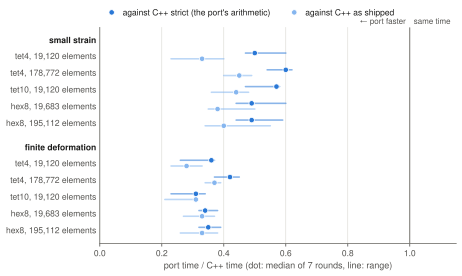
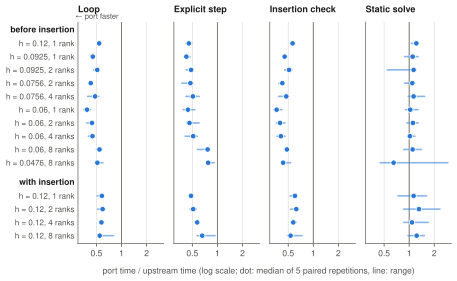
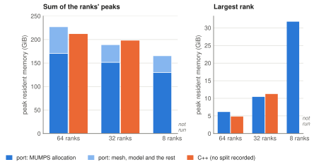

# Benchmarks and performance of akantu-rs

The Rust port of Akantu ("the port") was timed against the C++ library
("upstream", Akantu at `35a85178`) on the same x86_64 machines, with the
same meshes, partitions and solver library. Every ratio in this report is
the port's time divided by upstream's: below 1 the port is faster. On one
core the port's explicit step takes 0.31 to 0.60 times the time of the C++
step built with the same arithmetic, on five meshes of three element types.
In the cohesive benchmark the explicit loop takes 0.39 to 0.59 times
upstream's time at 1 to 8 ranks. On the JOSS mesh (4.39 million
tetrahedra, 5,000 steps with fracture) on one 64-core AWS node, the whole
run took 0.875 times upstream's time at 64 ranks and 0.851 at 32 (one run
each). The port
is slower in two phases: the mesh distribution (1.26 to 1.86 at full size)
and the static MUMPS solve (about 1.1 in the paired series, within
upstream's own run-to-run variation at full size). Both codes need about
the same memory, most of it held by MUMPS; at 64 ranks the port's largest
rank needs 1.27 times upstream's. Apart from one round on the explicit
step, no performance work has been done. Every number comes from
`docs/BENCHMARKS.md` and the files it names, none from a development
machine.

## Method

| Machine | CPU | Used for |
|---|---|---|
| AWS `r7a.16xlarge`, one node, 64 cores | AMD EPYC 9R14 | the full-size run of both codes |
| 8 × AWS `r7a.2xlarge`, one placement group | AMD EPYC 9R14 | multi-node runs of the port |
| boat.dev sandboxes (rented, shared cloud virtual machines), 4 or 8 vCPU | AMD EPYC 9455, Ryzen 9 9950X, Ryzen 7 9700X | serial kernels, the cohesive benchmark at 1 to 8 ranks, MPI latency |

The two codes always ran on the same machine in the same session. In the
cohesive benchmark both use the same mesh file, the same Scotch partition,
the same MUMPS 5.7.3 with single-threaded OpenBLAS, and the same blocked
global node (upstream's driver blocks a rank-local node, UD-349). The C++
runs skip the `fillNodesToElements()` rebuild after each insertion, as the
JOSS runs did with their patch; the physics is unchanged.

The C++ library is built with GCC 14.2 in `RelWithDebInfo` (`-O2 -g
-DNDEBUG`) twice. The strict install adds `-ffp-contract=off
-DEIGEN_DONT_VECTORIZE` and performs the same floating-point operations as
the port; the default install keeps upstream's flags. The port uses Rust's
release profile (`opt-level = 3`, no `target-cpu`), without fast-math or
fused multiply-add. At one rank the port reproduces the strict build bit
for bit, up to a whole fragmenting 5,000-step run on the mid-size mesh, so
the serial timings compare identical computations.

A sandbox's speed drifts by up to 2.5 times within a session. Every sandbox
comparison therefore interleaves the variants, rotates their order, uses 3
to 7 repetitions and reports medians with [min, max]; ratios are taken
within one repetition. The AWS runs are one run per point and give no
spread.

## Explicit step on one core

The explicit step of `examples/c++/solid_mechanics_model/explicit` (an
elastic cube under a displacement pulse), in nanoseconds per element and
step, medians of 7 rounds on a Ryzen 7 9700X sandbox:

| Mesh | Mode | C++ strict | C++ default | Port | Port / strict | Port / default |
|---|---|---:|---:|---:|---:|---:|
| tet4, 19,120 el. | small strain | 109 | 165 | 51 | 0.50 | 0.33 |
| tet4, 178,772 el. | small strain | 121 | 168 | 72 | 0.60 | 0.45 |
| tet10, 19,120 el. | finite deformation | 1,578 | 1,590 | 493 | 0.31 | 0.31 |
| hex8, 195,112 el. | small strain | 1,041 | 1,379 | 513 | 0.49 | 0.40 |
| hex8, 195,112 el. | finite deformation | 2,792 | 2,885 | 927 | 0.35 | 0.33 |

Over all ten configurations (`docs/reports/data/explicit-step-rust-vs-cpp.csv`)
the port takes 0.49 to 0.60 times the strict time in small strain and 0.31
to 0.42 in finite deformation. The internal-force assembly takes 0.25 to
0.60, the stress computation 0.36 to 0.59. The memory-bound case (tet4,
179 k elements, small strain) is the closest to C++. In the step medians
of the ten configurations, upstream's default install took 1.01 to 1.51
times the strict install's time; nobody profiled why.

Before this round the port took 2.8 to 3.6 times the strict time. Its
profile showed 42 % of the run in a generic emulation of Eigen's evaluation
order for small matrix products, and 13 % in page faults of per-step
allocations. Fixed-size kernels with the same reduction trees, and buffers
kept between steps, removed both without changing a result bit.

## The cohesive benchmark at 1 to 8 ranks

The JOSS scalability benchmark (an extrinsic cohesive cube under shear) ran
on one 8-vCPU sandbox (AMD EPYC 9455), five repetitions per point: ten
points before any insertion (500 steps, 23 k to 353 k tetrahedra) and four
with insertion (1,500 steps, 23 k tetrahedra).

| Point | Loop | Explicit step | Insertion check | Static solve |
|---|---:|---:|---:|---:|
| h = 0.12, 1 rank, before insertion | 0.54 | 0.45 | 0.56 | 1.22 |
| h = 0.06, 1 rank, before insertion | 0.39 | 0.44 | 0.36 | 1.03 |
| h = 0.06, 8 ranks, before insertion | 0.54 | 0.76 | 0.48 | 1.10 |
| h = 0.0476, 8 ranks, before insertion | 0.51 | 0.78 | 0.43 | 0.65 |
| h = 0.12, 1 rank, with insertion | 0.58 | 0.48 | 0.60 | 1.13 |
| h = 0.12, 8 ranks, with insertion | 0.55 | 0.66 | 0.53 | 1.23 |

(Port time over upstream time, medians of the paired ratios; all points in
`docs/reports/data/cohesive-port-over-upstream-boat.csv`.)

Before insertion the loop takes 0.39 to 0.54 times upstream's time and the
whole run 0.44 to 0.59. The insertion check is faster at every point (0.36
to 0.63; not profiled). The explicit step loses much of
its lead as ranks are added: 0.44 at 1 rank, 0.46 at 2, 0.51 at 4 and 0.76
at 8 on the same mesh. This fits a per-step parallel part that costs about
the same in both codes, but no per-rank timing confirms it. The static
solve phase (the same MUMPS on the same matrix, plus the port's assembly)
takes 1.02 to 1.31 times upstream's at 13 of 14 points.

With the full fragmenting schedule on the 177 k mesh (about 51,500 cohesive
elements inserted), the port took 0.68 to 0.74 times upstream's wall time
at 1 to 8 ranks. Its lead per element and step shrinks once the mesh
fragments (from about 0.5 to about 0.7 of upstream's cost); the reason
was not profiled.

## The full-size run

The JOSS mesh (2,203,782 DOFs), 5,000 steps with insertion, on one AWS
`r7a.16xlarge` on 12 November 2026. The C++ run at 8 ranks did not fit the
session's budget.

| Code | Ranks | Wall s | Static solve s | Step ms | Check ms | core-µs/el/step | Summed peak GiB | Largest rank GiB |
|---|---:|---:|---:|---:|---:|---:|---:|---:|
| port | 64 | 2,387 | 305 | 108 | 255 | 5.29 | 227.0 | 6.13 |
| C++ | 64 | 2,729 | 228 | 132 | 318 | 6.56 | 212.0 | 4.84 |
| port | 32 | 3,221 | 356 | 112 | 418 | 3.86 | 189.0 | 10.42 |
| C++ | 32 | 3,787 | 353 | 179 | 459 | 4.65 | 197.9 | 11.24 |
| port | 8 | 10,967 | 831 | 249 | 1,656 | 3.47 | 165.3 | 31.78 |

At 64 and 32 ranks the port's loop took 0.80 and 0.83 times upstream's
(step 0.82 and 0.63, check 0.80 and 0.91), and `init_full` 0.26 and 0.18.
The mesh distribution from rank 0 took 1.86 and 1.26 times upstream's: the
port's grows by about 2.1 s per added rank (32, 84 and 151 s at 8, 32 and
64 ranks), upstream's went from 66 to 81 s. The static solve took 1.34
times upstream's in the timed pair at 64 ranks, but upstream's own solve
took 324 s in a 20-step test run with the same binary, input and partition
(228 s in the timed run), and at 32 ranks the codes agree within 1 %, so
at full size the static solve shows no difference beyond upstream's own
run-to-run spread.

The insertion check is the largest cost in both codes: 75 % of the port's
wall time at 8 ranks, 65 % at 32 and 53 % at 64 (upstream: 61 % at 32, 58 %
at 64). The explicit step scales worst: 249, 112 and 108 ms per step at 8,
32 and 64 ranks. From 8 to 64 ranks the ghost layer grows from 8 % to 24 %
of a rank's tetrahedra. At 64 ranks a rank holds 0 to 19,833 cohesive
elements (median 7,658), and every step waits for the slowest rank.

Upstream's JOSS study ran the same mesh and schedule (v5.0.4 with its
patch, five runs per point) on EPFL's jed (Intel Xeon 8360Y). The port
costs 3.47, 3.86 and 5.29 core-µs per element and step at 8, 32 and 64
ranks; jed costs 3.87, 4.40 and 6.00 at 9, 36 and 72 cores. In this report
the loop efficiency between two rank counts is the core-µs per element and
step of the explicit step and the check at the smaller count over that at
the larger one (`docs/BENCHMARKS.md`, "Method"). Over the rank factors 4,
2 and 8 (8 to 32, 32 to 64 and 8 to 64 ranks) it is 90 %, 73 % and 66 %
for the port and 88 %, 73 % and 65 % on jed; upstream's own run on AWS
gives 71 % from 32 to 64 ranks. The port's static solve took 2.7 to 2.8
times jed's (upstream's on AWS 2.1 and 2.7 times); jed's MUMPS ordering and
BLAS are not recorded. The two machines differ in processor generation, in
a dedicated node against a shared cloud host, and in build, so only the
shape of the scaling curves can be compared.

Before the run, sandbox measurements at one rank predicted a third to a
half of the measured loop time; they could not show the parallel overhead
of 64 ranks.

## Parallel scaling

Weak scaling on the 8-vCPU sandbox (about 23 k and 45 k tetrahedra per
rank): both codes lose about the same share, with a weak efficiency of
0.67 to 0.78 at 2 ranks and 0.28 to 0.37 at 8 (medians; the machine drifted
during the series). On the AWS hosts (the port only, about 70 k tetrahedra
per rank, 8 ranks per host) it is 0.85, 0.67 and 0.53 at 16, 32 and 64
ranks, relative to 8.

Strong scaling of the loop on the 177 k mesh (speed-up over the rank
factor): the port 88 %, 65 % and 33 % at 2, 4 and 8 ranks, upstream 92 %,
82 % and 51 %. The port starts from a faster serial loop (131 against 359
ms per step) and at 8 ranks still takes 0.54 times upstream's time. At full
size the loop efficiencies are those of the previous section.

On up to eight `r7a.2xlarge` hosts the port ran a session of 13 runs. The
same 8 ranks on 1, 2, 4 and 8 hosts took 1.00, 0.76, 0.65 and 0.62 of the
one-host loop time. Strong scaling of the port at h = 0.04 across hosts
(8 ranks per host) drops to 0.45 at 32 ranks and 0.16 at 64, where the
loop is slower than at 32 (182.9 s against 130.2 s, about 8,700
tetrahedra per rank). On the JOSS mesh, eight hosts took 1.11 times the
single node's wall time at 64 ranks and 0.99 at 32.

## Memory

At full size the ranks' summed peaks are 227 GiB for the port and 212 GiB
for upstream at 64 ranks, 189 and 198 GiB at 32. MUMPS holds 170 GiB of the
port's 227 GiB at 64 ranks and 130 of 165 GiB at 8 (`INFOG(19)`), and stays
allocated through the loop in both codes. The port's largest rank at 64
ranks peaks at 6.13 GiB against 4.84 GiB; upstream records no MUMPS
statistics, so the cause is not measured. On the mid-size meshes the port's peaks were 0.86 to 0.99 times
upstream's at every point. Besides MUMPS, both hold about 10 to 14 KB per
tetrahedron.

## Other components

The port's translation of Eigen's SparseLU, the default solver without
MUMPS, takes 1.6 times (14 k DOFs) to 2.0 times (98 k DOFs) upstream's
SparseLU, which itself takes 18 times MUMPS's time at 98 k DOFs.

Against raw MPI (x86_64 sandbox, 14 November 2026), a small message over
shared memory costs about 0.5 µs more than raw MPI's 0.09 µs, and 1.3 times
raw over TCP. Large messages take 3.5 times (1 MiB) and 4.8 times (16 MiB)
the raw time over shared memory, 2.1 and 3.5 times over TCP, because of one
packing copy per send and a zeroed buffer and unpacking copy per receive.

## Known slow points and limits

None of the port's slow points has been worked on: the insertion check
(the largest phase at full size in both codes, not profiled once insertions
start), the explicit step's parallel overhead, the mesh distribution from
rank 0, the static solve phase (about 10 % slower in the paired series),
the largest rank's memory at 64 ranks, the SparseLU translation and the MPI
buffer copies. `04-possible-improvements.md` ("Possible improvements to
akantu-rs") discusses each.

Limits of the comparison:

- One run per point on AWS, so no spread at full size.
- Sandboxes are shared virtual machines. At 8 ranks every vCPU runs a rank,
  with no core left for the system.
- No per-rank timings or hardware counters: the causes given for the
  parallel overheads fit the data but are not proven.
- The cohesive series use the strict C++ build. In the cohesive driver the
  default build showed no measurable difference (paired medians 0.80 to
  1.24, every range containing 1); on the explicit step it took 1.01 to
  1.51 times the strict build's time (step medians above).
- The benchmark writes the energies of every step (4 to 5 % of the wall
  time); the JOSS runs did not.
- Upstream's runs at more than one rank solve another load case after their
  first insertion that touches a ghost boundary element (UD-890), so
  insertion counts at more than one rank are not compared.
- Not measured: the C++ full-size run at 8 ranks, the elastic series at
  full size, more than 64 ranks, other interconnects.
