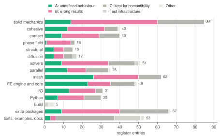

# Defects found in the C++ library

Porting Akantu to Rust meant comparing the port with the C++ library (built
from commit `35a851780d0b9471d258ed53a003ae98aaa95ea0`, and called the
oracle below) value by value. Every defect or questionable behaviour of the
C++ code met on the way went into a register, `docs/UPSTREAM_DEFECTS.md`.
It holds 596 entries: 148 cases of undefined behaviour (category A), 242
bugs that give wrong results (B), 176 quirks the port keeps for
compatibility (C), 20 defects of the test infrastructure and 10 others.
88 entries concern distributed runs. This report picks 25 entries by their
consequence for users of the C++ library today: wrong physical results
without an error, such as the 3-D thermal eigenstrain (UD-038), the
backwards rotation of anisotropic stiffness (UD-104) or the zero lumped
mass of beams (UD-005); undefined behaviour that can change results;
distributed runs that differ from serial ones; and crashes. Each of the 25
was checked again against the C++ source at the reference commit, and the
file, function and line numbers below come from that check. One CSV row per
register entry is in `docs/reports/data/upstream-defects.csv`.

## The register

### Categories and areas

The categories follow decision D-003 in `docs/DECISIONS.md`. A category is a
statement about the C++ code; the last column says what the port does.

| Category | Meaning | Entries | What the port does |
|---|---|---|---|
| A | undefined behaviour: uninitialised memory, out-of-bounds access, use after free, crashes | 148 | defines the behaviour, usually as an error or as zero-initialised data; compared with a patched oracle or with analytical results |
| B | a clear bug with wrong results | 242 | computes the corrected result by default; where practical, a compatibility switch reproduces the C++ result for the differential tests |
| C | a quirk or an API semantic | 176 | keeps the C++ behaviour by default and documents it |
| test infrastructure | defects of upstream's tests, test driver or CMake test registration | 20 | ports the test's intent |
| other | build (3), scope (1), dead code (1), withdrawn or no defect (5) | 10 | |

The counts use the first letter of the register's category column, as
`python3 scripts/docs/validation_counts.py defects` prints them; 38 entries
also name a second category (for example `A/B`). By status, 538 entries are
implemented in the port, 48 documented, 4 withdrawn, 2 superseded, 2
registered under another id, 1 not ported and 1 decided. The decided one,
UD-062, is not implemented: upstream's generalized trapezoidal scheme
reuses the Jacobian of the previous time step when only the time step
changes, and the port's scheme has the same rebuild triggers, so it reuses
the old Jacobian too.

The area of an entry is the part of the library its first reference points
to (the rule and six hand corrections are in
`scripts/docs/upstream_defects_csv.py`). Solid mechanics has the most
entries (85), then the extra packages (67), the mesh layer (62), the tests,
examples and manual (53), the solvers and DOF managers (51), and the FE
engine and core types (49). The area "parallel" (35) covers only the
synchronizers and partitioners; the 88 entries that concern distributed
runs (their description names ranks, ghosts, partitions or MPI) are spread
over all areas.

### How they were found

The oracle is upstream built twice in Docker, once with strict floating
point (`-O2 -ffp-contract=off -DEIGEN_DONT_VECTORIZE`) and once with
upstream's default flags. Both builds are `RelWithDebInfo`, so Akantu's own
debug assertions stay active (`docs/ORACLE_BUILD.md`). Probes (small C++
and Python drivers of the library) recorded the 2,023 golden fixture cases
of the repository, and the port's tests replay them, many bit for bit.
Defects came from four kinds of work:

- a source inventory of the whole tree before porting;
- porting itself: reading each function closely enough to translate it,
  then tracing every unexplained difference from the oracle to one side or
  the other;
- valgrind memcheck on oracle runs, for suspected uninitialised reads
  (UD-655, UD-671, UD-752, UD-814, UD-1060, UD-1140); no sanitizer build of
  the oracle was made;
- independent reviews of the port, which re-read the C++ code.

The register has no field for the finder. During the port, a keyword
reading of the register's descriptions, as they were worded then, counted
138 that cite an oracle run, probe or fixture, 54 that name a review or
audit, 5 that name valgrind, and 399 that name none of these, which mostly
means code reading (`docs/reports/data/upstream-defects-found-by.csv`).
The register was reworded for publication, so the count cannot be
reproduced from the published text.

### How the port treats each category

For category A the port implements defined behaviour and compares it with
an oracle variant that defines it the same way: three zero-initialisation
patches in `oracle/patches/variants/` (UD-001, UD-031, UD-814) and a
zero-fill patch in `oracle/patches/geometry/` (UD-414). Other A cases are
compared on the inputs where upstream's behaviour is defined, or with
analytical results.

For category B the port's default is the corrected result, with one
exception: UD-062 is decided but not implemented. 168 entries (153 of them
B, 10 A and 5 C) have a compatibility switch (the CSV column
`compat_switch`), and the oracle replays run with it on. Where upstream's
result is unusable (a zero lumped mass, corrupted connectivity) there is no
switch. Decision D-003 requires an independent scientific review of each B
correction. The register does not record one per entry: every correction
is part of a parity row that an independent reviewer accepted, and one
opt-in correction, the `Corrected` model of the anisotropic damage law,
still waits for its review.

For category C the port reproduces upstream and documents the behaviour.
Where the port's reading of upstream's intent is an interpretation, the
register says so, and so do the tables below.

## Defects that matter most to users

Paths are relative to the root of the Akantu repository, lines are at the
reference commit. "Switch" names the port's option that reproduces the C++
behaviour; "patch" names an oracle patch in `oracle/patches/`. Evidence
names a test of this repository (under `crates/`), an oracle fixture under
`fixtures/`, or a probe. Some test files carry the number of the review of
the port that found the defect (`review_v22_regressions`). The suggested
fixes are the port's corrections written in C++ terms; nobody has tried
them in the C++ code.

### Wrong results without an error

| ID | Where | What goes wrong, and when | Evidence | Suggested fix |
|---|---|---|---|---|
| UD-038 | `src/model/solid_mechanics/materials/material_thermal.hh:106` (`MaterialThermal<dim>::computeStressOnQuad`); `src/model/solid_mechanics/materials/material_plastic/material_linear_isotropic_hardening_inline_impl.hh:35, 99`; `src/model/solid_mechanics/materials/material_plastic/material_plastic.hh:65-76` | In 3-D the thermal eigenstrain is `(1 + ν) α ΔT`; the thermal stress `−E α ΔT/(1 − 2ν)` is right, so linear elasticity is unaffected, but the eigenstrain enters the phase-field strain (`src/model/model_couplers/coupler_solid_phasefield.cc:399`) and the phase-field material. J2 plasticity builds its trial stress with `σ_th,prev − σ_th`, the opposite sign of the convention `σ = C:ε + σ_th I` (`src/model/solid_mechanics/materials/material_elastic_inline_impl.hh:47`; Drucker-Prager uses `σ_th − σ_th,prev`, `material_plastic/material_drucker_prager_inline_impl.hh:285` in the same directory), and its final stress has no thermal increment. Met by any heated 3-D phase-field run and any heated J2 run. | `akantu-solid` tests `elastic_family_properties::ud038_thermal_eigenstrain_and_free_expansion`, `inelastic_properties::ud038_thermal_state_of_inelastic_laws` | `α ΔT` in 3-D (keep `(1 + ν) α ΔT` for 2-D plane strain, where it is the correct in-plane value); `σ_th − σ_th,prev` in the J2 trial and final stress. Switch `LawOptions::thermal_strain`, `plastic_thermal_increment` |
| UD-104 | `src/model/solid_mechanics/materials/material_elastic_linear_anisotropic.cc:140-141` (`rotateCprime`) | `rot_mat` holds the axes `n1, n2, …` as columns; the rotator is built from `rot_mat(k, i) * rot_mat(l, j)`, the transpose, so `C` is rotated backwards: for `n1 = (0.8, 0.6)` the stiff direction is `(0.8, −0.6)`. Met by `elastic_anisotropic` and `elastic_orthotropic` with axes that are not symmetric about the global ones. | `akantu-solid` `review_v22_regressions::mat02_*` (3-D non-symmetric rotation); oracle replays bitwise with the switch | `rotator(I, J) = rot_mat(i, k) * rot_mat(j, l)` and the transpose for `revrotor`. Switch `LawOptions::material_axes_as_directions = false` |
| UD-033 | `src/model/solid_mechanics/materials/material_elastic_linear_anisotropic.cc:77` (`C.eig(eigC)`) and `:228` (`getCelerity`) | The celerity is `sqrt(eigC(0)/ρ)`, the first eigenvalue in the order Eigen's `EigenSolver` returns (unsorted, `src/common/aka_types.hh:455-466`), not the largest, so the stable time step of explicit runs with these laws can be larger than the one the largest eigenvalue gives. | `elastic_family_properties::ud033_kelvin_bound_is_a_conservative_wave_speed` | use the largest eigenvalue (the port uses a Kelvin-Mandel upper bound, its own choice). Switch `LawOptions::celerity` |
| UD-029 | `src/model/solid_mechanics/materials/material_viscoelastic/material_viscoelastic_maxwell.cc:253-256` (`updateIntVarOnQuad`) | The recurrence result is written to `voigt_epsilon_v` and overwritten on the next line by `D σ_v / E_v` of the old stress; `sigma_v` is written back unchanged, so the Maxwell branch stresses stay zero and the law has no relaxation. | upstream's own `test_material_viscoelastic_maxwell_relaxation` (marked UNSTABLE upstream): with upstream's semantics the error is 0.195 at step 2, with the correction 2.8e-15 (`akantu-solid` `upstream_material_viscoelastic_maxwell_relaxation.rs`) | store the recurrence in `voigt_sigma_v`, then compute `voigt_epsilon_v` from it (the port's reading of the intent). Switch `MaxwellUpdate::Upstream` |
| UD-030 | `src/model/solid_mechanics/materials/material_plastic/material_linear_isotropic_hardening.cc:47-52` (`computeStress`) | With `finite_deformation = true` the Green-strain update runs and then the small-strain update on the same arguments, which overwrites stress and history: the finite-deformation J2 law is small-strain J2 on `∇u`. | oracle `*_finite_deformation` cases replayed in the port's `UpstreamLegacy` mode | drop the second call (line 52); the finite-strain branch then still needs a reviewed formulation, which is why the port refuses finite-strain J2 by default |
| UD-027 | `src/model/solid_mechanics/materials/material_damage/material_marigo_non_local.cc:83-84` | The keyword `marigo_non_local` registers `MaterialMarigo`, the local law; the `non_local` section is ignored. | oracle case `model/non_local/law_marigo_non_local_class` | `instantiateMaterial<MaterialMarigoNonLocal>`. Switch `register_upstream_marigo_non_local` |
| UD-352 | `src/model/solid_mechanics/solid_mechanics_model.cc:216` (`initSolver`) with `updateCurrentPosition` (`:411-424`) | Every `initSolver` (each `initNewSolver` or `getNewSolver`) copies `X` into `current_position` without changing its release. If the positions were refreshed at the current displacement before, every reader sees `X` instead of `X + u` until the displacement changes: the stable time step, the cohesive normals (`src/model/solid_mechanics/solid_mechanics_model_cohesive/materials/material_cohesive.cc:219, 296`), the contact couplers. Met by the static-then-explicit pattern, e.g. `examples/c++/scalability_test` (Δt computed on the undeformed mesh). | `akantu-solid` `smm_init_solver_ud352::smm_init_solver_orderings_match_the_oracle` (nine call orders) | copy `X` only when the array is allocated. Switch `SmmUpstreamCompat::init_solver_resets_current_position` |
| UD-005 | `src/model/structural_mechanics/structural_mechanics_model_mass.cc:126` (`assembleLumpedMassMatrix`), `:194` | `node2 = conn(0)`: every beam has length 0, so the lumped mass of `_bernoulli_beam_2/3` is zero; in 3-D the inertia loop then writes the (zero) inertia into every DOF, translations included. Any explicit or lumped dynamic beam run divides by zero masses. | oracle cases `bernoulli_beam_{2,3}_lumped_mass` record the zeros; `akantu-structural` `structural_model_dynamics_checks::lumped_mass_values_and_totals_2d` | `conn(1)`; write the inertia into the rotational DOFs only (the rotary inertia model itself needs review, UD-059). No switch |
| UD-007 | `src/model/structural_mechanics/structural_elements/structural_element_kirchhoff_shell.hh:46, 52` | `D` already holds `E t/(1 − ν²)` and the bending block multiplies it by `t³/12`: rigidity `E t⁴/(12(1 − ν²))`. Right only for `t = 1`, the only thickness upstream's tests use. | `akantu-structural` `structural_model_matches_oracle::ud007_corrected_alone_changes_exactly_the_declared_quantities`; plate checks against the Navier solution | `D * t² / 12`. Switch `StructuralModelUpstreamCompat::dkt_bending` |
| UD-293 | `src/fe_engine/element_classes/element_class_bernoulli_beam_inline_impl.hh:79` (`_bernoulli_beam_3` `computeShapes`, θy row) | The θy row is `+dw/ds` while the `w` row, the nodal rotations and `B` use `θy = −dw/ds`: interpolated θy has the wrong sign and a unit θy moment line load does virtual work −1. Stiffness, `B` and consistent mass are not affected. | `akantu-fe` `review_v55_regressions::fs02_*`; oracle fixtures replayed bitwise with the switch (152 comparisons) | negate the four coefficients of the row. Switch `StructuralUpstreamCompat::beam3_theta_y_legacy` |
| UD-217 | `src/common/aka_math.cc:50-58` (`Math::compute_tangents`) with `src/common/aka_math_tmpl.hh:33-39` (`Math::normal(vec)`) | The 2-D helper copies the 3-D normal and swaps components 0 and 1, keeping component 2: `t1 = normalize(n1, −n0, n2)`, so `t1·n = n2² / norm(n1, −n0, n2)`. The effective stress of extrinsic insertion then counts normal traction as shear: for `n = (0, 0.6, 0.8)` in pure tension the effective stress is 1.19 σ (β = 1) or 1.62 σ (β = 0.5). Inclined facets open early in 3-D extrinsic runs; facets with `n2 = 0` are not affected. | `akantu-cohesive` `review_v48_regressions::co01_*`: with upstream's tangents 134 facets of the tet4 test mesh open under hydrostatic tension 0.95 σc | `t1 = normalize(n1, −n0, 0)`, and `e0` when `n` is parallel to `e2`. Switch `CohesiveUpstreamCompat::tangent_rotation_2d_in_3d` |
| UD-040 | `src/model/solid_mechanics/solid_mechanics_model_cohesive/materials/constitutive_laws/material_cohesive_linear.cc:220-221` (`checkInsertion`) | The per-facet filter is zipped with the per-integration-point `sigma_c` array, so facet `k` is compared with the strength of point `k`. Matters only with a spatially varying σc (random or Weibull) on facets with more than one point (quadratic facets, quadrangle facets of hexahedral meshes). | `akantu-cohesive` `review_v48_regressions::defaults_ud040_mean_strength_of_a_two_point_facet` | view `sigma_c` per facet and compare with the facet's strength (the port uses the mean of its points, an interpretation). Switch `CohesiveUpstreamCompat::sigma_c_zipped_per_quad` |
| UD-002 | `src/model/contact_mechanics/resolution.cc:125` (`assembleLocalToGlobalArray`), `:177-193` (`assembleLocalToGlobalMatrix`) | Contact forces are written with `=` (times ½ for a deformable master), so a master node shared by several contact elements keeps one contribution. Stiffness equations are `node · dim + d`, not the DOF manager's numbers, and both `(i, j)` and `(j, i)` are added to the couplers' `_symmetric` `K`, whose key folds them onto one entry: off-diagonal terms are doubled. Results are right only where the numberings coincide and the master is rigid. | contact and coupler fixtures replayed with the switch (`akantu-contact` `contact_fixtures.rs`) | assemble through the DOF manager with `+=`, upper triangle only for symmetric storage. Switch `ContactUpstreamCompat` |
| UD-1291 | `src/model/model_couplers/coupler_solid_contact_tmpl.hh:66-79` (`assembleResidual`), `:133-145` (`corrector`) | In `_static` and `_implicit_dynamic` the couplers search the contact only in the corrector. Newton with the `residual` criterion tests the predictor's residual first, so a step in equilibrium on the previous contact set converges without a search and commits stale contact state. With the `solution` criterion the last residual can belong to a contact set the last search changed (observed: y equilibrium off by 25 %). | `akantu-couplers` `ud1291_search_order.rs`: a rigid translation into contact converges at iteration 0 with no contact force in upstream's order | search on the predicted positions before the first residual of the step. Switch `SolidContactCompat::search_in_corrector_only` |
| UD-216 | `src/solver/sparse_solver_mumps.cc:337-347` (`printError`, case −9), called from `factorize()` (`:264`) inside `solveInternal()` (`:286-319`) | When MUMPS runs out of workspace during factorisation, the handler calls `solve()` recursively, which is right, but the outer `solveInternal()` then runs `JOB = 3` again on `master_rhs_solution`, which now holds the solution: the result is `A^-(k+1) b` after `k` retries, with no error. | probe `oracle/probes/mumps/icntl14_interposer.c`: 8 retries, `A⁻⁹b`, relative error 1.44e23 at 1, 2 and 4 ranks; seen in 5 of 11 attempts of the cohesive scalability test at h = 0.06 on 8 ranks | copy the right-hand side into `master_rhs_solution` again just before `JOB = 3` (the port starts every solve from the original right-hand side). Switch `UpstreamCompat::mumps_retry_with_solution_rhs` |
| UD-178 | `src/solver/sparse_solver_eigen.cc:42-65` (`SparseSolverEigen::solve`) | `factorize` is never followed by an `info()` check: a structurally or numerically singular matrix (a model without enough Dirichlet conditions) is "solved", outside Eigen's precondition, and the releases are marked current. | oracle probes `solver/lu/{structurally,numerically}_singular` (`NumericalIssue`) | throw `SingularMatrixException` when `info() != Success`, as the MUMPS path does for −10. No switch |
| UD-110 | `third-party/iohelper/src/paraview_helper.tcc:160-173` (`ParaviewHelper::pushData`, matrix overload); `src/io/dumper/dumper_padding_helper.hh:120` | Matrix fields are written as zero-padded `dim × dim` squares (81 values per cell for a 9-component strain) under `NumberOfComponents = 9`. ParaView reads the first `9 n` values as the tuples of `n` cells without a message, so strain, Green strain and the padded 2-D stress cannot be inspected. The padded 2-D stress also leaves out-of-plane shear uninitialised (UD-111). | `docs/reports/2026-11-12-paraview-visual-check.md` (side-by-side views) | write `rows × cols` values; zero the padded matrix. Switch `DumperParaview::set_compat_layout(true)` |

### Undefined behaviour that can change results

| ID | Where | What goes wrong, and when | Evidence | Suggested fix and patch |
|---|---|---|---|---|
| UD-001 | `src/model/contact_mechanics/contact_detector_inline_impl.hh:250` (`isValidSelfContact`, `slave_normal`); `src/model/contact_mechanics/resolutions/resolution_penalty.cc:141` (`traction_trial`), `:242` (`computeTrialTangentialTraction`, `increment_xi`), `:532-537` (`computeSlipModuli`, `k_third`; `k_first` is zeroed twice) | Dynamic Eigen vectors and matrices are not zero-initialised but are accumulated into: the orientation check that `ContactDetector::search` applies to every candidate pair (`contact_detector.cc:253`) sums facet normals into `slave_normal`, and with friction (`mu ≠ 0`) the trial traction, the slip increment and the slip moduli start from stack contents. Met by every penalty contact run, frictionless or not. | contact probe case `explicit_friction`, generated on the patched oracle and replayed by `akantu-contact` `contact_fixtures.rs` | add the four `.zero()` calls: patch `variants/ud001-contact-zero-init.patch` |
| UD-031, UD-814 | `src/model/solid_mechanics/materials/material_damage/material_anisotropic_damage_tmpl.hh:197` (`computeStressOnQuad`), `:261`, `:100` (`tensorPlusOp`), `:235-237`; `src/common/aka_types.hh:471-519` (`MatrixBase::eig` with eigenvectors) | The elastic stress is written to `sigma`, never to `sigma_el`, which `damageStress` uses: the stress is identically zero as coded. `A_diag` is not initialised and only its diagonal is set, so the damage increment and `sqrt(1 − D)` read stack contents. The broken branch rewrites `E` and `ν` of the whole material, which carries the garbage into the tangent: three identical x86_64 runs gave two different tangents. In 3-D, once `D` is NaN, `eig` ignores Eigen's `NoConvergence` and returns uninitialised eigenpairs. | valgrind: 686 uninitialised reads in `variant_ud031/3d_uniaxial` with the first patch alone, none with both | zero `A_diag`; check `EigenSolver::info()` in `eig`; the law needs a specification (the port refuses it by default). Patches `variants/ud031-anisotropic-damage-zero-init.patch`, `variants/ud814-eig-noconvergence-zero-init.patch` |

### Distributed runs that differ from serial runs

| ID | Where | What goes wrong, and when | Evidence | Suggested fix |
|---|---|---|---|---|
| UD-003 | `src/solver/sparse_matrix_aij.cc:166-196` (`SparseMatrixAIJ::matVecMul`) | `tmp` is zeroed, the products go into `y`, and the reduction over the DOF synchronizer is applied to `tmp`, which is still zero: the partial products of shared rows are never summed across ranks. Upstream's `TestSMMFixtureBarImplicit.Dynamics` fails at 2 and 4 ranks (residual 5.3e-8 and 6.6e-6 against 1e-10) and passes serially; UD-003 is a credible cause, not proved (UD-077). | the port's distributed product equals the serial one at 2 and 4 ranks and its bar dynamics passes upstream's criterion (`akantu-solver` `review_v75_regressions::ex1_01_shared_rows_keep_the_ud003_correction`) | accumulate into `tmp` before the reduction (the port's reading of the intent; UD-872 discusses which rows the synchronizer covers). No switch |
| UD-890 | the write is not located; the load side is `src/model/common/boundary_condition/boundary_condition_tmpl.hh:103-112` (`applyBC` integrates a group's `_not_ghost` and `_ghost` elements) | Distributed extrinsic insertion overwrites ghost boundary elements of loaded groups with an interior facet's connectivity (oracle, h = 0.12 cube, 2 ranks, between steps 800 and 899). The next Neumann application integrates them with that facet's normal: the 2-rank run applies 3,607.05 N in z to an interior node. From then on the distributed run solves another load case; on h = 0.06 every C++ multi-rank run departs at steps 901 to 907. | oracle runs of the cohesive benchmark (`docs/NUMERICAL_VALIDATION.md`); `crates/akantu-bench/tests/ghost_boundary_insertion.rs` (2,609 forced insertions, nodal loads equal to serial) | locate the write; the port keeps ghost boundary elements on their faces. No switch |
| UD-1280 | `src/model/solid_mechanics/solid_mechanics_model_cohesive/solid_mechanics_model_cohesive.cc:504-548` (`onNodesAdded`) | A doubled node's copy gets displacement, velocity, acceleration and flags, but a zero external force: the original copy keeps the whole accumulated Neumann load, including the share of boundary elements that now use the copy. Which copy is the original follows the facet's neighbour order, so it depends on the element numbering and, on a distributed mesh, on the partition. | the h = 0.06 benchmark at 8 ranks leaves the serial trajectory at step 1,467 through this, and the oracle makes the same choice bit for bit (`docs/UPSTREAM_DEFECTS.md`); `akantu-bench` `doubled_node_load_side.rs` | move each boundary element's recorded load to the copy it uses (the port's design), or apply the Neumann loads again after an insertion. Switch `doubled_node_keeps_external_force` |
| UD-902 | `src/model/structural_mechanics/structural_mechanics_model.cc:506-507` (`assembleInternalForce`, the ghost call is commented out) | The structural model registers no synchronizer and skips ghost elements, so on a distributed mesh the residual at interface nodes misses the elements owned by other ranks; only the energies are reduced (`:605`, `:629`). No upstream test or example runs it in parallel. | code reading (the port refuses a distributed structural mesh) | refuse distributed meshes, or assemble ghosts after synchronising their stresses as the solid model does |

One more property of distributed runs is kept by the port in a fixed form.
Ghost elements join their law's filter in the order in which
`MPI_Waitany` completes (`src/synchronizer/synchronizer_impl_tmpl.hh:235`,
`src/model/common/constitutive_laws/constitutive_laws_handler_tmpl.hh:511-525`),
so from three ranks on the ghost numbering and the order of ghost sums vary
from run to run: two oracle runs of a 4-rank explicit case differed in the
last bits of every field (UD-232). The port unpacks in rank order.

### Crashes and aborts

| ID | Where | What goes wrong, and when | Evidence | Suggested fix |
|---|---|---|---|---|
| UD-1060, UD-655 | `src/common/aka_array_tmpl.hh:234` (defaulted `noexcept` move constructor of `ArrayDataLayer<T, _pod>` over the raw owning pointer `values`, `:366`; freed at `:244`); `src/common/aka_array.hh:239`; used in `src/synchronizer/node_info_per_processor.cc:545-566` (`MasterNodeInfoPerProc::synchronizePeriodicity`) | Moving an `Array` of a POD type leaves both objects owning the buffer. `synchronizePeriodicity` grows a `std::vector<Array<Idx>>` with `emplace_back` while earlier entries are in use (and handed to `asyncSend`); a reallocation frees buffers the relocated entries still use. Distributing a mesh made periodic before the distribution aborts on the root with "double free or corruption" when a relocated rank holds a periodic slave node (with the oracle's g++ 14.2: rank 0 at 2 ranks, ranks 0 to 1 at 3 to 4, 0 to 3 at 5 to 8). | parallel probe `distribution_square_periodic` (abort); valgrind on the probe | implement the move with `std::exchange(other.values, nullptr)` and reset the sizes; `reserve(nb_proc)` before the loop |
| UD-028 | `src/model/solid_mechanics/solid_mechanics_model_cohesive/materials/material_cohesive.cc:77-79` (constructor); `src/model/solid_mechanics/solid_mechanics_model_cohesive/materials/constitutive_laws/material_cohesive_exponential.cc:47`, `.../constitutive_laws/material_cohesive_linear.cc:81` | The base constructor enables the `delta_max` history only if `use_previous_delta_max` is set, and the derived constructors set it afterwards. `cohesive_exponential` and the implicit `cohesive_linear_friction` then read `delta_max.previous`, which was never created. | the oracle's implicit exponential case aborts on the assertion (fixture `implicit_static_exponential_triangle_6`) | call `initializeHistory()` from the derived constructors, or test the flag in `initMaterial`. Switch `CohesiveUpstreamCompat::delta_max_without_history` |

## Packages that do not compile, and defects in tests and examples

Three packages do not compile at the reference commit:

- IGFEM: `extra_packages/igfem/src/dumper_igfem_elemental_field.hh:26`
  includes `static_communicator.hh`, and the sources include
  `aka_debug_tools.hh`; neither header exists in the tree. IGFEM headers are
  pulled into core translation units, so with `AKANTU_IGFEM=ON` the core
  library does not compile either (UD-025, UD-050, UD-606).
- extra-materials: only `material_vreepeerlings_non_local.cc` compiles, and
  it registers nothing; the other files stop at removed APIs
  (`INSTANTIATE_MATERIAL`, `Matrix::mul`, `Math::matrix33_eigenvalues`,
  `solid_mechanics_model_RVE.hh`) (UD-572).
- embedded: `src/model/model_options.hh:104` calls the one-argument macro
  `DECLARE_NAMED_ARGUMENT` with two arguments (since commit `ad98b0167`,
  2024-10-15), so no file that includes it compiles with the package on
  (UD-073). The reinforcement law also uses renamed APIs, declares a
  destructor it never defines and registers `pre_stress` twice (UD-587,
  UD-588, UD-589). The patches in `oracle/patches/embedded/` make it build
  and run upstream's embedded tests; upstream's `embedded_model` example
  still crashes on that build (UD-851).

Smaller pieces in the same state: `MeshSphereIntersector` does not compile
(UD-409), and after compile fixes it writes out of bounds because
`Array::clear()` changed meaning in commit `afd7269e9` (2020) (UD-414; both
fixes in `oracle/patches/geometry/`). `InclinedFlatDirichlet` (UD-403) and
the complex `eig` overload (UD-068) do not compile, and
`ResolutionPenaltyQuadratic` cannot be constructed (UD-370).

Upstream's test set-up lets some failures pass unnoticed:

- `cmake/akantu_test_driver.sh:147` tests `$directory`, which is never set;
  an empty command succeeds, so the driver exits before post-processing and
  before the `diff` against the `.verified` file. Pass or fail is the exit
  code only (UD-018).
- `cmake/AkantuTestsMacros.cmake:561` writes `set(N MPIEXEC_MAX_NUMPROCS)`,
  the variable's name instead of its value, so every PARALLEL test without
  an explicit level is registered with one rank (UD-015). With the oracle
  patch `0001-tests-dereference-mpiexec-max-numprocs.patch` 195 more tests
  run at 2, 4 and 8 ranks, and 145 pass in the strict build
  (`docs/ORACLE_BUILD.md`).
- The heat-transfer patch tests require a package `heat_transfer` that does
  not exist (the package is `diffusion`), so they are never built (UD-014),
  and their fixture would not compile (UD-288).
- Tests that cannot fail or check the wrong thing: the phase-field optimal
  test has its `return EXIT_FAILURE` commented out (UD-384);
  `test_sparse_matrix_assemble.cc` assembles nothing (UD-181); at several
  ranks `test_sparse_solver_mumps.cc` gathers the unsolved `x` on the
  non-root ranks (UD-075); `Communicator.ReceiveAny` reuses one tag for 100
  rounds, the probable cause of its 4-rank failures (UD-076).

Among the examples,
`examples/c++/structural_mechanics_model/bernoulli_beam_2_example.cc:83`
calls `initFull()` with the default explicit method (UD-514), and
`examples/c++/phase_field_model/phase_field_parallel.cc:66-71` sets its
material selector after `initFull` (UD-853). The upstream manual
contradicts the code in 23 places, which the port's manual lists
(`docs/manual/src/differences.md`, "Upstream manual errata").

## What the port does differently by default

By default the port computes the corrected result for the B entries it
implements, and turns what is undefined upstream into defined behaviour,
usually an error. The switches that restore the C++ behaviour, by area:

| Area | Switch | Entries |
|---|---|---|
| materials | `LawOptions::upstream()` sets all of them (`thermal_strain`, `thermal_energy`, `celerity`, `material_axes_as_directions`, `orthotropic_parent_update`, …) | UD-038, UD-109, UD-033, UD-104, UD-105 and others |
| solid mechanics model | `SmmUpstreamCompat` | UD-208, UD-352 |
| solvers | `UpstreamCompat` (`stale_shared_jacobian`, `residual_mass_wgh_unrefreshed`, `generalized_trapezoidal_reads_k_when_e_is_zero`, `mumps_retry_with_solution_rhs`); `NonLinearSolverNewtonRaphson::set_legacy_hooks(true)` | UD-193, UD-194, UD-195, UD-216, UD-010 |
| cohesive | `CohesiveUpstreamCompat` | UD-028, UD-040, UD-217, UD-247, UD-249, UD-1160, UD-1280 |
| contact and couplers | `ContactUpstreamCompat::all()`; `SolidContactCompat::upstream()` | UD-002, UD-008, UD-362 to UD-369, UD-371, UD-372, UD-374, UD-772, UD-1291 |
| phase field | `PhaseFieldUpstreamCompat` | UD-004, UD-377 to UD-380, UD-385, UD-387, UD-388 |
| structural | `StructuralUpstreamCompat::UPSTREAM`, `StructuralModelUpstreamCompat::UPSTREAM` | UD-007, UD-293, UD-343, UD-507 |
| split-node contact | `TasnUpstreamCompat` | UD-039, UD-392, UD-394, UD-395, UD-397, UD-398 |
| mesh I/O and dumps | `ReadOptions::fill_unnamed_physical_groups = false`, `WriteOptions::upstream_precision()`, `DumperParaview::set_compat_layout(true)` | UD-045, UD-061, UD-110, UD-113, UD-114 |
| geometry | `SegmentIntersectorOptions::upstream()` | UD-407, UD-408 |
| Python | `setUpstreamCompat(True)` on the contact and phase-field models and the couplers | as the Rust switches |

The full table, with each upstream behaviour and the port's default, is in
the manual (`docs/manual/src/differences.md`, "How upstream defects are
handled"). Without a switch the port corrects, among others, the structural
lumped mass (UD-005), the distributed product (UD-003), the distributed
cohesive insertion (UD-890), singular and non-finite solves (UD-178,
UD-183) and the parser's stack overflows (UD-080, UD-081). The MPI
reductions are folded in rank order (`ReductionPolicy::NativeMpi` uses MPI's
own order, as upstream does).

## The full register

`docs/UPSTREAM_DEFECTS.md` has every entry with its upstream location, the
evidence, the decision and the tests. `docs/reports/data/upstream-defects.csv`
has one row per entry (area, category, one-line description, first upstream
file cited, status, switch, oracle patch); it is generated by
`python3 scripts/docs/upstream_defects_csv.py`, and its totals match the
register (596 entries; A 148, B 242, C 176). The `compat_switch` column is a
reading of the decision text and the manual, checked by hand on a sample;
the decision text of the register is authoritative. 16 entries cite no
upstream file in their reference or description.
