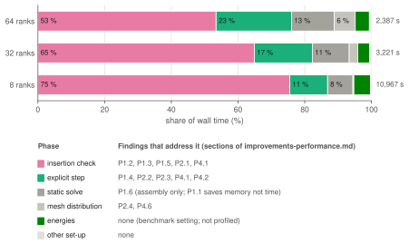
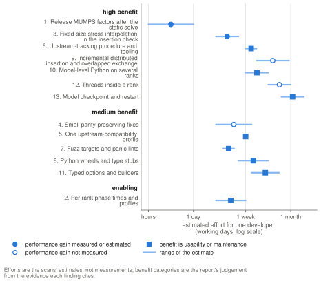

# Possible improvements to akantu-rs

The Rust port of Akantu ("the port") reproduces the C++ library ("upstream")
at commit `35a85178` feature for feature and, in most areas, bit for bit
(`01-migration-and-features.md`). Parity came first: apart from one round
on the explicit step, no performance work was done, and the public API
follows the C++ one closely so that every result could be compared. Three
read-only scans of the repository, made on 14 November 2026 and revised for
the public tree on 15 November, list what could be done next: 22 findings
on performance, 39 on features, API and usability, and 23 on
maintainability. The preparation of the public repository resolved some of
them, mostly in the maintainability scan; the scans mark which. The
changes with the most effect would be:

- releasing the MUMPS factors after the static preload, which would cut the
  memory of the 64-rank full-size time loop from about 205 GiB to about
  21 GiB;
- a faster insertion check, the largest phase of the full-size cohesive run
  in both codes (53 % to 75 % of the port's wall time);
- a procedure for following upstream commits;
- one switch that gives upstream's numbers;
- model-level Python on several MPI ranks.

None of the performance changes among them alters a result bit.

The full lists, with file and line references, are in `docs/reports/data/`:
`improvements-performance.md`, `improvements-features.md` and
`improvements-maintainability.md`. Below, P1.2 means section 1.2 of the
performance scan, F2.1 a section of the features scan and M2.10 one of the
maintainability scan. Every effort figure is an estimate for one developer
who knows the code base; none was measured. Ratios are the port's time over
upstream's (below 1 the port is faster).

## Performance

`02-benchmarks-and-performance.md` gives the measurements. On the full-size
run (JOSS mesh, 4.39 million tetrahedra, 5,000 steps, one 64-core AWS
node) the insertion check takes 53 % of the port's wall time at 64 ranks and
75 % at 8. At 64 ranks it costs 3.71 core-µs per element and step, against
1.77 before any insertion. Insertion itself therefore adds about 1.9
core-µs per element and step, about 130 ms per step on each rank. Nobody
has profiled that part. The explicit step takes 11 % to 23 % of the wall
time and scales worst, the static solve 8 % to 13 %, the mesh distribution
up to 6 %.

Three of the items below depend on measurements that do not exist yet. The
driver records no per-rank phase times, no profile covers the insertion
step once fragmentation starts, and nobody has counted at run time the
global agreements of the port's collective error protocol. Reading the code
gives about 19 small (five-value) `MPI_Allreduce` calls per explicit step with its check
on more than one rank, where upstream makes none of that kind (P4.4).
Whether they cost anything is unknown. A few days of instrumentation would
decide the order of the distributed items.

### Changes that keep the results bit for bit

Ordered by expected gain against effort.

| Item (finding) | Expected gain and its basis | Effort |
|---|---|---|
| Destroy the MUMPS factorisation after the static preload, as an explicit call off by default (P1.1) | Memory. Summed RSS of the 64-rank loop from about 205 GiB to about 21 GiB, largest rank from 6.13 GiB to about 1 GiB plus the loop's growth; at 8 ranks the largest rank holds 28.8 GiB after the solve against 1.8 GiB before. Basis: RSS recorded before and after the static solve | hours (driver) to about a day (library API) |
| Fixed-size kernel for the stress interpolation of the check, choosing the route once per element type and law; for linear tetrahedra the interpolation reduces to a copy of the stored stress (P1.2) | About −30 % of the check, an estimate made during the port from the one recorded split (interpolation 7.2 ms of a 13.2 ms check, h = 0.12, one thread on the development machine, before an earlier optimisation of the same check; the notes that hold it are not in the repository). The copy shortcut is unmeasured, and so is the interpolation's share in today's code at full size | 2 to 4 days |
| Skip the insertion-order exchange when no rank flagged a facet (P1.3) | Unmeasured. Removes two neighbour exchanges, their agreements and an allocation over all facets from each step without insertion (886 of the 5,000 full-size steps) | hours |
| Keep the cohesive residual and energy buffers between steps (P1.4); drop the whole-mesh scans of each check (P1.5) | Unmeasured for cohesive elements. The same change on the bulk internal forces took the tet4 step from 151 to 95 ns per element at 179 k elements | about a day; hours |
| Cache the scatter positions of sparse assembly instead of a hash lookup per entry (P1.6) | Unmeasured. The port's static-solve phase, which includes assembly, takes 1.02 to 1.31 times upstream's at 13 of 14 paired points | hours to 2 days |
| Loop order of the dense kernels of the pure-Rust SparseLU (P1.7) | `sparselu_gemm` was 18 % of the samples of a cohesive run with that back-end; the port's SparseLU takes 1.6 to 2.0 times upstream's | hours to a day |
| Incremental distributed insertion: append to the stress copy plan, update node schemes for doubled nodes, keep only O(inserted) consistency checks in release builds (P2.1) | Aims at the 1.9 core-µs per element and step above, which is measured but not profiled; how much of it these causes explain is not known. Removing the full consistency check from release builds removes a safety net and is a decision for the maintainers | 1 to 3 weeks, after a profile |
| Post the stress exchange before the not-ghost assembly and wait before the ghost one, as upstream does (P2.2) | Unmeasured. Aims at the step's parallel overhead: 0.45, 0.82 and 1.58 core-µs per element and step at 8, 32 and 64 ranks | 2 to 4 days |
| Mesh distribution from rank 0 (P2.4) | The port's grows by about 2.1 s per added rank (151 s at 64 ranks against upstream's 81 s); reading the code does not explain it | days, after a profile |
| Remaining serial kernels of the explicit step (P2.3) | Estimates of −2 % to −15 % of the step each, made during the port from the profile in `docs/BENCHMARKS.md`; a few per cent of a full-size run | about a week |
| Reuse send and receive buffers in the communication layer (P2.5) | Over shared memory a 1 MiB message takes 3.5 times raw MPI's time and a 16 MiB message 4.8 times; the effect on a model run is unmeasured | about a week |

Outside the solvers, the input-file parser evaluates a variable by parsing
its expression again at every reference, as upstream's grammar does, so
24 definitions that each refer twice to the previous one take 1.8 s to
evaluate on the development machine, and each further line doubles the
time; a cache per evaluation would fix it in hours to two days (P1.8).

### Changes that need a switch or change the results

| Item (finding) | Effect on results | Gain and effort |
|---|---|---|
| Opt-in build for the host CPU (`-C target-cpu`) (P3.1) | Rust never contracts `a·b + c` into a fused multiply-add by itself; one review found identical explicit-step digests with `target-cpu=native`. Must be shown per build with the replay tier | gain unmeasured (fat LTO with one codegen unit gave 0.78 to 1.17 times the time, within noise); a day plus a replay run |
| Double buffering of the history arrays (P2.6) | Bitwise, but changes the buffer identity that zero-copy NumPy views hold, so it would be opt-in for runs without Python views | the copies are 13 % of the hex8 small-strain profile |
| A fast numerical mode without the emulation of Eigen's evaluation order, with SIMD reductions and fused multiply-add (P3.2) | Changes results; needs its own tolerance study | unmeasured; weeks, mostly validation |
| A supernodal or multifrontal pure-Rust factorisation (P4.5) and distributed Krylov solvers (F5.3) | Other rounding than upstream's SparseLU; iterative results depend on partition and tolerance. New solver choices next to the existing ones | upstream's own SparseLU takes 314.6 s and 7.5 GiB at 97,551 DOFs, 18 times MUMPS's time; weeks to months, and 1 to 2 weeks for CG and GMRES with Jacobi |
| Parallel mesh input and partitioning (P4.6) | Results unchanged, but the partition differs from the replayed C++ ones, which matters for comparisons | weeks |

### Options beyond the C++ library

The port's numerical code runs on one thread per rank. Three options go
further, and bit-for-bit parity limits what each may do.

Threads inside a rank (P4.1, F5.2). The architecture allows `rayon` (a Rust
library for data parallelism) where the threaded result is bit-identical to
the serial one, with a test for each loop; no crate uses threads today.
Per-element work (gradient, constitutive law, `D·B`, integration, the
check's interpolation) writes disjoint outputs and qualifies directly. The
scatter to nodes sums in element order. A gather form that visits each
node's elements in increasing order through a node-to-element table
reproduces that order and runs in parallel over nodes. Fewer ranks per host
would also shrink the ghost layer, which is 24 % of a rank's tetrahedra at
64 ranks. Laws written by users, Python laws among them, would have to
declare whether they are thread-safe. Gain unmeasured; several weeks.

SIMD across elements (P4.2). Upstream's default build vectorises inside
Eigen's small products; on aarch64, where it also contracts multiply-adds,
it changes the last bits of 1,265 of 2,250 records of the dense layer.
Running the same scalar operations on two or
four elements at once, one element per lane, gives each lane exactly the
scalar result for `+ − × ÷ sqrt` without fused multiply-add. It needs a
structure-of-arrays layout or gathers per block, and run-time dispatch on
baseline builds. Gain unmeasured, and the serial step already takes 0.31
to 0.60 times the strict C++ time; weeks.

GPU (P4.3). Bit identity with the CPU would need no fused multiply-add
(CUDA `-fmad=false`), the same per-entry order, a gather assembly and
fixed-order reductions for the energies. Insertion changes the mesh on the
CPU, which forces transfers on 4,114 of the 5,000 full-size steps. Months
of work; the scan advises it only after P1.2, P2.1 and P4.1.

## Features and gaps

The table lists what the port does not do, and the state of the same
feature upstream.

| Gap (finding) | Upstream | What closing it takes | Effort |
|---|---|---|---|
| Models from Python on several ranks (F1.1); the mesh level works and matches the oracle at 1, 2 and 4 ranks | never runs its module on several ranks; its default solver refuses them | bindings work only, since the Rust models already run distributed: communicator ownership next to mpi4py, an agreed error when a Python callback raises on one rank, tests against the Rust run of the same partition | 1 to 2 weeks |
| Structural model on a distributed mesh (F1.2) | distributed residual wrong at every interface node (UD-902) | node synchronizer for all DOFs, not-ghost assembly, the rotary inertia blocks across ranks; checked against the port's serial run, as no oracle exists | 1 to 2 weeks |
| Contact on a distributed mesh (F1.3) | serial only | a ghost layer of master surfaces around each rank's slave nodes on the existing grid synchronizer, and a deterministic tie rule | 3 to 6 weeks |
| Inputs refused by default because upstream's result is wrong or undefined (F1.5): finite-deformation J2 and damage, the anisotropic damage law, Maxwell with thermal loading, among others | accepts the input | one reviewed formulation at a time; the anisotropic damage law has a `Corrected` model awaiting independent review | days for that review, weeks per new formulation |
| IGFEM and the extra materials, checked without a full-precision oracle (F1.6) | do not compile at the reference commit | a second oracle at the last commit where they compiled, or a compile-only patch set as for the embedded model | 1 to 3 weeks each |
| Smaller refusals on several ranks (F1.7), PETSc in the contact couplers and 64-bit PETSc indices (F1.8) | defective or absent in most of these cases (UD-1105, UD-904, UD-1141, UD-429) | a partition constraint that keeps split-node pairs on one rank, distributed renumbering for phase-field element events, and others | days each |
| A C API (F1.4); `akantu-capi` exports only the version string | has none | a minimal ABI with handles to meshes and models, error codes and a header | 1 to 2 weeks |

Several additions would go beyond upstream:

- Model checkpoint and restart (F4.3), which neither code has. The port's
  rank-ordered reductions make a byte-for-byte test possible: N steps equal
  N/2 steps, a restart and N/2 more. Cohesive mesh changes and distributed
  meshes make it 3 to 6 weeks.
- New output and input formats: zlib-compressed and appended VTU next to
  the byte-identical default (F4.1, 2 to 3 days); one VTKHDF or XDMF file
  for all ranks and steps in place of a piece per rank (F4.2, 2 to 3 weeks,
  with HDF5 as a native dependency); binary MSH input (F4.4, 3 to 5 days);
  a meshio bridge in Python for Abaqus, Exodus and other formats (F4.5, 2
  to 3 days).
- Fuzz targets (tests that feed generated malformed input) for the `.dat`
  parser, the expression evaluator and the mesh readers (F5.1, 2 to 3
  days). Property tests exist, but the upstream scan found stack overflows
  (UD-080, UD-081) and reads of uninitialised data (UD-082, UD-083) in
  exactly these parts, and the port promises that malformed input never
  panics.
- An MFront bridge once upstream merges `features/mfront-material` (F5.4),
  and a check of whether the pure-Rust crates build for WebAssembly, for
  teaching (F5.5, a day to find out).

## API and usability

The Rust API follows the C++ one so that every call could be compared with
the oracle. For Rust users this leaves the following work (F2):

- One compatibility profile (F2.1). Today corrected defaults are reverted
  through 14 `*Compat` structs of three different shapes plus several
  setters. A model-level `Corrected` or `Upstream` profile, and an
  input-file parameter so that an existing `.dat` file can ask for
  upstream's numbers without code, would serve C++ users and anyone writing
  differential tests. About a week.
- Typed solver options, an `Energy` enum and a solver-id type in place of
  the string-keyed parameters both codes use (F2.2), generated from the
  parameter registry so that the two cannot drift; builders in place of the
  positional constructors copied from C++ (F2.3); a fuller prelude and
  facade features `mumps` and `petsc` (F2.7). One to three weeks together.
- Smaller items: implement the `Model` trait, or a time-loop trait, for the
  cohesive, contact, embedded and IGFEM models and the couplers (F2.5);
  getters that do not need exclusive access (F2.6); error variants with
  structured context instead of free text (F2.8).
- At a future major version, an idiomatic default for some of the 176
  category-C quirks the port keeps (F2.4): the consistent tangent for J2
  plasticity (UD-079), an absolute floor on the residual criterion
  (UD-1294), textbook names for the Newmark parameters (UD-017).

For Python users the package installs as `akantu` and runs upstream's
examples unchanged. What stops it from being a drop-in replacement:

- Model-level runs on several ranks (F1.1, above).
- No wheels are published, and the distribution name is upstream's own
  PyPI name, so a name has to be agreed with the Akantu maintainers (F3.1).
  The delivered CI builds wheels for Linux x86_64 and macOS arm64 (the
  macOS job has not yet passed on GitHub). Linux aarch64 is a small
  addition; Windows has never been tried.
- No type stubs (F3.2, 2 to 4 days).
- Behaviour stricter than upstream's: topology views become read-only once
  a model uses the mesh (UD-532), and the error message could say so
  (F3.4). Python exception subclasses for the main error kinds would help
  scripts (F2.8).
- One upstream example fails in both codes because `MaterialCohesive` does
  not bind `getNormals` (UD-980, F3.3). A binding of a few hours fixes it in
  the port and could be offered upstream.

## Following upstream

The port tracks one commit. The oracle build, the probes (50 directories
under `oracle/probes/`), the fixture generators and a fixture comparison
tool exist, and `docs/MAINTAINING.md` ("Following a new upstream commit")
describes the move to a newer commit by hand: list the upstream changes,
map them to parity rows by search, build a second oracle, regenerate and
compare the affected fixtures, port row by row. The pinned hash is
repeated in 168 files under `crates/`, `scripts/`, `oracle/`, `python/`
and `ci/` (F6.1). The scan proposes tooling for the first steps: one file
that holds the pin, and a script that maps an upstream diff to parity rows
through the source references in the parity matrix and lists the affected
fixtures. About a week for the tooling; after that each sync costs what the
upstream change costs.

The first candidate is `features/matrix_free`: 210 commits ahead of
`master`, last commit on 5 November 2026 (F6.1). Its latest commit messages
touch PETSc linear operators and the TAO solver, contact detection on ghost
elements and cohesive insertion, all areas with register entries. A sync
would have to check which of those entries the branch changes. Other
branches past the pin: `features/ufl-model`, `features/modular_fe_engine`,
`features/52-anisotropic-and-at1-phase-field-models` and
`features/mfront-material`.

What the C++ library could take from the port:

- The defects of `03-upstream-defects.md`, each with its location, evidence
  and the test that shows it.
- The 2,023 fixture cases and the probes as a regression suite. Rebuilding
  the oracle at a new upstream commit and replaying the probes shows which
  results changed, to the bit. The probes exercise paths upstream's own
  tests do not reach (F6.4).
- The patches in `oracle/patches/` that make the embedded package (eight
  patches) and the mesh sphere intersector (two) compile again (F6.4).
- Designs for upstream's own gaps: a distributed structural residual
  (UD-902, F1.2), the `getNormals` binding (F3.3), and the category-C list
  of F2.4 as candidate changes.

## Code health

From the maintainability scan:

- Each of the 472 integration-test files builds its own binary (433 of
  them in a default workspace run; `01-migration-and-features.md` explains
  the 462 binaries of that run), and the debug target directory of 21 to 27
  GB does not fit a CI cache. Merging them into one binary per crate,
  except where a test needs its own process (M2.3), and folding the 66 test
  files named after reviews of the port into subject files (M2.2) take
  three to five days.
- One 11 MB `SHA256SUMS` lists 73,889 fixture files, so any two changes
  that add fixtures conflict. Per-case checksums take half a day; packing
  each case into one `.npz` with the same array bytes takes two to three
  days (M2.10).
- 219 `#[allow]` attributes silence pedantic lints that the workspace does
  not enable. Deleting them, turning the rest into `#[expect]` and adding
  `unwrap_used`, `expect_used` and `panic` as warnings takes about a day
  (M2.4, M2.5).
- Nothing checks RustSec security advisories, and `sha2` is declared
  directly in seven crates instead of the workspace table (M2.11, two
  hours).
- Longer refactorings: splitting the files above 3,000 lines where they do
  not mirror an upstream function (M3.1), sharing the model scaffolding
  repeated across four physics (M3.2), and generating `FEATURE_PARITY.md`
  from one record per row so that a diff shows the changed field (M3.3).

## Roadmap

The order puts cheap, certain items first, then measurement, then the items
that depend on it. The benefit categories are this report's judgement from
the evidence the findings cite (`docs/reports/data/improvements-roadmap.csv`).

| # | Item | Findings | Effort | Expected benefit | Depends on |
|---:|---|---|---|---|---|
| 1 | Release the MUMPS factors after the static solve | P1.1 | hours to 1 day | loop memory at 64 ranks from about 205 to about 21 GiB (measured) | |
| 2 | Per-rank phase times, agreement count, profiles of fragmentation and mesh distribution | P4.4, P2.1, P2.4 | days | decides the order of 9 and of P2.4 | |
| 3 | Fixed-size stress interpolation in the check | P1.2 | 2 to 4 days | check about −30 % (estimate from an older split) | |
| 4 | Small parity-preserving fixes | P1.3 to P1.7 | 2 to 6 days | unmeasured; insertion check, cohesive step, assembly, SparseLU | |
| 5 | One upstream-compatibility profile, also from the input file | F2.1 | about a week | upstream's numbers without code | |
| 6 | Upstream-tracking procedure and tooling; patches offered upstream | F6.1, F6.4 | about a week | the port can follow upstream | |
| 7 | Fuzz targets and panic lints | F5.1, M2.5 | about 3 days | evidence for the no-panic claim | |
| 8 | Python wheels (name, Linux aarch64) and type stubs | F3.1, F3.2 | 1 to 2 weeks | installable package, editor support | a name agreed with the Akantu maintainers |
| 9 | Incremental distributed insertion and overlapped stress exchange | P2.1, P2.2 | 1.5 to 4 weeks | targets the 1.9 core-µs per element and step that insertion adds at 64 ranks (measured, not profiled) | 2 |
| 10 | Models from Python on several ranks | F1.1 | 1 to 2 weeks | removes the largest drop-in exception | |
| 11 | Typed options, builders, fuller prelude | F2.2, F2.3, F2.7 | 1 to 3 weeks | compile-time checks for Rust users | 5 |
| 12 | Threads inside a rank, bit-identical | P4.1, F5.2 | 2 to 4 weeks | unmeasured; workstation runs, fewer ranks per host | 3, 9 |
| 13 | Model checkpoint and restart | F4.3 | 3 to 6 weeks | long runs survive job limits | |
