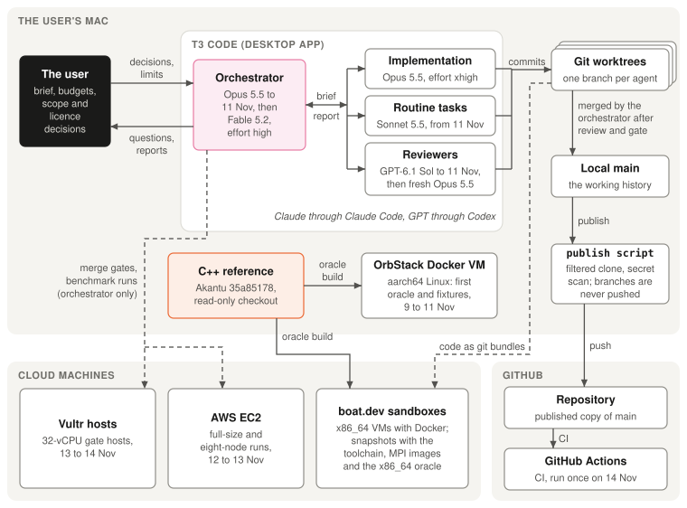
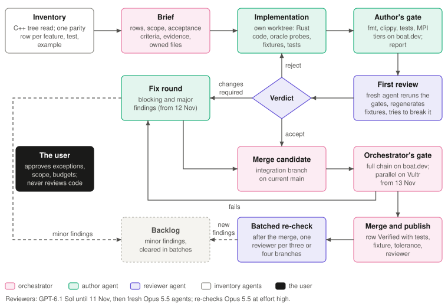
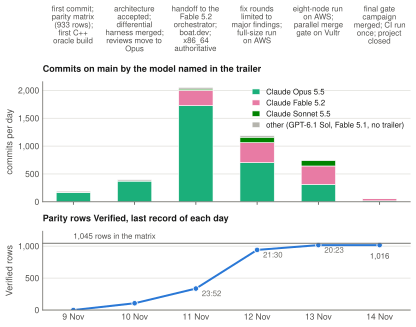
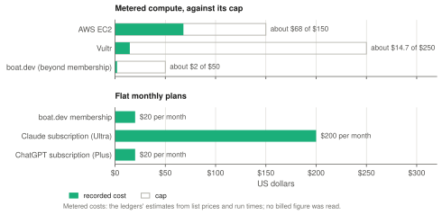

# How the work was organised: agents, models, tools, machines, cost

AI coding agents wrote the Rust port of Akantu (about 514,000 lines of Rust
in 27 crates; 4,638 commits by 14 November, 22:00 local time) between 9 and
14 November 2026. One person wrote the brief and decided scope, budgets and
licence questions. An orchestrator agent planned the work, wrote the task
briefs, merged branches and kept the records. Subagents implemented
features, reviewed each other's work and ran the test campaigns. About 200
work packages (a work package is a set of parity rows given to one agent
with one brief) and 180 numbered reviews went through this process in six
days. At the end 1,016 of the 1,045 rows of the parity matrix were Verified
(with Rust tests, a golden fixture or an analytical reference, a justified
tolerance and an independent review), and 26 were exceptions the user
approved. Metered cloud compute cost about $85 by the
project's own estimates (AWS about $68, Vultr about $14.7, boat.dev about
$2 beyond its $20 monthly membership); sign-up credits covered the AWS and
Vultr parts. The models ran on two flat subscriptions, Claude at $200 per
month and ChatGPT at $20 per month. The process records cited here (the
brief, a progress log, a decision log, a blocker list, review reports and
budget ledgers) stayed in the project's private working history. Every
count below was taken from that history on 14 November 2026.

## The setup

All agents ran in T3 Code, a desktop application on the user's Mac. Each
agent is a conversation thread with its own git worktree (a separate
checkout of the same repository). The orchestrator starts a subagent with a
written brief, is woken when it finishes, reads its report and merges its
branch. T3 Code drives Claude models through Anthropic's Claude Code and GPT
models through OpenAI's Codex.

| Role | Who | What it did |
|---|---|---|
| User | one person | The mission brief, budgets, scope decisions, approval of exceptions, model and concurrency limits |
| Orchestrator | Claude Opus 5.5 (9 to 11 Nov), then Claude Fable 5.2 at effort high (11 to 14 Nov) | Planning, briefs, merges, gate runs, the records, all AWS and Vultr use, publishing |
| Implementation agents | Claude Opus 5.5 at effort xhigh | New numerical, parallel and solver code, oracle probes, defect analysis, debugging |
| Routine tasks | Claude Sonnet 5.5 at effort high (from 11 Nov, 21:50) | Merges of reviewed branches, documentation corrections, bookkeeping scripts, CI texts |
| First reviews and audits | GPT-6.1 Sol at effort xhigh (9 to 11 Nov), then Claude Opus 5.5 at effort xhigh | Independent review of every branch before its merge, never by the author |
| Re-checks | Claude Opus 5.5 at effort high (from 12 Nov) | Narrow checks that each finding of a review was fixed |

The brief asked for Opus 5.5 for all work and GPT-6.1 Sol for every
review, never by the agent that wrote the code. On 10 November the Codex
usage limit was reached, and from 11 November reviews went to a fresh Opus
5.5 agent that did not write the code (34 review reports are by GPT-6.1
Sol). Fable 5.1 ran two tasks on 9 November, both relaunched on Opus. On 11
November the user allowed Fable 5.2 for the orchestrator and, that evening,
Sonnet 5.5 for easy tasks; a Sonnet agent that met a semantic question, a
numerical difference or an unexplained failure had to stop and report.

Concurrency followed the model plans' limits and the user's instructions
(times are local times):

| From | Limit |
|---|---|
| 10 Nov, 17:45 | at most 4 implementation agents and 2 reviews (with 6, all hit the short-window rate limit together) |
| 11 Nov, 12:30 | about 20 or more at once until the weekly reset at 18:15, to use the rest of the weekly allowance (23 launched at 12:46) |
| 11 Nov, 18:15 | back to 4 + 2 |
| 12 Nov, morning | fixes of review findings may use an idle review slot |
| 12 Nov, 16:37 | 10 in total (4 implementation, up to 6 reviews and fix rounds) |
| 12 Nov, 21:38 and 22:18 | 14 until 23:00, then 18 |
| 12 Nov, 23:06 | 10 in total; the 16 running were allowed to finish |

## How a feature went from nothing to merged

1. Inventory agents read the C++ tree and wrote one parity row per feature,
   test and example (933 rows on 9 November, 1,045 at the end;
   `docs/FEATURE_PARITY.md`).
2. The orchestrator wrote a brief: the rows, numbered scope items,
   acceptance criteria and required evidence, the files the agent owns, a
   reserved range of upstream-defect numbers, and the compute rules.
3. The agent implemented on its own branch and worktree. It wrote oracle
   probes (small C++ programs linked against the reference build) whose
   outputs became golden fixtures, and Rust tests that replay them, bitwise
   where the arithmetic allows.
4. The author ran the gates (formatting, lints, workspace tests, MPI
   tiers) on a boat.dev sandbox and reported the results.
5. A fresh reviewer checked the branch. It had to rerun the gates,
   regenerate at least three fixture cases from the oracle, build at least
   two adversarial cases, and revert each fix to see its regression test
   fail. Verdicts were accept, accept with required changes, or reject.
6. The author or a new agent fixed the findings (a fix round). From 12
   November only blocking and major findings were fixed before a merge;
   minor ones went to a backlog that Sonnet agents cleared in batches.
7. The orchestrator ran the merge gate (every test tier, in sequence) on an
   integration branch and merged into `main`. The parity row became
   Verified only with test names, fixture, tolerance and reviewer recorded.
8. A batched re-check after the merge (one reviewer for three or four
   branches) confirmed the fix rounds.

A rules file, read first by every agent, set the following constraints.
The C++ checkout was read-only. No tolerance could be loosened to make a test pass, and
every tolerance needed a written numerical reason and a review. A failing
test was never ignored; it went on the blocker list. No fast-math flags
were allowed. Every `unsafe` block carried a safety comment and was flagged
for review. Subagents never merged into `main` and never pushed. Code under
an incompatible licence (GCC's libstdc++, other GPL code) was reproduced
clean-room from specifications and black-box tests (D-030 in
`docs/DECISIONS.md`). The exception is CGAL's GPL packages, which the user
allowed to be ported into a separate, opt-in GPL crate (D-042). Upstream
defects fall into three categories (D-003; see `03-upstream-defects.md`).

## How state survived context loss

No agent's memory lasted the week, and the orchestrator itself was replaced
once (Opus 5.5 handed over to Fable 5.2 on 11 November at 12:30).
Everything needed to continue lived in committed files:

| Record | Role |
|---|---|
| Operating rules | Read first by every agent, with the history of each rule change |
| The brief | The user's mission statement, verbatim |
| Progress log | A state snapshot at the top, refreshed at milestones; one row per work package and review with its branch head; the minor-findings backlog |
| Decision log | 119 numbered decisions, with the user's words quoted where the user decided; the technical ones are kept in `docs/DECISIONS.md` |
| Blocker list | 32 blockers by 14 November, each with what it needed and how it was closed |
| Handoff note | Written for the orchestrator change of 11 November: what to read, the first 20 minutes, the rules for briefs, the merge protocol, lessons |

After a context loss an agent read the rules and the progress log, checked
git state, ran the fast tests and continued from the highest-value
unfinished item. The orchestrator also kept lessons in Claude Code's
file-based memory outside the repository.

## The machines

| Machine | Used for |
|---|---|
| The user's Mac (Apple M4 Pro, 14 cores, 24 GB) | All agents and worktrees, editing, git, checks and tests of one crate. From 11 November no full test runs, benchmarks or oracle builds |
| OrbStack Docker VM on the Mac (aarch64 Linux, about 20 GB) | The first C++ oracle build (at most 3 parallel compile jobs: one translation unit needs up to 12 GB) and the first fixture corpus |
| boat.dev sandboxes (rented x86_64 Ubuntu virtual machines with Docker; 4 vCPU / 8 GB or 8 vCPU / 16 GB) | Every full build, test tier, oracle run, fixture campaign and benchmark from 11 November; agents created their own sandboxes |
| AWS EC2 (orchestrator only) | The full-size cohesive benchmark (734,594 nodes, 4,392,183 tetrahedra) on a 64-core, 512 GiB instance, and an eight-node run |
| Vultr (orchestrator only, from 13 November) | 32-vCPU hosts that ran the merge gate's tiers in parallel |
| GitHub Actions | The delivered CI, run once on 14 November and then disabled |

Until 11 November the oracle and all fixtures came from aarch64 Linux. The
user then asked whether upstream runs on x86_64. It does (its CI images and
the machine of the published cohesive benchmark), so x86_64 Linux became
the authoritative platform (D-043). The oracle was rebuilt on boat.dev, and
the corpus was regenerated and compared value by value; the remaining
differences are classified in `docs/NUMERICAL_VALIDATION.md`.

Sandboxes started from snapshots holding the toolchain, the project's
Docker images, a warm build cache and the x86_64 oracle build. They
received code as git bundles and started without the user's credentials.
Code reached GitHub only through a publishing script that removed account
details from the history and scanned it for secrets.

## Numbers

Commits per day, by the model named in the commit trailer (`git log`,
author dates in local time; no commit has more than one trailer):

| Day | Opus 5.5 | Fable 5.2 | Sonnet 5.5 | GPT-6.1 Sol | Fable 5.1 | No trailer | Total |
|---|---:|---:|---:|---:|---:|---:|---:|
| 9 Nov | 173 | 0 | 0 | 2 | 2 | 15 | 192 |
| 10 Nov | 374 | 0 | 0 | 2 | 0 | 20 | 396 |
| 11 Nov | 1,726 | 277 | 21 | 18 | 0 | 11 | 2,053 |
| 12 Nov | 703 | 359 | 98 | 0 | 0 | 26 | 1,186 |
| 13 Nov | 312 | 331 | 102 | 0 | 0 | 5 | 750 |
| 14 Nov | 17 | 39 | 5 | 0 | 0 | 0 | 61 |
| Total | 3,305 | 1,006 | 226 | 22 | 2 | 77 | 4,638 |

The Opus commits of 9 to 11 November include the first orchestrator's.
From 11 November the Fable 5.2 commits are the orchestrator's (merges,
records, small fixes).

| Quantity | Value |
|---|---|
| Work packages with a row in the progress log | 200 |
| Numbered reviews, re-checks and audits | 180, of which 27 batched re-checks |
| Review report files | 197 (107 first reviews, 73 re-checks, 17 audits); 121 evidence folders; 3,028 files in all |
| Reject verdicts | 16, all between 9 and 11 November |
| Decisions | 119; 36 name the user as their source |
| Blockers | 32 opened and 32 closed by 14 November, 22:00; the aarch64 comparisons of MUMPS and PETSc records found later are handled by decision D-121 (`docs/PLATFORMS.md`) |
| boat.dev sandboxes | 280 in the ledger |
| Parity rows Verified | 0 on 9 Nov, 106 on 10 Nov, 336 by the end of 11 Nov, 941 at 21:30 on 12 Nov, 1,016 at 20:23 on 13 Nov |

| Provider | What ran | Recorded cost | Cap |
|---|---|---:|---:|
| AWS EC2 | Full-size run on 12 Nov (7.07 h on demand, plus a spot instance reclaimed after 3 minutes); rerun on 13 Nov; eight hosts for 4.42 h on 13 Nov | about $68 | $150 |
| Vultr | Two 32-vCPU gate hosts (2.9 h and 10.4 h) and short CPU tests | about $14.7 | $250 |
| boat.dev | All 555 included hours of the plan (8-vCPU sandboxes count double), extra starts at $0.03 | about $2 from the wallet, plus the $20 monthly membership | $50 beyond the membership |
| GitHub Actions | One run of every job | about 1,280 runner minutes of the account's monthly allowance | none set |
| The user's Mac | Agents, editing, the aarch64 oracle | not costed | none |
| Claude subscription (Ultra plan) | The orchestrator and all Claude agents | $200 per month, flat | the plan's weekly usage allowance |
| ChatGPT subscription (Plus plan) | The GPT-6.1 Sol reviews of the first days | $20 per month, flat | the plan's usage allowance |

The free credits both providers give at sign-up covered the AWS and Vultr
charges. The money actually paid was therefore three subscriptions for one
month, $240 in all ($200 for Claude, $20 for ChatGPT, $20 for boat.dev),
plus about $2 of boat.dev extras. The model subscriptions are flat plans
with usage allowances, so token use was not billed separately.

The AWS figure is computed from list prices and run times; no billed
figure was read after the AWS login expired on the night of 12 November.
The boat.dev ledger's two running figures for paid starts disagree (both
under $5), and its hours mix wall time and billed time.

## What went wrong and what was learned

On 9 November five agents failed mid-task at once on the Claude API rate
limit. T3 Code resumed them, but it
also recreated worktrees of cancelled tasks. On 10 November six concurrent
Opus agents all hit the short-window limit together and made little
progress, so the limit became four implementation agents and two reviews.
The Codex limit the same day moved reviews to Opus. On 11 November the user
upgraded the Claude plan and asked for the rest of the weekly allowance to
be used before the reset; that day has 2,053 commits.

On 11 November two agents sent an interim "waiting" message and then
stopped for several hours without a word; from then on the
orchestrator checked every running agent's last commit each hour. On 14
November the completion notice of the last audit did not arrive, and the
orchestrator found the report seven hours later.

On 12 November finished branches waited for one of two review slots; the
user allowed more, and fix rounds were cut to blocking and major findings.
On 13 November the merge gate took three hours on one sandbox, running its
tiers one after the other, with six branches queued.
On 32-vCPU Vultr hosts the same tiers ran in parallel in 1,698 to 1,907
seconds. A Vultr host counted as a merge gate only after one full chain gave
the same counts as boat.dev on the same tree.

On 11 November agents used 54 of the 60 sandbox starts boat.dev allows in
one hour, so the rule became one sandbox per task, reused, from
a snapshot with everything a reviewer needs. Full gates filled sandbox
disks to 98 % and moved to a larger type.

Sandbox speed varied by up to 2.5 times within an hour
(`docs/BENCHMARKS.md`), so every performance
comparison interleaves repetitions and reports medians. Collective-timeout
tests failed when boat.dev's snapshot agent paused all containers. The
cause was reproduced with `docker pause`, and the tests now count waits
that end at the timeout instead of bounding wall time.

Re-meshing upstream's geometry files with Gmsh on x86_64 gave 17 of 122
meshes identical to the
aarch64 ones; the rest differed in coordinates or structure, so meshes are
frozen as fixtures (D-009, D-073). Invalid operations produce NaNs with the
opposite sign bit on x86_64. Eigen sizes its dense blocking from the CPU
cache sizes it reads at run time, so the x86_64 oracle's LU factors changed
with the host until the cache sizes were pinned (D-050). On GitHub's
runners NumPy's `exp` changed 149 of 4,221 values of one input pulse by up
to 2 ulp, which no sandbox had shown. The cause is the AVX-512 kernel NumPy
picks where the CPU has it, as the oracle's host does; the runner's CPU was
inferred, not observed.

One review found that after `distribute()` on one rank, 90 % of the state
of an implicit
dynamic example differed from the oracle from the first step, by rounding:
a matrix-vector product accumulated into a separate vector instead of in
place. Another found a Python callback reading a stale current position,
wrong by up to 1.1e-3. An audit of `unsafe` code found a safe PETSc call
that could corrupt memory. One reviewer found a load misplacement in a file
outside its assignment, and another a wrong count in a results file the
orchestrator had written. The architecture was rejected five times before
it was accepted on 10 November.

The test runs also found errors in their own tooling: a script that
picked the test binary by its position in cargo's output, whose order is
not fixed, and an audit command that set an environment variable outside
the container and so shortened the benchmark replays. The first runs on
GitHub failed six jobs for three reasons never seen on boat.dev (a clean
cargo registry, the NumPy difference, a 2-vCPU runner). On AWS the first
spot instance was reclaimed three minutes into the full-size session and
the run continued on demand; the C++ point at 8 ranks was skipped under the
session's budget rule.

## What it takes to repeat this

Each point below is what this project depended on, with the fact that shows
it.

- A reference implementation that builds and runs, with probes that dump
  intermediate arrays: 2,023 fixture cases recorded element kernels,
  assembled operators and Newton histories, so that a difference could be
  traced to one step.
- Bitwise comparison as the default test, with each tolerance justified in
  writing and reviewed: 197 of the 240 tolerance rules are exact, and the
  one-rank defect above first showed up as a difference in the last bits.
- A parity matrix written from the reference source before implementation
  starts: 933 rows on the first day, 1,045 at the end, so that every
  feature, test and example had a row to close.
- Review by an agent that did not write the code, with authority to reject
  and the duty to rerun the gates and regenerate fixtures: 16 rejections,
  and the wrong results described above, which the authors' tests had
  passed.
- All state in committed files that every agent reads first: the
  orchestrator was replaced on 11 November and its successor continued from
  the progress log and the handoff note.
- Cheap Linux machines that agents may create themselves: 280 sandboxes in
  six days, from snapshots of the reference build, with a budget ledger per
  provider.
- One person who answers scope, budget and licence questions within hours:
  36 of the 119 decisions name the user as their source.
