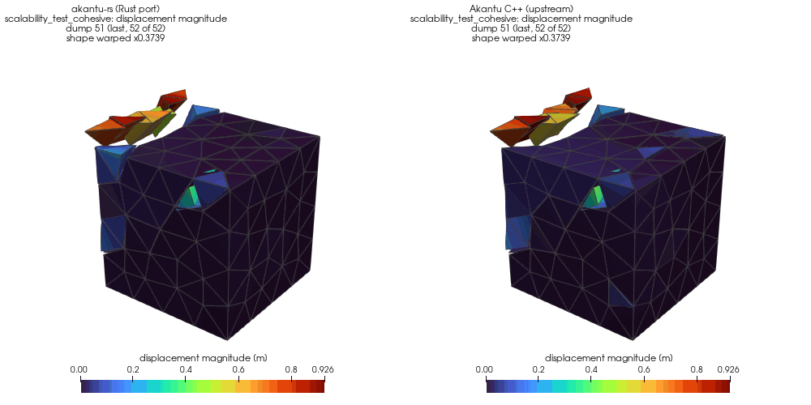
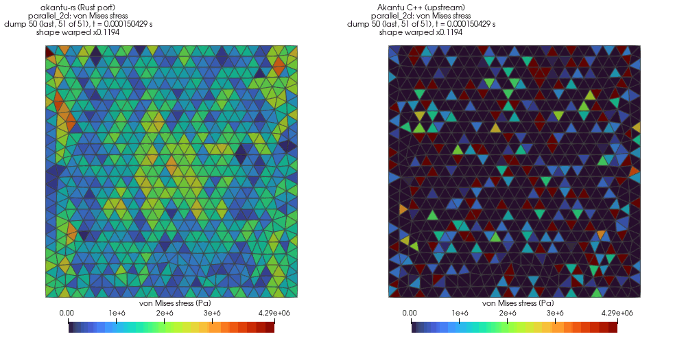
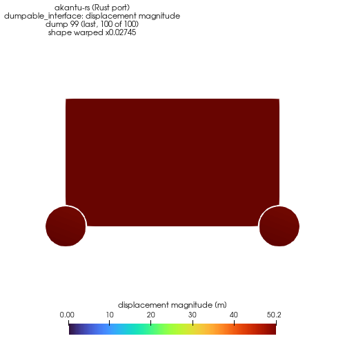

# ParaView visual check of the example outputs

*First run 2026-11-12; every difference explained, and the one gap of the port fixed, on 2026-11-13. Written for a finite-element developer who knows Akantu but not this port. The tables of this report are generated by `scripts/paraview/make_report.py`; the paragraphs of section 3 are written by hand from the sources of both libraries.*

## 1. What was done

[akantu-rs](../../README.md) is a Rust port of Akantu, checked against upstream at commit `35a851780d0b9471d258ed53a003ae98aaa95ea0` (`v5.0.7-post1-554`). For this check every example of upstream's `examples/c++` and every Python example that writes ParaView files was run twice, once with the port and once with upstream:

- **The runs.** The C++ examples are the port's Rust programs (`crates/akantu/examples/<name>`) against upstream's binaries built from the reference commit; where an example uses a sparse direct solver, upstream's variant with Eigen's `SparseLU` pinned is used, because the reference build's default (`_auto`) is MUMPS, whose rounding differs from Eigen's, while the port's default is a bit-exact translation of Eigen's `SparseLU`. The Python examples are upstream's scripts, unchanged, run once with the port's `akantu` module and once with upstream's (upstream's side of nine cases reads a marked Eigen-pinned input-file variant, `python/examples/variants/`: the `_eigen` cases of `scripts/paraview/python-cases.tsv`).
- **The comparison.** Every ParaView file of both runs (each `.pvd` with all its time steps, every `.pvtu`, every `.vtu` piece; 16,090 files from the port, 16,086 from upstream) was opened in ParaView 5.13.3 (headless, OSMesa). A ParaView message counts as a failure. The files were compared byte for byte; the differing ones array by array, both as ParaView reads them and directly from their XML and base64 (`scripts/paraview/vtu_diff.py`).
- **The pictures.** The first, a middle and the last dump of each run are drawn side by side: **port on the left, upstream on the right**, the same camera, the same colour scale (the port's range), a legend. 248 pictures; all of them are in the [gallery](paraview-visual-check/gallery.md).

**How differences are classified.** The port treats every defect found in upstream with one rule (decision D-003; the list with the evidence of each entry is [`docs/UPSTREAM_DEFECTS.md`](../UPSTREAM_DEFECTS.md), entries `UD-n`): category **A**, undefined behaviour (uninitialised memory, reads out of bounds, crashes): the port does something defined, with no switch to reproduce upstream; category **B**, a wrong result: the port computes the correct one by default and, where practical, a compatibility switch reproduces upstream for comparisons, which every example exposes as `--upstream-compat`; category **C**, a quirk: kept, or a documented difference. In the summary below, *identical* means every file is byte-identical; *identical with upstream's behaviour switched on* means the default corrects a B defect and `--upstream-compat` gives upstream's files byte for byte; *differs: upstream's file cannot be reproduced* means that no setting of the port writes upstream's file, because upstream's file is invalid VTK or holds undefined values (the cause column names the defect); *gap of the port* would mean that the port cannot do what upstream does.

**In short.** 12,772 of the 16,086 files written by both sides are byte-identical. ParaView opened every file of the port without a message; it printed messages for upstream's files of one example (`dumpable_interface`, section 3.3). Every remaining difference has its cause read in both sources and a defect entry; none is a defect of the port. The one gap found by the first run (`scalability_test` could not write its ParaView output) was an omission of the port's example, now fixed (section 3.1). To the eye, every example where the two sides agree is physically plausible: plates stretch and compress in the expected direction, the cohesive plates split along the expected lines, the phase-field notch opens with the damage at its tip, the contact examples show the stress under the contact, the heat spreads from the hot point or sphere. This is a visual check, not a validation (the validation is the test suite).

## 2. Summary

One row per run; `…_compat` rows are the same example run with `--upstream-compat`. *Byte-identical files*: identical / files written by both sides.

| Example (run) | Verdict | Byte-identical files | Cause (defect entry) |
|---|---|---|---|
| `predefined_bc` | identical | 2 / 2 | - |
| `user_defined_bc` | identical | 2 / 2 | - |
| `python_user_defined_bc` | identical | 2 / 2 | - |
| `static` | identical | 4 / 4 | - |
| `explicit_dynamic` | identical | 2,003 / 2,003 | - |
| `implicit_dynamic` | identical | 127 / 127 | - |
| `example_parser` | identical | 2 / 2 | - |
| `new_local_material` | identical | 23 / 23 | - |
| `dumper_low_level` | identical with upstream's behaviour switched on | 204 / 404 | the wheels turn in the port; upstream's `applyRotation` writes into a copy (UD-473, B) |
| `dumper_low_level_compat` | identical | 404 / 404 | - |
| `dumpable_interface` | differs: upstream's file cannot be reproduced; ParaView messages: 416 | 100 / 400 | upstream's `train` piece holds a 1,496-value `color` for 15,244 cells (ParaView reports an error for `color` and shows the piece empty) and its `wheels` pieces whole-mesh arrays (UD-474, C); by default also UD-473 |
| `dumpable_interface_compat` | differs: upstream's file cannot be reproduced; ParaView messages: 416 | 100 / 400 | UD-474 (as above) |
| `parallel_2d` | differs: upstream's file cannot be reproduced | 52 / 154 | padded 2-D stress: upstream writes 81 values per cell (UD-110, B) and leaves 4 entries uninitialised (UD-111, A) |
| `parallel_2d_compat` | differs: upstream's file cannot be reproduced | 52 / 154 | the 4 uninitialised entries of upstream's padded stress (UD-111, A); everything else byte-identical |
| `cohesive_extrinsic` | identical | 203 / 203 | - |
| `cohesive_intrinsic` | identical | 703 / 703 | - |
| `cohesive_extrinsic_ig_tg` | identical | 205 / 205 | - |
| `scalability_test` | identical with upstream's behaviour switched on | 158 / 210 | no cohesive element: the empty `cohesive elements` pieces, invalid base64 upstream (UD-114, B) |
| `scalability_test_compat` | identical | 210 / 210 | - |
| `scalability_test_cohesive` | identical with upstream's behaviour switched on | 117 / 210 | UD-114 until the first insertion, then upstream's 3-D facet tangents (UD-217, B) insert other facets |
| `scalability_test_cohesive_compat` | identical | 210 / 210 | - |
| `heat_diffusion_dynamics_2d` | identical | 301 / 301 | - |
| `heat_diffusion_dynamics_3d` | identical | 21 / 21 | - |
| `heat_diffusion_static_2d` | identical | 4 / 4 | - |
| `bernoulli_beam_2_example` | identical | 2 / 2 | - |
| `material_viscoelastic_maxwell_energies` | identical with upstream's behaviour switched on | 1,003 / 2,005 | the Maxwell branch relaxes in the port (UD-029, B); step lifecycle (UD-010, B); `strain` as 16 values per cell upstream (UD-110, B) |
| `material_viscoelastic_maxwell_energies_compat` | identical | 2,005 / 2,005 | - |
| `phase_field_notch` | identical | 24 / 24 | - |
| `phase_field_parallel` | identical | 20 / 20 | - |
| `contact_explicit_dynamic` | identical | 40 / 40 | - |
| `contact_explicit_static` | identical | 200 / 200 | - |
| `cohesive_contact_explicit_dynamic` | differs: upstream's file cannot be reproduced | 69 / 100 | after the insertion upstream's `blocked_dofs` is 3 values short (UD-850, B); by default also the contact `gaps` of 2 dumps (UD-363, B, ≤ 1.4e-20 m) |
| `cohesive_contact_explicit_dynamic_compat` | differs: upstream's file cannot be reproduced | 69 / 100 | UD-850 (as above); every value exactly |
| `bloc_friction` | identical with upstream's behaviour switched on | 322 / 602 | upstream measures the friction slip on the previous master facet (UD-365, B) |
| `bloc_friction_compat` | identical | 602 / 602 | - |
| `steady_state` | identical | 203 / 203 | - |
| `embedded` | port only | 4 (port only) | upstream's embedded package does not compile at this commit; built with the project's minimal compile patches (D-060), the example stops with a segmentation fault in `initFull` (UD-851, A; cause: UD-1140) |
| `py-dynamics` | differs: upstream's file cannot be reproduced | 27 / 53 | `strain` as 16 values per cell upstream (UD-110, B); equal after mapping |
| `py-plate_hole` | differs: upstream's file cannot be reproduced | 1 / 2 | UD-110 (`strain`) |
| `py-custom_material` | differs: upstream's file cannot be reproduced | 27 / 53 | UD-110 (`strain`) |
| `py-bi_material` | differs: upstream's file cannot be reproduced | 1 / 2 | UD-110 (`strain`) |
| `py-solver_callback` | differs: upstream's file cannot be reproduced | 27 / 53 | UD-110 (`strain`) |
| `py-multi_material` | differs: upstream's file cannot be reproduced | 304 / 406 | UD-110 (`strain`); empty cohesive pieces (UD-114) |
| `py-phasefield_static` | differs: upstream's file cannot be reproduced | 31 / 62 | UD-110 (`strain`) |
| `py-phasefield_dynamic_full` | differs: upstream's file cannot be reproduced | 17 / 33 | UD-110 (`strain`) |
| `py-cohesive_plate` | differs: upstream's file cannot be reproduced | 34 / 46 | UD-110 (`strain`); empty cohesive pieces (UD-114) |
| `py-fragmentation` | differs: upstream's file cannot be reproduced | 1,424 / 2,002 | UD-110 (`strain`); empty cohesive pieces (UD-114) |
| `py-eigen_modes` | identical | 103 / 103 | - |
| `py-compression_full` | identical | 402 / 402 | - |
| `py-detection_explicit_full` | identical | 2 / 2 | - |
| `py-bloc_friction_full` | identical | 602 / 602 | - |
| `py-cohesive_custom_material_full` | differs: upstream's file cannot be reproduced | 2 / 4 | UD-110 (`strain`); empty cohesive pieces (UD-114); both runs stop at line 191 (UD-980) |

The arguments of every run, what each example simulates, ParaView's loading results and the per-array findings are in [`paraview-visual-check/details.md`](paraview-visual-check/details.md); the ranges of every array in [`paraview-visual-check/arrays.md`](paraview-visual-check/arrays.md).

## 3. The differences, one by one

Each paragraph gives what differs (measured in this run), the cause as read in upstream's and the port's sources, the defect entry, and the pictures. "Directly" means read from the XML and base64 by `vtu_diff.py`, without ParaView; the per-file rows are in `paraview-visual-check/data/<run>-vtu-diff.tsv.gz` and the per-example summaries in [`details.md`](paraview-visual-check/details.md) §3. Line numbers refer to upstream's files at the reference commit; paths are from the root of the reference checkout.

### 3.1 `scalability_test`: the port could not write the ParaView output (an omission of the example, fixed)

Upstream's two input files switch the dumps off (`output_paraview = false`). With them switched on (the oracle cases `scalability_test_paraview` and `scalability_test_cohesive_paraview`, inputs `oracle/probes/examples/scalability_{elastic,cohesive}_paraview.dat`, read by both sides) upstream's `cohesive_extrinsic.cc` writes two series of 52 dumps each (before the static solve, before the first explicit step, then every 100 steps; `examples/c++/scalability_test/cohesive_extrinsic.cc:189-202, 237-243, 285-300`): the solid model's default dumper renamed `extrinsic` (displacement, forces, stress, blocked DOFs, `grad_u`, velocity, acceleration) and the `cohesive elements` dumper of `SolidMechanicsModelCohesive`, whose files carry the model id `solid_mechanics_model_cohesive` (`src/model/solid_mechanics/solid_mechanics_model_cohesive/solid_mechanics_model_cohesive.cc:122-123`; displacement, cohesive tractions, velocity). In the first run the port's example stopped at once with "the `cohesive elements` dumper of SolidMechanicsModelCohesive is not ported yet".

This was an omission of the example, not of the library: the example reached the port's main branch on 2026-11-11, when the library had no cohesive dumper yet, so its refusal was right at the time; the library's cohesive dumpers (parity row COH-013: `akantu::cohesive::COHESIVE_DUMPER`, tested by `crates/akantu-cohesive/tests/cohesive_dump*.rs`) followed on 2026-11-12, and the example was not revisited. The example now registers and writes both dumpers as upstream does (`crates/akantu/examples/scalability_test/main.rs`, including upstream's progress line). Its test compares the files with the new oracle cases (three identical upstream runs each): `examples_scalability_test::scalability_test_paraview_dumps_match_the_oracle_reduced` (1100 steps) and, in optimised builds, `…_full_runs_match_the_oracle` (5000 steps, every file and the standard output).

In this check: with `--upstream-compat` every file of both configurations is byte-identical with upstream's (`scalability_test_compat`, `scalability_test_cohesive_compat`). By default two documented corrections show:

- **UD-114** (its B part; the dumper's compatibility layout reproduces upstream). While no cohesive element exists (the whole elastic run; the cohesive run until its first insertion) the `cohesive elements` pieces hold points and no cell. Upstream's base64 stream of each empty array (`connectivity`, `offsets`, `types`, `tractions`) is `BAAAAA==AA==`, padding followed by more data (`third-party/iohelper/src/base64.hh:320-379, 393-396`), which a strict decoder rejects; the port writes the valid `BAAAAA==`. All other arrays are identical; ParaView reads both without a message.
- **UD-217** (B, cohesive configuration only). Upstream's 3-D facet tangents are not orthonormal (`src/common/aka_math.cc:50-69`, `src/common/aka_math_tmpl.hh:33-39`), so its effective stress counts normal traction as shear: upstream inserts its first cohesive element at step 969 on an inclined facet, the port's default at step 1084. Up to dump 10 (step 900) the solid model's files are identical; from dump 11 (step 1000) the runs carry different cracks, as the pictures of the middle and last dump show (the test `scalability_test_default_rejects_upstreams_first_facet` checks the criterion at step 969 with an independently computed orthonormal frame).

*`scalability_test_cohesive`, last dump, default: the port's cracks (left) differ from upstream's (right) after upstream's first, UD-217-driven insertion. With `--upstream-compat` (`scalability_test_cohesive_compat` in the gallery) the two halves are pixel-identical.*

### 3.2 `parallel_2d`: upstream's padded 2-D stress is not readable (UD-110, UD-111)

Displacement, velocity, acceleration and `grad_u` of the two-rank run are identical (the port replays upstream's recorded Scotch partition on two in-process ranks). 102 of the 154 files differ, and in each of them only the cell array `stress` differs. Directly, in all 102 per-rank pieces: by default the port's 9 values per cell equal, bitwise, the top-left 3 × 3 block of upstream's 81 values per cell, except four entries; with `--upstream-compat` (upstream's 81-value layout) the files are byte-identical except those four entries.

- **Upstream's layout (UD-110, B).** The example dumps the stress with `addDumpFieldTensor("stress")` (`src/model/model.cc:237-241`), so `SolidMechanicsModel::createElementalField` wraps it in `StressPadder<2>` (`src/model/solid_mechanics/solid_mechanics_model_io.cc:101-116`; `src/io/dumper/dumper_material_padders.hh:86-121`, `getDim` 9 at l. 119), which returns a 3 × 3 matrix per quadrature point. IOHelper writes a matrix-valued tuple as a zero-filled `dim × dim` square with `dim` = the number of components (`ParaviewHelper::pushData` for matrices, `third-party/iohelper/src/paraview_helper.tcc:160-173`): 81 values per cell under `NumberOfComponents="9"`. ParaView takes the array's first 9 × n values as the tuples of the n cells, without a message: cell i shows row i mod 9 of the square of cell ⌊i/9⌋, uninitialised entries included, and the von Mises stress drawn from it is a speckle (values up to 1.3e103) where the port's is a stress field. With `--upstream-compat` the port's file has upstream's layout with zeros in the four entries below, so its picture is a speckle too, of another pattern. The port writes the 9 values (corrected default) and upstream's 81 with `--upstream-compat` (`DumperParaview::set_compat_layout`).
- **The four entries (UD-111, A).** `PadderGeneric::pad` (`src/io/dumper/dumper_padding_helper.hh:112-130`, the uninitialised `Matrix<T> ret` at l. 120) returns a new `Matrix<Real>(3, 3)` (an Eigen matrix, not zero-initialised) and copies only the 2 × 2 in-plane stress into it; `StressPadder` then sets σzz = ν(σxx + σyy) (plane strain; `src/io/dumper/dumper_material_padders.hh:109-115`). The out-of-plane shear entries (0,2), (1,2), (2,0), (2,1) are never written: upstream's files hold whatever was in that heap memory (e.g. 8.2e227, 2.3e6, 1.3e103, 4.9e-80 in rank 0's step-200 piece; the same in the oracle's three runs, which is chance, not a guarantee). The port writes zeros in both modes and cannot reproduce them.

The example's own oracle test (`examples_parallel_2d`) compares every other array of every per-rank piece (each rank's own, not-ghost cells and all its nodes, pure ghosts included) bitwise through payload digests, the `.pvtu` and `.pvd` files byte for byte, and the stress of rank 0's step-200 piece (the one kept in the fixture) value by value except those four entries; this check found the same for all 102 pieces. The examples' README and the manual's differences page ("Upstream's dumps in ParaView") now say so; both entries were already listed in the manual's tables. (The pure-ghost points of each rank's pieces carry meaningless values on both sides, UD-475; no cell uses them and the pictures leave them out.)

*`parallel_2d`, von Mises stress, last dump, default: the port's stress field (left) and upstream's 81-value array as ParaView reads it (right), on the port's colour scale. The displacement pictures of the same run are pixel-identical.*

### 3.3 `dumpable_interface`: ParaView reports an error for upstream's `train` files (UD-474; by default also UD-473)

This is the only example for which ParaView printed messages (416 lines of the VTK output window in each of the two runs), all for upstream's files: for each of the 200 `train` files (100 `.pvtu`, 100 `.vtu`) `Cannot read cell data array "color" from PointData in piece 0. The data array in the element may be too short.`, after which ParaView shows the piece empty. The port's files open without a message. 300 of the 400 files differ in both runs (default and `--upstream-compat`):

- **`train` (UD-474, C).** `examples/c++/solid_mechanics_model/io/dumper/dumpable_interface.cc` filters a colour to the wheel elements itself (`ElementalField<Int, Vector<Int>, true>` over `ElementTypeMapArrayFilter`, l. 117-123) and registers it on the whole-mesh dumper `train` (l. 104, 123); nothing checks a field's length against the piece (neither `DumperIOHelper::registerField`, `src/io/dumper/dumper_iohelper.cc:138`, nor IOHelper), so the piece holds a 1,496-value `color` array (Int32) for 15,244 cells. The port's dumpers evaluate every field over their own mesh part and refuse a group field that does not cover it, so the port's example leaves the filtered colour off `train`; its `.pvtu` therefore lacks the `color` declaration too. This is a deliberate, documented difference with no switch (reproducing an invalid file has no use; review V75).
- **`wheels` (UD-474).** On the group dumper `wheels` upstream registers unfiltered fields (`dumpable_interface.cc:125-135`): its pieces hold 15,682 displacement values (7,841 nodes × 2), 23,523 padded ones and 15,244 colours for 810 points and 1,496 cells; ParaView reads the first values without a message. The port writes the wheels' own 810 nodes and 1,496 cells. The example's test compares upstream's arrays restricted to the wheel nodes and elements, and the short `color` through its digest.
- **The turning wheels (UD-473, B), default run only.** As in `dumper_low_level` (section 3.5) the displacement of 1,616 wheel values differs by default; with `--upstream-compat` the displacement is identical and only UD-474 remains.

*`dumpable_interface`, last dump: only the port's `train` can be drawn (upstream's piece is empty in ParaView); the wheels rotate (UD-473).*

### 3.4 `cohesive_contact_explicit_dynamic`: upstream's `blocked_dofs` is short after the insertion (UD-850, UD-1270)

31 of the 100 files differ, in both runs: the dumps 19 to 49, written after the first cohesive insertion. Directly: in each of them upstream's `blocked_dofs` holds 15 values for 18 points, and these 15 values equal the port's first 15; the port's three extra rows (the nodes the insertion added) are `false`. Every other array is identical with `--upstream-compat`; by default also the contact `gaps` differ in dumps 48 and 49 (by at most 1.4e-20 m where they reach 6.8e-5 m).

- **UD-850 (B).** `ContactMechanicsModel::search()` resizes the contact arrays to the current number of nodes "if cohesive elements are added" (`src/model/contact_mechanics/contact_mechanics_model.cc:336-358`, the block resizing `gaps`, `normals`, `tangents`, …) but never `blocked_dofs` (allocated once with one component, l. 207), which the coupler's dump resolves to the contact model's array (`src/model/model_couplers/coupler_solid_contact_tmpl.hh:317-328`; `contact_mechanics_model.cc:573-583`); upstream's dump is therefore invalid VTK. The port extends the array with `false` rows (corrected, no switch: the port's dumper refuses an array shorter than its piece). The example's test compares upstream's 15 values with the port's first 15 and checks the 3 new rows.
- **Why ParaView does not complain (UD-1270, new, C).** IOHelper's base64 length header counts its own 4 bytes (here 19 for 15 data bytes; `third-party/iohelper/src/base64.hh:204-220, 393-396`; part of UD-114, which the port reproduces). As observed in ParaView (VTK's source was not checked): VTK reads only the bytes the stream holds, raises no error, and the last entries of its array keep whatever its buffer held (the values change from one reader to the next). In twelve fresh readers of upstream's dump 19, nine returned 0 at the three missing points and three returned other values (34, 221 and 81 at the last one); this was a one-off observation and the script of that experiment was not kept. In this run's loading of all 31 short pieces ParaView reported values above 1 in 15 of them (12 in the `--upstream-compat` run), up to 255 (`data/cohesive_contact_explicit_dynamic-files.tsv.gz`). The port's pieces read 0 every time. A larger shortfall gives an error in ParaView (section 3.3).
- **`gaps`, default only (UD-363, B).** The port's default projects slave nodes with the surface metric `G Gᵀ`; upstream's Newton iteration uses `Gᵀ G` (`src/model/contact_mechanics/geometry_utils_inline_impl.hh:422, 462-465`), which coincides on axis-aligned facets and differs in rounding on the disc's inclined ones: the gaps depart from step 42,507 on by at most 2e-14 m (the example's test `cohesive_contact_explicit_dynamic_default_mode_matches_the_oracle` checks the departure step and the bound) and read by nothing else.

The examples' README said the `--upstream-compat` run is "exactly" upstream's; it now says: every value exactly, but the 31 dumps after the insertion are not byte-identical because of UD-850, in both modes.

### 3.5 Three examples whose default corrects an upstream defect (identical with `--upstream-compat`)

- **`dumper_low_level` (UD-473, B).** `applyRotation` (`examples/c++/solid_mechanics_model/io/dumper/locomotive_tools.cc:46`) writes the rotated wheel displacement into `Vector<Real> dis = disp_it[node]`, a copy (Akantu 5's `Vector` is an owning Eigen matrix), so upstream's wheels never turn. The port rotates them by default: 200 of the 404 files differ (the displacement of the 1,616 wheel values, by up to 0.59 m where it reaches 24.5 m at dump 50); with `--upstream-compat` all 404 files are byte-identical. The middle and last pictures show the turning wheels (left) against upstream's rigid ones (right).
- **`bloc_friction` (UD-365, B).** Upstream computes the friction slip increment as `x_prev(ξ_cur) − x_prev(ξ_prev)` with both points interpolated on the *previous* master facet (`src/model/contact_mechanics/resolutions/resolution_penalty.cc:229-241`, `computeTrialTangentialTraction`); when a slave node crosses to another facet, `ξ_cur` belongs to another parametrisation and the slip can have the wrong size and sign. The port uses the current facet for the current point. The two runs are bitwise equal until step 1,911, when a slave node in contact (node 67) first changes master facet (`examples_bloc_friction` checks this step and the Coulomb return map of the default run); the 280 dumps written after it (21 to 300) differ, in displacement, velocity, forces, stress and contact areas, and the pictures of the middle and last dump differ; with `--upstream-compat` all 602 files are byte-identical. Both panels look plausible: the block is pressed on the wall and sheared sideways.
- **`material_viscoelastic_maxwell_energies` (UD-029, UD-010, UD-110, all B).** Every one of the 1,002 `.vtu` pieces differs by default; with `--upstream-compat --solver eigen` all 2,005 files are byte-identical. Directly: in dumps 0 and 1 only the `strain` layout differs (UD-110): upstream writes each 4-component 2-D strain as a zero-filled 4 × 4 square (as in 3.2), whose 2 × 2 block equals the port's 4 values bitwise (the arrays of this class number 49 pieces in all, spread over dumps 0 to 95, and 47 of them also differ in stress and internal force); from dump 2 on the stress and the internal force differ in every piece; `grad_u`, the strain values and the displacement differ, by rounding, in 953 of them. The causes: upstream's Maxwell branches keep no internal stress: the recurrence is computed and then overwritten (`material_viscoelastic_maxwell.cc:253-260`), so `sigma_v` stays zero and each step's branch stress is only that step's `E_eff C Δε`, with no exponential relaxation (UD-029; `src/model/solid_mechanics/materials/material_viscoelastic/material_viscoelastic_maxwell.cc:139-178, 229-264`); the port updates `sigma_v`; and upstream's Newton–Raphson skips the end-of-step update on a step that has already converged (UD-010, every step of the hold; the port completes the step). The three drawn dumps happen to be pixel-identical at this resolution.

The examples' README names these entries in its "Default = upstream?" column (`bloc_friction`, viscoelastic) and now in the notes of `dumper_low_level` and `dumpable_interface`.

### 3.6 The Python examples: `strain` (UD-110) and empty cohesive pieces (UD-114)

The Python examples are upstream's scripts, unchanged, run with the port's module (upstream's side of nine cases reads a marked Eigen-pinned input-file variant, `python/examples/variants/`: the `_eigen` cases of `scripts/paraview/python-cases.tsv`). Every difference they show is one of two documented layout defects of upstream's writer; displacement, stress, forces, damage and every other array are identical.

- **`strain` (UD-110, B).** Eleven scripts dump `strain` (`py-dynamics`, `py-plate_hole`, `py-custom_material`, `py-bi_material`, `py-solver_callback`, `py-multi_material`, `py-phasefield_static`, `py-phasefield_dynamic_full`, `py-cohesive_plate`, `py-fragmentation`, `py-cohesive_custom_material_full`). `ComputeStrain` returns a 2 × 2 matrix per element (`src/io/dumper/dumper_material_padders.hh:158-199`), which IOHelper writes as a zero-filled 4 × 4 square, 16 values per cell under `NumberOfComponents="4"` (as the padded stress of 3.2: ParaView shows, for cell i, row i mod 4 of the square of cell ⌊i/4⌋); directly, in all 740 differing pieces, the 2 × 2 block of every square equals the port's 4 values bitwise. Through ParaView upstream's strain therefore looks wrong (the first run reported differences "up to the size of the values"). These files cannot be byte-identical: the scripts are upstream's and the module has no switch for the dumper's layout. The project's comparison of these examples (`python/tests/examples/test_python_examples.py`) maps upstream's squares back to tuples (rule `UD-110`) and finds every array bitwise equal. To compare the strain, use the port's `strain` in ParaView, or read upstream's file with a script that keeps the top-left 2 × 2 block of each square.
- **Empty cohesive pieces (UD-114, B).** The cohesive scripts (`py-multi_material`, `py-cohesive_plate`, `py-fragmentation`, `py-cohesive_custom_material_full`: 81 pieces, 78 of them in `py-fragmentation`) also dump the cohesive elements. A piece written before the first insertion holds points and no cell; upstream's base64 stream of each empty array is invalid (`BAAAAA==AA==`), the port's is valid (as in 3.1). These are the files of the first run whose arrays were equal while their bytes differed.

### 3.7 `python_user_defined_bc` (not run by the first check)

Upstream's C++ program embeds CPython (`pybind11::embed`) and applies a Dirichlet condition computed by a Python object (`boundary_condition.SinBoundary(0.2, 10).compute(disp, coord, flags)` for every node of `Fixed_x`), then a `FixedValue`, a traction and one dump; there is no solve. The port's example embeds CPython the same way and hands the node's displacement and flag rows to Python as writable NumPy views (feature `python`). The first run left it out because the port needs that feature and NumPy in the embedded interpreter; `scripts/paraview/run-ex012.sh` now runs both sides (upstream: the unchanged binary of the reference build tree; the port: built with `--features python`, run with Debian's NumPy). Both files of its single dump and the standard output are byte-identical (and so is the picture: the sine displacement prescribed on the left edge).

### 3.8 Not differences, but easy to misread

- `embedded`: the port's run only; upstream's embedded package does not compile at this commit; built with the project's minimal compile patches (D-060), the example stops with a segmentation fault in `initFull` (UD-851, A; cause: UD-1140). The picture is magnified 245,000 times: the displacement is a few micrometres.
- `new_local_material`: the damage is zero in every dump, so its damage pictures have one colour.
- The compiled `cohesive_*` examples do not dump the cohesive elements; their cracks show as gaps between the warped pieces. The Python cohesive examples dump them separately: their *cohesive* pictures draw them as coloured lines over the grey body, from the middle dump on (the first holds no cohesive element).
- `dumper_low_level`: dump 0 holds the geometry only, on both sides (no displacement picture).
- Colour scales start at 0 and are the port's range; the first dump of many examples has zero displacement and is drawn in one colour.

## 4. What was not checked

- **No interactive session, no GPU.** The pictures come from ParaView's software renderer (OSMesa) in a script; nothing was rotated, sliced or probed by hand.
- **Three dumps drawn per run** (first, middle, last). Every file was loaded and compared; not every dump was looked at.
- **The stress shown is computed here**: the von Mises stress of the dumped tensor (the plane form for 2-D bodies, from the in-plane entries only). Strain, velocity, forces and the cohesive tractions were loaded and compared, not drawn.
- **Plausibility, not validation.** "Looks right" means that the deformation and the colours are what the set-up suggests. Accuracy is the business of the test suite and of `docs/NUMERICAL_VALIDATION.md`.
- **Upstream ran once per case** in the reference image; the Eigen-pinned variants were drawn where the reference build would use MUMPS. The project's oracle fixtures, against which the port's tests compare, were made from three identical runs each.
- **Not run:** the structural-mechanics Python examples (they write no ParaView file) and real multi-process MPI runs: `parallel_2d` ran as two in-process ranks replaying upstream's recorded two-rank partition, `phase_field_parallel` on one rank; more ranks were not drawn.
- **`scalability_test`** ran with the committed tiny `cube.msh`, not the 4.5-million-element benchmark mesh.
- **Platform.** x86-64 Linux (Debian-based images); the project's other platform (aarch64) was not used.
- **Pictures are 8-bit indexed PNGs** (at most 256 colours: frequent colours exact, gradients by median cut) to keep the folder small (largest picture 106 kB, all pictures 6.1 MB). Legends look slightly stepped: read values from the labels.

## 5. How it was done and how to repeat it

- **ParaView:** version 5.13.3, Kitware's binary `ParaView-5.13.3-osmesa-MPI-Linux-Python3.10-x86_64.tar.gz` from `https://www.paraview.org/files/v5.13/` (SHA-256 `7c63b9aa349950358b8fd323b1dc0b8c7e6ad9439362dbbdd9a38180c92b4d77`), BSD 3-clause, in a Debian 12 container (`docker/paraview/Dockerfile`, base image pinned by digest).
- **Where:** a temporary x86-64 Linux virtual machine with Docker (8 vCPU, 16 GB) made from the project's reference snapshot (the pinned upstream image and the project's images), deleted afterwards.
- **Upstream:** the reference checkout built in the project's oracle image (`akantu-oracle:dev`, image id `sha256:2da26d87e063…`, Debian 13, g++ 14.2.0) with the pins of the project's oracle runs (`OPENBLAS_CORETYPE=Haswell`, one BLAS thread, Eigen's cache sizes), the unmodified example binaries or the Eigen-pinned variants of `oracle/probes/examples`, and the unmodified `python_user_defined_bc` binary of the build tree.
- **The port:** this branch, the examples built in release mode in the project image and run as their tests run them; `python_user_defined_bc` built with the feature `python`.
- **Re-run:** on a machine like the one above, `AKANTU_SRC_HOST=<reference checkout> scripts/paraview/run-all.sh <work-dir>`, then for each example `python3 -I scripts/paraview/vtu_diff.py <work-dir>/port/<example> <work-dir>/oracle/<case> <out>/<example>.tsv > <out>/<example>.txt` (the Python examples: `<work-dir>/py-runs/<case>/{port,upstream}/run`), and `python3 -I scripts/paraview/make_report.py <work-dir>/res <work-dir>/runinfo.json <out>` regenerates the pictures, the gallery, the details and the tables of this report. See `scripts/paraview/README.md` and `docs/TESTING.md` ("ParaView visual check").
- **The fix of section 3.1** is covered by the example's test: `cargo test -p akantu --test examples_scalability_test` (reduced runs; the whole runs in optimised builds, `cargo test --release -p akantu --test examples_scalability_test`).
