# Gallery of the ParaView visual check

Generated by `scripts/paraview/make_report.py`. Port on the left, upstream C++ on the right (a single panel where only one side could be drawn), the same camera and colour scale. The report (`../2026-11-12-paraview-visual-check.md`) explains every difference.

## `predefined_bc`

A square plate whose boundary nodes are moved by predefined fixed-value displacement conditions (static solve of a linear elastic solid).

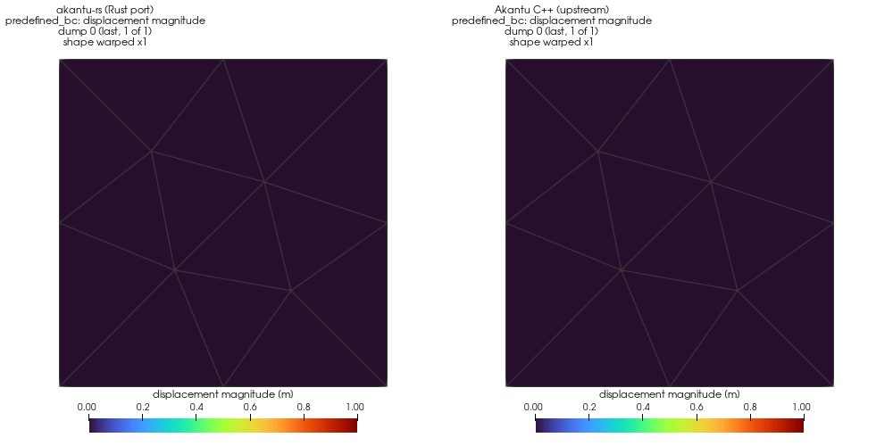

*Deformed shape, coloured by the displacement magnitude (how far each point has moved, in metres), last dump, dump 0 of 1; the shape is magnified 1× so that the movement can be seen. Left (Rust port) and right (upstream C++) are pixel-identical.*

## `user_defined_bc`

A plate loaded by a user-written boundary condition (a displacement functor) and by a traction computed from a stress.

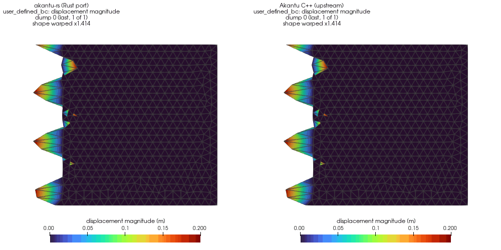

*Deformed shape, coloured by the displacement magnitude (how far each point has moved, in metres), last dump, dump 0 of 1; the shape is magnified 1.414× so that the movement can be seen. Left (Rust port) and right (upstream C++) are pixel-identical.*

## `python_user_defined_bc`

A plate whose Dirichlet condition is computed by a Python object called from the compiled program (embedded CPython; no solve).

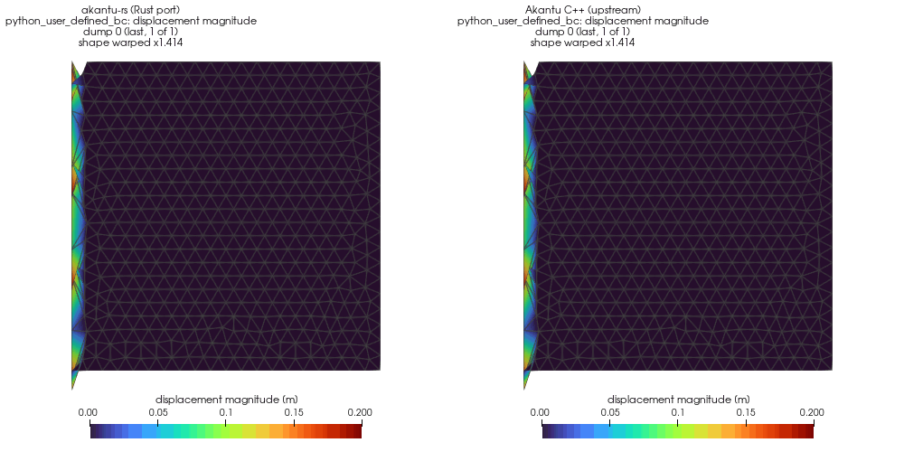

*Deformed shape, coloured by the displacement magnitude (how far each point has moved, in metres), last dump, dump 0 of 1; the shape is magnified 1.414× so that the movement can be seen. Left (Rust port) and right (upstream C++) are pixel-identical.*

## `static`

A square plate under a static load, solved with Newton-Raphson.

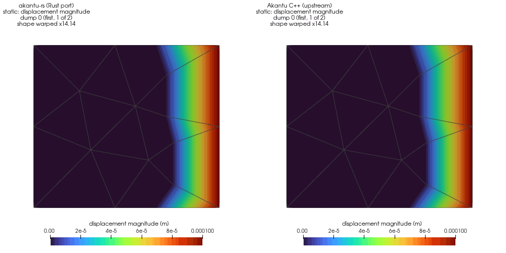

*Deformed shape, coloured by the displacement magnitude (how far each point has moved, in metres), first dump (the initial state), dump 0 of 2; the shape is magnified 14.14× so that the movement can be seen. Left (Rust port) and right (upstream C++) are pixel-identical.*

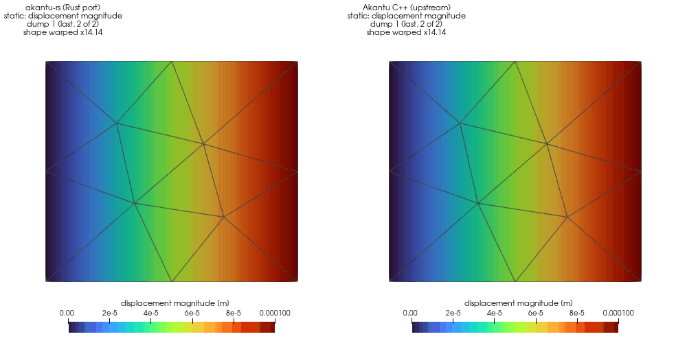

*Deformed shape, coloured by the displacement magnitude (how far each point has moved, in metres), last dump, dump 1 of 2; the shape is magnified 14.14× so that the movement can be seen. Left (Rust port) and right (upstream C++) are pixel-identical.*

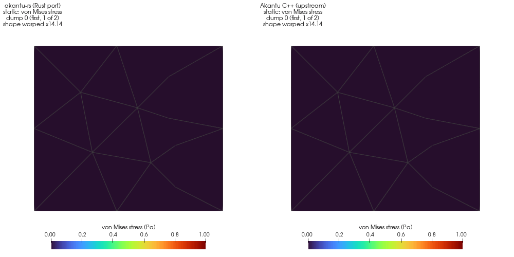

*Von Mises stress (one number that sums up the stress state, in pascals), first dump (the initial state), dump 0 of 2; the shape is magnified 14.14× so that the movement can be seen. Left (Rust port) and right (upstream C++) are pixel-identical.*

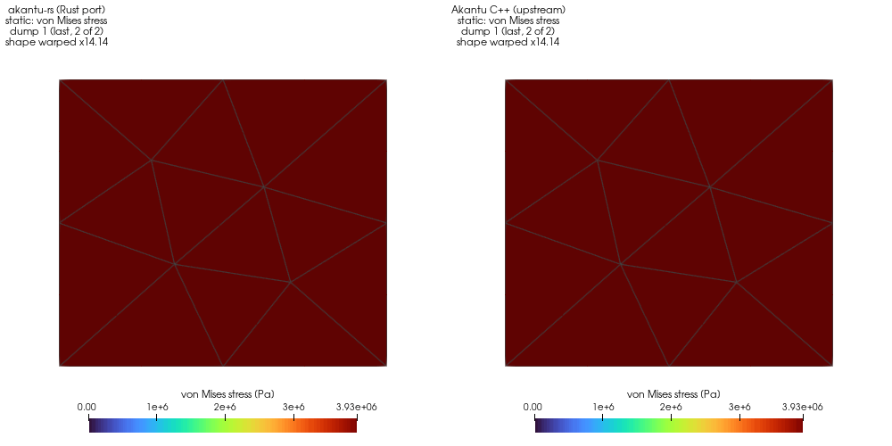

*Von Mises stress (one number that sums up the stress state, in pascals), last dump, dump 1 of 2; the shape is magnified 14.14× so that the movement can be seen. Left (Rust port) and right (upstream C++) are pixel-identical.*

## `explicit_dynamic`

A bar given an initial velocity and left free: explicit dynamics, energy conservation.

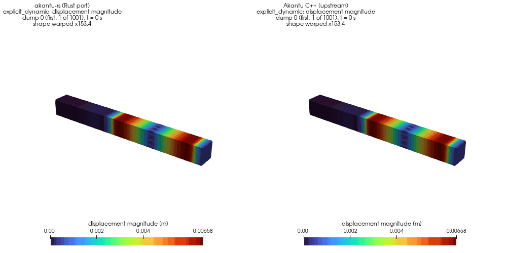

*Deformed shape, coloured by the displacement magnitude (how far each point has moved, in metres), first dump (the initial state), dump 0 of 1001; the shape is magnified 153.4× so that the movement can be seen. Left (Rust port) and right (upstream C++) are pixel-identical.*

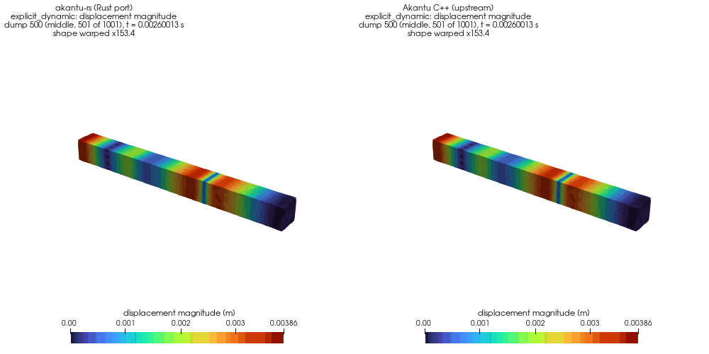

*Deformed shape, coloured by the displacement magnitude (how far each point has moved, in metres), a middle dump, dump 500 of 1001; the shape is magnified 153.4× so that the movement can be seen. Left (Rust port) and right (upstream C++) are pixel-identical.*

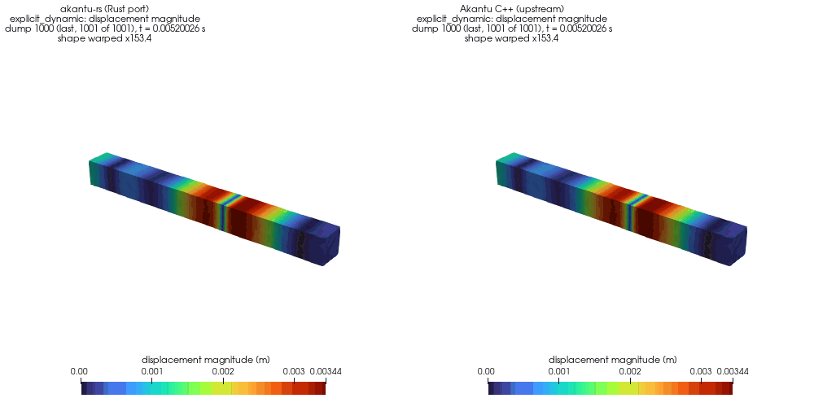

*Deformed shape, coloured by the displacement magnitude (how far each point has moved, in metres), last dump, dump 1000 of 1001; the shape is magnified 153.4× so that the movement can be seen. Left (Rust port) and right (upstream C++) are pixel-identical.*

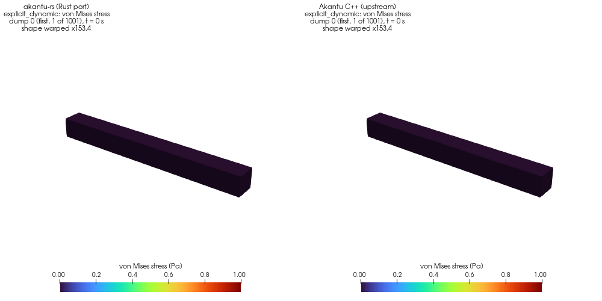

*Von Mises stress (one number that sums up the stress state, in pascals), first dump (the initial state), dump 0 of 1001; the shape is magnified 153.4× so that the movement can be seen. Left (Rust port) and right (upstream C++) are pixel-identical.*

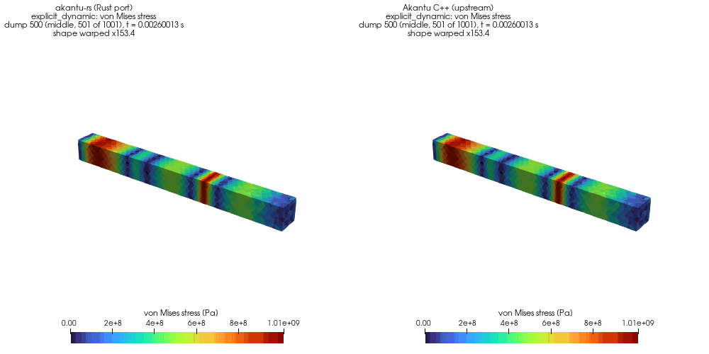

*Von Mises stress (one number that sums up the stress state, in pascals), a middle dump, dump 500 of 1001; the shape is magnified 153.4× so that the movement can be seen. Left (Rust port) and right (upstream C++) are pixel-identical.*

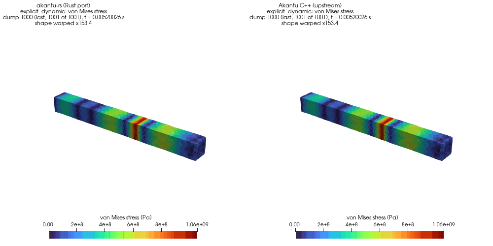

*Von Mises stress (one number that sums up the stress state, in pascals), last dump, dump 1000 of 1001; the shape is magnified 153.4× so that the movement can be seen. Left (Rust port) and right (upstream C++) are pixel-identical.*

## `implicit_dynamic`

A beam in implicit (Newmark) dynamics, compared with its modal solution.

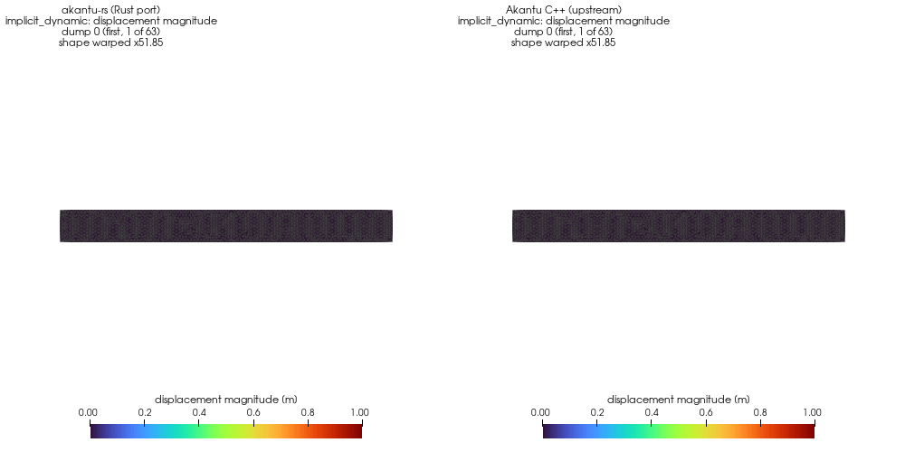

*Deformed shape, coloured by the displacement magnitude (how far each point has moved, in metres), first dump (the initial state), dump 0 of 63; the shape is magnified 51.85× so that the movement can be seen. Left (Rust port) and right (upstream C++) are pixel-identical.*

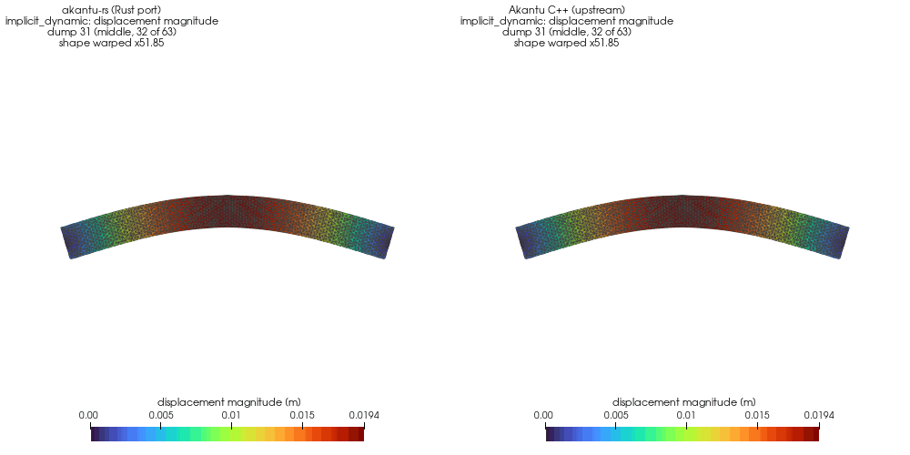

*Deformed shape, coloured by the displacement magnitude (how far each point has moved, in metres), a middle dump, dump 31 of 63; the shape is magnified 51.85× so that the movement can be seen. Left (Rust port) and right (upstream C++) are pixel-identical.*

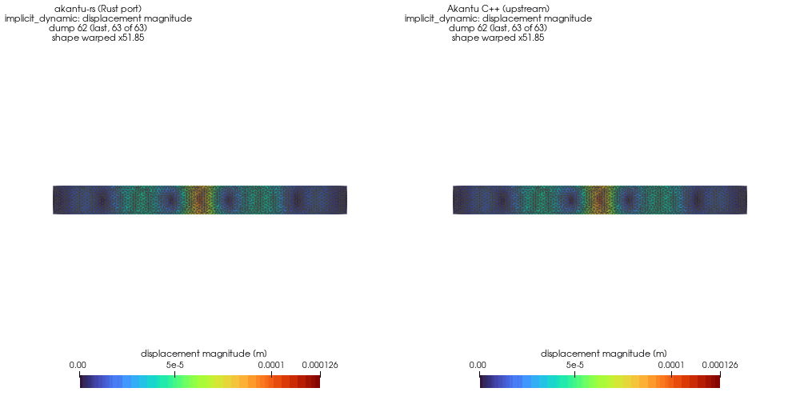

*Deformed shape, coloured by the displacement magnitude (how far each point has moved, in metres), last dump, dump 62 of 63; the shape is magnified 51.85× so that the movement can be seen. Left (Rust port) and right (upstream C++) are pixel-identical.*

## `example_parser`

A plate with holes (swiss cheese) whose material parameters come from the input file.

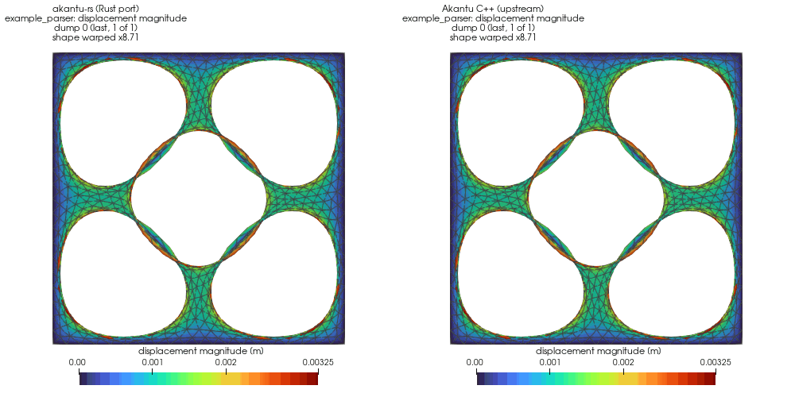

*Deformed shape, coloured by the displacement magnitude (how far each point has moved, in metres), last dump, dump 0 of 1; the shape is magnified 8.71× so that the movement can be seen. Left (Rust port) and right (upstream C++) are pixel-identical.*

## `new_local_material`

A bar with a hole and a user-written damage material (a new material law).

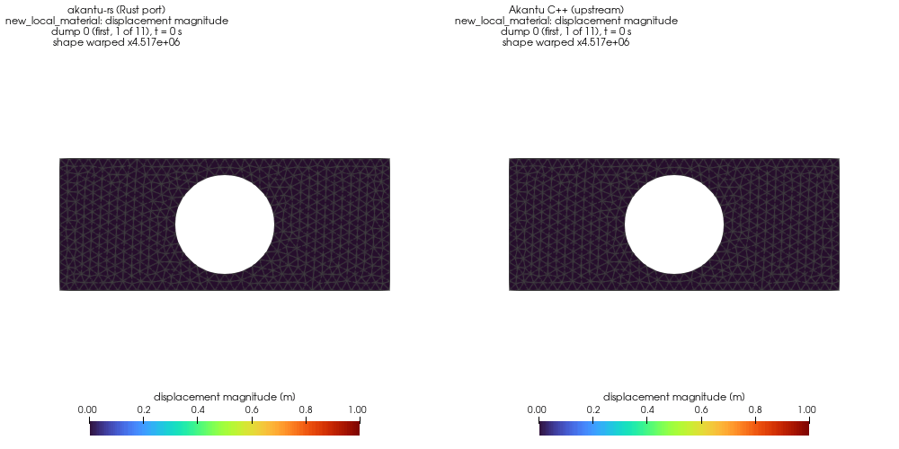

*Deformed shape, coloured by the displacement magnitude (how far each point has moved, in metres), first dump (the initial state), dump 0 of 11; the shape is magnified 4.517e+06× so that the movement can be seen. Left (Rust port) and right (upstream C++) are pixel-identical.*

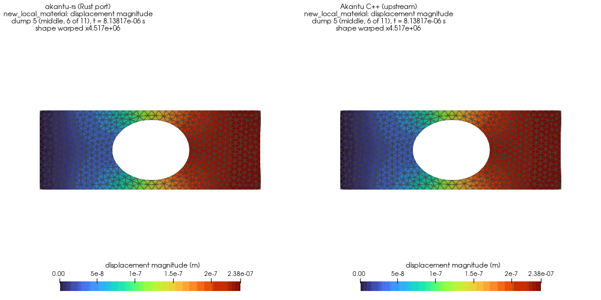

*Deformed shape, coloured by the displacement magnitude (how far each point has moved, in metres), a middle dump, dump 5 of 11; the shape is magnified 4.517e+06× so that the movement can be seen. Left (Rust port) and right (upstream C++) are pixel-identical.*

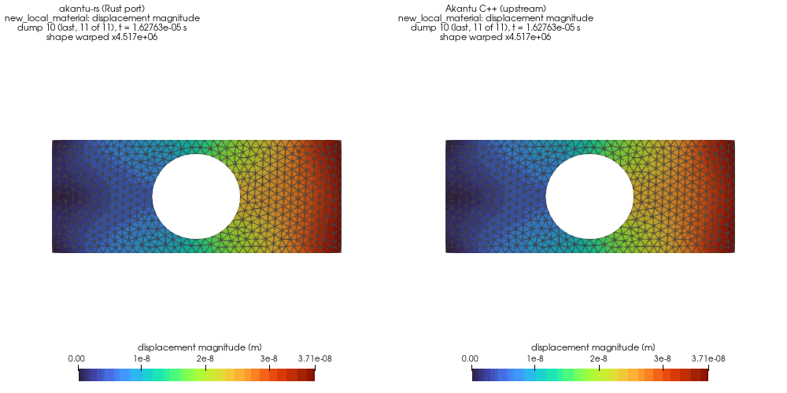

*Deformed shape, coloured by the displacement magnitude (how far each point has moved, in metres), last dump, dump 10 of 11; the shape is magnified 4.517e+06× so that the movement can be seen. Left (Rust port) and right (upstream C++) are pixel-identical.*

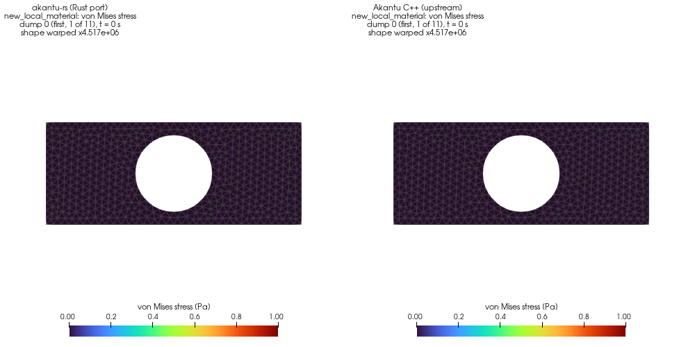

*Von Mises stress (one number that sums up the stress state, in pascals), first dump (the initial state), dump 0 of 11; the shape is magnified 4.517e+06× so that the movement can be seen. Left (Rust port) and right (upstream C++) are pixel-identical.*

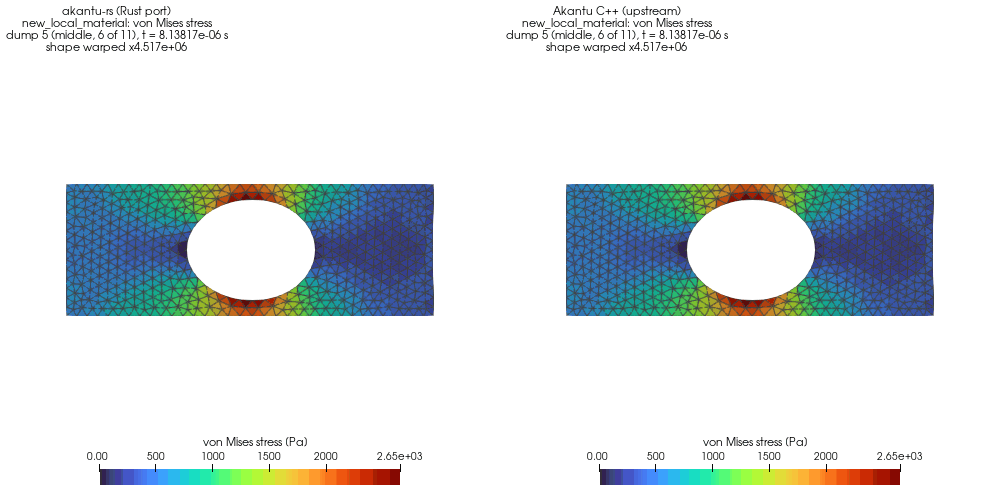

*Von Mises stress (one number that sums up the stress state, in pascals), a middle dump, dump 5 of 11; the shape is magnified 4.517e+06× so that the movement can be seen. Left (Rust port) and right (upstream C++) are pixel-identical.*

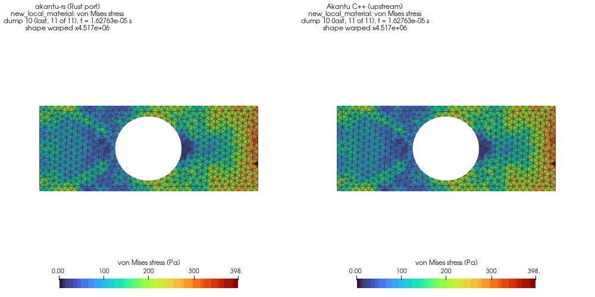

*Von Mises stress (one number that sums up the stress state, in pascals), last dump, dump 10 of 11; the shape is magnified 4.517e+06× so that the movement can be seen. Left (Rust port) and right (upstream C++) are pixel-identical.*

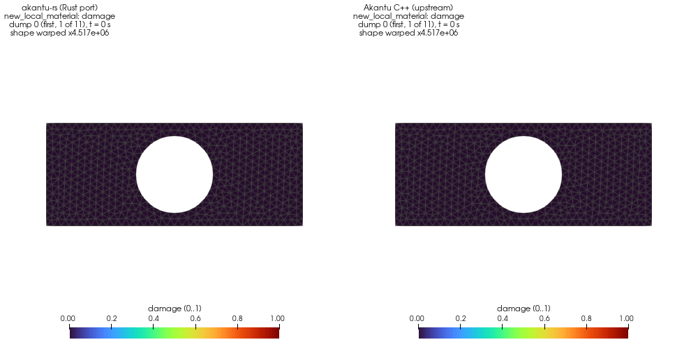

*Damage (0 = intact, 1 = fully broken), first dump (the initial state), dump 0 of 11; the shape is magnified 4.517e+06× so that the movement can be seen. Left (Rust port) and right (upstream C++) are pixel-identical.*

*Damage (0 = intact, 1 = fully broken), a middle dump, dump 5 of 11; the shape is magnified 4.517e+06× so that the movement can be seen. Left (Rust port) and right (upstream C++) are pixel-identical.*

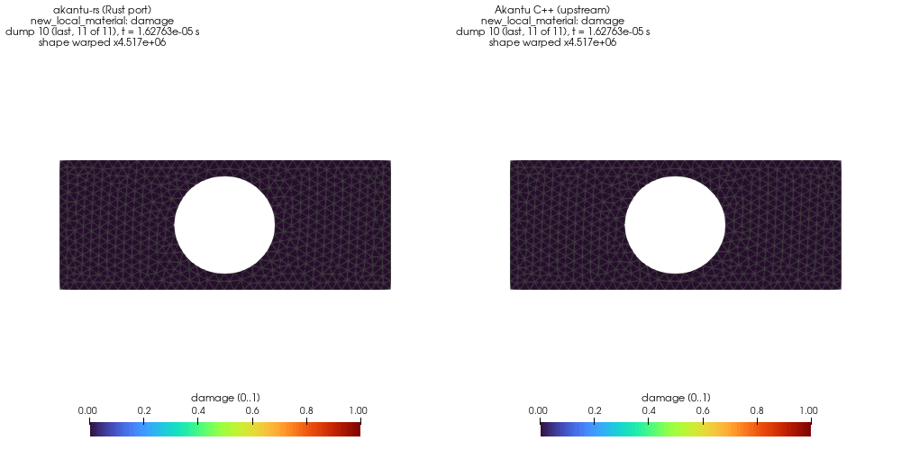

*Damage (0 = intact, 1 = fully broken), last dump, dump 10 of 11; the shape is magnified 4.517e+06× so that the movement can be seen. Left (Rust port) and right (upstream C++) are pixel-identical.*

## `dumper_low_level`

Low-level ParaView dumpers on a train mesh: filtered meshes, element groups.

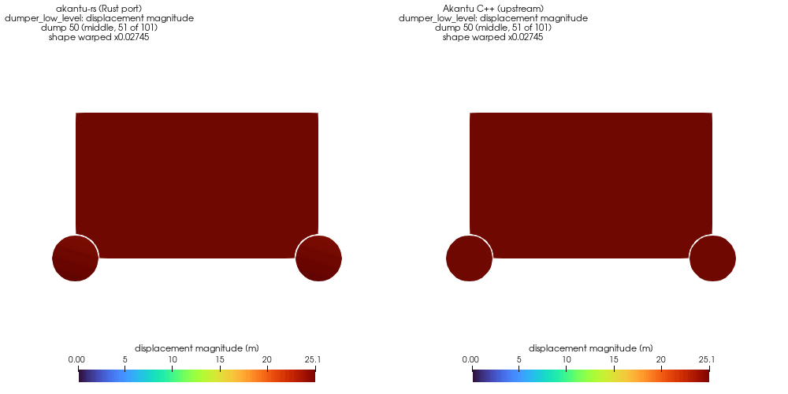

*Deformed shape, coloured by the displacement magnitude (how far each point has moved, in metres), a middle dump, dump 50 of 101; the shape is magnified 0.02745× so that the movement can be seen. Left (Rust port) and right (upstream C++) differ in 5,027 of 212,500 pixels (largest colour difference 122 of 255).*

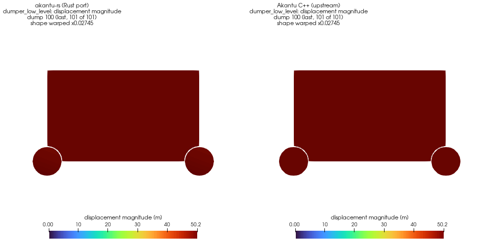

*Deformed shape, coloured by the displacement magnitude (how far each point has moved, in metres), last dump, dump 100 of 101; the shape is magnified 0.02745× so that the movement can be seen. Left (Rust port) and right (upstream C++) differ in 4,628 of 212,500 pixels (largest colour difference 122 of 255).*

## `dumper_low_level_compat`

The same run with the port's upstream-compatibility switch.

*Deformed shape, coloured by the displacement magnitude (how far each point has moved, in metres), a middle dump, dump 50 of 101; the shape is magnified 0.02784× so that the movement can be seen. Left (Rust port) and right (upstream C++) are pixel-identical.*

*Deformed shape, coloured by the displacement magnitude (how far each point has moved, in metres), last dump, dump 100 of 101; the shape is magnified 0.02784× so that the movement can be seen. Left (Rust port) and right (upstream C++) are pixel-identical.*

## `dumpable_interface`

The same train mesh dumped through the Dumpable interface.

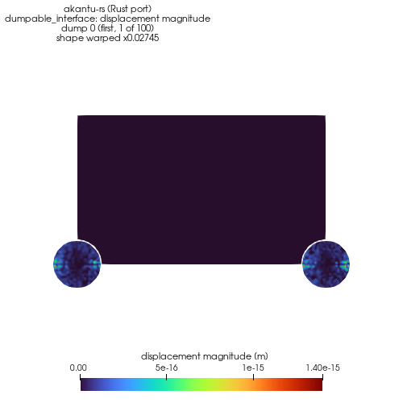

*Deformed shape, coloured by the displacement magnitude (how far each point has moved, in metres), first dump (the initial state), dump 0 of 100; the shape is magnified 0.02745× so that the movement can be seen. ParaView could not read this array from the upstream file; the other side is shown alone.*

*Deformed shape, coloured by the displacement magnitude (how far each point has moved, in metres), a middle dump, dump 50 of 100; the shape is magnified 0.02745× so that the movement can be seen. ParaView could not read this array from the upstream file; the other side is shown alone.*

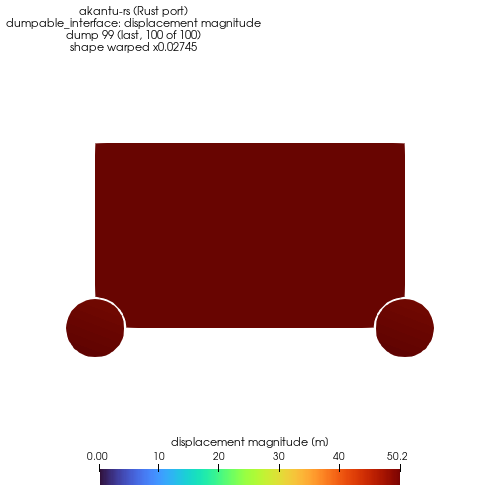

*Deformed shape, coloured by the displacement magnitude (how far each point has moved, in metres), last dump, dump 99 of 100; the shape is magnified 0.02745× so that the movement can be seen. ParaView could not read this array from the upstream file; the other side is shown alone.*

## `dumpable_interface_compat`

The same run with the port's upstream-compatibility switch.

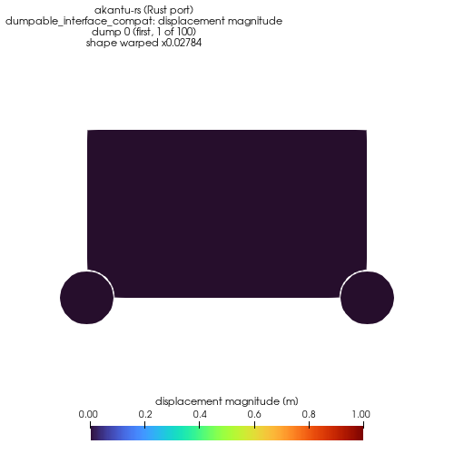

*Deformed shape, coloured by the displacement magnitude (how far each point has moved, in metres), first dump (the initial state), dump 0 of 100; the shape is magnified 0.02784× so that the movement can be seen. ParaView could not read this array from the upstream file; the other side is shown alone.*

*Deformed shape, coloured by the displacement magnitude (how far each point has moved, in metres), a middle dump, dump 50 of 100; the shape is magnified 0.02784× so that the movement can be seen. ParaView could not read this array from the upstream file; the other side is shown alone.*

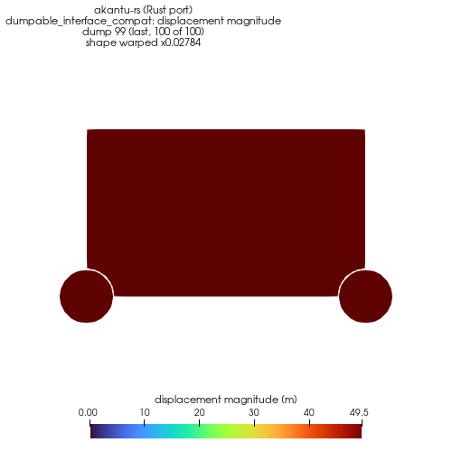

*Deformed shape, coloured by the displacement magnitude (how far each point has moved, in metres), last dump, dump 99 of 100; the shape is magnified 0.02784× so that the movement can be seen. ParaView could not read this array from the upstream file; the other side is shown alone.*

## `parallel_2d`

Explicit dynamics of a square split over two processes (the partition of the upstream run is replayed).

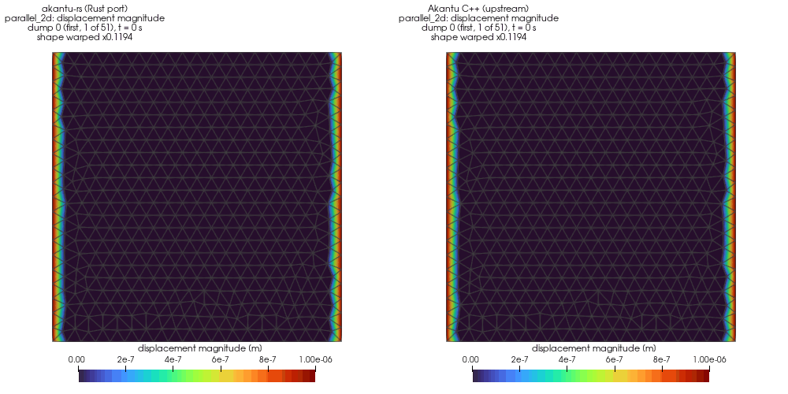

*Deformed shape, coloured by the displacement magnitude (how far each point has moved, in metres), first dump (the initial state), dump 0 of 51; the shape is magnified 0.1194× so that the movement can be seen. Left (Rust port) and right (upstream C++) are pixel-identical. 47 points that no cell uses (pure ghost points of the distributed run) are left out of the picture.*

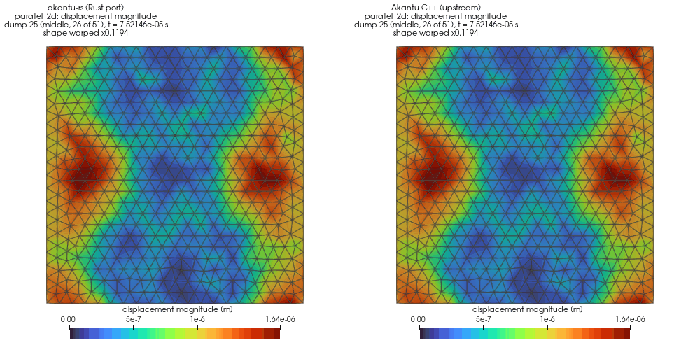

*Deformed shape, coloured by the displacement magnitude (how far each point has moved, in metres), a middle dump, dump 25 of 51; the shape is magnified 0.1194× so that the movement can be seen. Left (Rust port) and right (upstream C++) are pixel-identical. 47 points that no cell uses (pure ghost points of the distributed run) are left out of the picture.*

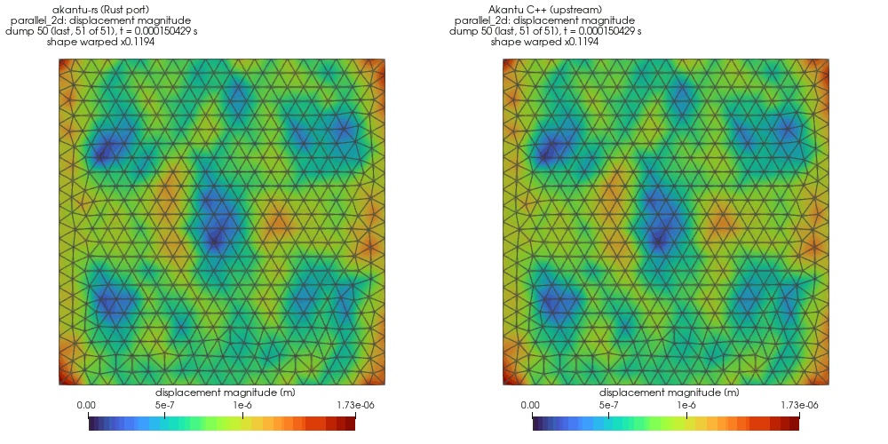

*Deformed shape, coloured by the displacement magnitude (how far each point has moved, in metres), last dump, dump 50 of 51; the shape is magnified 0.1194× so that the movement can be seen. Left (Rust port) and right (upstream C++) are pixel-identical. 47 points that no cell uses (pure ghost points of the distributed run) are left out of the picture.*

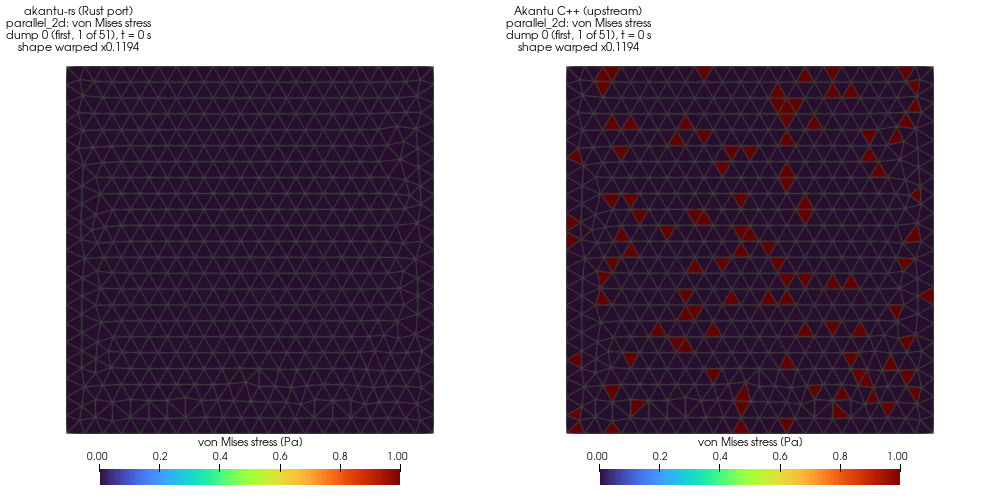

*Von Mises stress (one number that sums up the stress state, in pascals), first dump (the initial state), dump 0 of 51; the shape is magnified 0.1194× so that the movement can be seen. Left (Rust port) and right (upstream C++) differ in 17,608 of 212,500 pixels (largest colour difference 57 of 255). The colour scale is the port's range; upstream's values reach 1.258e+103 (smallest 0), outside it, and are drawn in the end colours. 47 points that no cell uses (pure ghost points of the distributed run) are left out of the picture.*

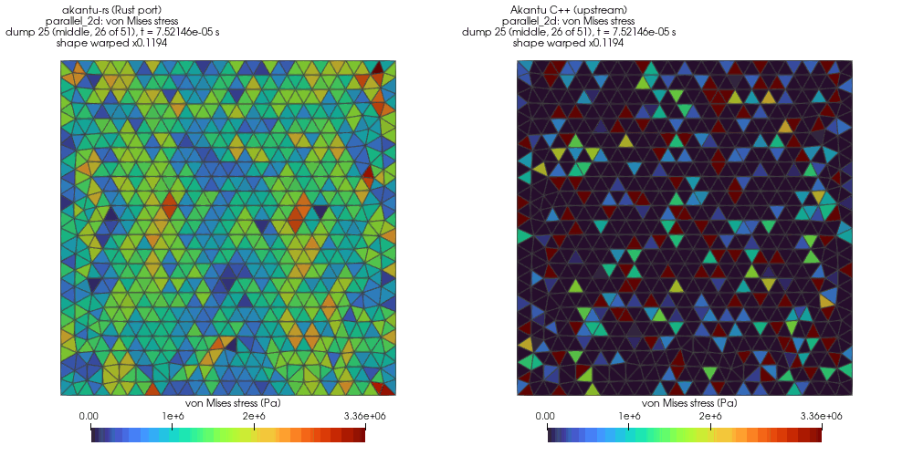

*Von Mises stress (one number that sums up the stress state, in pascals), a middle dump, dump 25 of 51; the shape is magnified 0.1194× so that the movement can be seen. Left (Rust port) and right (upstream C++) differ in 131,850 of 212,500 pixels (largest colour difference 194 of 255). The colour scale is the port's range; upstream's values reach 1.258e+103 (smallest 0), outside it, and are drawn in the end colours. 47 points that no cell uses (pure ghost points of the distributed run) are left out of the picture.*

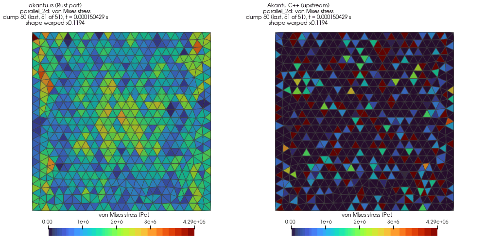

*Von Mises stress (one number that sums up the stress state, in pascals), last dump, dump 50 of 51; the shape is magnified 0.1194× so that the movement can be seen. Left (Rust port) and right (upstream C++) differ in 132,021 of 212,500 pixels (largest colour difference 194 of 255). The colour scale is the port's range; upstream's values reach 1.258e+103 (smallest 0), outside it, and are drawn in the end colours. 47 points that no cell uses (pure ghost points of the distributed run) are left out of the picture.*

## `parallel_2d_compat`

The same two-process run with the upstream-compatibility switch (writes the padded stress in upstream's layout, UD-110).

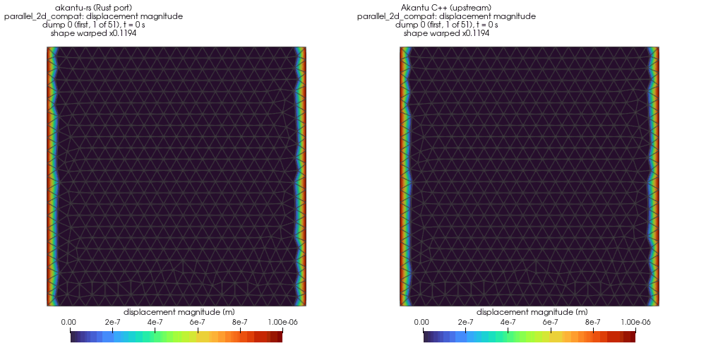

*Deformed shape, coloured by the displacement magnitude (how far each point has moved, in metres), first dump (the initial state), dump 0 of 51; the shape is magnified 0.1194× so that the movement can be seen. Left (Rust port) and right (upstream C++) are pixel-identical. 47 points that no cell uses (pure ghost points of the distributed run) are left out of the picture.*

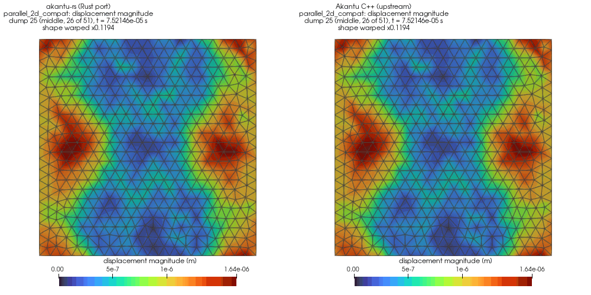

*Deformed shape, coloured by the displacement magnitude (how far each point has moved, in metres), a middle dump, dump 25 of 51; the shape is magnified 0.1194× so that the movement can be seen. Left (Rust port) and right (upstream C++) are pixel-identical. 47 points that no cell uses (pure ghost points of the distributed run) are left out of the picture.*

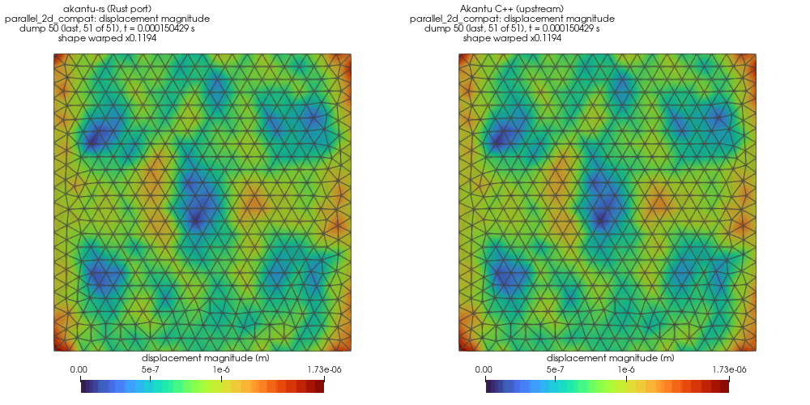

*Deformed shape, coloured by the displacement magnitude (how far each point has moved, in metres), last dump, dump 50 of 51; the shape is magnified 0.1194× so that the movement can be seen. Left (Rust port) and right (upstream C++) are pixel-identical. 47 points that no cell uses (pure ghost points of the distributed run) are left out of the picture.*

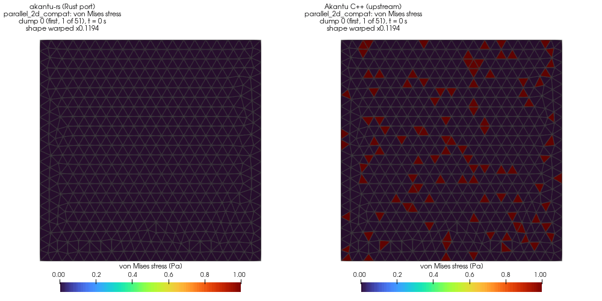

*Von Mises stress (one number that sums up the stress state, in pascals), first dump (the initial state), dump 0 of 51; the shape is magnified 0.1194× so that the movement can be seen. Left (Rust port) and right (upstream C++) differ in 17,608 of 212,500 pixels (largest colour difference 57 of 255). The colour scale is the port's range; upstream's values reach 1.258e+103 (smallest 0), outside it, and are drawn in the end colours. 47 points that no cell uses (pure ghost points of the distributed run) are left out of the picture.*

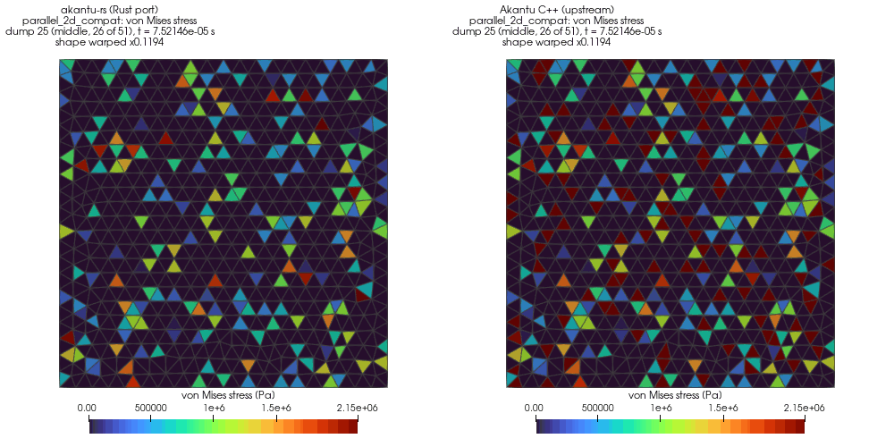

*Von Mises stress (one number that sums up the stress state, in pascals), a middle dump, dump 25 of 51; the shape is magnified 0.1194× so that the movement can be seen. Left (Rust port) and right (upstream C++) differ in 17,239 of 212,500 pixels (largest colour difference 57 of 255). The colour scale is the port's range; upstream's values reach 1.258e+103 (smallest 0), outside it, and are drawn in the end colours. 47 points that no cell uses (pure ghost points of the distributed run) are left out of the picture.*

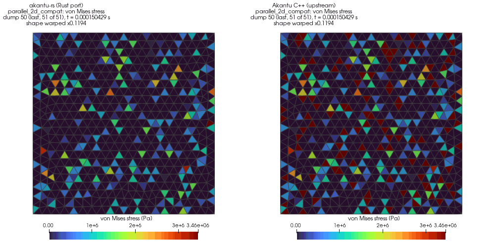

*Von Mises stress (one number that sums up the stress state, in pascals), last dump, dump 50 of 51; the shape is magnified 0.1194× so that the movement can be seen. Left (Rust port) and right (upstream C++) differ in 17,229 of 212,500 pixels (largest colour difference 57 of 255). The colour scale is the port's range; upstream's values reach 1.258e+103 (smallest 0), outside it, and are drawn in the end colours. 47 points that no cell uses (pure ghost points of the distributed run) are left out of the picture.*

## `cohesive_extrinsic`

A triangle-meshed plate that cracks: extrinsic cohesive elements are inserted where the stress exceeds the strength.

*Deformed shape, coloured by the displacement magnitude (how far each point has moved, in metres), first dump (the initial state), dump 0 of 101; the shape is magnified 0.05399× so that the movement can be seen. Left (Rust port) and right (upstream C++) are pixel-identical.*

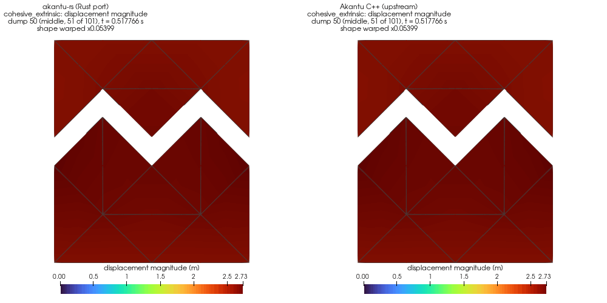

*Deformed shape, coloured by the displacement magnitude (how far each point has moved, in metres), a middle dump, dump 50 of 101; the shape is magnified 0.05399× so that the movement can be seen. Left (Rust port) and right (upstream C++) are pixel-identical.*

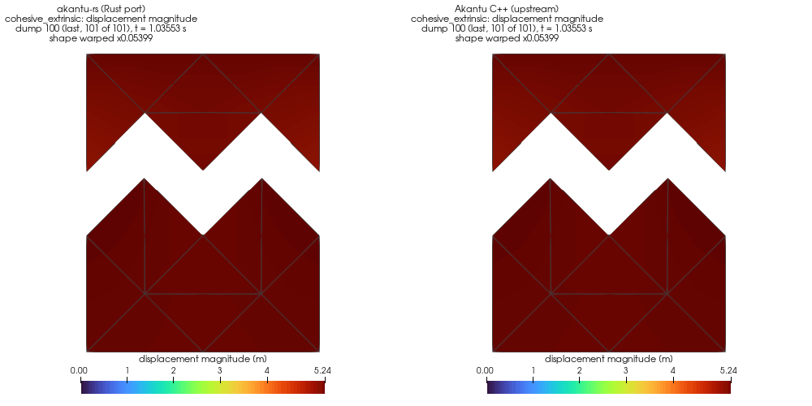

*Deformed shape, coloured by the displacement magnitude (how far each point has moved, in metres), last dump, dump 100 of 101; the shape is magnified 0.05399× so that the movement can be seen. Left (Rust port) and right (upstream C++) are pixel-identical.*

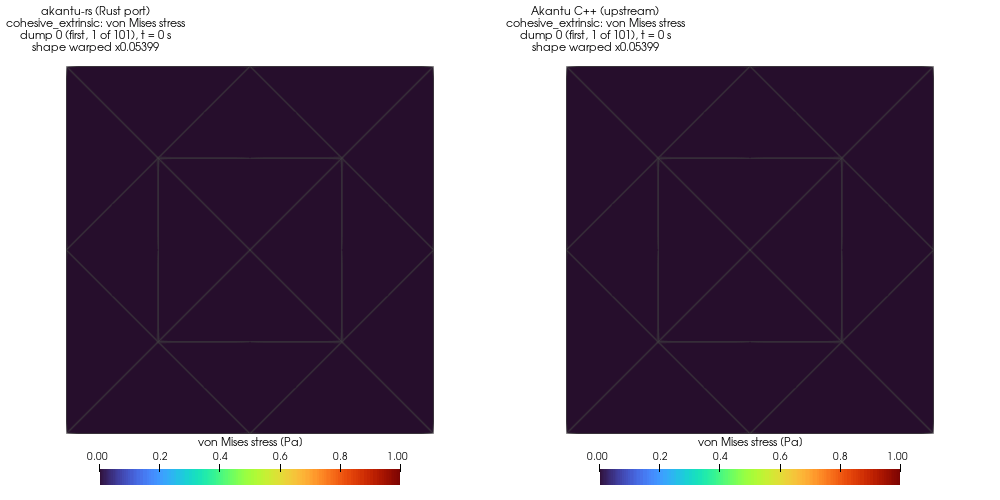

*Von Mises stress (one number that sums up the stress state, in pascals), first dump (the initial state), dump 0 of 101; the shape is magnified 0.05399× so that the movement can be seen. Left (Rust port) and right (upstream C++) are pixel-identical.*

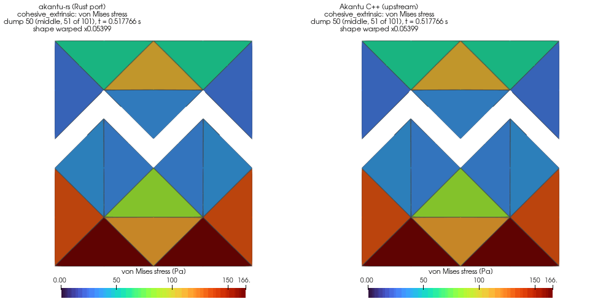

*Von Mises stress (one number that sums up the stress state, in pascals), a middle dump, dump 50 of 101; the shape is magnified 0.05399× so that the movement can be seen. Left (Rust port) and right (upstream C++) are pixel-identical.*

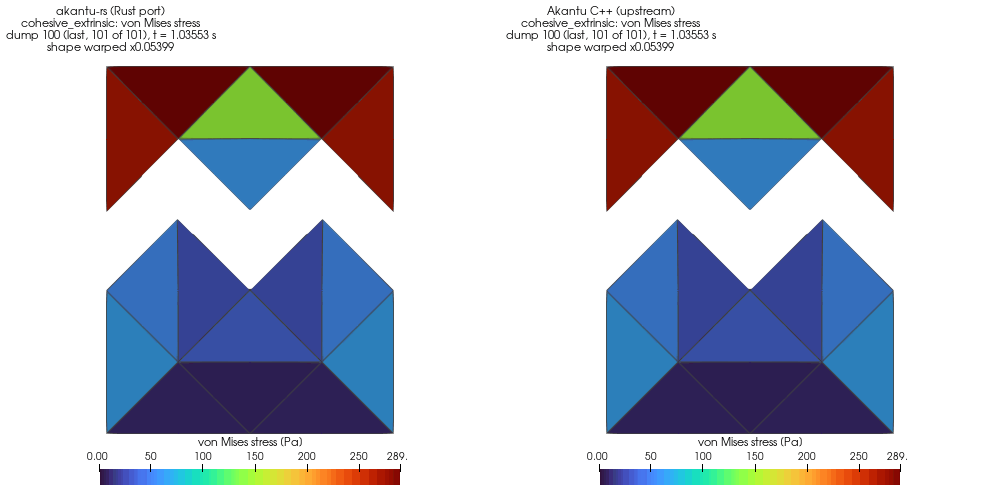

*Von Mises stress (one number that sums up the stress state, in pascals), last dump, dump 100 of 101; the shape is magnified 0.05399× so that the movement can be seen. Left (Rust port) and right (upstream C++) are pixel-identical.*

## `cohesive_intrinsic`

The same kind of plate with intrinsic cohesive elements already present at every interface.

*Deformed shape, coloured by the displacement magnitude (how far each point has moved, in metres), first dump (the initial state), dump 0 of 351; the shape is magnified 0.08058× so that the movement can be seen. Left (Rust port) and right (upstream C++) are pixel-identical.*

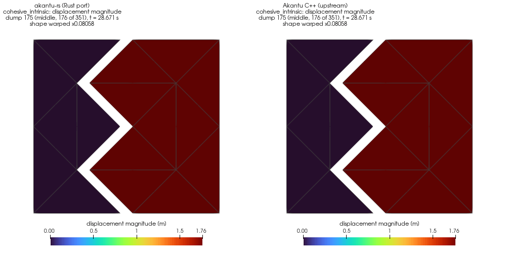

*Deformed shape, coloured by the displacement magnitude (how far each point has moved, in metres), a middle dump, dump 175 of 351; the shape is magnified 0.08058× so that the movement can be seen. Left (Rust port) and right (upstream C++) are pixel-identical.*

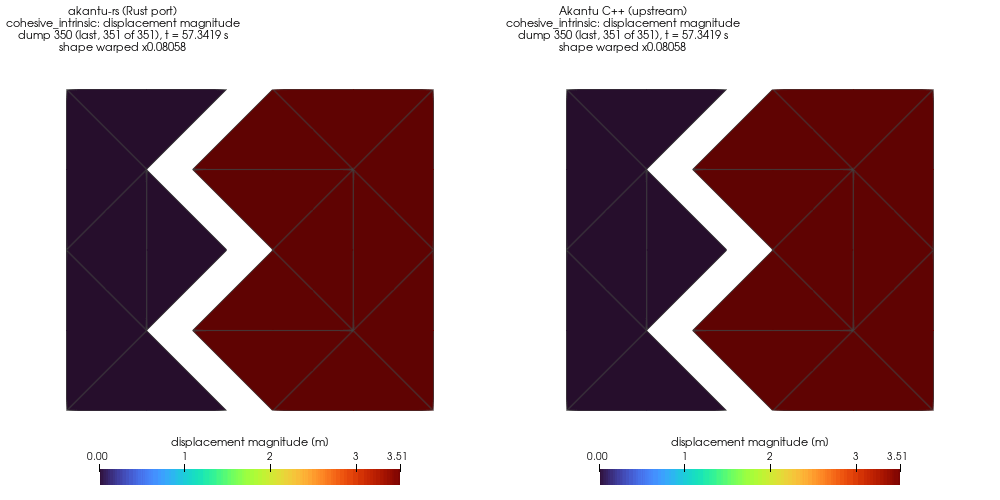

*Deformed shape, coloured by the displacement magnitude (how far each point has moved, in metres), last dump, dump 350 of 351; the shape is magnified 0.08058× so that the movement can be seen. Left (Rust port) and right (upstream C++) are pixel-identical.*

## `cohesive_extrinsic_ig_tg`

A square of grains with different cohesive laws on the grain boundaries (intergranular) and inside the grains (transgranular).

*Deformed shape, coloured by the displacement magnitude (how far each point has moved, in metres), first dump (the initial state), dump 0 of 102; the shape is magnified 0.1366× so that the movement can be seen. Left (Rust port) and right (upstream C++) are pixel-identical.*

*Deformed shape, coloured by the displacement magnitude (how far each point has moved, in metres), a middle dump, dump 51 of 102; the shape is magnified 0.1366× so that the movement can be seen. Left (Rust port) and right (upstream C++) are pixel-identical.*

*Deformed shape, coloured by the displacement magnitude (how far each point has moved, in metres), last dump, dump 101 of 102; the shape is magnified 0.1366× so that the movement can be seen. Left (Rust port) and right (upstream C++) are pixel-identical.*

*Von Mises stress (one number that sums up the stress state, in pascals), first dump (the initial state), dump 0 of 102; the shape is magnified 0.1366× so that the movement can be seen. Left (Rust port) and right (upstream C++) are pixel-identical.*

*Von Mises stress (one number that sums up the stress state, in pascals), a middle dump, dump 51 of 102; the shape is magnified 0.1366× so that the movement can be seen. Left (Rust port) and right (upstream C++) are pixel-identical.*

*Von Mises stress (one number that sums up the stress state, in pascals), last dump, dump 101 of 102; the shape is magnified 0.1366× so that the movement can be seen. Left (Rust port) and right (upstream C++) are pixel-identical.*

## `scalability_test`

A small cube under compression and shear, elastic material (the scalability benchmark, tiny mesh; dumps switched on).

*Deformed shape, coloured by the displacement magnitude (how far each point has moved, in metres), first dump (the initial state), dump 0 of 52; the shape is magnified 44.76× so that the movement can be seen. Left (Rust port) and right (upstream C++) are pixel-identical.*

*Deformed shape, coloured by the displacement magnitude (how far each point has moved, in metres), a middle dump, dump 26 of 52; the shape is magnified 44.76× so that the movement can be seen. Left (Rust port) and right (upstream C++) are pixel-identical.*

*Deformed shape, coloured by the displacement magnitude (how far each point has moved, in metres), last dump, dump 51 of 52; the shape is magnified 44.76× so that the movement can be seen. Left (Rust port) and right (upstream C++) are pixel-identical.*

*Von Mises stress (one number that sums up the stress state, in pascals), first dump (the initial state), dump 0 of 52; the shape is magnified 44.76× so that the movement can be seen. Left (Rust port) and right (upstream C++) are pixel-identical.*

*Von Mises stress (one number that sums up the stress state, in pascals), a middle dump, dump 26 of 52; the shape is magnified 44.76× so that the movement can be seen. Left (Rust port) and right (upstream C++) are pixel-identical.*

*Von Mises stress (one number that sums up the stress state, in pascals), last dump, dump 51 of 52; the shape is magnified 44.76× so that the movement can be seen. Left (Rust port) and right (upstream C++) are pixel-identical.*

## `scalability_test_compat`

The same elastic run with the upstream-compatibility switch (upstream's invalid base64 of the empty cohesive pieces, UD-114).

*Deformed shape, coloured by the displacement magnitude (how far each point has moved, in metres), first dump (the initial state), dump 0 of 52; the shape is magnified 44.76× so that the movement can be seen. Left (Rust port) and right (upstream C++) are pixel-identical.*

*Deformed shape, coloured by the displacement magnitude (how far each point has moved, in metres), a middle dump, dump 26 of 52; the shape is magnified 44.76× so that the movement can be seen. Left (Rust port) and right (upstream C++) are pixel-identical.*

*Deformed shape, coloured by the displacement magnitude (how far each point has moved, in metres), last dump, dump 51 of 52; the shape is magnified 44.76× so that the movement can be seen. Left (Rust port) and right (upstream C++) are pixel-identical.*

*Von Mises stress (one number that sums up the stress state, in pascals), first dump (the initial state), dump 0 of 52; the shape is magnified 44.76× so that the movement can be seen. Left (Rust port) and right (upstream C++) are pixel-identical.*

*Von Mises stress (one number that sums up the stress state, in pascals), a middle dump, dump 26 of 52; the shape is magnified 44.76× so that the movement can be seen. Left (Rust port) and right (upstream C++) are pixel-identical.*

*Von Mises stress (one number that sums up the stress state, in pascals), last dump, dump 51 of 52; the shape is magnified 44.76× so that the movement can be seen. Left (Rust port) and right (upstream C++) are pixel-identical.*

## `scalability_test_cohesive`

The same cube with cohesive elements inserted on the fly (explicit; dumps switched on).

*Deformed shape, coloured by the displacement magnitude (how far each point has moved, in metres), first dump (the initial state), dump 0 of 52; the shape is magnified 0.3739× so that the movement can be seen. Left (Rust port) and right (upstream C++) are pixel-identical.*

*Deformed shape, coloured by the displacement magnitude (how far each point has moved, in metres), a middle dump, dump 26 of 52; the shape is magnified 0.3739× so that the movement can be seen. Left (Rust port) and right (upstream C++) differ in 9,445 of 212,500 pixels (largest colour difference 213 of 255).*

*Deformed shape, coloured by the displacement magnitude (how far each point has moved, in metres), last dump, dump 51 of 52; the shape is magnified 0.3739× so that the movement can be seen. Left (Rust port) and right (upstream C++) differ in 44,802 of 212,500 pixels (largest colour difference 253 of 255).*

*Von Mises stress (one number that sums up the stress state, in pascals), first dump (the initial state), dump 0 of 52; the shape is magnified 0.3739× so that the movement can be seen. Left (Rust port) and right (upstream C++) are pixel-identical.*

*Von Mises stress (one number that sums up the stress state, in pascals), a middle dump, dump 26 of 52; the shape is magnified 0.3739× so that the movement can be seen. Left (Rust port) and right (upstream C++) differ in 58,225 of 212,500 pixels (largest colour difference 198 of 255). The colour scale is the port's range; upstream's values reach 2.161e+08 (smallest 1.040e+08), outside it, and are drawn in the end colours.*

*Von Mises stress (one number that sums up the stress state, in pascals), last dump, dump 51 of 52; the shape is magnified 0.3739× so that the movement can be seen. Left (Rust port) and right (upstream C++) differ in 63,150 of 212,500 pixels (largest colour difference 235 of 255). The colour scale is the port's range; upstream's values reach 2.651e+09 (smallest 4.789e+07), outside it, and are drawn in the end colours.*

## `scalability_test_cohesive_compat`

The same cohesive run with the upstream-compatibility switch (upstream's 3-D facet tangents, UD-217).

*Deformed shape, coloured by the displacement magnitude (how far each point has moved, in metres), first dump (the initial state), dump 0 of 52; the shape is magnified 0.3773× so that the movement can be seen. Left (Rust port) and right (upstream C++) are pixel-identical.*

*Deformed shape, coloured by the displacement magnitude (how far each point has moved, in metres), a middle dump, dump 26 of 52; the shape is magnified 0.3773× so that the movement can be seen. Left (Rust port) and right (upstream C++) are pixel-identical.*

*Deformed shape, coloured by the displacement magnitude (how far each point has moved, in metres), last dump, dump 51 of 52; the shape is magnified 0.3773× so that the movement can be seen. Left (Rust port) and right (upstream C++) are pixel-identical.*

*Von Mises stress (one number that sums up the stress state, in pascals), first dump (the initial state), dump 0 of 52; the shape is magnified 0.3773× so that the movement can be seen. Left (Rust port) and right (upstream C++) are pixel-identical.*

*Von Mises stress (one number that sums up the stress state, in pascals), a middle dump, dump 26 of 52; the shape is magnified 0.3773× so that the movement can be seen. Left (Rust port) and right (upstream C++) are pixel-identical.*

*Von Mises stress (one number that sums up the stress state, in pascals), last dump, dump 51 of 52; the shape is magnified 0.3773× so that the movement can be seen. Left (Rust port) and right (upstream C++) are pixel-identical.*

## `heat_diffusion_dynamics_2d`

Heat spreading in a square plate from a hot point (explicit time stepping).

*Temperature (kelvin), first dump (the initial state), dump 0 of 150. Left (Rust port) and right (upstream C++) are pixel-identical.*

*Temperature (kelvin), a middle dump, dump 75 of 150. Left (Rust port) and right (upstream C++) are pixel-identical.*

*Temperature (kelvin), last dump, dump 149 of 150. Left (Rust port) and right (upstream C++) are pixel-identical.*

## `heat_diffusion_dynamics_3d`

Heat spreading in a cube from a hot sphere (explicit time stepping).

*Temperature (kelvin), first dump (the initial state), dump 0 of 10. Left (Rust port) and right (upstream C++) are pixel-identical. The body is cut in half through its middle so that the inside is visible.*

*Temperature (kelvin), a middle dump, dump 5 of 10. Left (Rust port) and right (upstream C++) are pixel-identical. The body is cut in half through its middle so that the inside is visible.*

*Temperature (kelvin), last dump, dump 9 of 10. Left (Rust port) and right (upstream C++) are pixel-identical. The body is cut in half through its middle so that the inside is visible.*

## `heat_diffusion_static_2d`

Steady-state temperature of a square plate with a hot point.

*Temperature (kelvin), first dump (the initial state), dump 0 of 2. Left (Rust port) and right (upstream C++) are pixel-identical.*

*Temperature (kelvin), last dump, dump 1 of 2. Left (Rust port) and right (upstream C++) are pixel-identical.*

## `bernoulli_beam_2_example`

A small frame of Bernoulli beams under loads (structural mechanics, static).

*Deformed shape, coloured by the displacement magnitude (how far each point has moved, in metres), last dump, dump 0 of 1; the shape is magnified 1.8× so that the movement can be seen. Left (Rust port) and right (upstream C++) are pixel-identical.*

## `material_viscoelastic_maxwell_energies`

A viscoelastic (Maxwell) block under a time-dependent load, with its energies.

*Deformed shape, coloured by the displacement magnitude (how far each point has moved, in metres), first dump (the initial state), dump 0 of 1002; the shape is magnified 1× so that the movement can be seen. Left (Rust port) and right (upstream C++) are pixel-identical.*

*Deformed shape, coloured by the displacement magnitude (how far each point has moved, in metres), a middle dump, dump 501 of 1002; the shape is magnified 1× so that the movement can be seen. Left (Rust port) and right (upstream C++) are pixel-identical.*

*Deformed shape, coloured by the displacement magnitude (how far each point has moved, in metres), last dump, dump 1001 of 1002; the shape is magnified 1× so that the movement can be seen. Left (Rust port) and right (upstream C++) are pixel-identical.*

*Von Mises stress (one number that sums up the stress state, in pascals), first dump (the initial state), dump 0 of 1002; the shape is magnified 1× so that the movement can be seen. Left (Rust port) and right (upstream C++) are pixel-identical.*

*Von Mises stress (one number that sums up the stress state, in pascals), a middle dump, dump 501 of 1002; the shape is magnified 1× so that the movement can be seen. Left (Rust port) and right (upstream C++) are pixel-identical. The colour scale is the port's range; upstream's values reach 1.500e+06 (smallest 1.500e+06), outside it, and are drawn in the end colours.*

*Von Mises stress (one number that sums up the stress state, in pascals), last dump, dump 1001 of 1002; the shape is magnified 1× so that the movement can be seen. Left (Rust port) and right (upstream C++) are pixel-identical.*

## `material_viscoelastic_maxwell_energies_compat`

The same viscoelastic run with the upstream-compatibility switch.

*Deformed shape, coloured by the displacement magnitude (how far each point has moved, in metres), first dump (the initial state), dump 0 of 1002; the shape is magnified 1× so that the movement can be seen. Left (Rust port) and right (upstream C++) are pixel-identical.*

*Deformed shape, coloured by the displacement magnitude (how far each point has moved, in metres), a middle dump, dump 501 of 1002; the shape is magnified 1× so that the movement can be seen. Left (Rust port) and right (upstream C++) are pixel-identical.*

*Deformed shape, coloured by the displacement magnitude (how far each point has moved, in metres), last dump, dump 1001 of 1002; the shape is magnified 1× so that the movement can be seen. Left (Rust port) and right (upstream C++) are pixel-identical.*

*Von Mises stress (one number that sums up the stress state, in pascals), first dump (the initial state), dump 0 of 1002; the shape is magnified 1× so that the movement can be seen. Left (Rust port) and right (upstream C++) are pixel-identical.*

*Von Mises stress (one number that sums up the stress state, in pascals), a middle dump, dump 501 of 1002; the shape is magnified 1× so that the movement can be seen. Left (Rust port) and right (upstream C++) are pixel-identical.*

*Von Mises stress (one number that sums up the stress state, in pascals), last dump, dump 1001 of 1002; the shape is magnified 1× so that the movement can be seen. Left (Rust port) and right (upstream C++) are pixel-identical.*

## `phase_field_notch`

A notched square plate pulled at its top: the phase-field fracture grows from the notch.

*Deformed shape, coloured by the displacement magnitude (how far each point has moved, in metres), first dump (the initial state), dump 0 of 10; the shape is magnified 38.25× so that the movement can be seen. Left (Rust port) and right (upstream C++) are pixel-identical.*

*Deformed shape, coloured by the displacement magnitude (how far each point has moved, in metres), a middle dump, dump 5 of 10; the shape is magnified 38.25× so that the movement can be seen. Left (Rust port) and right (upstream C++) are pixel-identical.*

*Deformed shape, coloured by the displacement magnitude (how far each point has moved, in metres), last dump, dump 9 of 10; the shape is magnified 38.25× so that the movement can be seen. Left (Rust port) and right (upstream C++) are pixel-identical.*

*Von Mises stress (one number that sums up the stress state, in pascals), first dump (the initial state), dump 0 of 10; the shape is magnified 38.25× so that the movement can be seen. Left (Rust port) and right (upstream C++) are pixel-identical.*

*Von Mises stress (one number that sums up the stress state, in pascals), a middle dump, dump 5 of 10; the shape is magnified 38.25× so that the movement can be seen. Left (Rust port) and right (upstream C++) are pixel-identical.*

*Von Mises stress (one number that sums up the stress state, in pascals), last dump, dump 9 of 10; the shape is magnified 38.25× so that the movement can be seen. Left (Rust port) and right (upstream C++) are pixel-identical.*

*Damage (0 = intact, 1 = fully broken), first dump (the initial state), dump 0 of 10; the shape is magnified 38.25× so that the movement can be seen. Left (Rust port) and right (upstream C++) are pixel-identical.*

*Damage (0 = intact, 1 = fully broken), a middle dump, dump 5 of 10; the shape is magnified 38.25× so that the movement can be seen. Left (Rust port) and right (upstream C++) are pixel-identical.*

*Damage (0 = intact, 1 = fully broken), last dump, dump 9 of 10; the shape is magnified 38.25× so that the movement can be seen. Left (Rust port) and right (upstream C++) are pixel-identical.*

## `phase_field_parallel`

The same notched plate through the parallel example, run on one process.

*Deformed shape, coloured by the displacement magnitude (how far each point has moved, in metres), first dump (the initial state), dump 0 of 10; the shape is magnified 38.25× so that the movement can be seen. Left (Rust port) and right (upstream C++) are pixel-identical.*

*Deformed shape, coloured by the displacement magnitude (how far each point has moved, in metres), a middle dump, dump 5 of 10; the shape is magnified 38.25× so that the movement can be seen. Left (Rust port) and right (upstream C++) are pixel-identical.*

*Deformed shape, coloured by the displacement magnitude (how far each point has moved, in metres), last dump, dump 9 of 10; the shape is magnified 38.25× so that the movement can be seen. Left (Rust port) and right (upstream C++) are pixel-identical.*

*Von Mises stress (one number that sums up the stress state, in pascals), first dump (the initial state), dump 0 of 10; the shape is magnified 38.25× so that the movement can be seen. Left (Rust port) and right (upstream C++) are pixel-identical.*

*Von Mises stress (one number that sums up the stress state, in pascals), a middle dump, dump 5 of 10; the shape is magnified 38.25× so that the movement can be seen. Left (Rust port) and right (upstream C++) are pixel-identical.*

*Von Mises stress (one number that sums up the stress state, in pascals), last dump, dump 9 of 10; the shape is magnified 38.25× so that the movement can be seen. Left (Rust port) and right (upstream C++) are pixel-identical.*

*Damage (0 = intact, 1 = fully broken), first dump (the initial state), dump 0 of 10; the shape is magnified 38.25× so that the movement can be seen. Left (Rust port) and right (upstream C++) are pixel-identical.*

*Damage (0 = intact, 1 = fully broken), a middle dump, dump 5 of 10; the shape is magnified 38.25× so that the movement can be seen. Left (Rust port) and right (upstream C++) are pixel-identical.*

*Damage (0 = intact, 1 = fully broken), last dump, dump 9 of 10; the shape is magnified 38.25× so that the movement can be seen. Left (Rust port) and right (upstream C++) are pixel-identical.*

## `contact_explicit_dynamic`

A Hertz contact problem (an elastic disc pressed on a block) with explicit dynamics.

*Deformed shape, coloured by the displacement magnitude (how far each point has moved, in metres), first dump (the initial state), dump 0 of 20; the shape is magnified 5.595× so that the movement can be seen. Left (Rust port) and right (upstream C++) are pixel-identical.*

*Deformed shape, coloured by the displacement magnitude (how far each point has moved, in metres), a middle dump, dump 10 of 20; the shape is magnified 5.595× so that the movement can be seen. Left (Rust port) and right (upstream C++) are pixel-identical.*

*Deformed shape, coloured by the displacement magnitude (how far each point has moved, in metres), last dump, dump 19 of 20; the shape is magnified 5.595× so that the movement can be seen. Left (Rust port) and right (upstream C++) are pixel-identical.*

*Von Mises stress (one number that sums up the stress state, in pascals), first dump (the initial state), dump 0 of 20; the shape is magnified 5.595× so that the movement can be seen. Left (Rust port) and right (upstream C++) are pixel-identical.*

*Von Mises stress (one number that sums up the stress state, in pascals), a middle dump, dump 10 of 20; the shape is magnified 5.595× so that the movement can be seen. Left (Rust port) and right (upstream C++) are pixel-identical.*

*Von Mises stress (one number that sums up the stress state, in pascals), last dump, dump 19 of 20; the shape is magnified 5.595× so that the movement can be seen. Left (Rust port) and right (upstream C++) are pixel-identical.*

## `contact_explicit_static`

The Hertz contact problem solved statically.

*Deformed shape, coloured by the displacement magnitude (how far each point has moved, in metres), first dump (the initial state), dump 0 of 100; the shape is magnified 2.658× so that the movement can be seen. Left (Rust port) and right (upstream C++) are pixel-identical.*

*Deformed shape, coloured by the displacement magnitude (how far each point has moved, in metres), a middle dump, dump 50 of 100; the shape is magnified 2.658× so that the movement can be seen. Left (Rust port) and right (upstream C++) are pixel-identical.*

*Deformed shape, coloured by the displacement magnitude (how far each point has moved, in metres), last dump, dump 99 of 100; the shape is magnified 2.658× so that the movement can be seen. Left (Rust port) and right (upstream C++) are pixel-identical.*

*Von Mises stress (one number that sums up the stress state, in pascals), first dump (the initial state), dump 0 of 100; the shape is magnified 2.658× so that the movement can be seen. Left (Rust port) and right (upstream C++) are pixel-identical.*

*Von Mises stress (one number that sums up the stress state, in pascals), a middle dump, dump 50 of 100; the shape is magnified 2.658× so that the movement can be seen. Left (Rust port) and right (upstream C++) are pixel-identical.*

*Von Mises stress (one number that sums up the stress state, in pascals), last dump, dump 99 of 100; the shape is magnified 2.658× so that the movement can be seen. Left (Rust port) and right (upstream C++) are pixel-identical.*

## `cohesive_contact_explicit_dynamic`

The Hertz contact problem with cohesive elements in the block.

*Deformed shape, coloured by the displacement magnitude (how far each point has moved, in metres), first dump (the initial state), dump 0 of 50; the shape is magnified 197.1× so that the movement can be seen. Left (Rust port) and right (upstream C++) are pixel-identical.*

*Deformed shape, coloured by the displacement magnitude (how far each point has moved, in metres), a middle dump, dump 25 of 50; the shape is magnified 197.1× so that the movement can be seen. Left (Rust port) and right (upstream C++) are pixel-identical.*

*Deformed shape, coloured by the displacement magnitude (how far each point has moved, in metres), last dump, dump 49 of 50; the shape is magnified 197.1× so that the movement can be seen. Left (Rust port) and right (upstream C++) are pixel-identical.*

*Von Mises stress (one number that sums up the stress state, in pascals), first dump (the initial state), dump 0 of 50; the shape is magnified 197.1× so that the movement can be seen. Left (Rust port) and right (upstream C++) are pixel-identical.*

*Von Mises stress (one number that sums up the stress state, in pascals), a middle dump, dump 25 of 50; the shape is magnified 197.1× so that the movement can be seen. Left (Rust port) and right (upstream C++) are pixel-identical.*

*Von Mises stress (one number that sums up the stress state, in pascals), last dump, dump 49 of 50; the shape is magnified 197.1× so that the movement can be seen. Left (Rust port) and right (upstream C++) are pixel-identical.*

## `cohesive_contact_explicit_dynamic_compat`

The same run with the port's upstream-compatibility switch.

*Deformed shape, coloured by the displacement magnitude (how far each point has moved, in metres), first dump (the initial state), dump 0 of 50; the shape is magnified 197.1× so that the movement can be seen. Left (Rust port) and right (upstream C++) are pixel-identical.*

*Deformed shape, coloured by the displacement magnitude (how far each point has moved, in metres), a middle dump, dump 25 of 50; the shape is magnified 197.1× so that the movement can be seen. Left (Rust port) and right (upstream C++) are pixel-identical.*

*Deformed shape, coloured by the displacement magnitude (how far each point has moved, in metres), last dump, dump 49 of 50; the shape is magnified 197.1× so that the movement can be seen. Left (Rust port) and right (upstream C++) are pixel-identical.*

*Von Mises stress (one number that sums up the stress state, in pascals), first dump (the initial state), dump 0 of 50; the shape is magnified 197.1× so that the movement can be seen. Left (Rust port) and right (upstream C++) are pixel-identical.*

*Von Mises stress (one number that sums up the stress state, in pascals), a middle dump, dump 25 of 50; the shape is magnified 197.1× so that the movement can be seen. Left (Rust port) and right (upstream C++) are pixel-identical.*

*Von Mises stress (one number that sums up the stress state, in pascals), last dump, dump 49 of 50; the shape is magnified 197.1× so that the movement can be seen. Left (Rust port) and right (upstream C++) are pixel-identical.*

## `bloc_friction`

A block pressed against a wall and pushed sideways: friction with stick-slip.

*Deformed shape, coloured by the displacement magnitude (how far each point has moved, in metres), first dump (the initial state), dump 0 of 301; the shape is magnified 0.833× so that the movement can be seen. Left (Rust port) and right (upstream C++) are pixel-identical.*

*Deformed shape, coloured by the displacement magnitude (how far each point has moved, in metres), a middle dump, dump 150 of 301; the shape is magnified 0.833× so that the movement can be seen. Left (Rust port) and right (upstream C++) differ in 17,469 of 212,500 pixels (largest colour difference 200 of 255).*

*Deformed shape, coloured by the displacement magnitude (how far each point has moved, in metres), last dump, dump 300 of 301; the shape is magnified 0.833× so that the movement can be seen. Left (Rust port) and right (upstream C++) differ in 25,192 of 212,500 pixels (largest colour difference 254 of 255). The colour scale is the port's range; upstream's values reach 2.318 (smallest 0), outside it, and are drawn in the end colours.*

*Von Mises stress (one number that sums up the stress state, in pascals), first dump (the initial state), dump 0 of 301; the shape is magnified 0.833× so that the movement can be seen. Left (Rust port) and right (upstream C++) are pixel-identical.*

*Von Mises stress (one number that sums up the stress state, in pascals), a middle dump, dump 150 of 301; the shape is magnified 0.833× so that the movement can be seen. Left (Rust port) and right (upstream C++) differ in 19,374 of 212,500 pixels (largest colour difference 211 of 255).*

*Von Mises stress (one number that sums up the stress state, in pascals), last dump, dump 300 of 301; the shape is magnified 0.833× so that the movement can be seen. Left (Rust port) and right (upstream C++) differ in 25,224 of 212,500 pixels (largest colour difference 236 of 255).*

## `bloc_friction_compat`

The same friction run with the port's upstream-compatibility switch (reproduces upstream's contact-friction behaviour, UD-365).

*Deformed shape, coloured by the displacement magnitude (how far each point has moved, in metres), first dump (the initial state), dump 0 of 301; the shape is magnified 0.833× so that the movement can be seen. Left (Rust port) and right (upstream C++) are pixel-identical.*

*Deformed shape, coloured by the displacement magnitude (how far each point has moved, in metres), a middle dump, dump 150 of 301; the shape is magnified 0.833× so that the movement can be seen. Left (Rust port) and right (upstream C++) are pixel-identical.*

*Deformed shape, coloured by the displacement magnitude (how far each point has moved, in metres), last dump, dump 300 of 301; the shape is magnified 0.833× so that the movement can be seen. Left (Rust port) and right (upstream C++) are pixel-identical.*

*Von Mises stress (one number that sums up the stress state, in pascals), first dump (the initial state), dump 0 of 301; the shape is magnified 0.833× so that the movement can be seen. Left (Rust port) and right (upstream C++) are pixel-identical.*

*Von Mises stress (one number that sums up the stress state, in pascals), a middle dump, dump 150 of 301; the shape is magnified 0.833× so that the movement can be seen. Left (Rust port) and right (upstream C++) are pixel-identical.*

*Von Mises stress (one number that sums up the stress state, in pascals), last dump, dump 300 of 301; the shape is magnified 0.833× so that the movement can be seen. Left (Rust port) and right (upstream C++) are pixel-identical.*

## `steady_state`

Node-to-node contact with friction under a constant sliding velocity.

*Deformed shape, coloured by the displacement magnitude (how far each point has moved, in metres), first dump (the initial state), dump 0 of 101; the shape is magnified 3467× so that the movement can be seen. Left (Rust port) and right (upstream C++) are pixel-identical.*

*Deformed shape, coloured by the displacement magnitude (how far each point has moved, in metres), a middle dump, dump 50 of 101; the shape is magnified 3467× so that the movement can be seen. Left (Rust port) and right (upstream C++) are pixel-identical.*

*Deformed shape, coloured by the displacement magnitude (how far each point has moved, in metres), last dump, dump 100 of 101; the shape is magnified 3467× so that the movement can be seen. Left (Rust port) and right (upstream C++) are pixel-identical.*

## `embedded`

A concrete block reinforced by an embedded steel bar (port only: upstream's embedded package does not compile at this commit; built with the project's minimal compile patches (D-060), the example stops with a segmentation fault in `initFull` (UD-851; cause: UD-1140)).

*Deformed shape, coloured by the displacement magnitude (how far each point has moved, in metres), last dump, dump 0 of 1; the shape is magnified 2.452e+05× so that the movement can be seen. Rust port only.*

*Von Mises stress (one number that sums up the stress state, in pascals), last dump, dump 0 of 1; the shape is magnified 2.452e+05× so that the movement can be seen. Rust port only.*

## `py-dynamics`

A bar in explicit dynamics driven from Python (the Python version of the explicit example).

*Deformed shape, coloured by the displacement magnitude (how far each point has moved, in metres), first dump (the initial state), dump 0 of 26; the shape is magnified 253.4× so that the movement can be seen. Left (Rust port) and right (upstream C++) are pixel-identical.*

*Deformed shape, coloured by the displacement magnitude (how far each point has moved, in metres), a middle dump, dump 13 of 26; the shape is magnified 253.4× so that the movement can be seen. Left (Rust port) and right (upstream C++) are pixel-identical.*

*Deformed shape, coloured by the displacement magnitude (how far each point has moved, in metres), last dump, dump 25 of 26; the shape is magnified 253.4× so that the movement can be seen. Left (Rust port) and right (upstream C++) are pixel-identical.*

*Von Mises stress (one number that sums up the stress state, in pascals), first dump (the initial state), dump 0 of 26; the shape is magnified 253.4× so that the movement can be seen. Left (Rust port) and right (upstream C++) are pixel-identical.*

*Von Mises stress (one number that sums up the stress state, in pascals), a middle dump, dump 13 of 26; the shape is magnified 253.4× so that the movement can be seen. Left (Rust port) and right (upstream C++) are pixel-identical.*

*Von Mises stress (one number that sums up the stress state, in pascals), last dump, dump 25 of 26; the shape is magnified 253.4× so that the movement can be seen. Left (Rust port) and right (upstream C++) are pixel-identical.*

## `py-plate_hole`

A plate with a circular hole under tension, solved from Python (stress concentration around the hole).

*Deformed shape, coloured by the displacement magnitude (how far each point has moved, in metres), last dump, dump 0 of 1; the shape is magnified 2.491e+10× so that the movement can be seen. Left (Rust port) and right (upstream C++) are pixel-identical.*

*Von Mises stress (one number that sums up the stress state, in pascals), last dump, dump 0 of 1; the shape is magnified 2.491e+10× so that the movement can be seen. Left (Rust port) and right (upstream C++) are pixel-identical.*

## `py-custom_material`

A bar with a material law written in Python.

*Deformed shape, coloured by the displacement magnitude (how far each point has moved, in metres), first dump (the initial state), dump 0 of 26; the shape is magnified 253.4× so that the movement can be seen. Left (Rust port) and right (upstream C++) are pixel-identical.*

*Deformed shape, coloured by the displacement magnitude (how far each point has moved, in metres), a middle dump, dump 13 of 26; the shape is magnified 253.4× so that the movement can be seen. Left (Rust port) and right (upstream C++) are pixel-identical.*

*Deformed shape, coloured by the displacement magnitude (how far each point has moved, in metres), last dump, dump 25 of 26; the shape is magnified 253.4× so that the movement can be seen. Left (Rust port) and right (upstream C++) are pixel-identical.*

*Von Mises stress (one number that sums up the stress state, in pascals), first dump (the initial state), dump 0 of 26; the shape is magnified 253.4× so that the movement can be seen. Left (Rust port) and right (upstream C++) are pixel-identical.*

*Von Mises stress (one number that sums up the stress state, in pascals), a middle dump, dump 13 of 26; the shape is magnified 253.4× so that the movement can be seen. Left (Rust port) and right (upstream C++) are pixel-identical.*

*Von Mises stress (one number that sums up the stress state, in pascals), last dump, dump 25 of 26; the shape is magnified 253.4× so that the movement can be seen. Left (Rust port) and right (upstream C++) are pixel-identical.*

## `py-bi_material`

A plate made of two materials, set up from Python.

*Deformed shape, coloured by the displacement magnitude (how far each point has moved, in metres), last dump, dump 0 of 1; the shape is magnified 0.1414× so that the movement can be seen. Left (Rust port) and right (upstream C++) are pixel-identical.*

*Von Mises stress (one number that sums up the stress state, in pascals), last dump, dump 0 of 1; the shape is magnified 0.1414× so that the movement can be seen. Left (Rust port) and right (upstream C++) are pixel-identical.*

## `py-solver_callback`

A bar whose solver is driven step by step from Python through a callback.

*Deformed shape, coloured by the displacement magnitude (how far each point has moved, in metres), first dump (the initial state), dump 0 of 26; the shape is magnified 100.5× so that the movement can be seen. Left (Rust port) and right (upstream C++) are pixel-identical.*

*Deformed shape, coloured by the displacement magnitude (how far each point has moved, in metres), a middle dump, dump 13 of 26; the shape is magnified 100.5× so that the movement can be seen. Left (Rust port) and right (upstream C++) are pixel-identical.*

*Deformed shape, coloured by the displacement magnitude (how far each point has moved, in metres), last dump, dump 25 of 26; the shape is magnified 100.5× so that the movement can be seen. Left (Rust port) and right (upstream C++) are pixel-identical.*

*Von Mises stress (one number that sums up the stress state, in pascals), first dump (the initial state), dump 0 of 26; the shape is magnified 100.5× so that the movement can be seen. Left (Rust port) and right (upstream C++) are pixel-identical.*

*Von Mises stress (one number that sums up the stress state, in pascals), a middle dump, dump 13 of 26; the shape is magnified 100.5× so that the movement can be seen. Left (Rust port) and right (upstream C++) are pixel-identical.*

*Von Mises stress (one number that sums up the stress state, in pascals), last dump, dump 25 of 26; the shape is magnified 100.5× so that the movement can be seen. Left (Rust port) and right (upstream C++) are pixel-identical.*

## `py-multi_material`

A plate of several materials with cohesive elements, driven from Python.

*Deformed shape, coloured by the displacement magnitude (how far each point has moved, in metres), first dump (the initial state), dump 0 of 101; the shape is magnified 1.41× so that the movement can be seen. Left (Rust port) and right (upstream C++) are pixel-identical.*

*Deformed shape, coloured by the displacement magnitude (how far each point has moved, in metres), a middle dump, dump 50 of 101; the shape is magnified 1.41× so that the movement can be seen. Left (Rust port) and right (upstream C++) are pixel-identical.*

*Deformed shape, coloured by the displacement magnitude (how far each point has moved, in metres), last dump, dump 100 of 101; the shape is magnified 1.41× so that the movement can be seen. Left (Rust port) and right (upstream C++) are pixel-identical.*

*Von Mises stress (one number that sums up the stress state, in pascals), first dump (the initial state), dump 0 of 101; the shape is magnified 1.41× so that the movement can be seen. Left (Rust port) and right (upstream C++) are pixel-identical.*

*Von Mises stress (one number that sums up the stress state, in pascals), a middle dump, dump 50 of 101; the shape is magnified 1.41× so that the movement can be seen. Left (Rust port) and right (upstream C++) are pixel-identical.*

*Von Mises stress (one number that sums up the stress state, in pascals), last dump, dump 100 of 101; the shape is magnified 1.41× so that the movement can be seen. Left (Rust port) and right (upstream C++) are pixel-identical.*

*Cohesive elements (the lines where the body can crack), coloured by their damage (0 = intact, 1 = broken), drawn over the grey body, a middle dump, dump 50 of 101; the shape is magnified 1.41× so that the movement can be seen. Left (Rust port) and right (upstream C++) are pixel-identical.*

*Cohesive elements (the lines where the body can crack), coloured by their damage (0 = intact, 1 = broken), drawn over the grey body, last dump, dump 100 of 101; the shape is magnified 1.41× so that the movement can be seen. Left (Rust port) and right (upstream C++) are pixel-identical.*

## `py-phasefield_static`

A phase-field fracture (static) set up from Python.

*Deformed shape, coloured by the displacement magnitude (how far each point has moved, in metres), first dump (the initial state), dump 0 of 31; the shape is magnified 18.85× so that the movement can be seen. Left (Rust port) and right (upstream C++) are pixel-identical.*

*Deformed shape, coloured by the displacement magnitude (how far each point has moved, in metres), a middle dump, dump 15 of 31; the shape is magnified 18.85× so that the movement can be seen. Left (Rust port) and right (upstream C++) are pixel-identical.*

*Deformed shape, coloured by the displacement magnitude (how far each point has moved, in metres), last dump, dump 30 of 31; the shape is magnified 18.85× so that the movement can be seen. Left (Rust port) and right (upstream C++) are pixel-identical.*

*Von Mises stress (one number that sums up the stress state, in pascals), first dump (the initial state), dump 0 of 31; the shape is magnified 18.85× so that the movement can be seen. Left (Rust port) and right (upstream C++) are pixel-identical.*

*Von Mises stress (one number that sums up the stress state, in pascals), a middle dump, dump 15 of 31; the shape is magnified 18.85× so that the movement can be seen. Left (Rust port) and right (upstream C++) are pixel-identical.*

*Von Mises stress (one number that sums up the stress state, in pascals), last dump, dump 30 of 31; the shape is magnified 18.85× so that the movement can be seen. Left (Rust port) and right (upstream C++) are pixel-identical.*

*Damage (0 = intact, 1 = fully broken), first dump (the initial state), dump 0 of 31; the shape is magnified 18.85× so that the movement can be seen. Left (Rust port) and right (upstream C++) are pixel-identical.*

*Damage (0 = intact, 1 = fully broken), a middle dump, dump 15 of 31; the shape is magnified 18.85× so that the movement can be seen. Left (Rust port) and right (upstream C++) are pixel-identical.*

*Damage (0 = intact, 1 = fully broken), last dump, dump 30 of 31; the shape is magnified 18.85× so that the movement can be seen. Left (Rust port) and right (upstream C++) are pixel-identical.*

## `py-phasefield_dynamic_full`

A phase-field fracture (dynamic) set up from Python.

*Deformed shape, coloured by the displacement magnitude (how far each point has moved, in metres), first dump (the initial state), dump 0 of 16; the shape is magnified 8.517× so that the movement can be seen. Left (Rust port) and right (upstream C++) are pixel-identical.*

*Deformed shape, coloured by the displacement magnitude (how far each point has moved, in metres), a middle dump, dump 8 of 16; the shape is magnified 8.517× so that the movement can be seen. Left (Rust port) and right (upstream C++) are pixel-identical.*

*Deformed shape, coloured by the displacement magnitude (how far each point has moved, in metres), last dump, dump 15 of 16; the shape is magnified 8.517× so that the movement can be seen. Left (Rust port) and right (upstream C++) are pixel-identical.*

*Von Mises stress (one number that sums up the stress state, in pascals), first dump (the initial state), dump 0 of 16; the shape is magnified 8.517× so that the movement can be seen. Left (Rust port) and right (upstream C++) are pixel-identical.*

*Von Mises stress (one number that sums up the stress state, in pascals), a middle dump, dump 8 of 16; the shape is magnified 8.517× so that the movement can be seen. Left (Rust port) and right (upstream C++) are pixel-identical.*

*Von Mises stress (one number that sums up the stress state, in pascals), last dump, dump 15 of 16; the shape is magnified 8.517× so that the movement can be seen. Left (Rust port) and right (upstream C++) are pixel-identical.*

*Damage (0 = intact, 1 = fully broken), first dump (the initial state), dump 0 of 16; the shape is magnified 8.517× so that the movement can be seen. Left (Rust port) and right (upstream C++) are pixel-identical.*

*Damage (0 = intact, 1 = fully broken), a middle dump, dump 8 of 16; the shape is magnified 8.517× so that the movement can be seen. Left (Rust port) and right (upstream C++) are pixel-identical.*

*Damage (0 = intact, 1 = fully broken), last dump, dump 15 of 16; the shape is magnified 8.517× so that the movement can be seen. Left (Rust port) and right (upstream C++) are pixel-identical.*

## `py-cohesive_plate`

A plate with cohesive elements inserted as it cracks, from Python.

*Deformed shape, coloured by the displacement magnitude (how far each point has moved, in metres), first dump (the initial state), dump 0 of 11; the shape is magnified 1.41× so that the movement can be seen. Left (Rust port) and right (upstream C++) are pixel-identical.*

*Deformed shape, coloured by the displacement magnitude (how far each point has moved, in metres), a middle dump, dump 5 of 11; the shape is magnified 1.41× so that the movement can be seen. Left (Rust port) and right (upstream C++) are pixel-identical.*

*Deformed shape, coloured by the displacement magnitude (how far each point has moved, in metres), last dump, dump 10 of 11; the shape is magnified 1.41× so that the movement can be seen. Left (Rust port) and right (upstream C++) are pixel-identical.*

*Von Mises stress (one number that sums up the stress state, in pascals), first dump (the initial state), dump 0 of 11; the shape is magnified 1.41× so that the movement can be seen. Left (Rust port) and right (upstream C++) are pixel-identical.*

*Von Mises stress (one number that sums up the stress state, in pascals), a middle dump, dump 5 of 11; the shape is magnified 1.41× so that the movement can be seen. Left (Rust port) and right (upstream C++) are pixel-identical.*

*Von Mises stress (one number that sums up the stress state, in pascals), last dump, dump 10 of 11; the shape is magnified 1.41× so that the movement can be seen. Left (Rust port) and right (upstream C++) are pixel-identical.*

*Cohesive elements (the lines where the body can crack), coloured by their damage (0 = intact, 1 = broken), drawn over the grey body, a middle dump, dump 5 of 11; the shape is magnified 1.41× so that the movement can be seen. Left (Rust port) and right (upstream C++) are pixel-identical.*

*Cohesive elements (the lines where the body can crack), coloured by their damage (0 = intact, 1 = broken), drawn over the grey body, last dump, dump 10 of 11; the shape is magnified 1.41× so that the movement can be seen. Left (Rust port) and right (upstream C++) are pixel-identical.*

## `py-fragmentation`

A body that fragments into many pieces (cohesive elements), from Python.

*Deformed shape, coloured by the displacement magnitude (how far each point has moved, in metres), first dump (the initial state), dump 0 of 500; the shape is magnified 0.3969× so that the movement can be seen. Left (Rust port) and right (upstream C++) are pixel-identical.*

*Deformed shape, coloured by the displacement magnitude (how far each point has moved, in metres), a middle dump, dump 250 of 500; the shape is magnified 0.3969× so that the movement can be seen. Left (Rust port) and right (upstream C++) are pixel-identical.*

*Deformed shape, coloured by the displacement magnitude (how far each point has moved, in metres), last dump, dump 499 of 500; the shape is magnified 0.3969× so that the movement can be seen. Left (Rust port) and right (upstream C++) are pixel-identical.*

*Von Mises stress (one number that sums up the stress state, in pascals), first dump (the initial state), dump 0 of 500; the shape is magnified 0.3969× so that the movement can be seen. Left (Rust port) and right (upstream C++) are pixel-identical.*

*Von Mises stress (one number that sums up the stress state, in pascals), a middle dump, dump 250 of 500; the shape is magnified 0.3969× so that the movement can be seen. Left (Rust port) and right (upstream C++) are pixel-identical.*

*Von Mises stress (one number that sums up the stress state, in pascals), last dump, dump 499 of 500; the shape is magnified 0.3969× so that the movement can be seen. Left (Rust port) and right (upstream C++) are pixel-identical.*

*Cohesive elements (the lines where the body can crack), coloured by their damage (0 = intact, 1 = broken), drawn over the grey body, a middle dump, dump 250 of 500; the shape is magnified 0.3969× so that the movement can be seen. Left (Rust port) and right (upstream C++) are pixel-identical.*

*Cohesive elements (the lines where the body can crack), coloured by their damage (0 = intact, 1 = broken), drawn over the grey body, last dump, dump 499 of 500; the shape is magnified 0.3969× so that the movement can be seen. Left (Rust port) and right (upstream C++) are pixel-identical.*

## `py-eigen_modes`

The vibration modes of a bar (eigenvalue problem), dumped as modes.

*Deformed shape, coloured by the displacement magnitude (how far each point has moved, in metres), first dump (the initial state), dump 0 of 51; the shape is magnified 2.243× so that the movement can be seen. Left (Rust port) and right (upstream C++) are pixel-identical.*

*Deformed shape, coloured by the displacement magnitude (how far each point has moved, in metres), a middle dump, dump 25 of 51; the shape is magnified 2.243× so that the movement can be seen. Left (Rust port) and right (upstream C++) are pixel-identical.*

*Deformed shape, coloured by the displacement magnitude (how far each point has moved, in metres), last dump, dump 50 of 51; the shape is magnified 2.243× so that the movement can be seen. Left (Rust port) and right (upstream C++) are pixel-identical.*

## `py-compression_full`

A block compressed against a wall (contact), from Python.

*Deformed shape, coloured by the displacement magnitude (how far each point has moved, in metres), first dump (the initial state), dump 0 of 201; the shape is magnified 22.47× so that the movement can be seen. Left (Rust port) and right (upstream C++) are pixel-identical.*

*Deformed shape, coloured by the displacement magnitude (how far each point has moved, in metres), a middle dump, dump 100 of 201; the shape is magnified 22.47× so that the movement can be seen. Left (Rust port) and right (upstream C++) are pixel-identical.*

*Deformed shape, coloured by the displacement magnitude (how far each point has moved, in metres), last dump, dump 200 of 201; the shape is magnified 22.47× so that the movement can be seen. Left (Rust port) and right (upstream C++) are pixel-identical.*

*Von Mises stress (one number that sums up the stress state, in pascals), first dump (the initial state), dump 0 of 201; the shape is magnified 22.47× so that the movement can be seen. Left (Rust port) and right (upstream C++) are pixel-identical.*

*Von Mises stress (one number that sums up the stress state, in pascals), a middle dump, dump 100 of 201; the shape is magnified 22.47× so that the movement can be seen. Left (Rust port) and right (upstream C++) are pixel-identical.*

*Von Mises stress (one number that sums up the stress state, in pascals), last dump, dump 200 of 201; the shape is magnified 22.47× so that the movement can be seen. Left (Rust port) and right (upstream C++) are pixel-identical.*

## `py-bloc_friction_full`

The friction block example (stick-slip), from Python.

*Deformed shape, coloured by the displacement magnitude (how far each point has moved, in metres), first dump (the initial state), dump 0 of 301; the shape is magnified 0.833× so that the movement can be seen. Left (Rust port) and right (upstream C++) are pixel-identical.*

*Deformed shape, coloured by the displacement magnitude (how far each point has moved, in metres), a middle dump, dump 150 of 301; the shape is magnified 0.833× so that the movement can be seen. Left (Rust port) and right (upstream C++) are pixel-identical.*

*Deformed shape, coloured by the displacement magnitude (how far each point has moved, in metres), last dump, dump 300 of 301; the shape is magnified 0.833× so that the movement can be seen. Left (Rust port) and right (upstream C++) are pixel-identical.*

*Von Mises stress (one number that sums up the stress state, in pascals), first dump (the initial state), dump 0 of 301; the shape is magnified 0.833× so that the movement can be seen. Left (Rust port) and right (upstream C++) are pixel-identical.*

*Von Mises stress (one number that sums up the stress state, in pascals), a middle dump, dump 150 of 301; the shape is magnified 0.833× so that the movement can be seen. Left (Rust port) and right (upstream C++) are pixel-identical.*

*Von Mises stress (one number that sums up the stress state, in pascals), last dump, dump 300 of 301; the shape is magnified 0.833× so that the movement can be seen. Left (Rust port) and right (upstream C++) are pixel-identical.*

## `py-cohesive_custom_material_full`

A cohesive law written in Python (upstream's run raises at line 191, UD-980; both runs stop there).

*Deformed shape, coloured by the displacement magnitude (how far each point has moved, in metres), last dump, dump 0 of 1; the shape is magnified 1.41× so that the movement can be seen. Left (Rust port) and right (upstream C++) are pixel-identical.*

*Von Mises stress (one number that sums up the stress state, in pascals), last dump, dump 0 of 1; the shape is magnified 1.41× so that the movement can be seen. Left (Rust port) and right (upstream C++) are pixel-identical.*
